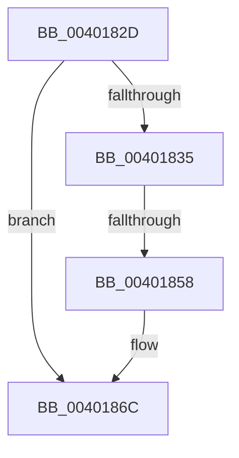

# sub_0040182D

- RVA: `0x0040182D`–`0x00401884` (길이 `87` bytes)
- VA: `0x000000014040182D`
- 실행 섹션: `.text`
- PDB 이름 있음: `아니요`; PDB Function 태그: `아니요`
- unwind 정보 RVA: `0x0009A4AC`
- 디코드: `22`개 명령, `87/87` bytes 표시
- 미해석 바이트: `0` (있으면 어셈블리에 `.byte`로 보존)

> 이 문서는 커널 이미지의 기계어와 PDB 기호를 분석해 생성했습니다. 4번과 5번은 함수 원형과 자료형을 바이너리 사용 방식에서 추정한 C 해석이며 원본 소스 복구 결과는 아닙니다.

## 1. Dependencies

- 직접 호출 지점: **0**; 고유 호출 대상: **0**
- 직접 호출자로 확인된 함수: **0**
- RIP 상대 이미지 참조: **2**

### Outgoing calls
- 직접 디코드된 call 명령이 없습니다.

### Direct callers
- 이 함수 시작 RVA로 연결되는 직접 call은 확인되지 않았습니다. 간접 호출은 완전히 역산할 수 없습니다.

### Static image references
- `0x0040183D` → RVA `0x00FC8528` (`ALMOSTRO`; read)
- `0x00401847` → RVA `0x00FC5030` (`ALMOSTRO`; read)

## 2. Other-region calls and transfers

- 다른 실행 섹션으로 향하는 call: **0**
- call이 아닌 외부 분기/꼬리 이동: **1**
  - `0x00401852` → [sub_0040190F](Unknown_function_0040190F.md) (`tail-transfer`)

## 3. Assembly (complete function range)

```asm
0040182D  43 83 7C 3C 1C FF               cmp dword ptr [r12 + r15 + 0x1c], -1
00401833  75 37                           jne 0x14040186c
00401835  41 0F B6 87 D0 BF FF FF         movzx eax, byte ptr [r15 - 0x4030]
0040183D  48 8D 0D E4 6C BC 00            lea rcx, [rip + 0xbc6ce4]
00401844  48 03 C0                        add rax, rax
00401847  83 3D E2 37 BC 00 00            cmp dword ptr [rip + 0xbc37e2], 0
0040184E  48 8B 0C C1                     mov rcx, qword ptr [rcx + rax*8]
00401852  0F 84 B7 00 00 00               je 0x14040190f
00401858  41 83 E0 3F                     and r8d, 0x3f
0040185C  48 C1 ED 06                     shr rbp, 6
00401860  48 8D 0C E9                     lea rcx, [rcx + rbp*8]
00401864  41 8B C0                        mov eax, r8d
00401867  F0 48 0F B3 01                  lock btr qword ptr [rcx], rax
0040186C  F0 48 83 23 00                  lock and qword ptr [rbx], 0
00401871  48 8B 5C 24 50                  mov rbx, qword ptr [rsp + 0x50]
00401876  48 83 C4 20                     add rsp, 0x20
0040187A  41 5F                           pop r15
0040187C  41 5E                           pop r14
0040187E  41 5D                           pop r13
00401880  41 5C                           pop r12
00401882  5D                              pop rbp
00401883  C3                              ret
```

## 4. C-style interpretation (structured pseudocode)

```c
__int64 __fastcall sub_0040182D(__int64 a1, __int64 a2, int a3, __int64 a4, __int64 a5, __int64 a6, __int64 a7, __int64 a8, __int64 a9, __int64 a10)
{
    __int64 result;
    __int64 v_rbp;
    __int64 v_rsp;

    if ((*(unsigned int *)(v_r12 + v_r15 * 1 + 28)) != -1) goto loc_0040186C;
    result = (*(unsigned __int8 *)(v_r15 - 16432)) + (*(unsigned __int8 *)(v_r15 - 16432));
    a3 = (unsigned int)((a3) & (63));
    v_rbp = (v_rbp) >> (6);
loc_0040186C:
    v_rsp = (v_rsp) + (32);
    return (unsigned int)(a3);
}
```

## 5. (Beta) C Style

```c
int64_t sub_0040182D(int64_t Arg1, int64_t Arg2, int32_t Arg3, int64_t Arg4, uint64_t Arg5, uint64_t Arg6, uint64_t Arg7, uint64_t Arg8, uint64_t Arg9, int64_t Arg10)
{
    int64_t result;
    int64_t local_rbp;
    int64_t local_rsp;

    if ((*(uint32_t *)(local_r12 + local_r15 * 1 + 0x1C)) != -1) goto loc_0040186C;
    result = (*(uint8_t *)(local_r15 - 0x4030)) + (*(uint8_t *)(local_r15 - 0x4030));
    Arg3 = (uint32_t)((Arg3) & (63));
    local_rbp = (local_rbp) >> (6);
loc_0040186C:
    local_rsp = (local_rsp) + (32);
    return (uint32_t)(Arg3);
}
```

## 6. Execution-region graph

[열기: 2D/3D 그래프와 함수 탐색 컨트롤 패널](../../../control-panel.html?section=text&rva=0x0040182D&view=graph)

- 2D 그래프는 위에서 아래로 흐르고, 3D 그래프는 빈 공간을 드래그해 회전합니다. Shift+드래그는 이동, 휠은 확대·축소, 함수 노드 선택은 대상 보고서 이동입니다.

### Static fallback


