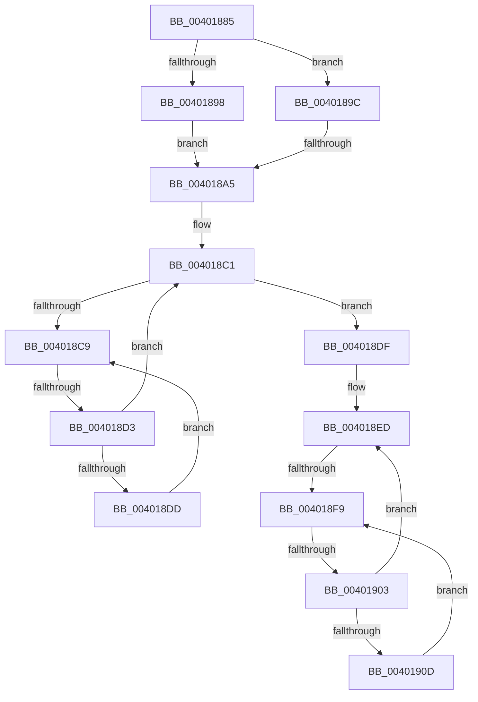

# sub_00401885

- RVA: `0x00401885`–`0x0040190F` (길이 `138` bytes)
- VA: `0x0000000140401885`
- 실행 섹션: `.text`
- PDB 이름 있음: `아니요`; PDB Function 태그: `아니요`
- unwind 정보 RVA: `0x0009A4D0`
- 디코드: `40`개 명령, `138/138` bytes 표시
- 미해석 바이트: `0` (있으면 어셈블리에 `.byte`로 보존)

> 이 문서는 커널 이미지의 기계어와 PDB 기호를 분석해 생성했습니다. 4번과 5번은 함수 원형과 자료형을 바이너리 사용 방식에서 추정한 C 해석이며 원본 소스 복구 결과는 아닙니다.

## 1. Dependencies

- 직접 호출 지점: **0**; 고유 호출 대상: **0**
- 직접 호출자로 확인된 함수: **0**
- RIP 상대 이미지 참조: **1**

### Outgoing calls
- 직접 디코드된 call 명령이 없습니다.

### Direct callers
- 이 함수 시작 RVA로 연결되는 직접 call은 확인되지 않았습니다. 간접 호출은 완전히 역산할 수 없습니다.

### Static image references
- `0x004018CB` → RVA `0x00FC52AC` (`ALMOSTRO`; reference)

## 2. Other-region calls and transfers

- 다른 실행 섹션으로 향하는 call: **0**
- call이 아닌 외부 분기/꼬리 이동: **4**
  - `0x0040189F` → [sub_0040181B + 0x5](Unknown_function_0040181B.md) (`tail-transfer`)
  - `0x004018D1` → [sub_0040194A](Unknown_function_0040194A.md) (`tail-transfer`)
  - `0x004018F3` → [sub_00401812](Unknown_function_00401812.md) (`tail-transfer`)
  - `0x00401901` → [sub_0040194A + 0x27](Unknown_function_0040194A.md) (`tail-transfer`)

## 3. Assembly (complete function range)

```asm
00401885  48 8D 5D 10                     lea rbx, [rbp + 0x10]
00401889  48 C1 E3 05                     shl rbx, 5
0040188D  49 03 DF                        add rbx, r15
00401890  F0 48 0F BA 2B 00               lock bts qword ptr [rbx], 0
00401896  73 04                           jae 0x14040189c
00401898  F3 90                           pause
0040189A  EB 09                           jmp 0x1404018a5
0040189C  48 85 DB                        test rbx, rbx
0040189F  0F 85 7B FF FF FF               jne 0x140401820
004018A5  49 8B 01                        mov rax, qword ptr [r9]
004018A8  48 89 74 24 58                  mov qword ptr [rsp + 0x58], rsi
004018AD  F0 48 83 20 00                  lock and qword ptr [rax], 0
004018B2  48 8D 5D 10                     lea rbx, [rbp + 0x10]
004018B6  48 C1 E3 05                     shl rbx, 5
004018BA  49 03 DF                        add rbx, r15
004018BD  33 FF                           xor edi, edi
004018BF  8B F7                           mov esi, edi
004018C1  F0 48 0F BA 2B 00               lock bts qword ptr [rbx], 0
004018C7  73 16                           jae 0x1404018df
004018C9  FF C6                           inc esi
004018CB  85 35 DB 39 BC 00               test dword ptr [rip + 0xbc39db], esi
004018D1  74 77                           je 0x14040194a
004018D3  F3 90                           pause
004018D5  48 8B 03                        mov rax, qword ptr [rbx]
004018D8  48 85 C0                        test rax, rax
004018DB  74 E4                           je 0x1404018c1
004018DD  EB EA                           jmp 0x1404018c9
004018DF  48 8D B5 10 01 00 00            lea rsi, [rbp + 0x110]
004018E6  48 C1 E6 05                     shl rsi, 5
004018EA  49 03 F7                        add rsi, r15
004018ED  F0 48 0F BA 2E 00               lock bts qword ptr [rsi], 0
004018F3  0F 83 19 FF FF FF               jae 0x140401812
004018F9  FF C7                           inc edi
004018FB  85 3D AB 39 BC 00               test dword ptr [rip + 0xbc39ab], edi
00401901  74 6E                           je 0x140401971
00401903  F3 90                           pause
00401905  48 8B 06                        mov rax, qword ptr [rsi]
00401908  48 85 C0                        test rax, rax
0040190B  74 E0                           je 0x1404018ed
0040190D  EB EA                           jmp 0x1404018f9
```

## 4. C-style interpretation (structured pseudocode)

```c
__int64 __fastcall sub_00401885(__int64 a1, __int64 a2, __int64 a3, __int64 a4)
{
    __int64 v_rbx;
    __int64 v_rdi;
    __int64 v_rsi;
    unsigned __int64 v_stack_p58;

    v_rbx = (v_rbp + 16) << (5);
    v_rbx = (v_rbx) + (v_r15);
    if (condition_is_above_or_equal) goto loc_0040189C;
    goto loc_004018A5;
loc_0040189C:
loc_004018A5:
    v_stack_p58 = v_rsi;
    v_rbx = (v_rbp + 16) << (5);
    v_rbx = (v_rbx) + (v_r15);
    v_rdi = 0;
loc_004018C1:
    if (condition_is_above_or_equal) goto loc_004018DF;
loc_004018C9:
    v_rsi = (unsigned int)((0) + 1);
    if (*(unsigned __int64 *)(v_rbx) == 0) goto loc_004018C1;
    goto loc_004018C9;
loc_004018DF:
    v_rsi = (v_rbp + 272) << (5);
    v_rsi = (v_rsi) + (v_r15);
loc_004018ED:
loc_004018F9:
    v_rdi = (unsigned int)((v_rdi) + 1);
    if (*(unsigned __int64 *)(v_rsi) == 0) goto loc_004018ED;
    goto loc_004018F9;
}
```

## 5. (Beta) C Style

```c
int64_t sub_00401885(int64_t Arg1, int64_t Arg2, int64_t Arg3, void *Arg4)
{
    uint8_t *arg4 = (uint8_t *)Arg4;

    int64_t local_rbx;
    int64_t local_rdi;
    int64_t local_rsi;
    uint64_t v_stack_p58;

    local_rbx = (local_rbp + 16) << (5);
    local_rbx = (local_rbx) + (local_r15);
    if (condition_is_above_or_equal) goto loc_0040189C;
    goto loc_004018A5;
loc_0040189C:
loc_004018A5:
    v_stack_p58 = local_rsi;
    local_rbx = (local_rbp + 16) << (5);
    local_rbx = (local_rbx) + (local_r15);
    local_rdi = 0;
loc_004018C1:
    if (condition_is_above_or_equal) goto loc_004018DF;
loc_004018C9:
    local_rsi = (uint32_t)((0) + 1);
    if (*(uint64_t *)(local_rbx) == 0) goto loc_004018C1;
    goto loc_004018C9;
loc_004018DF:
    local_rsi = (local_rbp + 272) << (5);
    local_rsi = (local_rsi) + (local_r15);
loc_004018ED:
loc_004018F9:
    local_rdi = (uint32_t)((local_rdi) + 1);
    if (*(uint64_t *)(local_rsi) == 0) goto loc_004018ED;
    goto loc_004018F9;
}
```

### 관측된 메모리 오프셋

구조체 형식이 확인되지 않은 접근은 인자 기준의 오프셋으로만 기록했습니다.

| 기준 인자 | 오프셋 표현 | 폭 (bit) | 접근 |
|---|---:|---:|---|
| `Arg4` | `+ 0x0` | `64` | `R` |

## 6. Execution-region graph

[열기: 2D/3D 그래프와 함수 탐색 컨트롤 패널](../../../control-panel.html?section=text&rva=0x00401885&view=graph)

- 2D 그래프는 위에서 아래로 흐르고, 3D 그래프는 빈 공간을 드래그해 회전합니다. Shift+드래그는 이동, 휠은 확대·축소, 함수 노드 선택은 대상 보고서 이동입니다.

### Static fallback


