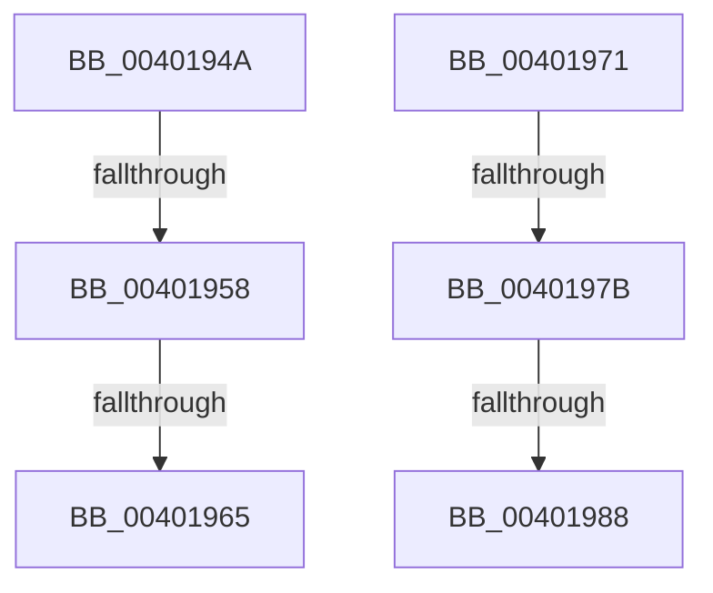

# sub_0040194A

- RVA: `0x0040194A`–`0x00401994` (길이 `74` bytes)
- VA: `0x000000014040194A`
- 실행 섹션: `.text`
- PDB 이름 있음: `아니요`; PDB Function 태그: `아니요`
- unwind 정보 RVA: `0x0009A518`
- 디코드: `18`개 명령, `74/74` bytes 표시
- 미해석 바이트: `0` (있으면 어셈블리에 `.byte`로 보존)

> 이 문서는 커널 이미지의 기계어와 PDB 기호를 분석해 생성했습니다. 4번과 5번은 함수 원형과 자료형을 바이너리 사용 방식에서 추정한 C 해석이며 원본 소스 복구 결과는 아닙니다.

## 1. Dependencies

- 직접 호출 지점: **4**; 고유 호출 대상: **2**
- 직접 호출자로 확인된 함수: **0**
- RIP 상대 이미지 참조: **1**

### Outgoing calls
- `0x00401958` → [KiCheckVpBackingLongSpinWaitHypercall](../30/KiCheckVpBackingLongSpinWaitHypercall_function_0030F490.md) (function, `0x0030F490`)
- `0x00401967` → [HvlNotifyLongSpinWait](../30/HvlNotifyLongSpinWait_function_0030F460.md) (function, `0x0030F460`)
- `0x0040197B` → [KiCheckVpBackingLongSpinWaitHypercall](../30/KiCheckVpBackingLongSpinWaitHypercall_function_0030F490.md) (function, `0x0030F490`)
- `0x0040198A` → [HvlNotifyLongSpinWait](../30/HvlNotifyLongSpinWait_function_0030F460.md) (function, `0x0030F460`)

### Direct callers
- 이 함수 시작 RVA로 연결되는 직접 call은 확인되지 않았습니다. 간접 호출은 완전히 역산할 수 없습니다.

### Static image references
- `0x0040194A` → RVA `0x00FC6AB8` (`ALMOSTRO`; read)

## 2. Other-region calls and transfers

- 다른 실행 섹션으로 향하는 call: **0**
- call이 아닌 외부 분기/꼬리 이동: **6**
  - `0x00401952` → [sub_00401885 + 0x4E](Unknown_function_00401885.md) (`tail-transfer`)
  - `0x0040195F` → [sub_00401885 + 0x4E](Unknown_function_00401885.md) (`tail-transfer`)
  - `0x0040196C` → [sub_00401885 + 0x50](Unknown_function_00401885.md) (`tail-transfer`)
  - `0x00401979` → [sub_00401885 + 0x7E](Unknown_function_00401885.md) (`tail-transfer`)
  - `0x00401982` → [sub_00401885 + 0x7E](Unknown_function_00401885.md) (`tail-transfer`)
  - `0x0040198F` → [sub_00401885 + 0x80](Unknown_function_00401885.md) (`tail-transfer`)

## 3. Assembly (complete function range)

```asm
0040194A  8B 05 68 51 BC 00               mov eax, dword ptr [rip + 0xbc5168]
00401950  A8 40                           test al, 0x40
00401952  0F 84 7B FF FF FF               je 0x1404018d3
00401958  E8 33 DB F0 FF                  call 0x14030f490
0040195D  84 C0                           test al, al
0040195F  0F 84 6E FF FF FF               je 0x1404018d3
00401965  8B CE                           mov ecx, esi
00401967  E8 F4 DA F0 FF                  call 0x14030f460
0040196C  E9 64 FF FF FF                  jmp 0x1404018d5
00401971  8B 05 41 51 BC 00               mov eax, dword ptr [rip + 0xbc5141]
00401977  A8 40                           test al, 0x40
00401979  74 88                           je 0x140401903
0040197B  E8 10 DB F0 FF                  call 0x14030f490
00401980  84 C0                           test al, al
00401982  0F 84 7B FF FF FF               je 0x140401903
00401988  8B CF                           mov ecx, edi
0040198A  E8 D1 DA F0 FF                  call 0x14030f460
0040198F  E9 71 FF FF FF                  jmp 0x140401905
```

## 4. C-style interpretation (structured pseudocode)

```c
__int64 __fastcall sub_0040194A(void)
{
    __int64 result;

    result = KiCheckVpBackingLongSpinWaitHypercall(a1, a2, a3, a4);
    result = HvlNotifyLongSpinWait((unsigned int)((unsigned int)(v_rsi)), a2, a3, a4);
}
```

## 5. (Beta) C Style

```c
void sub_0040194A(void)
{
    int64_t result;

    result = KiCheckVpBackingLongSpinWaitHypercall(a1, a2, a3, a4);
    result = HvlNotifyLongSpinWait((uint32_t)((uint32_t)(local_rsi)), a2, a3, a4);
}
```

## 6. Execution-region graph

[열기: 2D/3D 그래프와 함수 탐색 컨트롤 패널](../../../control-panel.html?section=text&rva=0x0040194A&view=graph)

- 2D 그래프는 위에서 아래로 흐르고, 3D 그래프는 빈 공간을 드래그해 회전합니다. Shift+드래그는 이동, 휠은 확대·축소, 함수 노드 선택은 대상 보고서 이동입니다.

### Static fallback


