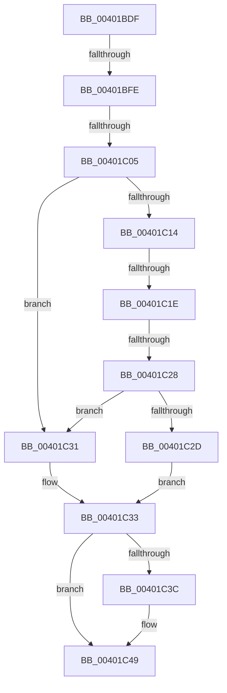

# sub_00401BDF

- RVA: `0x00401BDF`–`0x00401C5B` (길이 `124` bytes)
- VA: `0x0000000140401BDF`
- 실행 섹션: `.text`
- PDB 이름 있음: `아니요`; PDB Function 태그: `아니요`
- unwind 정보 RVA: `0x0009A5A8`
- 디코드: `31`개 명령, `124/124` bytes 표시
- 미해석 바이트: `0` (있으면 어셈블리에 `.byte`로 보존)

> 이 문서는 커널 이미지의 기계어와 PDB 기호를 분석해 생성했습니다. 4번과 5번은 함수 원형과 자료형을 바이너리 사용 방식에서 추정한 C 해석이며 원본 소스 복구 결과는 아닙니다.

## 1. Dependencies

- 직접 호출 지점: **1**; 고유 호출 대상: **1**
- 직접 호출자로 확인된 함수: **0**
- RIP 상대 이미지 참조: **1**

### Outgoing calls
- `0x00401C44` → [KiLowerIrqlProcessIrqlFlags](../4F/KiLowerIrqlProcessIrqlFlags_function_004F5698.md) (function, `0x004F5698`)

### Direct callers
- 이 함수 시작 RVA로 연결되는 직접 call은 확인되지 않았습니다. 간접 호출은 완전히 역산할 수 없습니다.

### Static image references
- `0x00401BF1` → RVA `0x00FC6D20` (`ALMOSTRO`; read)

## 2. Other-region calls and transfers

- 다른 실행 섹션으로 향하는 call: **0**
- call이 아닌 외부 분기/꼬리 이동: **5**
  - `0x00401BF8` → [sub_00401C83 + 0x10](Unknown_function_00401C83.md) (`tail-transfer`)
  - `0x00401C03` → [sub_00401C83](Unknown_function_00401C83.md) (`tail-transfer`)
  - `0x00401C18` → [sub_00401CBE](Unknown_function_00401CBE.md) (`tail-transfer`)
  - `0x00401C22` → [sub_00401CBE](Unknown_function_00401CBE.md) (`tail-transfer`)
  - `0x00401C56` → [ExIsFastResourceHeld + 0xDF](ExIsFastResourceHeld_function_00401AE0.md) (`tail-transfer`)

## 3. Assembly (complete function range)

```asm
00401BDF  48 89 6C 24 40                  mov qword ptr [rsp + 0x40], rbp
00401BE4  44 0F 20 C5                     mov rbp, cr8
00401BE8  B8 02 00 00 00                  mov eax, 2
00401BED  44 0F 22 C0                     mov cr8, rax
00401BF1  83 3D 28 51 BC 00 00            cmp dword ptr [rip + 0xbc5128], 0
00401BF8  0F 85 95 00 00 00               jne 0x140401c93
00401BFE  48 8B 07                        mov rax, qword ptr [rdi]
00401C01  A8 01                           test al, 1
00401C03  75 7E                           jne 0x140401c83
00401C05  48 81 C6 B8 06 00 00            add rsi, 0x6b8
00401C0C  48 8B 0E                        mov rcx, qword ptr [rsi]
00401C0F  48 3B CE                        cmp rcx, rsi
00401C12  74 1D                           je 0x140401c31
00401C14  F6 41 25 02                     test byte ptr [rcx + 0x25], 2
00401C18  0F 85 A0 00 00 00               jne 0x140401cbe
00401C1E  48 39 79 18                     cmp qword ptr [rcx + 0x18], rdi
00401C22  0F 85 96 00 00 00               jne 0x140401cbe
00401C28  48 85 C9                        test rcx, rcx
00401C2B  74 04                           je 0x140401c31
00401C2D  B3 01                           mov bl, 1
00401C2F  EB 02                           jmp 0x140401c33
00401C31  32 DB                           xor bl, bl
00401C33  83 3D E6 50 BC 00 00            cmp dword ptr [rip + 0xbc50e6], 0
00401C3A  74 0D                           je 0x140401c49
00401C3C  44 0F 20 C1                     mov rcx, cr8
00401C40  40 0F B6 D5                     movzx edx, bpl
00401C44  E8 4F 3A 0F 00                  call 0x1404f5698
00401C49  40 0F B6 CD                     movzx ecx, bpl
00401C4D  44 0F 22 C1                     mov cr8, rcx
00401C51  48 8B 6C 24 40                  mov rbp, qword ptr [rsp + 0x40]
00401C56  E9 64 FF FF FF                  jmp 0x140401bbf
```

## 4. C-style interpretation (structured pseudocode)

```c
__int64 __fastcall sub_00401BDF(__int64 a1, __int64 a2, __int64 a3, __int64 a4, __int64 a5, __int64 a6, __int64 a7, __int64 a8)
{
    __int64 result;
    __int64 v_rbx;
    __int64 v_rsi;
    unsigned __int64 v_stack_p40;

    v_stack_p40 = v_rbp;
    v_rsi = (v_rsi) + (0x6B8ULL);
    if ((*(unsigned __int64 *)(v_rsi)) == v_rsi) goto loc_00401C31;
    if (*(unsigned __int64 *)(v_rsi) == 0) goto loc_00401C31;
    goto loc_00401C33;
loc_00401C31:
    v_rbx = 0;
loc_00401C33:
    result = *(unsigned __int64 *)(v_rdi);
    if ((*(unsigned int *)(v_rip + 12341478)) != 0) {
        a1 = 2;
        a2 = (unsigned __int8)(v_cr8);
        result = KiLowerIrqlProcessIrqlFlags(a1, a2, a3, a4);
    }
}
```

## 5. (Beta) C Style

```c
int64_t sub_00401BDF(int64_t Arg1, int64_t Arg2, int64_t Arg3, int64_t Arg4, uint64_t Arg5, uint64_t Arg6, uint64_t Arg7, int64_t Arg8)
{
    int64_t result;
    int64_t local_rbx;
    int64_t local_rsi;
    uint64_t v_stack_p40;

    v_stack_p40 = local_rbp;
    local_rsi = (local_rsi) + (0x6B8ULL);
    if ((*(uint64_t *)(local_rsi)) == local_rsi) goto loc_00401C31;
    if (*(uint64_t *)(local_rsi) == 0) goto loc_00401C31;
    goto loc_00401C33;
loc_00401C31:
    local_rbx = 0;
loc_00401C33:
    result = *(uint64_t *)(local_rdi);
    if ((*(uint32_t *)(v_rip + 0xBC50E6)) != 0) {
        Arg1 = 2;
        Arg2 = (uint8_t)(v_cr8);
        result = KiLowerIrqlProcessIrqlFlags(Arg1, Arg2, Arg3, Arg4);
    }
}
```

## 6. Execution-region graph

[열기: 2D/3D 그래프와 함수 탐색 컨트롤 패널](../../../control-panel.html?section=text&rva=0x00401BDF&view=graph)

- 2D 그래프는 위에서 아래로 흐르고, 3D 그래프는 빈 공간을 드래그해 회전합니다. Shift+드래그는 이동, 휠은 확대·축소, 함수 노드 선택은 대상 보고서 이동입니다.

### Static fallback


