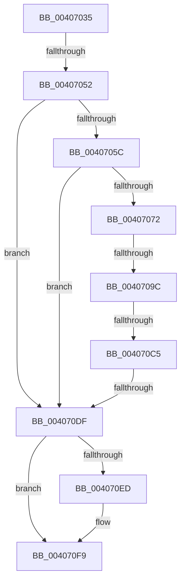

# sub_00407035

- RVA: `0x00407035`–`0x0040710D` (길이 `216` bytes)
- VA: `0x0000000140407035`
- 실행 섹션: `.text`
- PDB 이름 있음: `아니요`; PDB Function 태그: `아니요`
- unwind 정보 RVA: `0x0009A908`
- 디코드: `52`개 명령, `216/216` bytes 표시
- 미해석 바이트: `0` (있으면 어셈블리에 `.byte`로 보존)

> 이 문서는 커널 이미지의 기계어와 PDB 기호를 분석해 생성했습니다. 4번과 5번은 함수 원형과 자료형을 바이너리 사용 방식에서 추정한 C 해석이며 원본 소스 복구 결과는 아닙니다.

## 1. Dependencies

- 직접 호출 지점: **4**; 고유 호출 대상: **4**
- 직접 호출자로 확인된 함수: **0**
- RIP 상대 이미지 참조: **0**

### Outgoing calls
- `0x00407069` → [MiGetPagePrivilege](../28/MiGetPagePrivilege_function_00285420.md) (function, `0x00285420`)
- `0x004070D2` → [VslRemoveProtectedPage](VslRemoveProtectedPage_function_004079D0.md) (function, `0x004079D0`)
- `0x004070E4` → [MiSetPfnIdentity](../2A/MiSetPfnIdentity_function_002A2350.md) (function, `0x002A2350`)
- `0x004070F4` → [MiUnlockPage](../31/MiUnlockPage_function_0031A3E0.md) (function, `0x0031A3E0`)

### Direct callers
- 이 함수 시작 RVA로 연결되는 직접 call은 확인되지 않았습니다. 간접 호출은 완전히 역산할 수 없습니다.

### Static image references
- 디코드된 RIP-relative 메모리 참조가 없습니다.

## 2. Other-region calls and transfers

- 다른 실행 섹션으로 향하는 call: **0**
- call이 아닌 외부 분기/꼬리 이동: **5**
  - `0x0040704C` → [sub_0040710D + 0xC](Unknown_function_0040710D.md) (`tail-transfer`)
  - `0x00407096` → [sub_0040710D + 0x38](Unknown_function_0040710D.md) (`tail-transfer`)
  - `0x004070C3` → [sub_0040710D](Unknown_function_0040710D.md) (`tail-transfer`)
  - `0x004070D9` → [sub_0040710D + 0x6C](Unknown_function_0040710D.md) (`tail-transfer`)
  - `0x00407108` → [MiClearPfnImageVerified + 0x25](MiClearPfnImageVerified_function_00407000.md) (`tail-transfer`)

## 3. Assembly (complete function range)

```asm
00407035  48 89 6C 24 50                  mov qword ptr [rsp + 0x50], rbp
0040703A  8B EF                           mov ebp, edi
0040703C  4C 89 74 24 60                  mov qword ptr [rsp + 0x60], r14
00407041  41 B6 11                        mov r14b, 0x11
00407044  48 89 74 24 58                  mov qword ptr [rsp + 0x58], rsi
00407049  83 E5 04                        and ebp, 4
0040704C  0F 84 C7 00 00 00               je 0x140407119
00407052  40 F6 C7 08                     test dil, 8
00407056  0F 84 83 00 00 00               je 0x1404070df
0040705C  4C 8D 44 24 30                  lea r8, [rsp + 0x30]
00407061  BA 01 00 00 00                  mov edx, 1
00407066  48 8B CB                        mov rcx, rbx
00407069  E8 B2 E3 E7 FF                  call 0x140285420
0040706E  85 C0                           test eax, eax
00407070  74 6D                           je 0x1404070df
00407072  48 B9 00 00 00 00 00 DE FF FF   movabs rcx, 0xffffde0000000000
0040707C  48 8B F3                        mov rsi, rbx
0040707F  48 2B F1                        sub rsi, rcx
00407082  48 B9 AB AA AA AA AA AA AA AA   movabs rcx, 0xaaaaaaaaaaaaaaab
0040708C  48 C1 FE 04                     sar rsi, 4
00407090  48 0F AF F1                     imul rsi, rcx
00407094  A8 20                           test al, 0x20
00407096  0F 85 A9 00 00 00               jne 0x140407145
0040709C  40 F6 C7 10                     test dil, 0x10
004070A0  B8 10 00 00 00                  mov eax, 0x10
004070A5  B9 20 00 00 00                  mov ecx, 0x20
004070AA  0F 45 C1                        cmovne eax, ecx
004070AD  44 8B C0                        mov r8d, eax
004070B0  48 8B CE                        mov rcx, rsi
004070B3  41 83 C8 04                     or r8d, 4
004070B7  40 F6 C7 01                     test dil, 1
004070BB  44 0F 44 C0                     cmove r8d, eax
004070BF  41 F6 C0 30                     test r8b, 0x30
004070C3  74 48                           je 0x14040710d
004070C5  41 C1 E8 02                     shr r8d, 2
004070C9  48 8D 54 24 30                  lea rdx, [rsp + 0x30]
004070CE  41 83 E0 01                     and r8d, 1
004070D2  E8 F9 08 00 00                  call 0x1404079d0
004070D7  85 C0                           test eax, eax
004070D9  0F 88 9A 00 00 00               js 0x140407179
004070DF  33 D2                           xor edx, edx
004070E1  48 8B CB                        mov rcx, rbx
004070E4  E8 67 B2 E9 FF                  call 0x1402a2350
004070E9  85 ED                           test ebp, ebp
004070EB  75 0C                           jne 0x1404070f9
004070ED  41 0F B6 D6                     movzx edx, r14b
004070F1  48 8B CB                        mov rcx, rbx
004070F4  E8 E7 32 F1 FF                  call 0x14031a3e0
004070F9  48 8B 74 24 58                  mov rsi, qword ptr [rsp + 0x58]
004070FE  48 8B 6C 24 50                  mov rbp, qword ptr [rsp + 0x50]
00407103  4C 8B 74 24 60                  mov r14, qword ptr [rsp + 0x60]
00407108  E9 18 FF FF FF                  jmp 0x140407025
```

## 4. C-style interpretation (structured pseudocode)

```c
__int64 __fastcall sub_00407035(__int64 a1, __int64 a2, __int64 a3, __int64 a4, __int64 a5, __int64 a6, __int64 a7, __int64 a8, __int64 a9, __int64 a10, __int64 a11, __int64 a12)
{
    __int64 result;
    __int64 v_rbp;
    __int64 v_rsi;
    unsigned __int64 v_stack_p50;
    unsigned __int64 v_stack_p58;
    unsigned __int64 v_stack_p60;

    v_stack_p50 = v_rbp;
    v_stack_p60 = v_r14;
    v_stack_p58 = v_rsi;
    v_rbp = (unsigned int)(((unsigned int)((unsigned int)(v_rdi))) & (4));
    if ((((unsigned __int8)(v_rdi)) & (8)) == 0) goto loc_004070DF;
    result = MiGetPagePrivilege(v_rbx, 1, a6, a4);
    if ((unsigned int)(result) == 0) goto loc_004070DF;
    v_rsi = (v_rbx) - (v_rbx);
    v_rsi = (v_rsi) >> (4);
    v_rsi = (v_rsi) * (v_rbx);
    result = 16;
    if ((((unsigned __int8)(v_rdi)) & (16)) != 0) { result = 32; }
    a3 = (unsigned int)(((unsigned int)((unsigned int)(result))) | (4));
    if ((((unsigned __int8)(v_rdi)) & (1)) == 0) { a3 = (unsigned int)(result); }
    a3 = (unsigned int)((a3) >> (2));
    a3 = (unsigned int)((a3) & (1));
    result = VslRemoveProtectedPage(v_rsi, a6, a3, a4);
loc_004070DF:
    a2 = 0;
    result = MiSetPfnIdentity(v_rbx, a2, a3, a4);
    if ((unsigned int)(v_rbp) == 0) {
        a2 = 17;
        a1 = v_rbx;
        result = MiUnlockPage(a1, a2, a3, a4);
    }
}
```

## 5. (Beta) C Style

```c
int64_t sub_00407035(int64_t Arg1, int64_t Arg2, int64_t Arg3, int64_t Arg4, uint64_t Arg5, int64_t Arg6, uint64_t Arg7, uint64_t Arg8, uint64_t Arg9, int64_t Arg10, int64_t Arg11, int64_t Arg12)
{
    int64_t result;
    int64_t local_rbp;
    int64_t local_rsi;
    uint64_t v_stack_p50;
    uint64_t v_stack_p58;
    uint64_t v_stack_p60;

    v_stack_p50 = local_rbp;
    v_stack_p60 = local_r14;
    v_stack_p58 = local_rsi;
    local_rbp = (uint32_t)(((uint32_t)((uint32_t)(local_rdi))) & (4));
    if ((((uint8_t)(local_rdi)) & (8)) == 0) goto loc_004070DF;
    result = MiGetPagePrivilege(local_rbx, 1, Arg6, Arg4);
    if ((uint32_t)(result) == 0) goto loc_004070DF;
    local_rsi = (local_rbx) - (local_rbx);
    local_rsi = (local_rsi) >> (4);
    local_rsi = (local_rsi) * (local_rbx);
    result = 16;
    if ((((uint8_t)(local_rdi)) & (16)) != 0) { result = 32; }
    Arg3 = (uint32_t)(((uint32_t)((uint32_t)(result))) | (4));
    if ((((uint8_t)(local_rdi)) & (1)) == 0) { Arg3 = (uint32_t)(result); }
    Arg3 = (uint32_t)((Arg3) >> (2));
    Arg3 = (uint32_t)((Arg3) & (1));
    result = VslRemoveProtectedPage(local_rsi, Arg6, Arg3, Arg4);
loc_004070DF:
    Arg2 = 0;
    result = MiSetPfnIdentity(local_rbx, Arg2, Arg3, Arg4);
    if ((uint32_t)(local_rbp) == 0) {
        Arg2 = 17;
        Arg1 = local_rbx;
        result = MiUnlockPage(Arg1, Arg2, Arg3, Arg4);
    }
}
```

## 6. Execution-region graph

[열기: 2D/3D 그래프와 함수 탐색 컨트롤 패널](../../../control-panel.html?section=text&rva=0x00407035&view=graph)

- 2D 그래프는 위에서 아래로 흐르고, 3D 그래프는 빈 공간을 드래그해 회전합니다. Shift+드래그는 이동, 휠은 확대·축소, 함수 노드 선택은 대상 보고서 이동입니다.

### Static fallback


