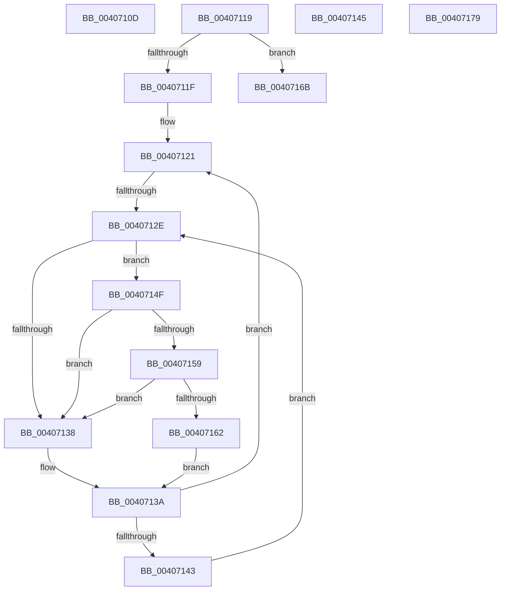

# sub_0040710D

- RVA: `0x0040710D`–`0x00407197` (길이 `138` bytes)
- VA: `0x000000014040710D`
- 실행 섹션: `.text`
- PDB 이름 있음: `아니요`; PDB Function 태그: `아니요`
- unwind 정보 RVA: `0x0009A924`
- 디코드: `38`개 명령, `138/138` bytes 표시
- 미해석 바이트: `0` (있으면 어셈블리에 `.byte`로 보존)

> 이 문서는 커널 이미지의 기계어와 PDB 기호를 분석해 생성했습니다. 4번과 5번은 함수 원형과 자료형을 바이너리 사용 방식에서 추정한 C 해석이며 원본 소스 복구 결과는 아닙니다.

## 1. Dependencies

- 직접 호출 지점: **5**; 고유 호출 대상: **5**
- 직접 호출자로 확인된 함수: **0**
- RIP 상대 이미지 참조: **2**

### Outgoing calls
- `0x00407112` → [VslMakeProtectedPageExecutable](VslMakeProtectedPageExecutable_function_00407A50.md) (function, `0x00407A50`)
- `0x00407159` → [KiCheckVpBackingLongSpinWaitHypercall](../30/KiCheckVpBackingLongSpinWaitHypercall_function_0030F490.md) (function, `0x0030F490`)
- `0x00407164` → [HvlNotifyLongSpinWait](../30/HvlNotifyLongSpinWait_function_0030F460.md) (function, `0x0030F460`)
- `0x0040716B` → [MiLockPageInline](../31/MiLockPageInline_function_0031A340.md) (function, `0x0031A340`)
- `0x00407191` → [KeBugCheckEx](../4F/KeBugCheckEx_function_004FD660.md) (function, `0x004FD660`)

### Direct callers
- 이 함수 시작 RVA로 연결되는 직접 call은 확인되지 않았습니다. 간접 호출은 완전히 역산할 수 없습니다.

### Static image references
- `0x00407130` → RVA `0x00FC52AC` (`ALMOSTRO`; reference)
- `0x0040714F` → RVA `0x00FC6AB8` (`ALMOSTRO`; read)

## 2. Other-region calls and transfers

- 다른 실행 섹션으로 향하는 call: **0**
- call이 아닌 외부 분기/꼬리 이동: **4**
  - `0x00407117` → [sub_00407035 + 0xA2](Unknown_function_00407035.md) (`tail-transfer`)
  - `0x00407128` → [sub_00407035 + 0x1D](Unknown_function_00407035.md) (`tail-transfer`)
  - `0x0040714A` → [sub_00407035 + 0x78](Unknown_function_00407035.md) (`tail-transfer`)
  - `0x00407174` → [sub_00407035 + 0x1D](Unknown_function_00407035.md) (`tail-transfer`)

## 3. Assembly (complete function range)

```asm
0040710D  45 33 C0                        xor r8d, r8d
00407110  33 D2                           xor edx, edx
00407112  E8 39 09 00 00                  call 0x140407a50
00407117  EB BE                           jmp 0x1404070d7
00407119  40 F6 C7 40                     test dil, 0x40
0040711D  74 4C                           je 0x14040716b
0040711F  33 F6                           xor esi, esi
00407121  F0 48 0F BA 6B 18 3F            lock bts qword ptr [rbx + 0x18], 0x3f
00407128  0F 83 24 FF FF FF               jae 0x140407052
0040712E  FF C6                           inc esi
00407130  85 35 76 E1 BB 00               test dword ptr [rip + 0xbbe176], esi
00407136  74 17                           je 0x14040714f
00407138  F3 90                           pause
0040713A  48 8B 43 18                     mov rax, qword ptr [rbx + 0x18]
0040713E  48 85 C0                        test rax, rax
00407141  79 DE                           jns 0x140407121
00407143  EB E9                           jmp 0x14040712e
00407145  B8 00 01 00 00                  mov eax, 0x100
0040714A  E9 5E FF FF FF                  jmp 0x1404070ad
0040714F  8B 05 63 F9 BB 00               mov eax, dword ptr [rip + 0xbbf963]
00407155  A8 40                           test al, 0x40
00407157  74 DF                           je 0x140407138
00407159  E8 32 83 F0 FF                  call 0x14030f490
0040715E  84 C0                           test al, al
00407160  74 D6                           je 0x140407138
00407162  8B CE                           mov ecx, esi
00407164  E8 F7 82 F0 FF                  call 0x14030f460
00407169  EB CF                           jmp 0x14040713a
0040716B  E8 D0 31 F1 FF                  call 0x14031a340
00407170  44 0F B6 F0                     movzx r14d, al
00407174  E9 D9 FE FF FF                  jmp 0x140407052
00407179  45 33 C9                        xor r9d, r9d
0040717C  48 C7 44 24 20 00 00 00 00      mov qword ptr [rsp + 0x20], 0
00407185  4C 8B C6                        mov r8, rsi
00407188  BA 0B 15 05 00                  mov edx, 0x5150b
0040718D  41 8D 49 1A                     lea ecx, [r9 + 0x1a]
00407191  E8 CA 64 0F 00                  call 0x1404fd660
00407196  CC                              int3
```

## 4. C-style interpretation (structured pseudocode)

```c
__int64 __fastcall sub_0040710D(__int64 a1, int a2, int a3, int a4)
{
    __int64 result;
    unsigned __int64 v_stack_p20;

    a3 = 0;
    a2 = 0;
    result = VslMakeProtectedPageExecutable(a1, a2, a3, a4);
}
```

## 5. (Beta) C Style

```c
int64_t sub_0040710D(int64_t Arg1, int32_t Arg2, int32_t Arg3, int32_t Arg4)
{
    int64_t result;
    uint64_t v_stack_p20;

    Arg3 = 0;
    Arg2 = 0;
    result = VslMakeProtectedPageExecutable(Arg1, Arg2, Arg3, Arg4);
}
```

## 6. Execution-region graph

[열기: 2D/3D 그래프와 함수 탐색 컨트롤 패널](../../../control-panel.html?section=text&rva=0x0040710D&view=graph)

- 2D 그래프는 위에서 아래로 흐르고, 3D 그래프는 빈 공간을 드래그해 회전합니다. Shift+드래그는 이동, 휠은 확대·축소, 함수 노드 선택은 대상 보고서 이동입니다.

### Static fallback


