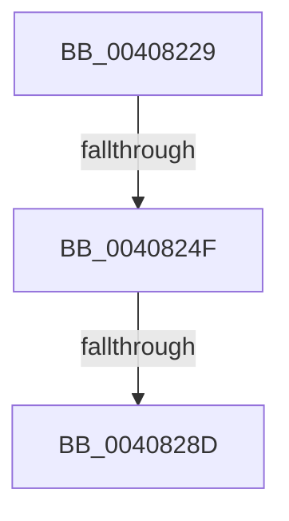

# sub_00408229

- RVA: `0x00408229`–`0x004082AD` (길이 `132` bytes)
- VA: `0x0000000140408229`
- 실행 섹션: `.text`
- PDB 이름 있음: `아니요`; PDB Function 태그: `아니요`
- unwind 정보 RVA: `0x0009AA34`
- 디코드: `27`개 명령, `132/132` bytes 표시
- 미해석 바이트: `0` (있으면 어셈블리에 `.byte`로 보존)

> 이 문서는 커널 이미지의 기계어와 PDB 기호를 분석해 생성했습니다. 4번과 5번은 함수 원형과 자료형을 바이너리 사용 방식에서 추정한 C 해석이며 원본 소스 복구 결과는 아닙니다.

## 1. Dependencies

- 직접 호출 지점: **0**; 고유 호출 대상: **0**
- 직접 호출자로 확인된 함수: **0**
- RIP 상대 이미지 참조: **1**

### Outgoing calls
- 직접 디코드된 call 명령이 없습니다.

### Direct callers
- 이 함수 시작 RVA로 연결되는 직접 call은 확인되지 않았습니다. 간접 호출은 완전히 역산할 수 없습니다.

### Static image references
- `0x004082A1` → RVA `0x00E38D00` (`.data`; read)

## 2. Other-region calls and transfers

- 다른 실행 섹션으로 향하는 call: **0**
- call이 아닌 외부 분기/꼬리 이동: **3**
  - `0x00408249` → [sub_00408350](Unknown_function_00408350.md) (`tail-transfer`)
  - `0x00408287` → [sub_004083D9](Unknown_function_004083D9.md) (`tail-transfer`)
  - `0x004082AB` → [sub_004082AD + 0x58](Unknown_function_004082AD.md) (`tail-transfer`)

## 3. Assembly (complete function range)

```asm
00408229  4C 89 7C 24 30                  mov qword ptr [rsp + 0x30], r15
0040822E  4C 8B 7B 28                     mov r15, qword ptr [rbx + 0x28]
00408232  48 B8 FF FF FF FF FF 00 00 00   movabs rax, 0xffffffffff
0040823C  4C 23 F8                        and r15, rax
0040823F  45 33 F6                        xor r14d, r14d
00408242  F0 48 0F BA 6B 18 3F            lock bts qword ptr [rbx + 0x18], 0x3f
00408249  0F 82 01 01 00 00               jb 0x140408350
0040824F  48 8B 43 18                     mov rax, qword ptr [rbx + 0x18]
00408253  48 8B D0                        mov rdx, rax
00408256  49 23 D5                        and rdx, r13
00408259  48 81 EA 00 00 01 00            sub rdx, 0x10000
00408260  48 8B CA                        mov rcx, rdx
00408263  48 33 C8                        xor rcx, rax
00408266  48 B8 00 00 00 00 00 00 00 C0   movabs rax, 0xc000000000000000
00408270  48 23 C8                        and rcx, rax
00408273  48 33 CA                        xor rcx, rdx
00408276  48 89 4B 18                     mov qword ptr [rbx + 0x18], rcx
0040827A  48 8B 43 18                     mov rax, qword ptr [rbx + 0x18]
0040827E  49 23 C5                        and rax, r13
00408281  48 3D 00 00 01 00               cmp rax, 0x10000
00408287  0F 82 4C 01 00 00               jb 0x1404083d9
0040828D  49 B8 FF FF FF FF FF FF FF 7F   movabs r8, 0x7fffffffffffffff
00408297  F0 4C 21 43 18                  lock and qword ptr [rbx + 0x18], r8
0040829C  4C 8B 7C 24 30                  mov r15, qword ptr [rsp + 0x30]
004082A1  4C 8D 35 58 0A A3 00            lea r14, [rip + 0xa30a58]
004082A8  48 85 FF                        test rdi, rdi
004082AB  74 58                           je 0x140408305
```

## 4. C-style interpretation (structured pseudocode)

```c
__int64 __fastcall sub_00408229(__int64 a1, __int64 a2, __int64 a3, __int64 a4, __int64 a5, __int64 a6)
{
    __int64 result;
    __int64 v_r14;
    __int64 v_r15;
    unsigned __int64 v_stack_p30;

    v_stack_p30 = v_r15;
    v_r15 = (*(unsigned __int64 *)(v_rbx + 40)) & (result);
    v_r14 = 0;
    a2 = (*(unsigned __int64 *)(v_rbx + 24)) & (v_r13);
    a2 = (a2) - (0x10000ULL);
    a1 = (a2) ^ (*(unsigned __int64 *)(v_rbx + 24));
    a1 = (a1) & (*(unsigned __int64 *)(v_rbx + 24));
    a1 = (a1) ^ (a2);
    *(unsigned __int64 *)(v_rbx + 24) = a1;
    result = (*(unsigned __int64 *)(v_rbx + 24)) & (v_r13);
}
```

## 5. (Beta) C Style

```c
int64_t sub_00408229(int64_t Arg1, int64_t Arg2, int64_t Arg3, int64_t Arg4, uint64_t Arg5, int64_t Arg6)
{
    int64_t result;
    int64_t local_r14;
    int64_t local_r15;
    uint64_t v_stack_p30;

    v_stack_p30 = local_r15;
    local_r15 = (*(uint64_t *)(local_rbx + 0x28)) & (result);
    local_r14 = 0;
    Arg2 = (*(uint64_t *)(local_rbx + 0x18)) & (local_r13);
    Arg2 = (Arg2) - (0x10000ULL);
    Arg1 = (Arg2) ^ (*(uint64_t *)(local_rbx + 0x18));
    Arg1 = (Arg1) & (*(uint64_t *)(local_rbx + 0x18));
    Arg1 = (Arg1) ^ (Arg2);
    *(uint64_t *)(local_rbx + 0x18) = Arg1;
    result = (*(uint64_t *)(local_rbx + 0x18)) & (local_r13);
}
```

## 6. Execution-region graph

[열기: 2D/3D 그래프와 함수 탐색 컨트롤 패널](../../../control-panel.html?section=text&rva=0x00408229&view=graph)

- 2D 그래프는 위에서 아래로 흐르고, 3D 그래프는 빈 공간을 드래그해 회전합니다. Shift+드래그는 이동, 휠은 확대·축소, 함수 노드 선택은 대상 보고서 이동입니다.

### Static fallback


