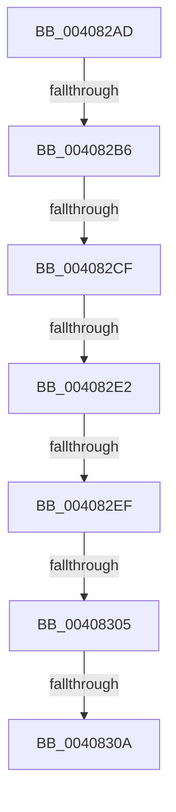

# sub_004082AD

- RVA: `0x004082AD`–`0x00408324` (길이 `119` bytes)
- VA: `0x00000001404082AD`
- 실행 섹션: `.text`
- PDB 이름 있음: `아니요`; PDB Function 태그: `아니요`
- unwind 정보 RVA: `0x0009AA48`
- 디코드: `28`개 명령, `119/119` bytes 표시
- 미해석 바이트: `0` (있으면 어셈블리에 `.byte`로 보존)

> 이 문서는 커널 이미지의 기계어와 PDB 기호를 분석해 생성했습니다. 4번과 5번은 함수 원형과 자료형을 바이너리 사용 방식에서 추정한 C 해석이며 원본 소스 복구 결과는 아닙니다.

## 1. Dependencies

- 직접 호출 지점: **0**; 고유 호출 대상: **0**
- 직접 호출자로 확인된 함수: **0**
- RIP 상대 이미지 참조: **0**

### Outgoing calls
- 직접 디코드된 call 명령이 없습니다.

### Direct callers
- 이 함수 시작 RVA로 연결되는 직접 call은 확인되지 않았습니다. 간접 호출은 완전히 역산할 수 없습니다.

### Static image references
- 디코드된 RIP-relative 메모리 참조가 없습니다.

## 2. Other-region calls and transfers

- 다른 실행 섹션으로 향하는 call: **0**
- call이 아닌 외부 분기/꼬리 이동: **6**
  - `0x004082B0` → [sub_0040843C + 0x30](Unknown_function_0040843C.md) (`tail-transfer`)
  - `0x004082C9` → [sub_0040843C + 0x30](Unknown_function_0040843C.md) (`tail-transfer`)
  - `0x004082DC` → [sub_0040843C](Unknown_function_0040843C.md) (`tail-transfer`)
  - `0x004082E9` → [sub_0040843C](Unknown_function_0040843C.md) (`tail-transfer`)
  - `0x004082FF` → [sub_0040843C + 0x67](Unknown_function_0040843C.md) (`tail-transfer`)
  - `0x00408308` → [sub_00408371](Unknown_function_00408371.md) (`tail-transfer`)

## 3. Assembly (complete function range)

```asm
004082AD  49 3B F6                        cmp rsi, r14
004082B0  0F 85 B6 01 00 00               jne 0x14040846c
004082B6  65 4C 8B 04 25 20 00 00 00      mov r8, qword ptr gs:[0x20]
004082BF  41 8B 90 9C 8B 00 00            mov edx, dword ptr [r8 + 0x8b9c]
004082C6  83 FA FF                        cmp edx, -1
004082C9  0F 84 9D 01 00 00               je 0x14040846c
004082CF  48 63 CA                        movsxd rcx, edx
004082D2  48 03 CF                        add rcx, rdi
004082D5  48 81 F9 00 01 00 00            cmp rcx, 0x100
004082DC  0F 87 5A 01 00 00               ja 0x14040843c
004082E2  48 81 FF 00 00 08 00            cmp rdi, 0x80000
004082E9  0F 83 4D 01 00 00               jae 0x14040843c
004082EF  8D 0C 17                        lea ecx, [rdi + rdx]
004082F2  8B C2                           mov eax, edx
004082F4  F0 41 0F B1 88 9C 8B 00 00      lock cmpxchg dword ptr [r8 + 0x8b9c], ecx
004082FD  8B D0                           mov edx, eax
004082FF  0F 85 9E 01 00 00               jne 0x1404084a3
00408305  48 85 ED                        test rbp, rbp
00408308  75 67                           jne 0x140408371
0040830A  48 8B 7C 24 70                  mov rdi, qword ptr [rsp + 0x70]
0040830F  48 8B 6C 24 60                  mov rbp, qword ptr [rsp + 0x60]
00408314  4C 8B 74 24 78                  mov r14, qword ptr [rsp + 0x78]
00408319  48 83 C4 38                     add rsp, 0x38
0040831D  41 5D                           pop r13
0040831F  41 5C                           pop r12
00408321  5E                              pop rsi
00408322  5B                              pop rbx
00408323  C3                              ret
```

## 4. C-style interpretation (structured pseudocode)

```c
__int64 __fastcall sub_004082AD(__int64 a1, __int64 a2, __int64 a3, __int64 a4, __int64 a5, __int64 a6, __int64 a7, __int64 a8, __int64 a9, __int64 a10, __int64 a11, __int64 a12, __int64 a13, __int64 a14, __int64 a15)
{
    __int64 v_rsp;

    a1 = ((int)((unsigned int)((unsigned int)(*(unsigned int *)(*(unsigned __int64 *)(gs_base + (0 + 32)) + 35740))))) + (v_rdi);
    v_rsp = (v_rsp) + (56);
    return (unsigned int)((unsigned int)((unsigned int)(*(unsigned int *)(*(unsigned __int64 *)(gs_base + (0 + 32)) + 35740))));
}
```

## 5. (Beta) C Style

```c
int64_t sub_004082AD(int64_t Arg1, int64_t Arg2, int64_t Arg3, int64_t Arg4, uint64_t Arg5, uint64_t Arg6, uint64_t Arg7, uint64_t Arg8, uint64_t Arg9, uint64_t Arg10, uint64_t Arg11, int64_t Arg12, uint64_t Arg13, int64_t Arg14, int64_t Arg15)
{
    int64_t local_rsp;

    Arg1 = ((int32_t)((uint32_t)((uint32_t)(*(uint32_t *)(*(uint64_t *)(gs_base + (0 + 0x20)) + 0x8B9C))))) + (local_rdi);
    local_rsp = (local_rsp) + (56);
    return (uint32_t)((uint32_t)((uint32_t)(*(uint32_t *)(*(uint64_t *)(gs_base + (0 + 0x20)) + 0x8B9C))));
}
```

## 6. Execution-region graph

[열기: 2D/3D 그래프와 함수 탐색 컨트롤 패널](../../../control-panel.html?section=text&rva=0x004082AD&view=graph)

- 2D 그래프는 위에서 아래로 흐르고, 3D 그래프는 빈 공간을 드래그해 회전합니다. Shift+드래그는 이동, 휠은 확대·축소, 함수 노드 선택은 대상 보고서 이동입니다.

### Static fallback


