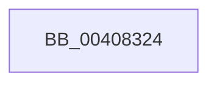

# sub_00408324

- RVA: `0x00408324`–`0x00408350` (길이 `44` bytes)
- VA: `0x0000000140408324`
- 실행 섹션: `.text`
- PDB 이름 있음: `아니요`; PDB Function 태그: `아니요`
- unwind 정보 RVA: `0x0009AA5C`
- 디코드: `12`개 명령, `44/44` bytes 표시
- 미해석 바이트: `0` (있으면 어셈블리에 `.byte`로 보존)

> 이 문서는 커널 이미지의 기계어와 PDB 기호를 분석해 생성했습니다. 4번과 5번은 함수 원형과 자료형을 바이너리 사용 방식에서 추정한 C 해석이며 원본 소스 복구 결과는 아닙니다.

## 1. Dependencies

- 직접 호출 지점: **1**; 고유 호출 대상: **1**
- 직접 호출자로 확인된 함수: **0**
- RIP 상대 이미지 참조: **0**

### Outgoing calls
- `0x00408344` → [KeBugCheckEx](../4F/KeBugCheckEx_function_004FD660.md) (function, `0x004FD660`)

### Direct callers
- 이 함수 시작 RVA로 연결되는 직접 call은 확인되지 않았습니다. 간접 호출은 완전히 역산할 수 없습니다.

### Static image references
- 디코드된 RIP-relative 메모리 참조가 없습니다.

## 2. Other-region calls and transfers

- 다른 실행 섹션으로 향하는 call: **0**
- 별도 외부 분기/꼬리 이동을 확인하지 못했습니다.

## 3. Assembly (complete function range)

```asm
00408324  CC                              int3
00408325  48 8B 01                        mov rax, qword ptr [rcx]
00408328  4C 8B C3                        mov r8, rbx
0040832B  4C 8B 4B 08                     mov r9, qword ptr [rbx + 8]
0040832F  49 23 C5                        and rax, r13
00408332  4D 0B CA                        or r9, r10
00408335  48 89 44 24 20                  mov qword ptr [rsp + 0x20], rax
0040833A  BA 91 17 04 00                  mov edx, 0x41791
0040833F  B9 1A 00 00 00                  mov ecx, 0x1a
00408344  E8 17 53 0F 00                  call 0x1404fd660
00408349  CC                              int3
0040834A  66 0F 1F 44 00 00               nop word ptr [rax + rax]
```

## 4. C-style interpretation (structured pseudocode)

```c
__int64 __fastcall sub_00408324(__int64 a1)
{
    __int64 result;
    unsigned __int64 v_stack_p20;

    result = (*(unsigned __int64 *)(a1)) & (v_r13);
    a4 = (*(unsigned __int64 *)(v_rbx + 8)) | (v_r10);
    v_stack_p20 = result;
    result = KeBugCheckEx(26, (unsigned int)(0x41791ULL), v_rbx, a4);
    return result;
}
```

## 5. (Beta) C Style

```c
int64_t sub_00408324(void *Arg1)
{
    uint8_t *arg1 = (uint8_t *)Arg1;

    int64_t result;
    uint64_t v_stack_p20;

    result = (*(uint64_t *)(arg1)) & (local_r13);
    a4 = (*(uint64_t *)(local_rbx + 0x8)) | (local_r10);
    v_stack_p20 = result;
    result = KeBugCheckEx(26, (uint32_t)(0x41791ULL), local_rbx, a4);
    return result;
}
```

### 관측된 메모리 오프셋

구조체 형식이 확인되지 않은 접근은 인자 기준의 오프셋으로만 기록했습니다.

| 기준 인자 | 오프셋 표현 | 폭 (bit) | 접근 |
|---|---:|---:|---|
| `Arg1` | `+ 0x0` | `64` | `R` |

## 6. Execution-region graph

[열기: 2D/3D 그래프와 함수 탐색 컨트롤 패널](../../../control-panel.html?section=text&rva=0x00408324&view=graph)

- 2D 그래프는 위에서 아래로 흐르고, 3D 그래프는 빈 공간을 드래그해 회전합니다. Shift+드래그는 이동, 휠은 확대·축소, 함수 노드 선택은 대상 보고서 이동입니다.

### Static fallback


