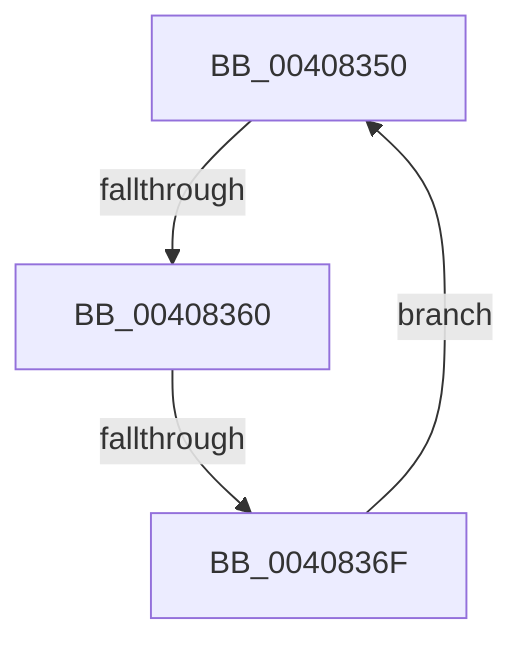

# sub_00408350

- RVA: `0x00408350`–`0x00408371` (길이 `33` bytes)
- VA: `0x0000000140408350`
- 실행 섹션: `.text`
- PDB 이름 있음: `아니요`; PDB Function 태그: `아니요`
- unwind 정보 RVA: `0x0009AA6C`
- 디코드: `8`개 명령, `33/33` bytes 표시
- 미해석 바이트: `0` (있으면 어셈블리에 `.byte`로 보존)

> 이 문서는 커널 이미지의 기계어와 PDB 기호를 분석해 생성했습니다. 4번과 5번은 함수 원형과 자료형을 바이너리 사용 방식에서 추정한 C 해석이며 원본 소스 복구 결과는 아닙니다.

## 1. Dependencies

- 직접 호출 지점: **0**; 고유 호출 대상: **0**
- 직접 호출자로 확인된 함수: **0**
- RIP 상대 이미지 참조: **1**

### Outgoing calls
- 직접 디코드된 call 명령이 없습니다.

### Direct callers
- 이 함수 시작 RVA로 연결되는 직접 call은 확인되지 않았습니다. 간접 호출은 완전히 역산할 수 없습니다.

### Static image references
- `0x00408353` → RVA `0x00FC52AC` (`ALMOSTRO`; reference)

## 2. Other-region calls and transfers

- 다른 실행 섹션으로 향하는 call: **0**
- call이 아닌 외부 분기/꼬리 이동: **2**
  - `0x0040835A` → [sub_004084AE](Unknown_function_004084AE.md) (`tail-transfer`)
  - `0x00408369` → [sub_00408229 + 0x19](Unknown_function_00408229.md) (`tail-transfer`)

## 3. Assembly (complete function range)

```asm
00408350  41 FF C6                        inc r14d
00408353  44 85 35 52 CF BB 00            test dword ptr [rip + 0xbbcf52], r14d
0040835A  0F 84 4E 01 00 00               je 0x1404084ae
00408360  F3 90                           pause
00408362  48 8B 43 18                     mov rax, qword ptr [rbx + 0x18]
00408366  48 85 C0                        test rax, rax
00408369  0F 89 D3 FE FF FF               jns 0x140408242
0040836F  EB DF                           jmp 0x140408350
```

## 4. C-style interpretation (structured pseudocode)

```c
__int64 __fastcall sub_00408350(void)
{
    __int64 v_r14;

    v_r14 = (unsigned int)((v_r14) + 1);
    goto loc_00408350;
}
```

## 5. (Beta) C Style

```c
void sub_00408350(void)
{
    int64_t local_r14;

    local_r14 = (uint32_t)((local_r14) + 1);
    goto loc_00408350;
}
```

## 6. Execution-region graph

[열기: 2D/3D 그래프와 함수 탐색 컨트롤 패널](../../../control-panel.html?section=text&rva=0x00408350&view=graph)

- 2D 그래프는 위에서 아래로 흐르고, 3D 그래프는 빈 공간을 드래그해 회전합니다. Shift+드래그는 이동, 휠은 확대·축소, 함수 노드 선택은 대상 보고서 이동입니다.

### Static fallback


