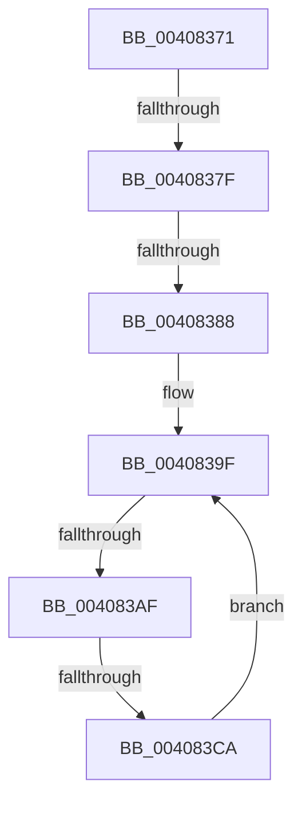

# sub_00408371

- RVA: `0x00408371`–`0x004083CF` (길이 `94` bytes)
- VA: `0x0000000140408371`
- 실행 섹션: `.text`
- PDB 이름 있음: `아니요`; PDB Function 태그: `아니요`
- unwind 정보 RVA: `0x0009AA8C`
- 디코드: `18`개 명령, `94/94` bytes 표시
- 미해석 바이트: `0` (있으면 어셈블리에 `.byte`로 보존)

> 이 문서는 커널 이미지의 기계어와 PDB 기호를 분석해 생성했습니다. 4번과 5번은 함수 원형과 자료형을 바이너리 사용 방식에서 추정한 C 해석이며 원본 소스 복구 결과는 아닙니다.

## 1. Dependencies

- 직접 호출 지점: **0**; 고유 호출 대상: **0**
- 직접 호출자로 확인된 함수: **0**
- RIP 상대 이미지 참조: **0**

### Outgoing calls
- 직접 디코드된 call 명령이 없습니다.

### Direct callers
- 이 함수 시작 RVA로 연결되는 직접 call은 확인되지 않았습니다. 간접 호출은 완전히 역산할 수 없습니다.

### Static image references
- 디코드된 RIP-relative 메모리 참조가 없습니다.

## 2. Other-region calls and transfers

- 다른 실행 섹션으로 향하는 call: **0**
- call이 아닌 외부 분기/꼬리 이동: **4**
  - `0x00408379` → [sub_004084EC](Unknown_function_004084EC.md) (`tail-transfer`)
  - `0x00408382` → [sub_0040843C + 0x3D](Unknown_function_0040843C.md) (`tail-transfer`)
  - `0x004083A9` → [sub_0040843C + 0x3D](Unknown_function_0040843C.md) (`tail-transfer`)
  - `0x004083C4` → [sub_004082AD + 0x5D](Unknown_function_004082AD.md) (`tail-transfer`)

## 3. Assembly (complete function range)

```asm
00408371  48 83 BE 08 42 00 00 00         cmp qword ptr [rsi + 0x4208], 0
00408379  0F 85 6D 01 00 00               jne 0x1404084ec
0040837F  49 3B F6                        cmp rsi, r14
00408382  0F 85 F1 00 00 00               jne 0x140408479
00408388  65 48 8B 14 25 20 00 00 00      mov rdx, qword ptr gs:[0x20]
00408391  0F 0D 8A 98 8B 00 00            prefetchw byte ptr [rdx + 0x8b98]
00408398  44 8B 82 98 8B 00 00            mov r8d, dword ptr [rdx + 0x8b98]
0040839F  49 8D 04 28                     lea rax, [r8 + rbp]
004083A3  48 3D 00 01 00 00               cmp rax, 0x100
004083A9  0F 87 CA 00 00 00               ja 0x140408479
004083AF  41 8D 0C 28                     lea ecx, [r8 + rbp]
004083B3  41 8B C0                        mov eax, r8d
004083B6  F0 0F B1 8A 98 8B 00 00         lock cmpxchg dword ptr [rdx + 0x8b98], ecx
004083BE  48 63 C8                        movsxd rcx, eax
004083C1  49 3B C8                        cmp rcx, r8
004083C4  0F 84 40 FF FF FF               je 0x14040830a
004083CA  4C 8B C1                        mov r8, rcx
004083CD  EB D0                           jmp 0x14040839f
```

## 4. C-style interpretation (structured pseudocode)

```c
__int64 __fastcall sub_00408371(void)
{
loc_0040839F:
    goto loc_0040839F;
}
```

## 5. (Beta) C Style

```c
void sub_00408371(void)
{
loc_0040839F:
    goto loc_0040839F;
}
```

## 6. Execution-region graph

[열기: 2D/3D 그래프와 함수 탐색 컨트롤 패널](../../../control-panel.html?section=text&rva=0x00408371&view=graph)

- 2D 그래프는 위에서 아래로 흐르고, 3D 그래프는 빈 공간을 드래그해 회전합니다. Shift+드래그는 이동, 휠은 확대·축소, 함수 노드 선택은 대상 보고서 이동입니다.

### Static fallback


