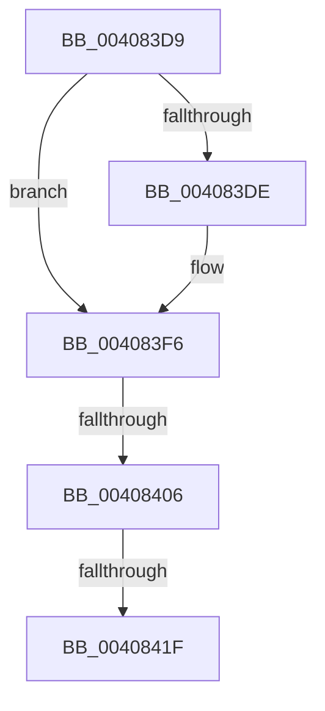

# sub_004083D9

- RVA: `0x004083D9`–`0x0040843C` (길이 `99` bytes)
- VA: `0x00000001404083D9`
- 실행 섹션: `.text`
- PDB 이름 있음: `아니요`; PDB Function 태그: `아니요`
- unwind 정보 RVA: `0x0009AAB8`
- 디코드: `21`개 명령, `99/99` bytes 표시
- 미해석 바이트: `0` (있으면 어셈블리에 `.byte`로 보존)

> 이 문서는 커널 이미지의 기계어와 PDB 기호를 분석해 생성했습니다. 4번과 5번은 함수 원형과 자료형을 바이너리 사용 방식에서 추정한 C 해석이며 원본 소스 복구 결과는 아닙니다.

## 1. Dependencies

- 직접 호출 지점: **0**; 고유 호출 대상: **0**
- 직접 호출자로 확인된 함수: **0**
- RIP 상대 이미지 참조: **1**

### Outgoing calls
- 직접 디코드된 call 명령이 없습니다.

### Direct callers
- 이 함수 시작 RVA로 연결되는 직접 call은 확인되지 않았습니다. 간접 호출은 완전히 역산할 수 없습니다.

### Static image references
- `0x004083E2` → RVA `0x00E30088` (`.data`; read)

## 2. Other-region calls and transfers

- 다른 실행 섹션으로 향하는 call: **0**
- call이 아닌 외부 분기/꼬리 이동: **3**
  - `0x00408400` → [sub_00408539](Unknown_function_00408539.md) (`tail-transfer`)
  - `0x00408419` → [sub_00408229 + 0x73](Unknown_function_00408229.md) (`tail-transfer`)
  - `0x00408437` → [sub_00408229 + 0x5](Unknown_function_00408229.md) (`tail-transfer`)

## 3. Assembly (complete function range)

```asm
004083D9  48 85 F6                        test rsi, rsi
004083DC  75 18                           jne 0x1404083f6
004083DE  48 8B 43 28                     mov rax, qword ptr [rbx + 0x28]
004083E2  48 8B 0D 9F 7C A2 00            mov rcx, qword ptr [rip + 0xa27c9f]
004083E9  48 C1 E8 2B                     shr rax, 0x2b
004083ED  25 FF 03 00 00                  and eax, 0x3ff
004083F2  48 8B 34 C1                     mov rsi, qword ptr [rcx + rax*8]
004083F6  48 8B 43 18                     mov rax, qword ptr [rbx + 0x18]
004083FA  48 FF C7                        inc rdi
004083FD  49 85 C5                        test r13, rax
00408400  0F 84 33 01 00 00               je 0x140408539
00408406  48 B8 FF FF FF FF FF FF FF 7F   movabs rax, 0x7fffffffffffffff
00408410  F0 48 21 43 18                  lock and qword ptr [rbx + 0x18], rax
00408415  41 83 C4 FF                     add r12d, -1
00408419  0F 84 7D FE FF FF               je 0x14040829c
0040841F  4B 8D 1C 7F                     lea rbx, [r15 + r15*2]
00408423  48 B8 00 00 00 00 00 DE FF FF   movabs rax, 0xffffde0000000000
0040842D  48 C1 E3 04                     shl rbx, 4
00408431  48 8B C0                        mov rax, rax
00408434  48 03 D8                        add rbx, rax
00408437  E9 F2 FD FF FF                  jmp 0x14040822e
```

## 4. C-style interpretation (structured pseudocode)

```c
__int64 __fastcall sub_004083D9(void)
{
    __int64 result;
    __int64 v_r12;
    __int64 v_rbx;
    __int64 v_rdi;
    __int64 v_rsi;

    if (v_rsi == 0) {
        result = *(unsigned __int64 *)(v_rbx + 40);
        a1 = *(unsigned __int64 *)(v_rip + 10648735);
        result = (result) >> (43);
        result = (unsigned int)((result) & (0x3FFULL));
        v_rsi = *(unsigned __int64 *)(a1 + result * 8);
    }
    v_rdi = (v_rdi) + 1;
    v_r12 = (unsigned int)((v_r12) + (-1));
    v_rbx = (v_r15 + v_r15 * 2) << (4);
    v_rbx = (v_rbx) + (*(unsigned __int64 *)(v_rbx + 24));
}
```

## 5. (Beta) C Style

```c
void sub_004083D9(void)
{
    int64_t result;
    int64_t local_r12;
    int64_t local_rbx;
    int64_t local_rdi;
    int64_t local_rsi;

    if (local_rsi == 0) {
        result = *(uint64_t *)(local_rbx + 0x28);
        a1 = *(uint64_t *)(v_rip + 0xA27C9F);
        result = (result) >> (43);
        result = (uint32_t)((result) & (0x3FFULL));
        local_rsi = *(uint64_t *)(a1 + result * 8);
    }
    local_rdi = (local_rdi) + 1;
    local_r12 = (uint32_t)((local_r12) + (-1));
    local_rbx = (local_r15 + local_r15 * 2) << (4);
    local_rbx = (local_rbx) + (*(uint64_t *)(local_rbx + 0x18));
}
```

## 6. Execution-region graph

[열기: 2D/3D 그래프와 함수 탐색 컨트롤 패널](../../../control-panel.html?section=text&rva=0x004083D9&view=graph)

- 2D 그래프는 위에서 아래로 흐르고, 3D 그래프는 빈 공간을 드래그해 회전합니다. Shift+드래그는 이동, 휠은 확대·축소, 함수 노드 선택은 대상 보고서 이동입니다.

### Static fallback


