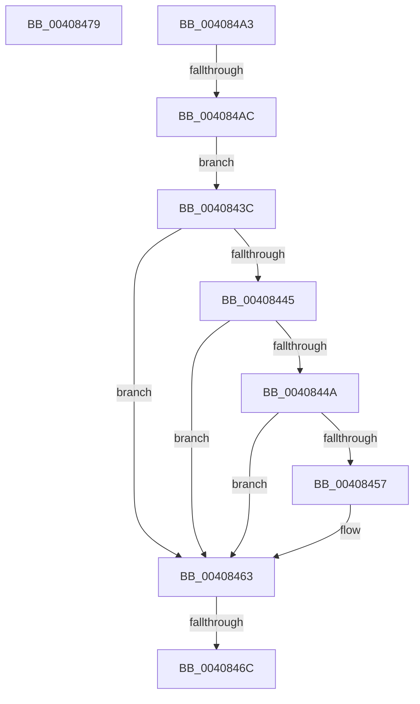

# sub_0040843C

- RVA: `0x0040843C`–`0x004084AE` (길이 `114` bytes)
- VA: `0x000000014040843C`
- 실행 섹션: `.text`
- PDB 이름 있음: `아니요`; PDB Function 태그: `아니요`
- unwind 정보 RVA: `0x0009AAD8`
- 디코드: `27`개 명령, `114/114` bytes 표시
- 미해석 바이트: `0` (있으면 어셈블리에 `.byte`로 보존)

> 이 문서는 커널 이미지의 기계어와 PDB 기호를 분석해 생성했습니다. 4번과 5번은 함수 원형과 자료형을 바이너리 사용 방식에서 추정한 C 해석이며 원본 소스 복구 결과는 아닙니다.

## 1. Dependencies

- 직접 호출 지점: **1**; 고유 호출 대상: **1**
- 직접 호출자로 확인된 함수: **0**
- RIP 상대 이미지 참조: **0**

### Outgoing calls
- `0x00408499` → [MiSignalCommitSignals](../24/MiSignalCommitSignals_function_00249090.md) (function, `0x00249090`)

### Direct callers
- 이 함수 시작 RVA로 연결되는 직접 call은 확인되지 않았습니다. 간접 호출은 완전히 역산할 수 없습니다.

### Static image references
- 디코드된 RIP-relative 메모리 참조가 없습니다.

## 2. Other-region calls and transfers

- 다른 실행 섹션으로 향하는 call: **0**
- call이 아닌 외부 분기/꼬리 이동: **4**
  - `0x00408466` → [sub_004082AD + 0x58](Unknown_function_004082AD.md) (`tail-transfer`)
  - `0x00408474` → [sub_004082AD + 0x58](Unknown_function_004082AD.md) (`tail-transfer`)
  - `0x0040849E` → [sub_004082AD + 0x5D](Unknown_function_004082AD.md) (`tail-transfer`)
  - `0x004084A6` → [sub_004082AD + 0x22](Unknown_function_004082AD.md) (`tail-transfer`)

## 3. Assembly (complete function range)

```asm
0040843C  B9 C0 00 00 00                  mov ecx, 0xc0
00408441  3B D1                           cmp edx, ecx
00408443  7E 1E                           jle 0x140408463
00408445  83 FA FF                        cmp edx, -1
00408448  74 19                           je 0x140408463
0040844A  8B C2                           mov eax, edx
0040844C  F0 41 0F B1 88 9C 8B 00 00      lock cmpxchg dword ptr [r8 + 0x8b9c], ecx
00408455  75 0C                           jne 0x140408463
00408457  8D 82 40 FF FF FF               lea eax, [rdx - 0xc0]
0040845D  48 63 C8                        movsxd rcx, eax
00408460  48 03 F9                        add rdi, rcx
00408463  48 85 FF                        test rdi, rdi
00408466  0F 84 99 FE FF FF               je 0x140408305
0040846C  F0 48 01 BE 40 49 00 00         lock add qword ptr [rsi + 0x4940], rdi
00408474  E9 8C FE FF FF                  jmp 0x140408305
00408479  4C 8B C5                        mov r8, rbp
0040847C  49 F7 D8                        neg r8
0040847F  F0 4C 01 86 80 4B 00 00         lock add qword ptr [rsi + 0x4b80], r8
00408487  F0 4C 0F C1 86 40 4B 00 00      lock xadd qword ptr [rsi + 0x4b40], r8
00408490  49 8B D0                        mov rdx, r8
00408493  48 8B CE                        mov rcx, rsi
00408496  48 2B D5                        sub rdx, rbp
00408499  E8 F2 0B E4 FF                  call 0x140249090
0040849E  E9 67 FE FF FF                  jmp 0x14040830a
004084A3  83 F8 FF                        cmp eax, -1
004084A6  0F 85 23 FE FF FF               jne 0x1404082cf
004084AC  EB 8E                           jmp 0x14040843c
```

## 4. C-style interpretation (structured pseudocode)

```c
__int64 __fastcall sub_0040843C(__int64 a1, __int64 a2, __int64 a3)
{
    __int64 result;
    __int64 v_rdi;

    if (((unsigned int)(a2)) <= 192) goto loc_00408463;
    if (((unsigned int)(a2)) == -1) goto loc_00408463;
    result = (unsigned int)((unsigned int)(a2));
    if (((unsigned int)(a2)) == -1) {
        result = a2 - 192;
        a1 = (int)((unsigned int)(result));
        v_rdi = (v_rdi) + (a1);
    }
}
```

## 5. (Beta) C Style

```c
int64_t sub_0040843C(int64_t Arg1, int64_t Arg2, void *Arg3)
{
    uint8_t *arg3 = (uint8_t *)Arg3;

    int64_t result;
    int64_t local_rdi;

    if (((uint32_t)(Arg2)) <= 192) goto loc_00408463;
    if (((uint32_t)(Arg2)) == -1) goto loc_00408463;
    result = (uint32_t)((uint32_t)(Arg2));
    if (((uint32_t)(Arg2)) == -1) {
        result = Arg2 - 192;
        Arg1 = (int32_t)((uint32_t)(result));
        local_rdi = (local_rdi) + (Arg1);
    }
}
```

### 관측된 메모리 오프셋

구조체 형식이 확인되지 않은 접근은 인자 기준의 오프셋으로만 기록했습니다.

| 기준 인자 | 오프셋 표현 | 폭 (bit) | 접근 |
|---|---:|---:|---|
| `Arg3` | `+ 0x8B9C` | `32` | `R` |

## 6. Execution-region graph

[열기: 2D/3D 그래프와 함수 탐색 컨트롤 패널](../../../control-panel.html?section=text&rva=0x0040843C&view=graph)

- 2D 그래프는 위에서 아래로 흐르고, 3D 그래프는 빈 공간을 드래그해 회전합니다. Shift+드래그는 이동, 휠은 확대·축소, 함수 노드 선택은 대상 보고서 이동입니다.

### Static fallback


