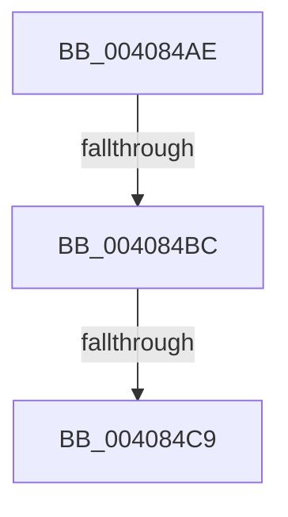

# sub_004084AE

- RVA: `0x004084AE`–`0x004084D6` (길이 `40` bytes)
- VA: `0x00000001404084AE`
- 실행 섹션: `.text`
- PDB 이름 있음: `아니요`; PDB Function 태그: `아니요`
- unwind 정보 RVA: `0x0009AAF4`
- 디코드: `9`개 명령, `40/40` bytes 표시
- 미해석 바이트: `0` (있으면 어셈블리에 `.byte`로 보존)

> 이 문서는 커널 이미지의 기계어와 PDB 기호를 분석해 생성했습니다. 4번과 5번은 함수 원형과 자료형을 바이너리 사용 방식에서 추정한 C 해석이며 원본 소스 복구 결과는 아닙니다.

## 1. Dependencies

- 직접 호출 지점: **2**; 고유 호출 대상: **2**
- 직접 호출자로 확인된 함수: **0**
- RIP 상대 이미지 참조: **1**

### Outgoing calls
- `0x004084BC` → [KiCheckVpBackingLongSpinWaitHypercall](../30/KiCheckVpBackingLongSpinWaitHypercall_function_0030F490.md) (function, `0x0030F490`)
- `0x004084CC` → [HvlNotifyLongSpinWait](../30/HvlNotifyLongSpinWait_function_0030F460.md) (function, `0x0030F460`)

### Direct callers
- 이 함수 시작 RVA로 연결되는 직접 call은 확인되지 않았습니다. 간접 호출은 완전히 역산할 수 없습니다.

### Static image references
- `0x004084AE` → RVA `0x00FC6AB8` (`ALMOSTRO`; read)

## 2. Other-region calls and transfers

- 다른 실행 섹션으로 향하는 call: **0**
- call이 아닌 외부 분기/꼬리 이동: **3**
  - `0x004084B6` → [sub_00408350 + 0x10](Unknown_function_00408350.md) (`tail-transfer`)
  - `0x004084C3` → [sub_00408350 + 0x10](Unknown_function_00408350.md) (`tail-transfer`)
  - `0x004084D1` → [sub_00408350 + 0x12](Unknown_function_00408350.md) (`tail-transfer`)

## 3. Assembly (complete function range)

```asm
004084AE  8B 05 04 E6 BB 00               mov eax, dword ptr [rip + 0xbbe604]
004084B4  A8 40                           test al, 0x40
004084B6  0F 84 A4 FE FF FF               je 0x140408360
004084BC  E8 CF 6F F0 FF                  call 0x14030f490
004084C1  84 C0                           test al, al
004084C3  0F 84 97 FE FF FF               je 0x140408360
004084C9  41 8B CE                        mov ecx, r14d
004084CC  E8 8F 6F F0 FF                  call 0x14030f460
004084D1  E9 8C FE FF FF                  jmp 0x140408362
```

## 4. C-style interpretation (structured pseudocode)

```c
__int64 __fastcall sub_004084AE(void)
{
    __int64 result;

    result = KiCheckVpBackingLongSpinWaitHypercall(a1, a2, a3, a4);
    result = HvlNotifyLongSpinWait((unsigned int)((unsigned int)(v_r14)), a2, a3, a4);
}
```

## 5. (Beta) C Style

```c
void sub_004084AE(void)
{
    int64_t result;

    result = KiCheckVpBackingLongSpinWaitHypercall(a1, a2, a3, a4);
    result = HvlNotifyLongSpinWait((uint32_t)((uint32_t)(local_r14)), a2, a3, a4);
}
```

## 6. Execution-region graph

[열기: 2D/3D 그래프와 함수 탐색 컨트롤 패널](../../../control-panel.html?section=text&rva=0x004084AE&view=graph)

- 2D 그래프는 위에서 아래로 흐르고, 3D 그래프는 빈 공간을 드래그해 회전합니다. Shift+드래그는 이동, 휠은 확대·축소, 함수 노드 선택은 대상 보고서 이동입니다.

### Static fallback


