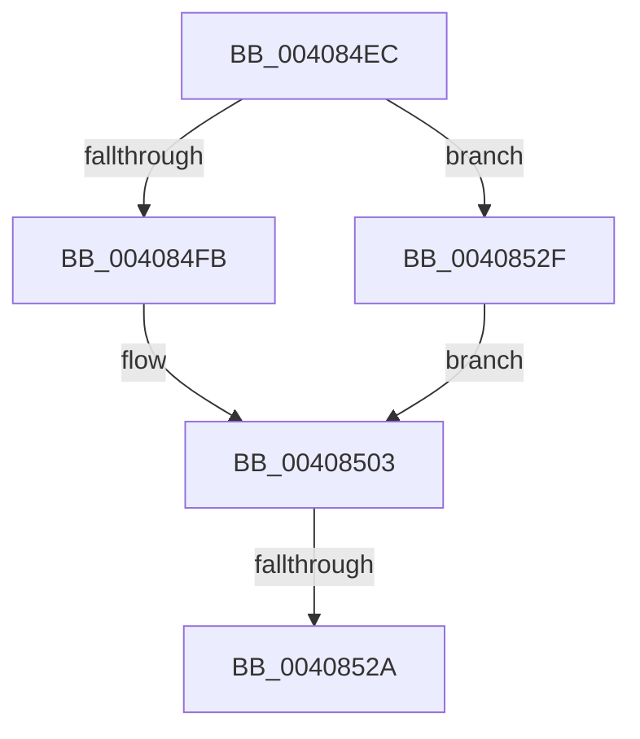

# sub_004084EC

- RVA: `0x004084EC`–`0x00408539` (길이 `77` bytes)
- VA: `0x00000001404084EC`
- 실행 섹션: `.text`
- PDB 이름 있음: `아니요`; PDB Function 태그: `아니요`
- unwind 정보 RVA: `0x0009AB24`
- 디코드: `19`개 명령, `77/77` bytes 표시
- 미해석 바이트: `0` (있으면 어셈블리에 `.byte`로 보존)

> 이 문서는 커널 이미지의 기계어와 PDB 기호를 분석해 생성했습니다. 4번과 5번은 함수 원형과 자료형을 바이너리 사용 방식에서 추정한 C 해석이며 원본 소스 복구 결과는 아닙니다.

## 1. Dependencies

- 직접 호출 지점: **4**; 고유 호출 대상: **4**
- 직접 호출자로 확인된 함수: **0**
- RIP 상대 이미지 참조: **0**

### Outgoing calls
- `0x004084FB` → [ExAcquireSpinLockExclusive](../24/ExAcquireSpinLockExclusive_function_00248690.md) (function, `0x00248690`)
- `0x00408509` → [MiRestockOverCommit](MiRestockOverCommit_function_00407D94.md) (function, `0x00407D94`)
- `0x0040851C` → [MiReleaseSpinLockExclusive](../24/MiReleaseSpinLockExclusive_function_002482C0.md) (function, `0x002482C0`)
- `0x00408532` → [ExAcquireSpinLockExclusiveAtDpcLevel](../24/ExAcquireSpinLockExclusiveAtDpcLevel_function_00248E80.md) (function, `0x00248E80`)

### Direct callers
- 이 함수 시작 RVA로 연결되는 직접 call은 확인되지 않았습니다. 간접 호출은 완전히 역산할 수 없습니다.

### Static image references
- 디코드된 RIP-relative 메모리 참조가 없습니다.

## 2. Other-region calls and transfers

- 다른 실행 섹션으로 향하는 call: **0**
- call이 아닌 외부 분기/꼬리 이동: **2**
  - `0x00408524` → [sub_004082AD + 0x5D](Unknown_function_004082AD.md) (`tail-transfer`)
  - `0x0040852A` → [sub_00408371 + 0xE](Unknown_function_00408371.md) (`tail-transfer`)

## 3. Assembly (complete function range)

```asm
004084EC  44 0F 20 C0                     mov rax, cr8
004084F0  48 8D 8E F8 41 00 00            lea rcx, [rsi + 0x41f8]
004084F7  3C 02                           cmp al, 2
004084F9  74 34                           je 0x14040852f
004084FB  E8 90 01 E4 FF                  call 0x140248690
00408500  0F B6 F8                        movzx edi, al
00408503  48 8B D5                        mov rdx, rbp
00408506  48 8B CE                        mov rcx, rsi
00408509  E8 86 F8 FF FF                  call 0x140407d94
0040850E  40 0F B6 D7                     movzx edx, dil
00408512  48 8D 8E F8 41 00 00            lea rcx, [rsi + 0x41f8]
00408519  48 8B E8                        mov rbp, rax
0040851C  E8 9F FD E3 FF                  call 0x1402482c0
00408521  48 85 ED                        test rbp, rbp
00408524  0F 84 E0 FD FF FF               je 0x14040830a
0040852A  E9 50 FE FF FF                  jmp 0x14040837f
0040852F  40 B7 11                        mov dil, 0x11
00408532  E8 49 09 E4 FF                  call 0x140248e80
00408537  EB CA                           jmp 0x140408503
```

## 4. C-style interpretation (structured pseudocode)

```c
__int64 __fastcall sub_004084EC(void)
{
    __int64 result;

    if (((unsigned __int8)(v_cr8)) == 2) goto loc_0040852F;
    result = ExAcquireSpinLockExclusive(v_rsi + 16888, a2, a3, a4);
loc_00408503:
    result = MiRestockOverCommit(v_rsi, v_rbp, a3, a4);
    result = MiReleaseSpinLockExclusive(v_rsi + 16888, (unsigned __int8)((unsigned __int8)(result)), a3, a4);
loc_0040852F:
    result = ExAcquireSpinLockExclusiveAtDpcLevel(v_rsi + 16888, (unsigned __int8)((unsigned __int8)(result)), a3, a4);
    goto loc_00408503;
}
```

## 5. (Beta) C Style

```c
void sub_004084EC(void)
{
    int64_t result;

    if (((uint8_t)(v_cr8)) == 2) goto loc_0040852F;
    result = ExAcquireSpinLockExclusive(local_rsi + 16888, a2, a3, a4);
loc_00408503:
    result = MiRestockOverCommit(local_rsi, local_rbp, a3, a4);
    result = MiReleaseSpinLockExclusive(local_rsi + 16888, (uint8_t)((uint8_t)(result)), a3, a4);
loc_0040852F:
    result = ExAcquireSpinLockExclusiveAtDpcLevel(local_rsi + 16888, (uint8_t)((uint8_t)(result)), a3, a4);
    goto loc_00408503;
}
```

## 6. Execution-region graph

[열기: 2D/3D 그래프와 함수 탐색 컨트롤 패널](../../../control-panel.html?section=text&rva=0x004084EC&view=graph)

- 2D 그래프는 위에서 아래로 흐르고, 3D 그래프는 빈 공간을 드래그해 회전합니다. Shift+드래그는 이동, 휠은 확대·축소, 함수 노드 선택은 대상 보고서 이동입니다.

### Static fallback


