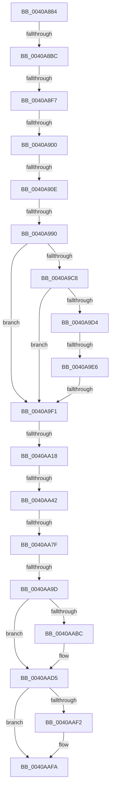

# sub_0040A884

- RVA: `0x0040A884`–`0x0040AB1A` (길이 `662` bytes)
- VA: `0x000000014040A884`
- 실행 섹션: `.text`
- PDB 이름 있음: `아니요`; PDB Function 태그: `아니요`
- unwind 정보 RVA: `0x0009AD58`
- 디코드: `154`개 명령, `662/662` bytes 표시
- 미해석 바이트: `0` (있으면 어셈블리에 `.byte`로 보존)

> 이 문서는 커널 이미지의 기계어와 PDB 기호를 분석해 생성했습니다. 4번과 5번은 함수 원형과 자료형을 바이너리 사용 방식에서 추정한 C 해석이며 원본 소스 복구 결과는 아닙니다.

## 1. Dependencies

- 직접 호출 지점: **1**; 고유 호출 대상: **1**
- 직접 호출자로 확인된 함수: **0**
- RIP 상대 이미지 참조: **4**

### Outgoing calls
- `0x0040AAF5` → [PpmPerfResetHistory](PpmPerfResetHistory_function_0040AF08.md) (function, `0x0040AF08`)

### Direct callers
- 이 함수 시작 RVA로 연결되는 직접 call은 확인되지 않았습니다. 간접 호출은 완전히 역산할 수 없습니다.

### Static image references
- `0x0040A997` → RVA `0x000134D8` (`.rdata`; read)
- `0x0040A9B6` → RVA `0x00E67A39` (`.data`; read)
- `0x0040A9C8` → RVA `0x00F083E8` (`.data`; read)
- `0x0040AAB3` → RVA `0x00F0B244` (`.data`; read)

## 2. Other-region calls and transfers

- 다른 실행 섹션으로 향하는 call: **0**
- call이 아닌 외부 분기/꼬리 이동: **11**
  - `0x0040A8B6` → [sub_0040AB34 + 0x1B2](Unknown_function_0040AB34.md) (`tail-transfer`)
  - `0x0040A8F1` → [sub_0040AB34 + 0x3A3](Unknown_function_0040AB34.md) (`tail-transfer`)
  - `0x0040A8FA` → [sub_0040AB34 + 0x146](Unknown_function_0040AB34.md) (`tail-transfer`)
  - `0x0040A908` → [sub_0040AB34 + 0x380](Unknown_function_0040AB34.md) (`tail-transfer`)
  - `0x0040A98A` → [sub_0040AB34 + 0x3AE](Unknown_function_0040AB34.md) (`tail-transfer`)
  - `0x0040A9E0` → [sub_0040AB34](Unknown_function_0040AB34.md) (`tail-transfer`)
  - `0x0040A9EB` → [sub_0040AB34 + 0x158](Unknown_function_0040AB34.md) (`tail-transfer`)
  - `0x0040AA12` → [sub_0040AB34 + 0x1E1](Unknown_function_0040AB34.md) (`tail-transfer`)
  - `0x0040AA3C` → [sub_0040AB34 + 0x378](Unknown_function_0040AB34.md) (`tail-transfer`)
  - `0x0040AA79` → [sub_0040AB34 + 0x36C](Unknown_function_0040AB34.md) (`tail-transfer`)
  - `0x0040AA97` → [sub_0040AB34 + 0x39B](Unknown_function_0040AB34.md) (`tail-transfer`)

## 3. Assembly (complete function range)

```asm
0040A884  49 89 73 10                     mov qword ptr [r11 + 0x10], rsi
0040A888  48 8B 73 08                     mov rsi, qword ptr [rbx + 8]
0040A88C  4D 89 63 18                     mov qword ptr [r11 + 0x18], r12
0040A890  4C 2B CE                        sub r9, rsi
0040A893  44 8B 63 50                     mov r12d, dword ptr [rbx + 0x50]
0040A897  44 2B 63 18                     sub r12d, dword ptr [rbx + 0x18]
0040A89B  4D 89 6B 20                     mov qword ptr [r11 + 0x20], r13
0040A89F  4C 8B 6B 10                     mov r13, qword ptr [rbx + 0x10]
0040A8A3  4D 89 73 D8                     mov qword ptr [r11 - 0x28], r14
0040A8A7  4C 8B 33                        mov r14, qword ptr [rbx]
0040A8AA  4C 8B 5B 30                     mov r11, qword ptr [rbx + 0x30]
0040A8AE  4D 2B D6                        sub r10, r14
0040A8B1  4D 2B DD                        sub r11, r13
0040A8B4  85 C0                           test eax, eax
0040A8B6  0F 85 2A 04 00 00               jne 0x14040ace6
0040A8BC  4D 3B D1                        cmp r10, r9
0040A8BF  4A 8D 04 0E                     lea rax, [rsi + r9]
0040A8C3  48 89 43 08                     mov qword ptr [rbx + 8], rax
0040A8C7  4D 8B C1                        mov r8, r9
0040A8CA  4B 8D 04 16                     lea rax, [r14 + r10]
0040A8CE  4D 0F 46 C2                     cmovbe r8, r10
0040A8D2  48 89 03                        mov qword ptr [rbx], rax
0040A8D5  4D 3B D9                        cmp r11, r9
0040A8D8  4B 8D 04 2B                     lea rax, [r11 + r13]
0040A8DC  4D 8B D1                        mov r10, r9
0040A8DF  48 89 43 10                     mov qword ptr [rbx + 0x10], rax
0040A8E3  4D 0F 46 D3                     cmovbe r10, r11
0040A8E7  8B 43 50                        mov eax, dword ptr [rbx + 0x50]
0040A8EA  89 43 18                        mov dword ptr [rbx + 0x18], eax
0040A8ED  49 83 F9 01                     cmp r9, 1
0040A8F1  0F 86 E0 05 00 00               jbe 0x14040aed7
0040A8F7  48 85 D2                        test rdx, rdx
0040A8FA  0F 85 7A 03 00 00               jne 0x14040ac7a
0040A900  44 0F B7 59 3C                  movzx r11d, word ptr [rcx + 0x3c]
0040A905  4D 85 FF                        test r15, r15
0040A908  0F 84 A6 05 00 00               je 0x14040aeb4
0040A90E  45 8B AF 84 00 00 00            mov r13d, dword ptr [r15 + 0x84]
0040A915  45 8B BF 88 00 00 00            mov r15d, dword ptr [r15 + 0x88]
0040A91C  0F B6 8B ED 00 00 00            movzx ecx, byte ptr [rbx + 0xed]
0040A923  33 D2                           xor edx, edx
0040A925  41 6B C7 64                     imul eax, r15d, 0x64
0040A929  44 89 6C 24 78                  mov dword ptr [rsp + 0x78], r13d
0040A92E  45 33 ED                        xor r13d, r13d
0040A931  88 4C 24 40                     mov byte ptr [rsp + 0x40], cl
0040A935  0F B6 8B EC 00 00 00            movzx ecx, byte ptr [rbx + 0xec]
0040A93C  C6 44 24 50 64                  mov byte ptr [rsp + 0x50], 0x64
0040A941  49 0F AF C0                     imul rax, r8
0040A945  88 4C 24 58                     mov byte ptr [rsp + 0x58], cl
0040A949  49 F7 F1                        div r9
0040A94C  33 D2                           xor edx, edx
0040A94E  44 89 7C 24 70                  mov dword ptr [rsp + 0x70], r15d
0040A953  48 8B F0                        mov rsi, rax
0040A956  4C 89 55 90                     mov qword ptr [rbp - 0x70], r10
0040A95A  41 8B C7                        mov eax, r15d
0040A95D  66 89 74 24 60                  mov word ptr [rsp + 0x60], si
0040A962  41 0F AF C3                     imul eax, r11d
0040A966  4C 89 45 88                     mov qword ptr [rbp - 0x78], r8
0040A96A  44 89 6C 24 4C                  mov dword ptr [rsp + 0x4c], r13d
0040A96F  49 0F AF C0                     imul rax, r8
0040A973  49 F7 F1                        div r9
0040A976  4D 2B C8                        sub r9, r8
0040A979  4C 8B F0                        mov r14, rax
0040A97C  4C 89 4D 80                     mov qword ptr [rbp - 0x80], r9
0040A980  66 44 89 74 24 68               mov word ptr [rsp + 0x68], r14w
0040A986  44 38 6F 44                     cmp byte ptr [rdi + 0x44], r13b
0040A98A  0F 84 52 05 00 00               je 0x14040aee2
0040A990  0F B6 87 20 77 FF FF            movzx eax, byte ptr [rdi - 0x88e0]
0040A997  4C 8D 15 3A 8B C0 FF            lea r10, [rip - 0x3f74c6]
0040A99E  66 89 44 24 4C                  mov word ptr [rsp + 0x4c], ax
0040A9A3  0F B6 87 21 77 FF FF            movzx eax, byte ptr [rdi - 0x88df]
0040A9AA  88 44 24 4E                     mov byte ptr [rsp + 0x4e], al
0040A9AE  48 C7 45 E8 03 00 00 00         mov qword ptr [rbp - 0x18], 3
0040A9B6  44 38 2D 7C D0 A5 00            cmp byte ptr [rip + 0xa5d07c], r13b
0040A9BD  48 8D 44 24 4C                  lea rax, [rsp + 0x4c]
0040A9C2  48 89 45 E0                     mov qword ptr [rbp - 0x20], rax
0040A9C6  74 29                           je 0x14040a9f1
0040A9C8  48 8B 15 19 DA AF 00            mov rdx, qword ptr [rip + 0xafda19]
0040A9CF  48 85 D2                        test rdx, rdx
0040A9D2  74 1D                           je 0x14040a9f1
0040A9D4  48 8B 4A 20                     mov rcx, qword ptr [rdx + 0x20]
0040A9D8  4D 8B 42 08                     mov r8, qword ptr [r10 + 8]
0040A9DC  44 39 69 60                     cmp dword ptr [rcx + 0x60], r13d
0040A9E0  0F 85 4E 01 00 00               jne 0x14040ab34
0040A9E6  66 44 39 6A 66                  cmp word ptr [rdx + 0x66], r13w
0040A9EB  0F 85 9B 02 00 00               jne 0x14040ac8c
0040A9F1  48 8B 57 20                     mov rdx, qword ptr [rdi + 0x20]
0040A9F5  44 0F B6 93 ED 00 00 00         movzx r10d, byte ptr [rbx + 0xed]
0040A9FD  44 0F B6 9B EC 00 00 00         movzx r11d, byte ptr [rbx + 0xec]
0040AA05  44 89 54 24 4C                  mov dword ptr [rsp + 0x4c], r10d
0040AA0A  48 89 54 24 70                  mov qword ptr [rsp + 0x70], rdx
0040AA0F  48 85 D2                        test rdx, rdx
0040AA12  0F 85 FD 02 00 00               jne 0x14040ad15
0040AA18  44 8B 83 E8 00 00 00            mov r8d, dword ptr [rbx + 0xe8]
0040AA1F  41 C1 E8 08                     shr r8d, 8
0040AA23  45 0F B6 C8                     movzx r9d, r8b
0040AA27  41 0F B6 C0                     movzx eax, r8b
0040AA2B  41 0F B6 D0                     movzx edx, r8b
0040AA2F  44 88 5C 24 40                  mov byte ptr [rsp + 0x40], r11b
0040AA34  41 0F B6 CB                     movzx ecx, r11b
0040AA38  41 80 FB 64                     cmp r11b, 0x64
0040AA3C  0F 83 6A 04 00 00               jae 0x14040aeac
0040AA42  80 F9 64                        cmp cl, 0x64
0040AA45  0F B6 C0                        movzx eax, al
0040AA48  44 0F B6 EA                     movzx r13d, dl
0040AA4C  44 0F 42 E8                     cmovb r13d, eax
0040AA50  41 0F B6 CB                     movzx ecx, r11b
0040AA54  0F AF CE                        imul ecx, esi
0040AA57  B8 1F 85 EB 51                  mov eax, 0x51eb851f
0040AA5C  45 0F B6 C9                     movzx r9d, r9b
0040AA60  F7 E1                           mul ecx
0040AA62  41 0F B6 C0                     movzx eax, r8b
0040AA66  C1 EA 05                        shr edx, 5
0040AA69  80 7C 24 40 64                  cmp byte ptr [rsp + 0x40], 0x64
0040AA6E  89 57 34                        mov dword ptr [rdi + 0x34], edx
0040AA71  44 0F 42 C8                     cmovb r9d, eax
0040AA75  41 80 FA 64                     cmp r10b, 0x64
0040AA79  0F 83 21 04 00 00               jae 0x14040aea0
0040AA7F  41 0F B6 CA                     movzx ecx, r10b
0040AA83  B8 1F 85 EB 51                  mov eax, 0x51eb851f
0040AA88  0F AF CE                        imul ecx, esi
0040AA8B  F7 E1                           mul ecx
0040AA8D  C1 EA 05                        shr edx, 5
0040AA90  89 57 38                        mov dword ptr [rdi + 0x38], edx
0040AA93  41 80 F9 64                     cmp r9b, 0x64
0040AA97  0F 83 32 04 00 00               jae 0x14040aecf
0040AA9D  45 0F B6 C1                     movzx r8d, r9b
0040AAA1  B8 1F 85 EB 51                  mov eax, 0x51eb851f
0040AAA6  41 8B C8                        mov ecx, r8d
0040AAA9  0F AF CE                        imul ecx, esi
0040AAAC  F7 E1                           mul ecx
0040AAAE  8B CA                           mov ecx, edx
0040AAB0  C1 E9 05                        shr ecx, 5
0040AAB3  83 3D 8A 07 B0 00 05            cmp dword ptr [rip + 0xb0078a], 5
0040AABA  75 19                           jne 0x14040aad5
0040AABC  45 0F AF C6                     imul r8d, r14d
0040AAC0  B8 1F 85 EB 51                  mov eax, 0x51eb851f
0040AAC5  2B F1                           sub esi, ecx
0040AAC7  C6 44 24 48 01                  mov byte ptr [rsp + 0x48], 1
0040AACC  41 F7 E0                        mul r8d
0040AACF  C1 EA 05                        shr edx, 5
0040AAD2  44 2B F2                        sub r14d, edx
0040AAD5  80 7C 24 48 00                  cmp byte ptr [rsp + 0x48], 0
0040AADA  89 77 28                        mov dword ptr [rdi + 0x28], esi
0040AADD  44 89 77 2C                     mov dword ptr [rdi + 0x2c], r14d
0040AAE1  89 4F 30                        mov dword ptr [rdi + 0x30], ecx
0040AAE4  66 44 89 7F 3E                  mov word ptr [rdi + 0x3e], r15w
0040AAE9  44 89 A3 F0 00 00 00            mov dword ptr [rbx + 0xf0], r12d
0040AAF0  74 08                           je 0x14040aafa
0040AAF2  48 8B CF                        mov rcx, rdi
0040AAF5  E8 0E 04 00 00                  call 0x14040af08
0040AAFA  4C 8B AC 24 C8 01 00 00         mov r13, qword ptr [rsp + 0x1c8]
0040AB02  4C 8B A4 24 C0 01 00 00         mov r12, qword ptr [rsp + 0x1c0]
0040AB0A  48 8B B4 24 B8 01 00 00         mov rsi, qword ptr [rsp + 0x1b8]
0040AB12  4C 8B B4 24 80 01 00 00         mov r14, qword ptr [rsp + 0x180]
```

## 4. C-style interpretation (structured pseudocode)

```c
__int64 __fastcall sub_0040A884(__int64 a1, __int64 a2, __int64 a3, __int64 a4, __int64 a5, __int64 a6, __int64 a7, unsigned __int8 a8, unsigned __int8 a9, __int64 a10, __int64 a11, __int64 a12, __int64 a13, __int64 a14, __int64 a15, __int64 a16, __int64 a17, __int64 a18, __int64 a19, __int64 a20, __int64 a21, __int64 a22, __int64 a23, __int64 a24, __int64 a25, __int64 a26, __int64 a27, __int64 a28, __int64 a29, __int64 a30, __int64 a31, __int64 a32, __int64 a33, __int64 a34, __int64 a35, __int64 a36, __int64 a37, __int64 a38, __int64 a39, __int64 a40, __int64 a41, __int64 a42, __int64 a43, __int64 a44, __int64 a45, __int64 a46, __int64 a47, __int64 a48, __int64 a49, __int64 a50, __int64 a51, __int64 a52, __int64 a53, __int64 a54, __int64 a55, __int64 a56, __int64 a57)
{
    __int64 result;
    __int64 v_r10;
    __int64 v_r11;
    __int64 v_r12;
    __int64 v_r13;
    __int64 v_r14;
    __int64 v_rsi;
    unsigned __int8 v_stack_p40;
    unsigned __int8 v_stack_p48;
    unsigned int v_stack_p4C;
    unsigned __int8 v_stack_p4E;
    unsigned __int8 v_stack_p50;
    unsigned __int8 v_stack_p58;
    unsigned __int16 v_stack_p60;
    unsigned __int16 v_stack_p68;
    unsigned int v_stack_p70;
    unsigned int v_stack_p78;

    *(unsigned __int64 *)(v_r11 + 16) = v_rsi;
    *(unsigned __int64 *)(v_r11 + 24) = v_r12;
    a4 = (a4) - (*(unsigned __int64 *)(v_rbx + 8));
    v_r12 = (unsigned int)(((unsigned int)(*(unsigned int *)(v_rbx + 80))) - (*(unsigned int *)(v_rbx + 24)));
    *(unsigned __int64 *)(v_r11 + 32) = v_r13;
    *(unsigned __int64 *)(v_r11 - 40) = v_r14;
    v_r10 = (v_r10) - (*(unsigned __int64 *)(v_rbx));
    v_r11 = (*(unsigned __int64 *)(v_rbx + 48)) - (*(unsigned __int64 *)(v_rbx + 16));
    *(unsigned __int64 *)(v_rbx + 8) = *(unsigned __int64 *)(v_rbx + 8) + a4 * 1;
    if (v_r10 <= a4) { a4 = v_r10; }
    *(unsigned __int64 *)(v_rbx) = *(unsigned __int64 *)(v_rbx) + v_r10 * 1;
    *(unsigned __int64 *)(v_rbx + 16) = v_r11 + *(unsigned __int64 *)(v_rbx + 16) * 1;
    if (v_r11 <= a4) { a4 = v_r11; }
    *(unsigned int *)(v_rbx + 24) = (unsigned int)((unsigned int)(*(unsigned int *)(v_rbx + 80)));
    a2 = 0;
    result = (unsigned int)(((unsigned int)(*(unsigned int *)(v_rbx + 80))) * ((unsigned int)((unsigned int)(*(unsigned int *)(v_r15 + 136)))));
    v_stack_p78 = (unsigned int)((unsigned int)(*(unsigned int *)(v_r15 + 132)));
    v_r13 = 0;
    v_stack_p40 = (unsigned __int8)(*(unsigned __int8 *)(v_rbx + 237));
    v_stack_p50 = 100;
    result = (result) * (a4);
    v_stack_p58 = (unsigned __int8)(*(unsigned __int8 *)(v_rbx + 236));
    a2 = 0;
    v_stack_p70 = (unsigned int)((unsigned int)(*(unsigned int *)(v_r15 + 136)));
    *(unsigned __int64 *)(v_rbp - 112) = a4;
    v_stack_p60 = (unsigned __int16)(result);
    result = (unsigned int)(((unsigned int)((unsigned int)((unsigned int)(*(unsigned int *)(v_r15 + 136))))) * ((unsigned int)(*(unsigned __int16 *)(a1 + 60))));
    *(unsigned __int64 *)(v_rbp - 120) = a4;
    v_stack_p4C = 0;
    result = (result) * (a4);
    a4 = (a4) - (a4);
    *(unsigned __int64 *)(v_rbp - 128) = a4;
    v_stack_p68 = (unsigned __int16)(result);
    v_stack_p4C = (unsigned __int16)(*(unsigned __int8 *)(v_rdi - 35040));
    v_stack_p4E = (unsigned __int8)(*(unsigned __int8 *)(v_rdi - 35039));
    *(unsigned __int64 *)(v_rbp - 24) = 3;
    *(unsigned __int64 *)(v_rbp - 32) = v_stack_p4C;
    if ((*(unsigned __int8 *)(v_rip + 10866812)) == 0) goto loc_0040A9F1;
    if (*(unsigned __int64 *)(v_rip + 11524633) == 0) goto loc_0040A9F1;
loc_0040A9F1:
    v_stack_p4C = (unsigned int)(*(unsigned __int8 *)(v_rbx + 237));
    v_stack_p70 = *(unsigned __int64 *)(v_rdi + 32);
    a3 = (unsigned int)(((unsigned int)(*(unsigned int *)(v_rbx + 232))) >> (8));
    v_stack_p40 = (unsigned __int8)(*(unsigned __int8 *)(v_rbx + 236));
    v_r13 = (unsigned __int8)((unsigned __int8)(a3));
    if (((unsigned __int8)((unsigned __int8)(*(unsigned __int8 *)(v_rbx + 236)))) < 100) { v_r13 = (unsigned int)((unsigned __int8)((unsigned __int8)(a3))); }
    a1 = (unsigned int)(((unsigned __int8)(*(unsigned __int8 *)(v_rbx + 236))) * ((unsigned int)(result)));
    a2 = (unsigned int)(((unsigned __int8)(a3)) >> (5));
    *(unsigned int *)(v_rdi + 52) = (unsigned int)(a2);
    a4 = (unsigned __int8)((unsigned __int8)(a3));
    if (a8 < 100) { a4 = (unsigned int)((unsigned __int8)(a3)); }
    a1 = (unsigned int)(((unsigned __int8)(*(unsigned __int8 *)(v_rbx + 237))) * ((unsigned int)(result)));
    a2 = (unsigned int)((a2) >> (5));
    *(unsigned int *)(v_rdi + 56) = (unsigned int)(a2);
    a1 = (unsigned int)(((unsigned int)((unsigned int)((unsigned __int8)(a4)))) * ((unsigned int)(result)));
    a1 = (unsigned int)(((unsigned int)((unsigned int)(a2))) >> (5));
    result = (unsigned int)(0x51EB851FULL);
    v_rsi = result;
    v_r14 = result;
    if ((*(unsigned int *)(v_rip + 11536266)) == 5) {
        a3 = (unsigned int)(((unsigned __int8)(a4)) * ((unsigned int)(result)));
        result = 0x51EB851FULL;
        v_rsi = (unsigned int)((result) - ((unsigned int)(a1)));
        v_stack_p48 = 1;
        a2 = (unsigned int)((a2) >> (5));
        v_r14 = (unsigned int)((result) - ((unsigned int)(a2)));
    }
    *(unsigned int *)(v_rdi + 40) = (unsigned int)(v_rsi);
    *(unsigned int *)(v_rdi + 44) = (unsigned int)(v_r14);
    *(unsigned int *)(v_rdi + 48) = (unsigned int)(a1);
    *(unsigned __int16 *)(v_rdi + 62) = (unsigned __int16)((unsigned int)(*(unsigned int *)(v_r15 + 136)));
    *(unsigned int *)(v_rbx + 240) = (unsigned int)(v_r12);
    if (a9 != 0) {
        a1 = v_rdi;
        result = PpmPerfResetHistory(a1, a2, a3, a4);
    }
    return result;
}
```

## 5. (Beta) C Style

```c
int64_t sub_0040A884(void *Arg1, int64_t Arg2, int64_t Arg3, int64_t Arg4, uint64_t Arg5, uint64_t Arg6, uint64_t Arg7, uint8_t Arg8, uint8_t Arg9, uint64_t Arg10, uint64_t Arg11, uint64_t Arg12, uint64_t Arg13, uint64_t Arg14, uint64_t Arg15, uint64_t Arg16, uint64_t Arg17, uint64_t Arg18, uint64_t Arg19, uint64_t Arg20, uint64_t Arg21, uint64_t Arg22, uint64_t Arg23, uint64_t Arg24, uint64_t Arg25, uint64_t Arg26, uint64_t Arg27, uint64_t Arg28, uint64_t Arg29, uint64_t Arg30, uint64_t Arg31, uint64_t Arg32, uint64_t Arg33, uint64_t Arg34, uint64_t Arg35, uint64_t Arg36, uint64_t Arg37, uint64_t Arg38, uint64_t Arg39, uint64_t Arg40, uint64_t Arg41, uint64_t Arg42, uint64_t Arg43, uint64_t Arg44, uint64_t Arg45, uint64_t Arg46, uint64_t Arg47, int64_t Arg48, uint64_t Arg49, uint64_t Arg50, uint64_t Arg51, uint64_t Arg52, uint64_t Arg53, uint64_t Arg54, int64_t Arg55, int64_t Arg56, int64_t Arg57)
{
    uint8_t *arg1 = (uint8_t *)Arg1;

    int64_t result;
    int64_t local_r10;
    int64_t local_r11;
    int64_t local_r12;
    int64_t local_r13;
    int64_t local_r14;
    int64_t local_rsi;
    uint8_t v_stack_p40;
    uint8_t v_stack_p48;
    uint32_t v_stack_p4C;
    uint8_t v_stack_p4E;
    uint8_t v_stack_p50;
    uint8_t v_stack_p58;
    uint16_t v_stack_p60;
    uint16_t v_stack_p68;
    uint32_t v_stack_p70;
    uint32_t v_stack_p78;

    *(uint64_t *)(local_r11 + 0x10) = local_rsi;
    *(uint64_t *)(local_r11 + 0x18) = local_r12;
    Arg4 = (Arg4) - (*(uint64_t *)(local_rbx + 0x8));
    local_r12 = (uint32_t)(((uint32_t)(*(uint32_t *)(local_rbx + 0x50))) - (*(uint32_t *)(local_rbx + 0x18)));
    *(uint64_t *)(local_r11 + 0x20) = local_r13;
    *(uint64_t *)(local_r11 - 0x28) = local_r14;
    local_r10 = (local_r10) - (*(uint64_t *)(local_rbx));
    local_r11 = (*(uint64_t *)(local_rbx + 0x30)) - (*(uint64_t *)(local_rbx + 0x10));
    *(uint64_t *)(local_rbx + 0x8) = *(uint64_t *)(local_rbx + 0x8) + Arg4 * 1;
    if (local_r10 <= Arg4) { Arg4 = local_r10; }
    *(uint64_t *)(local_rbx) = *(uint64_t *)(local_rbx) + local_r10 * 1;
    *(uint64_t *)(local_rbx + 0x10) = local_r11 + *(uint64_t *)(local_rbx + 0x10) * 1;
    if (local_r11 <= Arg4) { Arg4 = local_r11; }
    *(uint32_t *)(local_rbx + 0x18) = (uint32_t)((uint32_t)(*(uint32_t *)(local_rbx + 0x50)));
    Arg2 = 0;
    result = (uint32_t)(((uint32_t)(*(uint32_t *)(local_rbx + 0x50))) * ((uint32_t)((uint32_t)(*(uint32_t *)(local_r15 + 0x88)))));
    v_stack_p78 = (uint32_t)((uint32_t)(*(uint32_t *)(local_r15 + 0x84)));
    local_r13 = 0;
    v_stack_p40 = (uint8_t)(*(uint8_t *)(local_rbx + 0xED));
    v_stack_p50 = 100;
    result = (result) * (Arg4);
    v_stack_p58 = (uint8_t)(*(uint8_t *)(local_rbx + 0xEC));
    Arg2 = 0;
    v_stack_p70 = (uint32_t)((uint32_t)(*(uint32_t *)(local_r15 + 0x88)));
    *(uint64_t *)(local_rbp - 0x70) = Arg4;
    v_stack_p60 = (uint16_t)(result);
    result = (uint32_t)(((uint32_t)((uint32_t)((uint32_t)(*(uint32_t *)(local_r15 + 0x88))))) * ((uint32_t)(*(uint16_t *)(arg1 + 0x3C))));
    *(uint64_t *)(local_rbp - 0x78) = Arg4;
    v_stack_p4C = 0;
    result = (result) * (Arg4);
    Arg4 = (Arg4) - (Arg4);
    *(uint64_t *)(local_rbp - 0x80) = Arg4;
    v_stack_p68 = (uint16_t)(result);
    v_stack_p4C = (uint16_t)(*(uint8_t *)(local_rdi - 0x88E0));
    v_stack_p4E = (uint8_t)(*(uint8_t *)(local_rdi - 0x88DF));
    *(uint64_t *)(local_rbp - 0x18) = 3;
    *(uint64_t *)(local_rbp - 0x20) = v_stack_p4C;
    if ((*(uint8_t *)(v_rip + 0xA5D07C)) == 0) goto loc_0040A9F1;
    if (*(uint64_t *)(v_rip + 0xAFDA19) == 0) goto loc_0040A9F1;
loc_0040A9F1:
    v_stack_p4C = (uint32_t)(*(uint8_t *)(local_rbx + 0xED));
    v_stack_p70 = *(uint64_t *)(local_rdi + 0x20);
    Arg3 = (uint32_t)(((uint32_t)(*(uint32_t *)(local_rbx + 0xE8))) >> (8));
    v_stack_p40 = (uint8_t)(*(uint8_t *)(local_rbx + 0xEC));
    local_r13 = (uint8_t)((uint8_t)(Arg3));
    if (((uint8_t)((uint8_t)(*(uint8_t *)(local_rbx + 0xEC)))) < 100) { local_r13 = (uint32_t)((uint8_t)((uint8_t)(Arg3))); }
    Arg1 = (uint32_t)(((uint8_t)(*(uint8_t *)(local_rbx + 0xEC))) * ((uint32_t)(result)));
    Arg2 = (uint32_t)(((uint8_t)(Arg3)) >> (5));
    *(uint32_t *)(local_rdi + 0x34) = (uint32_t)(Arg2);
    Arg4 = (uint8_t)((uint8_t)(Arg3));
    if (Arg8 < 100) { Arg4 = (uint32_t)((uint8_t)(Arg3)); }
    Arg1 = (uint32_t)(((uint8_t)(*(uint8_t *)(local_rbx + 0xED))) * ((uint32_t)(result)));
    Arg2 = (uint32_t)((Arg2) >> (5));
    *(uint32_t *)(local_rdi + 0x38) = (uint32_t)(Arg2);
    Arg1 = (uint32_t)(((uint32_t)((uint32_t)((uint8_t)(Arg4)))) * ((uint32_t)(result)));
    Arg1 = (uint32_t)(((uint32_t)((uint32_t)(Arg2))) >> (5));
    result = (uint32_t)(0x51EB851FULL);
    local_rsi = result;
    local_r14 = result;
    if ((*(uint32_t *)(v_rip + 0xB0078A)) == 5) {
        Arg3 = (uint32_t)(((uint8_t)(Arg4)) * ((uint32_t)(result)));
        result = 0x51EB851FULL;
        local_rsi = (uint32_t)((result) - ((uint32_t)(Arg1)));
        v_stack_p48 = 1;
        Arg2 = (uint32_t)((Arg2) >> (5));
        local_r14 = (uint32_t)((result) - ((uint32_t)(Arg2)));
    }
    *(uint32_t *)(local_rdi + 0x28) = (uint32_t)(local_rsi);
    *(uint32_t *)(local_rdi + 0x2C) = (uint32_t)(local_r14);
    *(uint32_t *)(local_rdi + 0x30) = (uint32_t)(Arg1);
    *(uint16_t *)(local_rdi + 0x3E) = (uint16_t)((uint32_t)(*(uint32_t *)(local_r15 + 0x88)));
    *(uint32_t *)(local_rbx + 0xF0) = (uint32_t)(local_r12);
    if (Arg9 != 0) {
        Arg1 = local_rdi;
        result = PpmPerfResetHistory(Arg1, Arg2, Arg3, Arg4);
    }
    return result;
}
```

### 관측된 메모리 오프셋

구조체 형식이 확인되지 않은 접근은 인자 기준의 오프셋으로만 기록했습니다.

| 기준 인자 | 오프셋 표현 | 폭 (bit) | 접근 |
|---|---:|---:|---|
| `Arg1` | `+ 0x3C` | `16` | `R` |

## 6. Execution-region graph

[열기: 2D/3D 그래프와 함수 탐색 컨트롤 패널](../../../control-panel.html?section=text&rva=0x0040A884&view=graph)

- 2D 그래프는 위에서 아래로 흐르고, 3D 그래프는 빈 공간을 드래그해 회전합니다. Shift+드래그는 이동, 휠은 확대·축소, 함수 노드 선택은 대상 보고서 이동입니다.

### Static fallback


