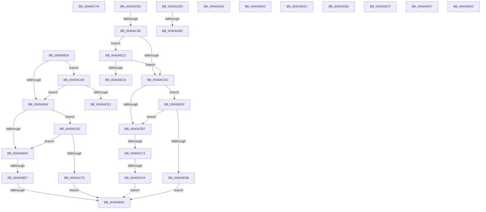

# sub_0040AB34

- RVA: `0x0040AB34`–`0x0040AF01` (길이 `973` bytes)
- VA: `0x000000014040AB34`
- 실행 섹션: `.text`
- PDB 이름 있음: `아니요`; PDB Function 태그: `아니요`
- unwind 정보 RVA: `0x0009AD8C`
- 디코드: `227`개 명령, `973/973` bytes 표시
- 미해석 바이트: `0` (있으면 어셈블리에 `.byte`로 보존)

> 이 문서는 커널 이미지의 기계어와 PDB 기호를 분석해 생성했습니다. 4번과 5번은 함수 원형과 자료형을 바이너리 사용 방식에서 추정한 C 해석이며 원본 소스 복구 결과는 아닙니다.

## 1. Dependencies

- 직접 호출 지점: **1**; 고유 호출 대상: **1**
- 직접 호출자로 확인된 함수: **0**
- RIP 상대 이미지 참조: **3**

### Outgoing calls
- `0x0040AC62` → [EtwWriteEx](../25/EtwWriteEx_function_0025F0D0.md) (function, `0x0025F0D0`)

### Direct callers
- 이 함수 시작 RVA로 연결되는 직접 call은 확인되지 않았습니다. 간접 호출은 완전히 역산할 수 없습니다.

### Static image references
- `0x0040AB6A` → RVA `0x00F083E8` (`.data`; read)
- `0x0040AB71` → RVA `0x00F0B260` (`.data`; read)
- `0x0040AEE6` → RVA `0x000134E8` (`.rdata`; read)

## 2. Other-region calls and transfers

- 다른 실행 섹션으로 향하는 call: **0**
- call이 아닌 외부 분기/꼬리 이동: **18**
  - `0x0040AB51` → [sub_0040A884 + 0x162](Unknown_function_0040A884.md) (`tail-transfer`)
  - `0x0040AB64` → [sub_0040A884 + 0x162](Unknown_function_0040A884.md) (`tail-transfer`)
  - `0x0040AC67` → [sub_0040A884 + 0x16D](Unknown_function_0040A884.md) (`tail-transfer`)
  - `0x0040AC87` → [sub_0040A884 + 0x276](Unknown_function_0040A884.md) (`tail-transfer`)
  - `0x0040AC98` → [sub_0040A884 + 0x16D](Unknown_function_0040A884.md) (`tail-transfer`)
  - `0x0040ACBB` → [sub_0040A884 + 0x16D](Unknown_function_0040A884.md) (`tail-transfer`)
  - `0x0040ACCE` → [sub_0040A884 + 0x16D](Unknown_function_0040A884.md) (`tail-transfer`)
  - `0x0040ACE1` → [sub_0040A884 + 0x162](Unknown_function_0040A884.md) (`tail-transfer`)
  - `0x0040AD07` → [sub_0040A884 + 0x38](Unknown_function_0040A884.md) (`tail-transfer`)
  - `0x0040AD10` → [sub_0040A884 + 0x38](Unknown_function_0040A884.md) (`tail-transfer`)
  - `0x0040AE8D` → [sub_0040A884 + 0x1AB](Unknown_function_0040A884.md) (`tail-transfer`)
  - `0x0040AEA7` → [sub_0040A884 + 0x1FB](Unknown_function_0040A884.md) (`tail-transfer`)
  - `0x0040AEAF` → [sub_0040A884 + 0x1BE](Unknown_function_0040A884.md) (`tail-transfer`)
  - `0x0040AEBD` → [sub_0040A884 + 0x98](Unknown_function_0040A884.md) (`tail-transfer`)
  - `0x0040AECA` → [sub_0040A884 + 0x16D](Unknown_function_0040A884.md) (`tail-transfer`)
  - `0x0040AED2` → [sub_0040A884 + 0x219](Unknown_function_0040A884.md) (`tail-transfer`)
  - `0x0040AEDD` → [sub_0040A884 + 0x73](Unknown_function_0040A884.md) (`tail-transfer`)
  - `0x0040AEFC` → [sub_0040A884 + 0x132](Unknown_function_0040A884.md) (`tail-transfer`)

## 3. Assembly (complete function range)

```asm
0040AB34  0F B6 41 64                     movzx eax, byte ptr [rcx + 0x64]
0040AB38  41 38 42 04                     cmp byte ptr [r10 + 4], al
0040AB3C  0F 87 97 01 00 00               ja 0x14040acd9
0040AB42  8B 41 68                        mov eax, dword ptr [rcx + 0x68]
0040AB45  A8 40                           test al, 0x40
0040AB47  0F 85 1F 01 00 00               jne 0x14040ac6c
0040AB4D  4C 85 41 70                     test qword ptr [rcx + 0x70], r8
0040AB51  0F 84 8F FE FF FF               je 0x14040a9e6
0040AB57  48 8B 49 78                     mov rcx, qword ptr [rcx + 0x78]
0040AB5B  48 8B C1                        mov rax, rcx
0040AB5E  49 23 C0                        and rax, r8
0040AB61  48 3B C1                        cmp rax, rcx
0040AB64  0F 85 7C FE FF FF               jne 0x14040a9e6
0040AB6A  48 8B 0D 77 D8 AF 00            mov rcx, qword ptr [rip + 0xafd877]
0040AB71  48 8D 05 E8 06 B0 00            lea rax, [rip + 0xb006e8]
0040AB78  48 89 45 A0                     mov qword ptr [rbp - 0x60], rax
0040AB7C  45 33 C9                        xor r9d, r9d
0040AB7F  48 8D 45 80                     lea rax, [rbp - 0x80]
0040AB83  48 C7 45 A8 08 00 00 00         mov qword ptr [rbp - 0x58], 8
0040AB8B  48 89 45 B0                     mov qword ptr [rbp - 0x50], rax
0040AB8F  45 33 C0                        xor r8d, r8d
0040AB92  48 8D 45 88                     lea rax, [rbp - 0x78]
0040AB96  48 C7 45 B8 08 00 00 00         mov qword ptr [rbp - 0x48], 8
0040AB9E  48 89 45 C0                     mov qword ptr [rbp - 0x40], rax
0040ABA2  49 8B D2                        mov rdx, r10
0040ABA5  48 8D 44 24 78                  lea rax, [rsp + 0x78]
0040ABAA  48 C7 45 C8 08 00 00 00         mov qword ptr [rbp - 0x38], 8
0040ABB2  48 89 45 D0                     mov qword ptr [rbp - 0x30], rax
0040ABB6  48 8D 44 24 70                  lea rax, [rsp + 0x70]
0040ABBB  48 89 45 F0                     mov qword ptr [rbp - 0x10], rax
0040ABBF  48 8D 44 24 60                  lea rax, [rsp + 0x60]
0040ABC4  48 89 45 00                     mov qword ptr [rbp], rax
0040ABC8  48 8D 44 24 68                  lea rax, [rsp + 0x68]
0040ABCD  48 89 45 10                     mov qword ptr [rbp + 0x10], rax
0040ABD1  48 8D 44 24 50                  lea rax, [rsp + 0x50]
0040ABD6  48 89 45 20                     mov qword ptr [rbp + 0x20], rax
0040ABDA  48 8D 83 E9 00 00 00            lea rax, [rbx + 0xe9]
0040ABE1  48 89 45 30                     mov qword ptr [rbp + 0x30], rax
0040ABE5  48 8D 45 90                     lea rax, [rbp - 0x70]
0040ABE9  48 89 45 40                     mov qword ptr [rbp + 0x40], rax
0040ABED  48 8D 44 24 58                  lea rax, [rsp + 0x58]
0040ABF2  48 89 45 50                     mov qword ptr [rbp + 0x50], rax
0040ABF6  48 8D 44 24 40                  lea rax, [rsp + 0x40]
0040ABFB  48 89 45 60                     mov qword ptr [rbp + 0x60], rax
0040ABFF  48 8D 45 A0                     lea rax, [rbp - 0x60]
0040AC03  48 89 44 24 38                  mov qword ptr [rsp + 0x38], rax
0040AC08  C7 44 24 30 0D 00 00 00         mov dword ptr [rsp + 0x30], 0xd
0040AC10  4C 89 6C 24 28                  mov qword ptr [rsp + 0x28], r13
0040AC15  4C 89 6C 24 20                  mov qword ptr [rsp + 0x20], r13
0040AC1A  48 C7 45 D8 04 00 00 00         mov qword ptr [rbp - 0x28], 4
0040AC22  48 C7 45 F8 04 00 00 00         mov qword ptr [rbp - 8], 4
0040AC2A  48 C7 45 08 02 00 00 00         mov qword ptr [rbp + 8], 2
0040AC32  48 C7 45 18 02 00 00 00         mov qword ptr [rbp + 0x18], 2
0040AC3A  48 C7 45 28 01 00 00 00         mov qword ptr [rbp + 0x28], 1
0040AC42  48 C7 45 38 01 00 00 00         mov qword ptr [rbp + 0x38], 1
0040AC4A  48 C7 45 48 08 00 00 00         mov qword ptr [rbp + 0x48], 8
0040AC52  48 C7 45 58 01 00 00 00         mov qword ptr [rbp + 0x58], 1
0040AC5A  48 C7 45 68 01 00 00 00         mov qword ptr [rbp + 0x68], 1
0040AC62  E8 69 44 E5 FF                  call 0x14025f0d0
0040AC67  E9 85 FD FF FF                  jmp 0x14040a9f1
0040AC6C  4D 85 C0                        test r8, r8
0040AC6F  0F 85 D8 FE FF FF               jne 0x14040ab4d
0040AC75  E9 F0 FE FF FF                  jmp 0x14040ab6a
0040AC7A  0F B6 4A 01                     movzx ecx, byte ptr [rdx + 1]
0040AC7E  0F B6 02                        movzx eax, byte ptr [rdx]
0040AC81  0F AF C8                        imul ecx, eax
0040AC84  89 4F 28                        mov dword ptr [rdi + 0x28], ecx
0040AC87  E9 6E FE FF FF                  jmp 0x14040aafa
0040AC8C  48 8B 4A 28                     mov rcx, qword ptr [rdx + 0x28]
0040AC90  4D 8B 42 08                     mov r8, qword ptr [r10 + 8]
0040AC94  44 39 69 60                     cmp dword ptr [rcx + 0x60], r13d
0040AC98  0F 84 53 FD FF FF               je 0x14040a9f1
0040AC9E  0F B6 41 64                     movzx eax, byte ptr [rcx + 0x64]
0040ACA2  41 38 42 04                     cmp byte ptr [r10 + 4], al
0040ACA6  0F 87 16 02 00 00               ja 0x14040aec2
0040ACAC  8B 41 68                        mov eax, dword ptr [rcx + 0x68]
0040ACAF  A8 40                           test al, 0x40
0040ACB1  0F 85 DB 01 00 00               jne 0x14040ae92
0040ACB7  4C 85 41 70                     test qword ptr [rcx + 0x70], r8
0040ACBB  0F 84 30 FD FF FF               je 0x14040a9f1
0040ACC1  48 8B 49 78                     mov rcx, qword ptr [rcx + 0x78]
0040ACC5  48 8B C1                        mov rax, rcx
0040ACC8  49 23 C0                        and rax, r8
0040ACCB  48 3B C1                        cmp rax, rcx
0040ACCE  0F 85 1D FD FF FF               jne 0x14040a9f1
0040ACD4  E9 91 FE FF FF                  jmp 0x14040ab6a
0040ACD9  84 C0                           test al, al
0040ACDB  0F 84 61 FE FF FF               je 0x14040ab42
0040ACE1  E9 00 FD FF FF                  jmp 0x14040a9e6
0040ACE6  33 D2                           xor edx, edx
0040ACE8  44 8D 40 01                     lea r8d, [rax + 1]
0040ACEC  49 8B C1                        mov rax, r9
0040ACEF  49 F7 F0                        div r8
0040ACF2  48 8B 54 24 70                  mov rdx, qword ptr [rsp + 0x70]
0040ACF7  4C 3B D0                        cmp r10, rax
0040ACFA  4C 8B C8                        mov r9, rax
0040ACFD  49 0F 42 C2                     cmovb rax, r10
0040AD01  4C 8B D0                        mov r10, rax
0040AD04  4D 3B D9                        cmp r11, r9
0040AD07  0F 82 AF FB FF FF               jb 0x14040a8bc
0040AD0D  4D 8B D9                        mov r11, r9
0040AD10  E9 A7 FB FF FF                  jmp 0x14040a8bc
0040AD15  44 8B 4A 04                     mov r9d, dword ptr [rdx + 4]
0040AD19  44 8B 12                        mov r10d, dword ptr [rdx]
0040AD1C  4B 8D 0C 49                     lea rcx, [r9 + r9*2]
0040AD20  0F B7 44 8A 2C                  movzx eax, word ptr [rdx + rcx*4 + 0x2c]
0040AD25  4C 8D 04 8A                     lea r8, [rdx + rcx*4]
0040AD29  0F B7 CE                        movzx ecx, si
0040AD2C  2B C8                           sub ecx, eax
0040AD2E  01 4A 08                        add dword ptr [rdx + 8], ecx
0040AD31  41 0F B7 40 2E                  movzx eax, word ptr [r8 + 0x2e]
0040AD36  66 41 89 70 2C                  mov word ptr [r8 + 0x2c], si
0040AD3B  41 0F B7 CE                     movzx ecx, r14w
0040AD3F  2B C8                           sub ecx, eax
0040AD41  01 4A 0C                        add dword ptr [rdx + 0xc], ecx
0040AD44  41 0F B7 40 30                  movzx eax, word ptr [r8 + 0x30]
0040AD49  66 45 89 70 2E                  mov word ptr [r8 + 0x2e], r14w
0040AD4E  41 0F B7 D7                     movzx edx, r15w
0040AD52  4C 8B 7C 24 70                  mov r15, qword ptr [rsp + 0x70]
0040AD57  8B CA                           mov ecx, edx
0040AD59  2B C8                           sub ecx, eax
0040AD5B  41 01 4F 10                     add dword ptr [r15 + 0x10], ecx
0040AD5F  41 8B CB                        mov ecx, r11d
0040AD62  41 0F B6 40 32                  movzx eax, byte ptr [r8 + 0x32]
0040AD67  66 41 89 50 30                  mov word ptr [r8 + 0x30], dx
0040AD6C  2B C8                           sub ecx, eax
0040AD6E  41 01 4F 14                     add dword ptr [r15 + 0x14], ecx
0040AD72  41 0F B6 40 33                  movzx eax, byte ptr [r8 + 0x33]
0040AD77  8B 54 24 4C                     mov edx, dword ptr [rsp + 0x4c]
0040AD7B  45 88 58 32                     mov byte ptr [r8 + 0x32], r11b
0040AD7F  0F B6 CA                        movzx ecx, dl
0040AD82  2B C8                           sub ecx, eax
0040AD84  41 01 4F 18                     add dword ptr [r15 + 0x18], ecx
0040AD88  41 88 50 33                     mov byte ptr [r8 + 0x33], dl
0040AD8C  41 0F B6 40 34                  movzx eax, byte ptr [r8 + 0x34]
0040AD91  41 8B 4F 1C                     mov ecx, dword ptr [r15 + 0x1c]
0040AD95  2B C8                           sub ecx, eax
0040AD97  41 89 4F 1C                     mov dword ptr [r15 + 0x1c], ecx
0040AD9B  0F B6 83 E8 00 00 00            movzx eax, byte ptr [rbx + 0xe8]
0040ADA2  03 C1                           add eax, ecx
0040ADA4  41 89 47 1C                     mov dword ptr [r15 + 0x1c], eax
0040ADA8  0F B6 83 E8 00 00 00            movzx eax, byte ptr [rbx + 0xe8]
0040ADAF  41 88 40 34                     mov byte ptr [r8 + 0x34], al
0040ADB3  41 0F B6 40 35                  movzx eax, byte ptr [r8 + 0x35]
0040ADB8  41 8B 4F 20                     mov ecx, dword ptr [r15 + 0x20]
0040ADBC  2B C8                           sub ecx, eax
0040ADBE  41 89 4F 20                     mov dword ptr [r15 + 0x20], ecx
0040ADC2  0F B6 83 E9 00 00 00            movzx eax, byte ptr [rbx + 0xe9]
0040ADC9  03 C1                           add eax, ecx
0040ADCB  41 89 47 20                     mov dword ptr [r15 + 0x20], eax
0040ADCF  0F B6 83 E9 00 00 00            movzx eax, byte ptr [rbx + 0xe9]
0040ADD6  41 88 40 35                     mov byte ptr [r8 + 0x35], al
0040ADDA  41 0F B6 40 36                  movzx eax, byte ptr [r8 + 0x36]
0040ADDF  41 8B 4F 24                     mov ecx, dword ptr [r15 + 0x24]
0040ADE3  2B C8                           sub ecx, eax
0040ADE5  41 89 4F 24                     mov dword ptr [r15 + 0x24], ecx
0040ADE9  0F B6 83 EA 00 00 00            movzx eax, byte ptr [rbx + 0xea]
0040ADF0  03 C1                           add eax, ecx
0040ADF2  41 89 47 24                     mov dword ptr [r15 + 0x24], eax
0040ADF6  0F B6 83 EA 00 00 00            movzx eax, byte ptr [rbx + 0xea]
0040ADFD  41 88 40 36                     mov byte ptr [r8 + 0x36], al
0040AE01  41 0F B6 40 37                  movzx eax, byte ptr [r8 + 0x37]
0040AE06  41 8B 4F 28                     mov ecx, dword ptr [r15 + 0x28]
0040AE0A  2B C8                           sub ecx, eax
0040AE0C  41 89 4F 28                     mov dword ptr [r15 + 0x28], ecx
0040AE10  0F B6 83 EB 00 00 00            movzx eax, byte ptr [rbx + 0xeb]
0040AE17  03 C1                           add eax, ecx
0040AE19  41 89 47 28                     mov dword ptr [r15 + 0x28], eax
0040AE1D  0F B6 83 EB 00 00 00            movzx eax, byte ptr [rbx + 0xeb]
0040AE24  41 88 40 37                     mov byte ptr [r8 + 0x37], al
0040AE28  41 8D 41 01                     lea eax, [r9 + 1]
0040AE2C  41 3B C2                        cmp eax, r10d
0040AE2F  44 0F 45 E8                     cmovne r13d, eax
0040AE33  41 8B 47 08                     mov eax, dword ptr [r15 + 8]
0040AE37  33 D2                           xor edx, edx
0040AE39  45 89 6F 04                     mov dword ptr [r15 + 4], r13d
0040AE3D  41 F7 F2                        div r10d
0040AE40  33 D2                           xor edx, edx
0040AE42  8B F0                           mov esi, eax
0040AE44  41 8B 47 0C                     mov eax, dword ptr [r15 + 0xc]
0040AE48  41 F7 F2                        div r10d
0040AE4B  33 D2                           xor edx, edx
0040AE4D  44 8B F0                        mov r14d, eax
0040AE50  41 8B 47 10                     mov eax, dword ptr [r15 + 0x10]
0040AE54  48 8B 4C 24 70                  mov rcx, qword ptr [rsp + 0x70]
0040AE59  41 F7 F2                        div r10d
0040AE5C  33 D2                           xor edx, edx
0040AE5E  44 8B F8                        mov r15d, eax
0040AE61  8B 41 14                        mov eax, dword ptr [rcx + 0x14]
0040AE64  41 F7 F2                        div r10d
0040AE67  33 D2                           xor edx, edx
0040AE69  44 8B D8                        mov r11d, eax
0040AE6C  8B 41 18                        mov eax, dword ptr [rcx + 0x18]
0040AE6F  41 F7 F2                        div r10d
0040AE72  33 D2                           xor edx, edx
0040AE74  89 44 24 4C                     mov dword ptr [rsp + 0x4c], eax
0040AE78  8B 41 20                        mov eax, dword ptr [rcx + 0x20]
0040AE7B  41 F7 F2                        div r10d
0040AE7E  44 8B 54 24 4C                  mov r10d, dword ptr [rsp + 0x4c]
0040AE83  44 8B C8                        mov r9d, eax
0040AE86  44 0F B6 C0                     movzx r8d, al
0040AE8A  0F B6 D0                        movzx edx, al
0040AE8D  E9 9D FB FF FF                  jmp 0x14040aa2f
0040AE92  4D 85 C0                        test r8, r8
0040AE95  0F 85 1C FE FF FF               jne 0x14040acb7
0040AE9B  E9 CA FC FF FF                  jmp 0x14040ab6a
0040AEA0  41 B2 64                        mov r10b, 0x64
0040AEA3  45 0F B6 CD                     movzx r9d, r13b
0040AEA7  E9 D3 FB FF FF                  jmp 0x14040aa7f
0040AEAC  41 B3 64                        mov r11b, 0x64
0040AEAF  E9 8E FB FF FF                  jmp 0x14040aa42
0040AEB4  41 BD 64 00 00 00               mov r13d, 0x64
0040AEBA  45 8B FD                        mov r15d, r13d
0040AEBD  E9 5A FA FF FF                  jmp 0x14040a91c
0040AEC2  84 C0                           test al, al
0040AEC4  0F 84 E2 FD FF FF               je 0x14040acac
0040AECA  E9 22 FB FF FF                  jmp 0x14040a9f1
0040AECF  41 B1 64                        mov r9b, 0x64
0040AED2  E9 C6 FB FF FF                  jmp 0x14040aa9d
0040AED7  41 B9 01 00 00 00               mov r9d, 1
0040AEDD  E9 15 FA FF FF                  jmp 0x14040a8f7
0040AEE2  48 8B 47 08                     mov rax, qword ptr [rdi + 8]
0040AEE6  4C 8D 15 FB 85 C0 FF            lea r10, [rip - 0x3f7a05]
0040AEED  8B 48 14                        mov ecx, dword ptr [rax + 0x14]
0040AEF0  89 4C 24 4C                     mov dword ptr [rsp + 0x4c], ecx
0040AEF4  48 C7 45 E8 04 00 00 00         mov qword ptr [rbp - 0x18], 4
0040AEFC  E9 B5 FA FF FF                  jmp 0x14040a9b6
```

## 4. C-style interpretation (structured pseudocode)

```c
__int64 __fastcall sub_0040AB34(__int64 a1, __int64 a2, __int64 a3, int a4, __int64 a5, __int64 a6, __int64 a7, __int64 a8, __int64 a9, __int64 a10, __int64 a11, __int64 a12, __int64 a13, __int64 a14, __int64 a15)
{
    __int64 result;
    unsigned __int64 v_stack_p20;
    unsigned __int64 v_stack_p28;
    unsigned int v_stack_p30;
    unsigned __int64 v_stack_p38;
    unsigned int v_stack_p4C;
    unsigned __int64 v_stack_p70;

    if ((*(unsigned __int8 *)(v_r10 + 4)) > ((unsigned __int8)(*(unsigned __int8 *)(a1 + 100)))) goto loc_0040ACD9;
loc_0040AB42:
    if ((((unsigned __int8)((unsigned int)(*(unsigned int *)(a1 + 104)))) & (64)) != 0) goto loc_0040AC6C;
loc_0040AB4D:
    result = (*(unsigned __int64 *)(a1 + 120)) & (a3);
loc_0040AB6A:
    *(unsigned __int64 *)(v_rbp - 96) = v_rip + 11536104;
    a4 = 0;
    *(unsigned __int64 *)(v_rbp - 88) = 8;
    *(unsigned __int64 *)(v_rbp - 80) = v_rbp - 128;
    a3 = 0;
    *(unsigned __int64 *)(v_rbp - 72) = 8;
    *(unsigned __int64 *)(v_rbp - 64) = v_rbp - 120;
    *(unsigned __int64 *)(v_rbp - 56) = 8;
    *(unsigned __int64 *)(v_rbp - 48) = a15;
    *(unsigned __int64 *)(v_rbp - 16) = a14;
    *(unsigned __int64 *)(v_rbp) = a12;
    *(unsigned __int64 *)(v_rbp + 16) = a13;
    *(unsigned __int64 *)(v_rbp + 32) = a10;
    *(unsigned __int64 *)(v_rbp + 48) = v_rbx + 233;
    *(unsigned __int64 *)(v_rbp + 64) = v_rbp - 112;
    *(unsigned __int64 *)(v_rbp + 80) = a11;
    *(unsigned __int64 *)(v_rbp + 96) = a8;
    v_stack_p38 = v_rbp - 96;
    v_stack_p30 = 13;
    v_stack_p28 = v_r13;
    v_stack_p20 = v_r13;
    *(unsigned __int64 *)(v_rbp - 40) = 4;
    *(unsigned __int64 *)(v_rbp - 8) = 4;
    *(unsigned __int64 *)(v_rbp + 8) = 2;
    *(unsigned __int64 *)(v_rbp + 24) = 2;
    *(unsigned __int64 *)(v_rbp + 40) = 1;
    *(unsigned __int64 *)(v_rbp + 56) = 1;
    *(unsigned __int64 *)(v_rbp + 72) = 8;
    *(unsigned __int64 *)(v_rbp + 88) = 1;
    *(unsigned __int64 *)(v_rbp + 104) = 1;
    result = EtwWriteEx(*(unsigned __int64 *)(v_rip + 11524215), v_r10, a3, a4);
loc_0040AC6C:
    if (0 != 0) goto loc_0040AB4D;
    goto loc_0040AB6A;
loc_0040ACD9:
    if ((unsigned __int8)(result) == 0) goto loc_0040AB42;
}
```

## 5. (Beta) C Style

```c
int64_t sub_0040AB34(void *Arg1, int64_t Arg2, int64_t Arg3, int32_t Arg4, uint64_t Arg5, uint64_t Arg6, uint64_t Arg7, int64_t Arg8, uint64_t Arg9, int64_t Arg10, int64_t Arg11, int64_t Arg12, int64_t Arg13, int64_t Arg14, int64_t Arg15)
{
    uint8_t *arg1 = (uint8_t *)Arg1;

    int64_t result;
    uint64_t v_stack_p20;
    uint64_t v_stack_p28;
    uint32_t v_stack_p30;
    uint64_t v_stack_p38;
    uint32_t v_stack_p4C;
    uint64_t v_stack_p70;

    if ((*(uint8_t *)(local_r10 + 0x4)) > ((uint8_t)(*(uint8_t *)(arg1 + 0x64)))) goto loc_0040ACD9;
loc_0040AB42:
    if ((((uint8_t)((uint32_t)(*(uint32_t *)(arg1 + 0x68)))) & (64)) != 0) goto loc_0040AC6C;
loc_0040AB4D:
    result = (*(uint64_t *)(arg1 + 0x78)) & (Arg3);
loc_0040AB6A:
    *(uint64_t *)(local_rbp - 0x60) = v_rip + 11536104;
    Arg4 = 0;
    *(uint64_t *)(local_rbp - 0x58) = 8;
    *(uint64_t *)(local_rbp - 0x50) = local_rbp - 128;
    Arg3 = 0;
    *(uint64_t *)(local_rbp - 0x48) = 8;
    *(uint64_t *)(local_rbp - 0x40) = local_rbp - 120;
    *(uint64_t *)(local_rbp - 0x38) = 8;
    *(uint64_t *)(local_rbp - 0x30) = Arg15;
    *(uint64_t *)(local_rbp - 0x10) = Arg14;
    *(uint64_t *)(local_rbp) = Arg12;
    *(uint64_t *)(local_rbp + 0x10) = Arg13;
    *(uint64_t *)(local_rbp + 0x20) = Arg10;
    *(uint64_t *)(local_rbp + 0x30) = local_rbx + 233;
    *(uint64_t *)(local_rbp + 0x40) = local_rbp - 112;
    *(uint64_t *)(local_rbp + 0x50) = Arg11;
    *(uint64_t *)(local_rbp + 0x60) = Arg8;
    v_stack_p38 = local_rbp - 96;
    v_stack_p30 = 13;
    v_stack_p28 = local_r13;
    v_stack_p20 = local_r13;
    *(uint64_t *)(local_rbp - 0x28) = 4;
    *(uint64_t *)(local_rbp - 0x8) = 4;
    *(uint64_t *)(local_rbp + 0x8) = 2;
    *(uint64_t *)(local_rbp + 0x18) = 2;
    *(uint64_t *)(local_rbp + 0x28) = 1;
    *(uint64_t *)(local_rbp + 0x38) = 1;
    *(uint64_t *)(local_rbp + 0x48) = 8;
    *(uint64_t *)(local_rbp + 0x58) = 1;
    *(uint64_t *)(local_rbp + 0x68) = 1;
    result = EtwWriteEx(*(uint64_t *)(v_rip + 0xAFD877), local_r10, Arg3, Arg4);
loc_0040AC6C:
    if (0 != 0) goto loc_0040AB4D;
    goto loc_0040AB6A;
loc_0040ACD9:
    if ((uint8_t)(result) == 0) goto loc_0040AB42;
}
```

### 관측된 메모리 오프셋

구조체 형식이 확인되지 않은 접근은 인자 기준의 오프셋으로만 기록했습니다.

| 기준 인자 | 오프셋 표현 | 폭 (bit) | 접근 |
|---|---:|---:|---|
| `Arg1` | `+ 0x64` | `8` | `R` |
| `Arg1` | `+ 0x68` | `32` | `R` |
| `Arg1` | `+ 0x70` | `64` | `R` |
| `Arg1` | `+ 0x78` | `64` | `R` |

## 6. Execution-region graph

[열기: 2D/3D 그래프와 함수 탐색 컨트롤 패널](../../../control-panel.html?section=text&rva=0x0040AB34&view=graph)

- 2D 그래프는 위에서 아래로 흐르고, 3D 그래프는 빈 공간을 드래그해 회전합니다. Shift+드래그는 이동, 휠은 확대·축소, 함수 노드 선택은 대상 보고서 이동입니다.

### Static fallback


