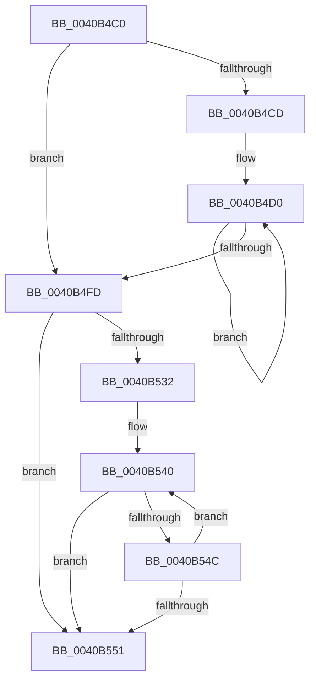

# sub_0040B4C0

- RVA: `0x0040B4C0`–`0x0040B586` (길이 `198` bytes)
- VA: `0x000000014040B4C0`
- 실행 섹션: `.text`
- PDB 이름 있음: `아니요`; PDB Function 태그: `아니요`
- unwind 정보 RVA: `0x0009AE40`
- 디코드: `56`개 명령, `198/198` bytes 표시
- 미해석 바이트: `0` (있으면 어셈블리에 `.byte`로 보존)

> 이 문서는 커널 이미지의 기계어와 PDB 기호를 분석해 생성했습니다. 4번과 5번은 함수 원형과 자료형을 바이너리 사용 방식에서 추정한 C 해석이며 원본 소스 복구 결과는 아닙니다.

## 1. Dependencies

- 직접 호출 지점: **0**; 고유 호출 대상: **0**
- 직접 호출자로 확인된 함수: **0**
- RIP 상대 이미지 참조: **0**

### Outgoing calls
- 직접 디코드된 call 명령이 없습니다.

### Direct callers
- 이 함수 시작 RVA로 연결되는 직접 call은 확인되지 않았습니다. 간접 호출은 완전히 역산할 수 없습니다.

### Static image references
- 디코드된 RIP-relative 메모리 참조가 없습니다.

## 2. Other-region calls and transfers

- 다른 실행 섹션으로 향하는 call: **0**
- call이 아닌 외부 분기/꼬리 이동: **1**
  - `0x0040B584` → [sub_0040B586 + 0x1B](Unknown_function_0040B586.md) (`tail-transfer`)

## 3. Assembly (complete function range)

```asm
0040B4C0  48 89 7C 24 10                  mov qword ptr [rsp + 0x10], rdi
0040B4C5  41 8B FA                        mov edi, r10d
0040B4C8  45 85 C0                        test r8d, r8d
0040B4CB  7E 30                           jle 0x14040b4fd
0040B4CD  0F 1F 00                        nop dword ptr [rax]
0040B4D0  48 8B 13                        mov rdx, qword ptr [rbx]
0040B4D3  48 63 C7                        movsxd rax, edi
0040B4D6  FF C7                           inc edi
0040B4D8  4C 8D 0C C5 00 00 00 00         lea r9, [rax*8]
0040B4E0  48 8B 43 08                     mov rax, qword ptr [rbx + 8]
0040B4E4  4E 8B 04 0A                     mov r8, qword ptr [rdx + r9]
0040B4E8  4E 2B 04 08                     sub r8, qword ptr [rax + r9]
0040B4EC  48 8B 43 10                     mov rax, qword ptr [rbx + 0x10]
0040B4F0  4D 89 04 01                     mov qword ptr [r9 + rax], r8
0040B4F4  44 8B 43 30                     mov r8d, dword ptr [rbx + 0x30]
0040B4F8  41 3B F8                        cmp edi, r8d
0040B4FB  7C D3                           jl 0x14040b4d0
0040B4FD  48 8B CE                        mov rcx, rsi
0040B500  48 BF 15 AE 47 E1 7A 14 AE 47   movabs rdi, 0x47ae147ae147ae15
0040B50A  49 0F AF CB                     imul rcx, r11
0040B50E  48 8B C7                        mov rax, rdi
0040B511  4D 8B CB                        mov r9, r11
0040B514  48 F7 E1                        mul rcx
0040B517  48 2B CA                        sub rcx, rdx
0040B51A  48 D1 E9                        shr rcx, 1
0040B51D  48 03 CA                        add rcx, rdx
0040B520  41 8D 50 FF                     lea edx, [r8 - 1]
0040B524  48 C1 E9 06                     shr rcx, 6
0040B528  4C 2B C9                        sub r9, rcx
0040B52B  49 8B CA                        mov rcx, r10
0040B52E  85 D2                           test edx, edx
0040B530  78 1F                           js 0x14040b551
0040B532  4C 8B 43 10                     mov r8, qword ptr [rbx + 0x10]
0040B536  66 66 0F 1F 84 00 00 00 00 00   nop word ptr [rax + rax]
0040B540  48 63 C2                        movsxd rax, edx
0040B543  49 03 0C C0                     add rcx, qword ptr [r8 + rax*8]
0040B547  49 3B C9                        cmp rcx, r9
0040B54A  73 05                           jae 0x14040b551
0040B54C  83 EA 01                        sub edx, 1
0040B54F  79 EF                           jns 0x14040b540
0040B551  48 8B 4C 24 40                  mov rcx, qword ptr [rsp + 0x40]
0040B556  48 8B C7                        mov rax, rdi
0040B559  48 8B 7C 24 10                  mov rdi, qword ptr [rsp + 0x10]
0040B55E  4D 8B C3                        mov r8, r11
0040B561  66 89 11                        mov word ptr [rcx], dx
0040B564  48 8B CD                        mov rcx, rbp
0040B567  49 0F AF CB                     imul rcx, r11
0040B56B  48 F7 E1                        mul rcx
0040B56E  48 2B CA                        sub rcx, rdx
0040B571  48 D1 E9                        shr rcx, 1
0040B574  48 03 CA                        add rcx, rdx
0040B577  48 C1 E9 06                     shr rcx, 6
0040B57B  4C 2B C1                        sub r8, rcx
0040B57E  8B 4B 30                        mov ecx, dword ptr [rbx + 0x30]
0040B581  83 E9 01                        sub ecx, 1
0040B584  78 1B                           js 0x14040b5a1
```

## 4. C-style interpretation (structured pseudocode)

```c
__int64 __fastcall sub_0040B4C0(__int64 a1, __int64 a2, int a3, __int64 a4, __int64 a5, __int64 a6, __int64 a7, __int64 a8)
{
    __int64 v_rdi;
    unsigned __int64 v_stack_p10;

    v_stack_p10 = v_rdi;
    if (condition_is_less_or_equal) goto loc_0040B4FD;
loc_0040B4D0:
    v_rdi = (unsigned int)(((unsigned int)((unsigned int)(v_r10))) + 1);
    a3 = (*(unsigned __int64 *)(*(unsigned __int64 *)(v_rbx) + (int)((unsigned int)((unsigned int)((unsigned int)(v_r10)))) * 8 * 1)) - (*(unsigned __int64 *)(*(unsigned __int64 *)(v_rbx + 8) + (int)((unsigned int)((unsigned int)((unsigned int)(v_r10)))) * 8 * 1));
    *(unsigned __int64 *)((int)((unsigned int)((unsigned int)((unsigned int)(v_r10)))) * 8 + *(unsigned __int64 *)(v_rbx + 16) * 1) = a3;
    if (((unsigned int)(v_rdi)) < ((unsigned int)((unsigned int)(*(unsigned int *)(v_rbx + 48))))) goto loc_0040B4D0;
loc_0040B4FD:
    a1 = (v_rsi) * (v_r11);
    a1 = (a1) - (*(unsigned __int64 *)(v_rbx));
    a1 = (a1) >> (1);
    a1 = (a1) + (*(unsigned __int64 *)(v_rbx));
    a1 = (a1) >> (6);
    a4 = (v_r11) - (a1);
    if (sign_flag) goto loc_0040B551;
loc_0040B540:
    a1 = (v_r10) + (*(unsigned __int64 *)(*(unsigned __int64 *)(v_rbx + 16) + (int)((unsigned int)((unsigned int)(*(unsigned int *)(v_rbx + 48)) - 1)) * 8));
    if (a1 >= a4) goto loc_0040B551;
    a2 = (unsigned int)(((unsigned int)(*(unsigned int *)(v_rbx + 48)) - 1) - (1));
    if (!sign_flag) goto loc_0040B540;
loc_0040B551:
    *(unsigned __int16 *)(a8) = (unsigned __int16)(a2);
    a1 = (v_rbp) * (v_r11);
    a1 = (a1) - (a2);
    a1 = (a1) >> (1);
    a1 = (a1) + (a2);
    a1 = (a1) >> (6);
    a3 = (v_r11) - (a1);
    a1 = (unsigned int)(((unsigned int)(*(unsigned int *)(v_rbx + 48))) - (1));
}
```

## 5. (Beta) C Style

```c
int64_t sub_0040B4C0(int64_t Arg1, int64_t Arg2, int32_t Arg3, int64_t Arg4, uint64_t Arg5, uint64_t Arg6, uint64_t Arg7, void *Arg8)
{
    uint8_t *arg8 = (uint8_t *)Arg8;

    int64_t local_rdi;
    uint64_t v_stack_p10;

    v_stack_p10 = local_rdi;
    if (condition_is_less_or_equal) goto loc_0040B4FD;
loc_0040B4D0:
    local_rdi = (uint32_t)(((uint32_t)((uint32_t)(local_r10))) + 1);
    Arg3 = (*(uint64_t *)(*(uint64_t *)(local_rbx) + (int32_t)((uint32_t)((uint32_t)((uint32_t)(local_r10)))) * 8 * 1)) - (*(uint64_t *)(*(uint64_t *)(local_rbx + 0x8) + (int32_t)((uint32_t)((uint32_t)((uint32_t)(local_r10)))) * 8 * 1));
    *(uint64_t *)((int32_t)((uint32_t)((uint32_t)((uint32_t)(local_r10)))) * 8 + *(uint64_t *)(local_rbx + 0x10) * 1) = Arg3;
    if (((uint32_t)(local_rdi)) < ((uint32_t)((uint32_t)(*(uint32_t *)(local_rbx + 0x30))))) goto loc_0040B4D0;
loc_0040B4FD:
    Arg1 = (local_rsi) * (local_r11);
    Arg1 = (Arg1) - (*(uint64_t *)(local_rbx));
    Arg1 = (Arg1) >> (1);
    Arg1 = (Arg1) + (*(uint64_t *)(local_rbx));
    Arg1 = (Arg1) >> (6);
    Arg4 = (local_r11) - (Arg1);
    if (sign_flag) goto loc_0040B551;
loc_0040B540:
    Arg1 = (local_r10) + (*(uint64_t *)(*(uint64_t *)(local_rbx + 0x10) + (int32_t)((uint32_t)((uint32_t)(*(uint32_t *)(local_rbx + 0x30)) - 0x1)) * 8));
    if (Arg1 >= Arg4) goto loc_0040B551;
    Arg2 = (uint32_t)(((uint32_t)(*(uint32_t *)(local_rbx + 0x30)) - 1) - (1));
    if (!sign_flag) goto loc_0040B540;
loc_0040B551:
    *(uint16_t *)(arg8) = (uint16_t)(Arg2);
    Arg1 = (local_rbp) * (local_r11);
    Arg1 = (Arg1) - (Arg2);
    Arg1 = (Arg1) >> (1);
    Arg1 = (Arg1) + (Arg2);
    Arg1 = (Arg1) >> (6);
    Arg3 = (local_r11) - (Arg1);
    Arg1 = (uint32_t)(((uint32_t)(*(uint32_t *)(local_rbx + 0x30))) - (1));
}
```

### 관측된 메모리 오프셋

구조체 형식이 확인되지 않은 접근은 인자 기준의 오프셋으로만 기록했습니다.

| 기준 인자 | 오프셋 표현 | 폭 (bit) | 접근 |
|---|---:|---:|---|
| `Arg8` | `+ 0x0` | `16` | `W` |

## 6. Execution-region graph

[열기: 2D/3D 그래프와 함수 탐색 컨트롤 패널](../../../control-panel.html?section=text&rva=0x0040B4C0&view=graph)

- 2D 그래프는 위에서 아래로 흐르고, 3D 그래프는 빈 공간을 드래그해 회전합니다. Shift+드래그는 이동, 휠은 확대·축소, 함수 노드 선택은 대상 보고서 이동입니다.

### Static fallback


