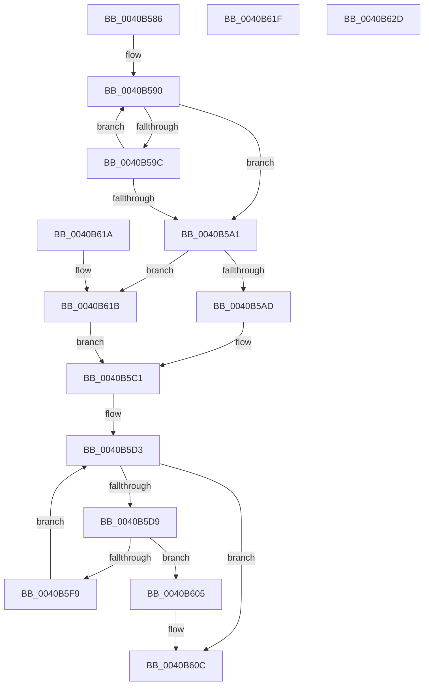

# sub_0040B586

- RVA: `0x0040B586`–`0x0040B62E` (길이 `168` bytes)
- VA: `0x000000014040B586`
- 실행 섹션: `.text`
- PDB 이름 있음: `아니요`; PDB Function 태그: `아니요`
- unwind 정보 RVA: `0x0009AE54`
- 디코드: `54`개 명령, `168/168` bytes 표시
- 미해석 바이트: `0` (있으면 어셈블리에 `.byte`로 보존)

> 이 문서는 커널 이미지의 기계어와 PDB 기호를 분석해 생성했습니다. 4번과 5번은 함수 원형과 자료형을 바이너리 사용 방식에서 추정한 C 해석이며 원본 소스 복구 결과는 아닙니다.

## 1. Dependencies

- 직접 호출 지점: **0**; 고유 호출 대상: **0**
- 직접 호출자로 확인된 함수: **0**
- RIP 상대 이미지 참조: **0**

### Outgoing calls
- 직접 디코드된 call 명령이 없습니다.

### Direct callers
- 이 함수 시작 RVA로 연결되는 직접 call은 확인되지 않았습니다. 간접 호출은 완전히 역산할 수 없습니다.

### Static image references
- 디코드된 RIP-relative 메모리 참조가 없습니다.

## 2. Other-region calls and transfers

- 다른 실행 섹션으로 향하는 call: **0**
- 별도 외부 분기/꼬리 이동을 확인하지 못했습니다.

## 3. Assembly (complete function range)

```asm
0040B586  48 8B 53 10                     mov rdx, qword ptr [rbx + 0x10]
0040B58A  66 0F 1F 44 00 00               nop word ptr [rax + rax]
0040B590  48 63 C1                        movsxd rax, ecx
0040B593  4C 03 14 C2                     add r10, qword ptr [rdx + rax*8]
0040B597  4D 3B D0                        cmp r10, r8
0040B59A  73 05                           jae 0x14040b5a1
0040B59C  83 E9 01                        sub ecx, 1
0040B59F  79 EF                           jns 0x14040b590
0040B5A1  48 8B 44 24 30                  mov rax, qword ptr [rsp + 0x30]
0040B5A6  66 89 08                        mov word ptr [rax], cx
0040B5A9  85 C9                           test ecx, ecx
0040B5AB  7E 6E                           jle 0x14040b61b
0040B5AD  48 8B 43 10                     mov rax, qword ptr [rbx + 0x10]
0040B5B1  33 D2                           xor edx, edx
0040B5B3  48 63 C9                        movsxd rcx, ecx
0040B5B6  48 6B 04 C8 64                  imul rax, qword ptr [rax + rcx*8], 0x64
0040B5BB  49 F7 F3                        div r11
0040B5BE  48 8B C8                        mov rcx, rax
0040B5C1  48 8B 44 24 38                  mov rax, qword ptr [rsp + 0x38]
0040B5C6  88 08                           mov byte ptr [rax], cl
0040B5C8  4C 01 5B 20                     add qword ptr [rbx + 0x20], r11
0040B5CC  8B 43 30                        mov eax, dword ptr [rbx + 0x30]
0040B5CF  4C 89 5B 28                     mov qword ptr [rbx + 0x28], r11
0040B5D3  FF C8                           dec eax
0040B5D5  85 C0                           test eax, eax
0040B5D7  78 33                           js 0x14040b60c
0040B5D9  4C 8B 4B 08                     mov r9, qword ptr [rbx + 8]
0040B5DD  48 63 C8                        movsxd rcx, eax
0040B5E0  48 8D 14 CD 00 00 00 00         lea rdx, [rcx*8]
0040B5E8  48 8B 4B 10                     mov rcx, qword ptr [rbx + 0x10]
0040B5EC  4C 8B 04 0A                     mov r8, qword ptr [rdx + rcx]
0040B5F0  49 8B 0C 11                     mov rcx, qword ptr [r9 + rdx]
0040B5F4  4D 3B C3                        cmp r8, r11
0040B5F7  77 0C                           ja 0x14040b605
0040B5F9  49 03 C8                        add rcx, r8
0040B5FC  49 89 0C 11                     mov qword ptr [r9 + rdx], rcx
0040B600  4D 2B D8                        sub r11, r8
0040B603  EB CE                           jmp 0x14040b5d3
0040B605  49 03 CB                        add rcx, r11
0040B608  49 89 0C 11                     mov qword ptr [r9 + rdx], rcx
0040B60C  B0 01                           mov al, 1
0040B60E  48 8B 5C 24 18                  mov rbx, qword ptr [rsp + 0x18]
0040B613  48 8B 6C 24 20                  mov rbp, qword ptr [rsp + 0x20]
0040B618  5E                              pop rsi
0040B619  C3                              ret
0040B61A  CC                              int3
0040B61B  32 C9                           xor cl, cl
0040B61D  EB A2                           jmp 0x14040b5c1
0040B61F  48 8B 5C 24 18                  mov rbx, qword ptr [rsp + 0x18]
0040B624  32 C0                           xor al, al
0040B626  48 8B 6C 24 20                  mov rbp, qword ptr [rsp + 0x20]
0040B62B  5E                              pop rsi
0040B62C  C3                              ret
0040B62D  CC                              int3
```

## 4. C-style interpretation (structured pseudocode)

```c
__int64 __fastcall sub_0040B586(int a1, __int64 a2, __int64 a3, __int64 a4, __int64 a5, __int64 a6, __int64 a7)
{
    __int64 result;
    __int64 v_r10;
    __int64 v_r11;
    unsigned __int64 v_stack_p18;
    unsigned __int64 v_stack_p20;
    unsigned __int64 v_stack_p28;

loc_0040B590:
    v_r10 = (v_r10) + (*(unsigned __int64 *)(*(unsigned __int64 *)(v_rbx + 16) + (int)(a1) * 8));
    if (v_r10 >= a3) goto loc_0040B5A1;
    a1 = (unsigned int)((a1) - (1));
    if (!sign_flag) goto loc_0040B590;
loc_0040B5A1:
    *(unsigned __int16 *)(a6) = (unsigned __int16)(a1);
    if (condition_is_less_or_equal) goto loc_0040B61B;
    a2 = 0;
    result = (*(unsigned __int64 *)(v_rbx + 16)) * (*(unsigned __int64 *)(*(unsigned __int64 *)(v_rbx + 16) + (int)(a1) * 8));
loc_0040B5C1:
    *(unsigned __int8 *)(a7) = (unsigned __int8)(result);
    *(unsigned __int64 *)(v_rbx + 40) = v_r11;
loc_0040B5D3:
    result = (unsigned int)(((unsigned int)(*(unsigned int *)(v_rbx + 48))) - 1);
    if (sign_flag) goto loc_0040B60C;
    if ((*(unsigned __int64 *)((int)((unsigned int)(result)) * 8 + *(unsigned __int64 *)(v_rbx + 16) * 1)) > v_r11) goto loc_0040B605;
    a1 = (*(unsigned __int64 *)(*(unsigned __int64 *)(v_rbx + 8) + (int)((unsigned int)(result)) * 8 * 1)) + (*(unsigned __int64 *)((int)((unsigned int)(result)) * 8 + *(unsigned __int64 *)(v_rbx + 16) * 1));
    *(unsigned __int64 *)(*(unsigned __int64 *)(v_rbx + 8) + (int)((unsigned int)(result)) * 8 * 1) = a1;
    v_r11 = (v_r11) - (*(unsigned __int64 *)((int)((unsigned int)(result)) * 8 + *(unsigned __int64 *)(v_rbx + 16) * 1));
    goto loc_0040B5D3;
loc_0040B605:
    a1 = (a1) + (v_r11);
    *(unsigned __int64 *)(*(unsigned __int64 *)(v_rbx + 8) + (int)((unsigned int)(result)) * 8 * 1) = a1;
loc_0040B60C:
    return 1;
loc_0040B61B:
    a1 = 0;
    goto loc_0040B5C1;
}
```

## 5. (Beta) C Style

```c
int64_t sub_0040B586(int32_t Arg1, int64_t Arg2, int64_t Arg3, int64_t Arg4, uint64_t Arg5, void *Arg6, void *Arg7)
{
    uint8_t *arg6 = (uint8_t *)Arg6;
    uint8_t *arg7 = (uint8_t *)Arg7;

    int64_t result;
    int64_t local_r10;
    int64_t local_r11;
    uint64_t v_stack_p18;
    uint64_t v_stack_p20;
    uint64_t v_stack_p28;

loc_0040B590:
    local_r10 = (local_r10) + (*(uint64_t *)(*(uint64_t *)(local_rbx + 0x10) + (int32_t)(Arg1) * 8));
    if (local_r10 >= Arg3) goto loc_0040B5A1;
    Arg1 = (uint32_t)((Arg1) - (1));
    if (!sign_flag) goto loc_0040B590;
loc_0040B5A1:
    *(uint16_t *)(arg6) = (uint16_t)(Arg1);
    if (condition_is_less_or_equal) goto loc_0040B61B;
    Arg2 = 0;
    result = (*(uint64_t *)(local_rbx + 0x10)) * (*(uint64_t *)(*(uint64_t *)(local_rbx + 0x10) + (int32_t)(Arg1) * 8));
loc_0040B5C1:
    *(uint8_t *)(arg7) = (uint8_t)(result);
    *(uint64_t *)(local_rbx + 0x28) = local_r11;
loc_0040B5D3:
    result = (uint32_t)(((uint32_t)(*(uint32_t *)(local_rbx + 0x30))) - 1);
    if (sign_flag) goto loc_0040B60C;
    if ((*(uint64_t *)((int32_t)((uint32_t)(result)) * 8 + *(uint64_t *)(local_rbx + 0x10) * 1)) > local_r11) goto loc_0040B605;
    Arg1 = (*(uint64_t *)(*(uint64_t *)(local_rbx + 0x8) + (int32_t)((uint32_t)(result)) * 8 * 1)) + (*(uint64_t *)((int32_t)((uint32_t)(result)) * 8 + *(uint64_t *)(local_rbx + 0x10) * 1));
    *(uint64_t *)(*(uint64_t *)(local_rbx + 0x8) + (int32_t)((uint32_t)(result)) * 8 * 1) = Arg1;
    local_r11 = (local_r11) - (*(uint64_t *)((int32_t)((uint32_t)(result)) * 8 + *(uint64_t *)(local_rbx + 0x10) * 1));
    goto loc_0040B5D3;
loc_0040B605:
    Arg1 = (Arg1) + (local_r11);
    *(uint64_t *)(*(uint64_t *)(local_rbx + 0x8) + (int32_t)((uint32_t)(result)) * 8 * 1) = Arg1;
loc_0040B60C:
    return 1;
loc_0040B61B:
    Arg1 = 0;
    goto loc_0040B5C1;
}
```

### 관측된 메모리 오프셋

구조체 형식이 확인되지 않은 접근은 인자 기준의 오프셋으로만 기록했습니다.

| 기준 인자 | 오프셋 표현 | 폭 (bit) | 접근 |
|---|---:|---:|---|
| `Arg6` | `+ 0x0` | `16` | `W` |
| `Arg7` | `+ 0x0` | `8` | `W` |

## 6. Execution-region graph

[열기: 2D/3D 그래프와 함수 탐색 컨트롤 패널](../../../control-panel.html?section=text&rva=0x0040B586&view=graph)

- 2D 그래프는 위에서 아래로 흐르고, 3D 그래프는 빈 공간을 드래그해 회전합니다. Shift+드래그는 이동, 휠은 확대·축소, 함수 노드 선택은 대상 보고서 이동입니다.

### Static fallback


