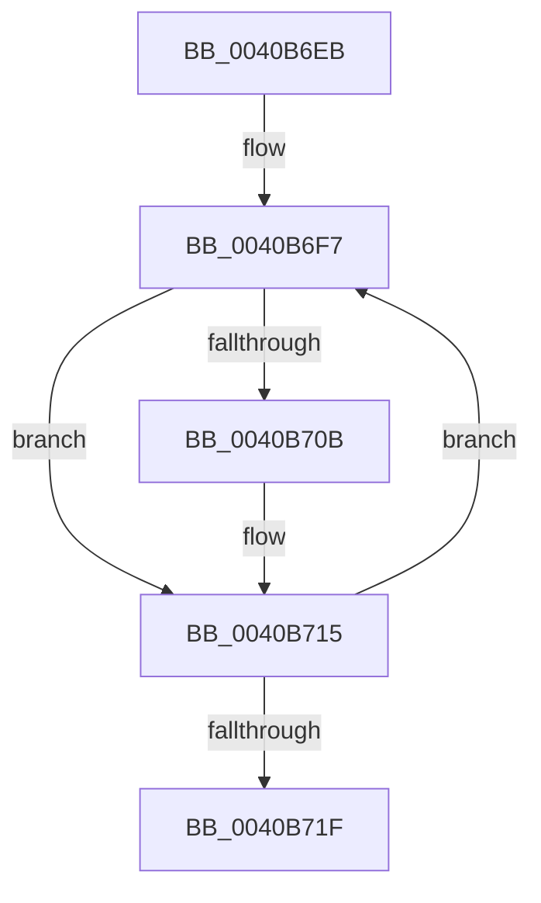

# sub_0040B6EB

- RVA: `0x0040B6EB`–`0x0040B724` (길이 `57` bytes)
- VA: `0x000000014040B6EB`
- 실행 섹션: `.text`
- PDB 이름 있음: `아니요`; PDB Function 태그: `아니요`
- unwind 정보 RVA: `0x0009AE80`
- 디코드: `16`개 명령, `57/57` bytes 표시
- 미해석 바이트: `0` (있으면 어셈블리에 `.byte`로 보존)

> 이 문서는 커널 이미지의 기계어와 PDB 기호를 분석해 생성했습니다. 4번과 5번은 함수 원형과 자료형을 바이너리 사용 방식에서 추정한 C 해석이며 원본 소스 복구 결과는 아닙니다.

## 1. Dependencies

- 직접 호출 지점: **0**; 고유 호출 대상: **0**
- 직접 호출자로 확인된 함수: **0**
- RIP 상대 이미지 참조: **0**

### Outgoing calls
- 직접 디코드된 call 명령이 없습니다.

### Direct callers
- 이 함수 시작 RVA로 연결되는 직접 call은 확인되지 않았습니다. 간접 호출은 완전히 역산할 수 없습니다.

### Static image references
- 디코드된 RIP-relative 메모리 참조가 없습니다.

## 2. Other-region calls and transfers

- 다른 실행 섹션으로 향하는 call: **0**
- 별도 외부 분기/꼬리 이동을 확인하지 못했습니다.

## 3. Assembly (complete function range)

```asm
0040B6EB  48 89 5C 24 10                  mov qword ptr [rsp + 0x10], rbx
0040B6F0  48 83 C2 08                     add rdx, 8
0040B6F4  41 8B D8                        mov ebx, r8d
0040B6F7  44 8B 12                        mov r10d, dword ptr [rdx]
0040B6FA  8B 4A F8                        mov ecx, dword ptr [rdx - 8]
0040B6FD  41 0F BA F2 1F                  btr r10d, 0x1f
0040B702  49 0F A3 C9                     bt r9, rcx
0040B706  44 89 12                        mov dword ptr [rdx], r10d
0040B709  73 0A                           jae 0x14040b715
0040B70B  41 0F BA EA 1F                  bts r10d, 0x1f
0040B710  44 89 12                        mov dword ptr [rdx], r10d
0040B713  FF C0                           inc eax
0040B715  48 83 C2 0C                     add rdx, 0xc
0040B719  48 83 EB 01                     sub rbx, 1
0040B71D  75 D8                           jne 0x14040b6f7
0040B71F  48 8B 5C 24 10                  mov rbx, qword ptr [rsp + 0x10]
```

## 4. C-style interpretation (structured pseudocode)

```c
__int64 __fastcall sub_0040B6EB(__int64 a1, __int64 a2, int a3, __int64 a4)
{
    __int64 result;
    __int64 v_rbx;
    unsigned __int64 v_stack_p10;

    v_stack_p10 = v_rbx;
    a2 = (a2) + (8);
loc_0040B6F7:
    *(unsigned int *)(a2) = (unsigned int)((unsigned int)(*(unsigned int *)(a2)));
    if (!(condition_is_above_or_equal)) {
        *(unsigned int *)(a2) = (unsigned int)((unsigned int)(*(unsigned int *)(a2)));
        result = (unsigned int)((result) + 1);
    }
    a2 = (a2) + (12);
    v_rbx = ((unsigned int)(a3)) - (1);
    if (condition_is_not_equal) goto loc_0040B6F7;
    return result;
}
```

## 5. (Beta) C Style

```c
int64_t sub_0040B6EB(int64_t Arg1, void *Arg2, int32_t Arg3, int64_t Arg4)
{
    uint8_t *arg2 = (uint8_t *)Arg2;

    int64_t result;
    int64_t local_rbx;
    uint64_t v_stack_p10;

    v_stack_p10 = local_rbx;
    Arg2 = (Arg2) + (8);
loc_0040B6F7:
    *(uint32_t *)(arg2) = (uint32_t)((uint32_t)(*(uint32_t *)(arg2)));
    if (!(condition_is_above_or_equal)) {
        *(uint32_t *)(arg2) = (uint32_t)((uint32_t)(*(uint32_t *)(arg2)));
        result = (uint32_t)((result) + 1);
    }
    Arg2 = (Arg2) + (12);
    local_rbx = ((uint32_t)(Arg3)) - (1);
    if (condition_is_not_equal) goto loc_0040B6F7;
    return result;
}
```

### 관측된 메모리 오프셋

구조체 형식이 확인되지 않은 접근은 인자 기준의 오프셋으로만 기록했습니다.

| 기준 인자 | 오프셋 표현 | 폭 (bit) | 접근 |
|---|---:|---:|---|
| `Arg2` | `- 0x8` | `32` | `R` |
| `Arg2` | `+ 0x0` | `32` | `R` |
| `Arg2` | `+ 0x0` | `32` | `W` |

## 6. Execution-region graph

[열기: 2D/3D 그래프와 함수 탐색 컨트롤 패널](../../../control-panel.html?section=text&rva=0x0040B6EB&view=graph)

- 2D 그래프는 위에서 아래로 흐르고, 3D 그래프는 빈 공간을 드래그해 회전합니다. Shift+드래그는 이동, 휠은 확대·축소, 함수 노드 선택은 대상 보고서 이동입니다.

### Static fallback


