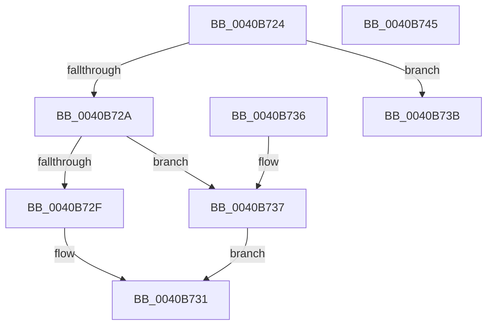

# sub_0040B724

- RVA: `0x0040B724`–`0x0040B746` (길이 `34` bytes)
- VA: `0x000000014040B724`
- 실행 섹션: `.text`
- PDB 이름 있음: `아니요`; PDB Function 태그: `아니요`
- unwind 정보 RVA: `0x0009AE94`
- 디코드: `15`개 명령, `34/34` bytes 표시
- 미해석 바이트: `0` (있으면 어셈블리에 `.byte`로 보존)

> 이 문서는 커널 이미지의 기계어와 PDB 기호를 분석해 생성했습니다. 4번과 5번은 함수 원형과 자료형을 바이너리 사용 방식에서 추정한 C 해석이며 원본 소스 복구 결과는 아닙니다.

## 1. Dependencies

- 직접 호출 지점: **0**; 고유 호출 대상: **0**
- 직접 호출자로 확인된 함수: **0**
- RIP 상대 이미지 참조: **0**

### Outgoing calls
- 직접 디코드된 call 명령이 없습니다.

### Direct callers
- 이 함수 시작 RVA로 연결되는 직접 call은 확인되지 않았습니다. 간접 호출은 완전히 역산할 수 없습니다.

### Static image references
- 디코드된 RIP-relative 메모리 참조가 없습니다.

## 2. Other-region calls and transfers

- 다른 실행 섹션으로 향하는 call: **0**
- 별도 외부 분기/꼬리 이동을 확인하지 못했습니다.

## 3. Assembly (complete function range)

```asm
0040B724  41 F6 C3 01                     test r11b, 1
0040B728  74 11                           je 0x14040b73b
0040B72A  41 3B C0                        cmp eax, r8d
0040B72D  74 08                           je 0x14040b737
0040B72F  32 C0                           xor al, al
0040B731  48 83 C4 18                     add rsp, 0x18
0040B735  C3                              ret
0040B736  CC                              int3
0040B737  B0 01                           mov al, 1
0040B739  EB F6                           jmp 0x14040b731
0040B73B  85 C0                           test eax, eax
0040B73D  0F 95 C0                        setne al
0040B740  48 83 C4 18                     add rsp, 0x18
0040B744  C3                              ret
0040B745  CC                              int3
```

## 4. C-style interpretation (structured pseudocode)

```c
__int64 __fastcall sub_0040B724(__int64 a1, __int64 a2, int a3)
{
    __int64 result;
    __int64 v_rsp;

    if ((((unsigned __int8)(v_r11)) & (1)) == 0) goto loc_0040B73B;
    if (((unsigned int)(result)) == a3) goto loc_0040B737;
    result = 0;
loc_0040B731:
    v_rsp = (v_rsp) + (24);
    return result;
loc_0040B737:
    goto loc_0040B731;
loc_0040B73B:
    result = (1 != 0) ? 1 : 0;
    v_rsp = (v_rsp) + (24);
    return result;
}
```

## 5. (Beta) C Style

```c
int64_t sub_0040B724(int64_t Arg1, int64_t Arg2, int32_t Arg3)
{
    int64_t result;
    int64_t local_rsp;

    if ((((uint8_t)(local_r11)) & (1)) == 0) goto loc_0040B73B;
    if (((uint32_t)(result)) == Arg3) goto loc_0040B737;
    result = 0;
loc_0040B731:
    local_rsp = (local_rsp) + (24);
    return result;
loc_0040B737:
    goto loc_0040B731;
loc_0040B73B:
    result = (1 != 0) ? 1 : 0;
    local_rsp = (local_rsp) + (24);
    return result;
}
```

## 6. Execution-region graph

[열기: 2D/3D 그래프와 함수 탐색 컨트롤 패널](../../../control-panel.html?section=text&rva=0x0040B724&view=graph)

- 2D 그래프는 위에서 아래로 흐르고, 3D 그래프는 빈 공간을 드래그해 회전합니다. Shift+드래그는 이동, 휠은 확대·축소, 함수 노드 선택은 대상 보고서 이동입니다.

### Static fallback


