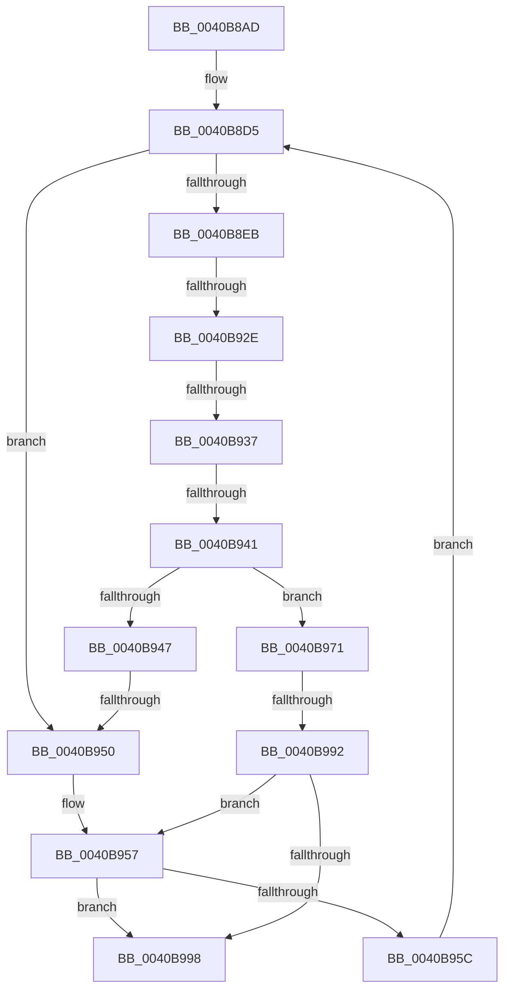

# sub_0040B8AD

- RVA: `0x0040B8AD`–`0x0040B9C2` (길이 `277` bytes)
- VA: `0x000000014040B8AD`
- 실행 섹션: `.text`
- PDB 이름 있음: `아니요`; PDB Function 태그: `아니요`
- unwind 정보 RVA: `0x0009AEC4`
- 디코드: `71`개 명령, `277/277` bytes 표시
- 미해석 바이트: `0` (있으면 어셈블리에 `.byte`로 보존)

> 이 문서는 커널 이미지의 기계어와 PDB 기호를 분석해 생성했습니다. 4번과 5번은 함수 원형과 자료형을 바이너리 사용 방식에서 추정한 C 해석이며 원본 소스 복구 결과는 아닙니다.

## 1. Dependencies

- 직접 호출 지점: **0**; 고유 호출 대상: **0**
- 직접 호출자로 확인된 함수: **0**
- RIP 상대 이미지 참조: **0**

### Outgoing calls
- 직접 디코드된 call 명령이 없습니다.

### Direct callers
- 이 함수 시작 RVA로 연결되는 직접 call은 확인되지 않았습니다. 간접 호출은 완전히 역산할 수 없습니다.

### Static image references
- 디코드된 RIP-relative 메모리 참조가 없습니다.

## 2. Other-region calls and transfers

- 다른 실행 섹션으로 향하는 call: **0**
- call이 아닌 외부 분기/꼬리 이동: **6**
  - `0x0040B928` → [sub_0040B9C2 + 0xC1](Unknown_function_0040B9C2.md) (`tail-transfer`)
  - `0x0040B931` → [sub_0040B9C2 + 0x7E](Unknown_function_0040B9C2.md) (`tail-transfer`)
  - `0x0040B93B` → [sub_0040B9C2 + 0xB](Unknown_function_0040B9C2.md) (`tail-transfer`)
  - `0x0040B94E` → [sub_0040B9C2](Unknown_function_0040B9C2.md) (`tail-transfer`)
  - `0x0040B98C` → [sub_0040B9C2 + 0x70](Unknown_function_0040B9C2.md) (`tail-transfer`)
  - `0x0040B9BD` → [RtlFindSetBitsEx + 0x26](RtlFindSetBitsEx_function_0040B880.md) (`tail-transfer`)

## 3. Assembly (complete function range)

```asm
0040B8AD  48 89 5C 24 38                  mov qword ptr [rsp + 0x38], rbx
0040B8B2  48 89 6C 24 40                  mov qword ptr [rsp + 0x40], rbp
0040B8B7  48 89 74 24 48                  mov qword ptr [rsp + 0x48], rsi
0040B8BC  4C 89 64 24 18                  mov qword ptr [rsp + 0x18], r12
0040B8C1  4C 89 6C 24 10                  mov qword ptr [rsp + 0x10], r13
0040B8C6  41 BD 40 00 00 00               mov r13d, 0x40
0040B8CC  4C 89 74 24 08                  mov qword ptr [rsp + 8], r14
0040B8D1  4C 89 3C 24                     mov qword ptr [rsp], r15
0040B8D5  48 8B CA                        mov rcx, rdx
0040B8D8  C7 44 24 30 00 00 00 00         mov dword ptr [rsp + 0x30], 0
0040B8E0  48 2B C8                        sub rcx, rax
0040B8E3  48 FF C1                        inc rcx
0040B8E6  49 3B CA                        cmp rcx, r10
0040B8E9  72 65                           jb 0x14040b950
0040B8EB  4C 8B FA                        mov r15, rdx
0040B8EE  BB 01 00 00 00                  mov ebx, 1
0040B8F3  4D 2B FA                        sub r15, r10
0040B8F6  49 FF C7                        inc r15
0040B8F9  49 8B CF                        mov rcx, r15
0040B8FC  48 C1 E9 06                     shr rcx, 6
0040B900  4C 8D 34 CF                     lea r14, [rdi + rcx*8]
0040B904  48 8B C8                        mov rcx, rax
0040B907  48 C1 E9 06                     shr rcx, 6
0040B90B  4C 8D 1C CF                     lea r11, [rdi + rcx*8]
0040B90F  0F B6 C8                        movzx ecx, al
0040B912  80 E1 3F                        and cl, 0x3f
0040B915  48 D3 E3                        shl rbx, cl
0040B918  49 8B 0B                        mov rcx, qword ptr [r11]
0040B91B  48 FF CB                        dec rbx
0040B91E  48 F7 D1                        not rcx
0040B921  48 0B D9                        or rbx, rcx
0040B924  49 83 FA 7F                     cmp r10, 0x7f
0040B928  0F 87 55 01 00 00               ja 0x14040ba83
0040B92E  4D 3B D5                        cmp r10, r13
0040B931  0F 83 09 01 00 00               jae 0x14040ba40
0040B937  49 83 FA 01                     cmp r10, 1
0040B93B  0F 87 8C 00 00 00               ja 0x14040b9cd
0040B941  48 83 FB FF                     cmp rbx, -1
0040B945  75 2A                           jne 0x14040b971
0040B947  49 83 C3 08                     add r11, 8
0040B94B  4D 3B DE                        cmp r11, r14
0040B94E  76 72                           jbe 0x14040b9c2
0040B950  48 C7 C6 FF FF FF FF            mov rsi, 0xffffffffffffffff
0040B957  48 85 C0                        test rax, rax
0040B95A  74 3C                           je 0x14040b998
0040B95C  4B 8D 14 02                     lea rdx, [r10 + r8]
0040B960  49 3B D1                        cmp rdx, r9
0040B963  49 0F 47 D1                     cmova rdx, r9
0040B967  48 FF CA                        dec rdx
0040B96A  33 C0                           xor eax, eax
0040B96C  E9 64 FF FF FF                  jmp 0x14040b8d5
0040B971  48 F7 D3                        not rbx
0040B974  49 8B F3                        mov rsi, r11
0040B977  48 2B F7                        sub rsi, rdi
0040B97A  48 C1 FE 03                     sar rsi, 3
0040B97E  48 0F BC CB                     bsf rcx, rbx
0040B982  48 C1 E6 06                     shl rsi, 6
0040B986  48 03 F1                        add rsi, rcx
0040B989  49 3B F7                        cmp rsi, r15
0040B98C  0F 87 A0 00 00 00               ja 0x14040ba32
0040B992  48 83 FE FF                     cmp rsi, -1
0040B996  74 BF                           je 0x14040b957
0040B998  4C 8B 3C 24                     mov r15, qword ptr [rsp]
0040B99C  48 8B C6                        mov rax, rsi
0040B99F  48 8B 74 24 48                  mov rsi, qword ptr [rsp + 0x48]
0040B9A4  4C 8B 74 24 08                  mov r14, qword ptr [rsp + 8]
0040B9A9  4C 8B 6C 24 10                  mov r13, qword ptr [rsp + 0x10]
0040B9AE  4C 8B 64 24 18                  mov r12, qword ptr [rsp + 0x18]
0040B9B3  48 8B 6C 24 40                  mov rbp, qword ptr [rsp + 0x40]
0040B9B8  48 8B 5C 24 38                  mov rbx, qword ptr [rsp + 0x38]
0040B9BD  E9 E4 FE FF FF                  jmp 0x14040b8a6
```

## 4. C-style interpretation (structured pseudocode)

```c
__int64 __fastcall sub_0040B8AD(__int64 a1, __int64 a2, __int64 a3, __int64 a4, __int64 a5, __int64 a6, __int64 a7, __int64 a8, __int64 a9)
{
    __int64 result;
    __int64 v_r11;
    __int64 v_r15;
    __int64 v_rbx;
    __int64 v_rsi;
    unsigned __int64 v_stack_p0;
    unsigned __int64 v_stack_p10;
    unsigned __int64 v_stack_p18;
    unsigned int v_stack_p30;
    unsigned __int64 v_stack_p38;
    unsigned __int64 v_stack_p40;
    unsigned __int64 v_stack_p48;
    unsigned __int64 v_stack_p8;

    v_stack_p38 = v_rbx;
    v_stack_p40 = v_rbp;
    v_stack_p48 = v_rsi;
    v_stack_p18 = v_r12;
    v_stack_p10 = v_r13;
    v_stack_p8 = v_r14;
    v_stack_p0 = v_r15;
loc_0040B8D5:
    v_stack_p30 = 0;
    a1 = (a2) - (result);
    a1 = (a1) + 1;
    if (a1 < v_r10) goto loc_0040B950;
    v_r15 = (a2) - (v_r10);
    v_r15 = (v_r15) + 1;
    a1 = (v_r15) >> (6);
    a1 = (result) >> (6);
    a1 = (unsigned __int8)(((unsigned __int8)(result)) & (63));
    v_rbx = (1) << ((unsigned __int8)(a1));
    v_rbx = (v_rbx) - 1;
    a1 = ~(*(unsigned __int64 *)(v_rdi + a1 * 8));
    v_rbx = (v_rbx) | (a1);
    if (v_rbx != -1) goto loc_0040B971;
    v_r11 = (v_rdi + a1 * 8) + (8);
loc_0040B950:
loc_0040B957:
    if (result == 0) goto loc_0040B998;
    a2 = v_r10 + a3 * 1;
    if ((v_r10 + a3 * 1) > a4) { a2 = a4; }
    a2 = (a2) - 1;
    result = 0;
    goto loc_0040B8D5;
loc_0040B971:
    v_rbx = ~(v_rbx);
    v_rsi = (v_r11) - (v_rdi);
    v_rsi = (v_rsi) >> (3);
    v_rsi = (v_rsi) << (6);
    v_rsi = (v_rsi) + (a1);
    if (v_rsi == -1) goto loc_0040B957;
loc_0040B998:
}
```

## 5. (Beta) C Style

```c
int64_t sub_0040B8AD(int64_t Arg1, int64_t Arg2, int64_t Arg3, int64_t Arg4, uint64_t Arg5, uint64_t Arg6, int64_t Arg7, int64_t Arg8, int64_t Arg9)
{
    int64_t result;
    int64_t local_r11;
    int64_t local_r15;
    int64_t local_rbx;
    int64_t local_rsi;
    uint64_t v_stack_p0;
    uint64_t v_stack_p10;
    uint64_t v_stack_p18;
    uint32_t v_stack_p30;
    uint64_t v_stack_p38;
    uint64_t v_stack_p40;
    uint64_t v_stack_p48;
    uint64_t v_stack_p8;

    v_stack_p38 = local_rbx;
    v_stack_p40 = local_rbp;
    v_stack_p48 = local_rsi;
    v_stack_p18 = local_r12;
    v_stack_p10 = local_r13;
    v_stack_p8 = local_r14;
    v_stack_p0 = local_r15;
loc_0040B8D5:
    v_stack_p30 = 0;
    Arg1 = (Arg2) - (result);
    Arg1 = (Arg1) + 1;
    if (Arg1 < local_r10) goto loc_0040B950;
    local_r15 = (Arg2) - (local_r10);
    local_r15 = (local_r15) + 1;
    Arg1 = (local_r15) >> (6);
    Arg1 = (result) >> (6);
    Arg1 = (uint8_t)(((uint8_t)(result)) & (63));
    local_rbx = (1) << ((uint8_t)(Arg1));
    local_rbx = (local_rbx) - 1;
    Arg1 = ~(*(uint64_t *)(local_rdi + Arg1 * 8));
    local_rbx = (local_rbx) | (Arg1);
    if (local_rbx != -1) goto loc_0040B971;
    local_r11 = (local_rdi + Arg1 * 8) + (8);
loc_0040B950:
loc_0040B957:
    if (result == 0) goto loc_0040B998;
    Arg2 = local_r10 + Arg3 * 1;
    if ((local_r10 + Arg3 * 1) > Arg4) { Arg2 = Arg4; }
    Arg2 = (Arg2) - 1;
    result = 0;
    goto loc_0040B8D5;
loc_0040B971:
    local_rbx = ~(local_rbx);
    local_rsi = (local_r11) - (local_rdi);
    local_rsi = (local_rsi) >> (3);
    local_rsi = (local_rsi) << (6);
    local_rsi = (local_rsi) + (Arg1);
    if (local_rsi == -1) goto loc_0040B957;
loc_0040B998:
}
```

## 6. Execution-region graph

[열기: 2D/3D 그래프와 함수 탐색 컨트롤 패널](../../../control-panel.html?section=text&rva=0x0040B8AD&view=graph)

- 2D 그래프는 위에서 아래로 흐르고, 3D 그래프는 빈 공간을 드래그해 회전합니다. Shift+드래그는 이동, 휠은 확대·축소, 함수 노드 선택은 대상 보고서 이동입니다.

### Static fallback


