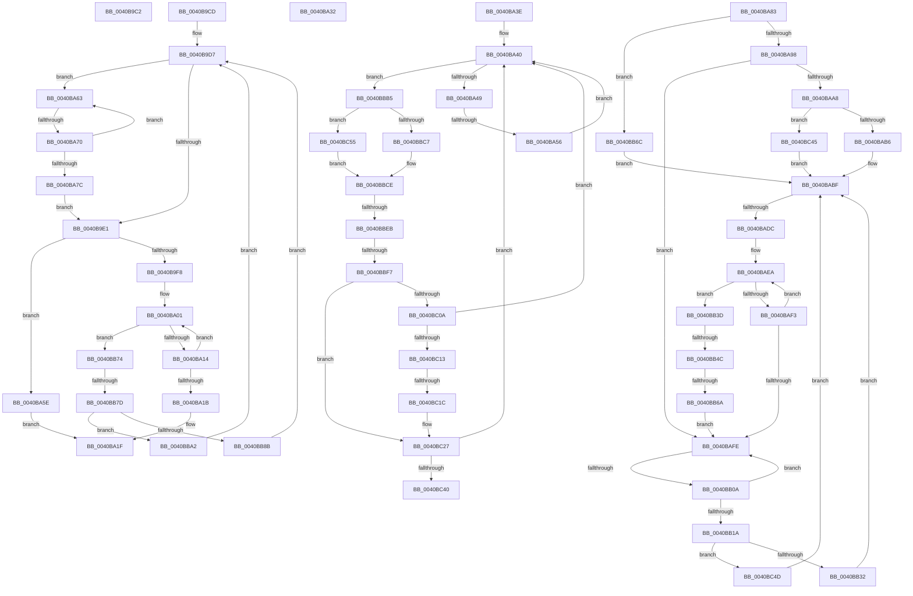

# sub_0040B9C2

- RVA: `0x0040B9C2`–`0x0040BC5D` (길이 `667` bytes)
- VA: `0x000000014040B9C2`
- 실행 섹션: `.text`
- PDB 이름 있음: `아니요`; PDB Function 태그: `아니요`
- unwind 정보 RVA: `0x0009AEF0`
- 디코드: `175`개 명령, `667/667` bytes 표시
- 미해석 바이트: `0` (있으면 어셈블리에 `.byte`로 보존)

> 이 문서는 커널 이미지의 기계어와 PDB 기호를 분석해 생성했습니다. 4번과 5번은 함수 원형과 자료형을 바이너리 사용 방식에서 추정한 C 해석이며 원본 소스 복구 결과는 아닙니다.

## 1. Dependencies

- 직접 호출 지점: **0**; 고유 호출 대상: **0**
- 직접 호출자로 확인된 함수: **0**
- RIP 상대 이미지 참조: **0**

### Outgoing calls
- 직접 디코드된 call 명령이 없습니다.

### Direct callers
- 이 함수 시작 RVA로 연결되는 직접 call은 확인되지 않았습니다. 간접 호출은 완전히 역산할 수 없습니다.

### Static image references
- 디코드된 RIP-relative 메모리 참조가 없습니다.

## 2. Other-region calls and transfers

- 다른 실행 섹션으로 향하는 call: **0**
- call이 아닌 외부 분기/꼬리 이동: **14**
  - `0x0040B9C8` → [sub_0040B8AD + 0x94](Unknown_function_0040B8AD.md) (`tail-transfer`)
  - `0x0040BA2D` → [sub_0040B8AD + 0xDC](Unknown_function_0040B8AD.md) (`tail-transfer`)
  - `0x0040BA39` → [sub_0040B8AD + 0xAA](Unknown_function_0040B8AD.md) (`tail-transfer`)
  - `0x0040BA50` → [sub_0040B8AD + 0xA3](Unknown_function_0040B8AD.md) (`tail-transfer`)
  - `0x0040BA6A` → [sub_0040B8AD + 0xA3](Unknown_function_0040B8AD.md) (`tail-transfer`)
  - `0x0040BAD6` → [sub_0040B8AD + 0xA3](Unknown_function_0040B8AD.md) (`tail-transfer`)
  - `0x0040BB04` → [sub_0040B8AD + 0xA3](Unknown_function_0040B8AD.md) (`tail-transfer`)
  - `0x0040BB46` → [sub_0040B8AD + 0xE5](Unknown_function_0040B8AD.md) (`tail-transfer`)
  - `0x0040BB64` → [sub_0040B8AD + 0xE5](Unknown_function_0040B8AD.md) (`tail-transfer`)
  - `0x0040BB77` → [sub_0040B8AD + 0xA3](Unknown_function_0040B8AD.md) (`tail-transfer`)
  - `0x0040BBE5` → [sub_0040B8AD + 0xA3](Unknown_function_0040B8AD.md) (`tail-transfer`)
  - `0x0040BBF1` → [sub_0040B8AD + 0xE5](Unknown_function_0040B8AD.md) (`tail-transfer`)
  - `0x0040BC16` → [sub_0040B8AD + 0xE5](Unknown_function_0040B8AD.md) (`tail-transfer`)
  - `0x0040BC40` → [sub_0040B8AD + 0xE5](Unknown_function_0040B8AD.md) (`tail-transfer`)

## 3. Assembly (complete function range)

```asm
0040B9C2  49 8B 1B                        mov rbx, qword ptr [r11]
0040B9C5  48 F7 D3                        not rbx
0040B9C8  E9 74 FF FF FF                  jmp 0x14040b941
0040B9CD  33 F6                           xor esi, esi
0040B9CF  48 C1 EA 06                     shr rdx, 6
0040B9D3  4C 8D 24 D7                     lea r12, [rdi + rdx*8]
0040B9D7  48 83 FB FF                     cmp rbx, -1
0040B9DB  0F 84 82 00 00 00               je 0x14040ba63
0040B9E1  48 0F BC D3                     bsf rdx, rbx
0040B9E5  C7 44 24 30 00 00 00 00         mov dword ptr [rsp + 0x30], 0
0040B9ED  41 0F 44 D5                     cmove edx, r13d
0040B9F1  03 D6                           add edx, esi
0040B9F3  49 3B D2                        cmp rdx, r10
0040B9F6  73 66                           jae 0x14040ba5e
0040B9F8  48 8B F3                        mov rsi, rbx
0040B9FB  41 8B EA                        mov ebp, r10d
0040B9FE  48 F7 D6                        not rsi
0040BA01  48 8B D6                        mov rdx, rsi
0040BA04  8B CD                           mov ecx, ebp
0040BA06  D1 E9                           shr ecx, 1
0040BA08  48 D3 EA                        shr rdx, cl
0040BA0B  48 23 F2                        and rsi, rdx
0040BA0E  0F 84 60 01 00 00               je 0x14040bb74
0040BA14  2B E9                           sub ebp, ecx
0040BA16  83 FD 01                        cmp ebp, 1
0040BA19  77 E6                           ja 0x14040ba01
0040BA1B  48 0F BC F6                     bsf rsi, rsi
0040BA1F  4C 2B DF                        sub r11, rdi
0040BA22  49 C1 FB 03                     sar r11, 3
0040BA26  49 C1 E3 06                     shl r11, 6
0040BA2A  49 03 F3                        add rsi, r11
0040BA2D  E9 57 FF FF FF                  jmp 0x14040b989
0040BA32  48 C7 C6 FF FF FF FF            mov rsi, 0xffffffffffffffff
0040BA39  E9 19 FF FF FF                  jmp 0x14040b957
0040BA3E  66 90                           nop
0040BA40  48 85 DB                        test rbx, rbx
0040BA43  0F 89 6C 01 00 00               jns 0x14040bbb5
0040BA49  49 83 C3 08                     add r11, 8
0040BA4D  4D 3B DE                        cmp r11, r14
0040BA50  0F 87 FA FE FF FF               ja 0x14040b950
0040BA56  49 8B 1B                        mov rbx, qword ptr [r11]
0040BA59  48 F7 D3                        not rbx
0040BA5C  EB E2                           jmp 0x14040ba40
0040BA5E  48 F7 DE                        neg rsi
0040BA61  EB BC                           jmp 0x14040ba1f
0040BA63  49 83 C3 08                     add r11, 8
0040BA67  4D 3B DE                        cmp r11, r14
0040BA6A  0F 87 E0 FE FF FF               ja 0x14040b950
0040BA70  49 8B 1B                        mov rbx, qword ptr [r11]
0040BA73  48 F7 D3                        not rbx
0040BA76  48 83 FB FF                     cmp rbx, -1
0040BA7A  74 E7                           je 0x14040ba63
0040BA7C  33 F6                           xor esi, esi
0040BA7E  E9 5E FF FF FF                  jmp 0x14040b9e1
0040BA83  41 F6 C7 3F                     test r15b, 0x3f
0040BA87  49 8D 6E 08                     lea rbp, [r14 + 8]
0040BA8B  49 0F 44 EE                     cmove rbp, r14
0040BA8F  48 85 DB                        test rbx, rbx
0040BA92  0F 84 D4 00 00 00               je 0x14040bb6c
0040BA98  49 8B 4B 08                     mov rcx, qword ptr [r11 + 8]
0040BA9C  49 83 C3 08                     add r11, 8
0040BAA0  48 F7 D1                        not rcx
0040BAA3  48 85 C9                        test rcx, rcx
0040BAA6  75 56                           jne 0x14040bafe
0040BAA8  89 4C 24 30                     mov dword ptr [rsp + 0x30], ecx
0040BAAC  48 0F BD CB                     bsr rcx, rbx
0040BAB0  0F 84 8F 01 00 00               je 0x14040bc45
0040BAB6  41 BE 3F 00 00 00               mov r14d, 0x3f
0040BABC  44 2B F1                        sub r14d, ecx
0040BABF  49 8B F3                        mov rsi, r11
0040BAC2  41 8B D6                        mov edx, r14d
0040BAC5  48 2B F7                        sub rsi, rdi
0040BAC8  48 C1 FE 03                     sar rsi, 3
0040BACC  48 C1 E6 06                     shl rsi, 6
0040BAD0  48 2B F2                        sub rsi, rdx
0040BAD3  49 3B F7                        cmp rsi, r15
0040BAD6  0F 87 74 FE FF FF               ja 0x14040b950
0040BADC  49 8B CA                        mov rcx, r10
0040BADF  48 2B CA                        sub rcx, rdx
0040BAE2  48 C1 E9 06                     shr rcx, 6
0040BAE6  49 8D 14 CB                     lea rdx, [r11 + rcx*8]
0040BAEA  49 83 C3 08                     add r11, 8
0040BAEE  4C 3B DA                        cmp r11, rdx
0040BAF1  74 4A                           je 0x14040bb3d
0040BAF3  49 8B 0B                        mov rcx, qword ptr [r11]
0040BAF6  48 F7 D1                        not rcx
0040BAF9  48 85 C9                        test rcx, rcx
0040BAFC  74 EC                           je 0x14040baea
0040BAFE  49 8B D3                        mov rdx, r11
0040BB01  4C 3B DD                        cmp r11, rbp
0040BB04  0F 87 46 FE FF FF               ja 0x14040b950
0040BB0A  49 8B 4B 08                     mov rcx, qword ptr [r11 + 8]
0040BB0E  49 83 C3 08                     add r11, 8
0040BB12  48 F7 D1                        not rcx
0040BB15  48 85 C9                        test rcx, rcx
0040BB18  75 E4                           jne 0x14040bafe
0040BB1A  48 8B 0A                        mov rcx, qword ptr [rdx]
0040BB1D  48 F7 D1                        not rcx
0040BB20  C7 44 24 30 00 00 00 00         mov dword ptr [rsp + 0x30], 0
0040BB28  48 0F BD D1                     bsr rdx, rcx
0040BB2C  0F 84 1B 01 00 00               je 0x14040bc4d
0040BB32  41 BE 3F 00 00 00               mov r14d, 0x3f
0040BB38  44 2B F2                        sub r14d, edx
0040BB3B  EB 82                           jmp 0x14040babf
0040BB3D  41 8B DA                        mov ebx, r10d
0040BB40  41 2B DE                        sub ebx, r14d
0040BB43  83 E3 3F                        and ebx, 0x3f
0040BB46  0F 84 46 FE FF FF               je 0x14040b992
0040BB4C  49 8B 0B                        mov rcx, qword ptr [r11]
0040BB4F  48 F7 D1                        not rcx
0040BB52  C7 44 24 30 00 00 00 00         mov dword ptr [rsp + 0x30], 0
0040BB5A  48 0F BC D1                     bsf rdx, rcx
0040BB5E  41 0F 44 D5                     cmove edx, r13d
0040BB62  3B D3                           cmp edx, ebx
0040BB64  0F 83 28 FE FF FF               jae 0x14040b992
0040BB6A  EB 92                           jmp 0x14040bafe
0040BB6C  45 33 F6                        xor r14d, r14d
0040BB6F  E9 4B FF FF FF                  jmp 0x14040babf
0040BB74  4D 3B DC                        cmp r11, r12
0040BB77  0F 84 D3 FD FF FF               je 0x14040b950
0040BB7D  48 0F BD CB                     bsr rcx, rbx
0040BB81  C7 44 24 30 00 00 00 00         mov dword ptr [rsp + 0x30], 0
0040BB89  74 17                           je 0x14040bba2
0040BB8B  49 8B 5B 08                     mov rbx, qword ptr [r11 + 8]
0040BB8F  BE 3F 00 00 00                  mov esi, 0x3f
0040BB94  2B F1                           sub esi, ecx
0040BB96  48 F7 D3                        not rbx
0040BB99  49 83 C3 08                     add r11, 8
0040BB9D  E9 35 FE FF FF                  jmp 0x14040b9d7
0040BBA2  49 8B 5B 08                     mov rbx, qword ptr [r11 + 8]
0040BBA6  49 83 C3 08                     add r11, 8
0040BBAA  48 F7 D3                        not rbx
0040BBAD  41 8B F5                        mov esi, r13d
0040BBB0  E9 22 FE FF FF                  jmp 0x14040b9d7
0040BBB5  48 0F BD D3                     bsr rdx, rbx
0040BBB9  C7 44 24 30 00 00 00 00         mov dword ptr [rsp + 0x30], 0
0040BBC1  0F 84 8E 00 00 00               je 0x14040bc55
0040BBC7  B9 3F 00 00 00                  mov ecx, 0x3f
0040BBCC  2B CA                           sub ecx, edx
0040BBCE  49 8B F3                        mov rsi, r11
0040BBD1  48 2B F7                        sub rsi, rdi
0040BBD4  48 C1 FE 03                     sar rsi, 3
0040BBD8  48 FF C6                        inc rsi
0040BBDB  48 C1 E6 06                     shl rsi, 6
0040BBDF  48 2B F1                        sub rsi, rcx
0040BBE2  49 3B F7                        cmp rsi, r15
0040BBE5  0F 87 65 FD FF FF               ja 0x14040b950
0040BBEB  49 8B D2                        mov rdx, r10
0040BBEE  48 2B D1                        sub rdx, rcx
0040BBF1  0F 84 9B FD FF FF               je 0x14040b992
0040BBF7  49 8B 4B 08                     mov rcx, qword ptr [r11 + 8]
0040BBFB  49 83 C3 08                     add r11, 8
0040BBFF  48 F7 D1                        not rcx
0040BC02  48 8B D9                        mov rbx, rcx
0040BC05  49 3B D5                        cmp rdx, r13
0040BC08  72 1D                           jb 0x14040bc27
0040BC0A  48 85 C9                        test rcx, rcx
0040BC0D  0F 85 2D FE FF FF               jne 0x14040ba40
0040BC13  49 2B D5                        sub rdx, r13
0040BC16  0F 84 76 FD FF FF               je 0x14040b992
0040BC1C  49 8B 5B 08                     mov rbx, qword ptr [r11 + 8]
0040BC20  49 83 C3 08                     add r11, 8
0040BC24  48 F7 D3                        not rbx
0040BC27  48 0F BC CB                     bsf rcx, rbx
0040BC2B  C7 44 24 30 00 00 00 00         mov dword ptr [rsp + 0x30], 0
0040BC33  41 0F 44 CD                     cmove ecx, r13d
0040BC37  48 3B CA                        cmp rcx, rdx
0040BC3A  0F 82 00 FE FF FF               jb 0x14040ba40
0040BC40  E9 4D FD FF FF                  jmp 0x14040b992
0040BC45  45 8B F5                        mov r14d, r13d
0040BC48  E9 72 FE FF FF                  jmp 0x14040babf
0040BC4D  45 8B F5                        mov r14d, r13d
0040BC50  E9 6A FE FF FF                  jmp 0x14040babf
0040BC55  41 8B CD                        mov ecx, r13d
0040BC58  E9 71 FF FF FF                  jmp 0x14040bbce
```

## 4. C-style interpretation (structured pseudocode)

```c
void __fastcall sub_0040B9C2(__int64 a1, __int64 a2)
{
    __int64 v_rbx;
    unsigned int v_stack_p30;

    v_rbx = ~(*(unsigned __int64 *)(v_r11));
}
```

## 5. (Beta) C Style

```c
void sub_0040B9C2(int64_t Arg1, int64_t Arg2)
{
    int64_t local_rbx;
    uint32_t v_stack_p30;

    local_rbx = ~(*(uint64_t *)(local_r11));
}
```

## 6. Execution-region graph

[열기: 2D/3D 그래프와 함수 탐색 컨트롤 패널](../../../control-panel.html?section=text&rva=0x0040B9C2&view=graph)

- 2D 그래프는 위에서 아래로 흐르고, 3D 그래프는 빈 공간을 드래그해 회전합니다. Shift+드래그는 이동, 휠은 확대·축소, 함수 노드 선택은 대상 보고서 이동입니다.

### Static fallback


