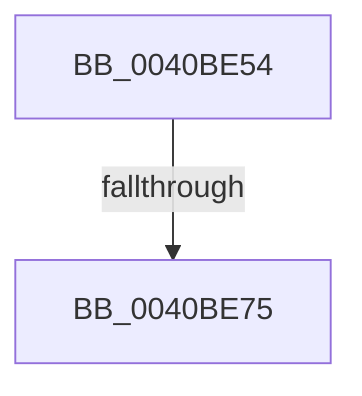

# sub_0040BE54

- RVA: `0x0040BE54`–`0x0040BE83` (길이 `47` bytes)
- VA: `0x000000014040BE54`
- 실행 섹션: `.text`
- PDB 이름 있음: `아니요`; PDB Function 태그: `아니요`
- unwind 정보 RVA: `0x0009B00C`
- 디코드: `10`개 명령, `47/47` bytes 표시
- 미해석 바이트: `0` (있으면 어셈블리에 `.byte`로 보존)

> 이 문서는 커널 이미지의 기계어와 PDB 기호를 분석해 생성했습니다. 4번과 5번은 함수 원형과 자료형을 바이너리 사용 방식에서 추정한 C 해석이며 원본 소스 복구 결과는 아닙니다.

## 1. Dependencies

- 직접 호출 지점: **1**; 고유 호출 대상: **1**
- 직접 호출자로 확인된 함수: **0**
- RIP 상대 이미지 참조: **0**

### Outgoing calls
- `0x0040BE7A` → [KiLogUserCetSetContextIpValidationFailure](../5C/KiLogUserCetSetContextIpValidationFailure_function_005C830C.md) (function, `0x005C830C`)

### Direct callers
- 이 함수 시작 RVA로 연결되는 직접 call은 확인되지 않았습니다. 간접 호출은 완전히 역산할 수 없습니다.

### Static image references
- 디코드된 RIP-relative 메모리 참조가 없습니다.

## 2. Other-region calls and transfers

- 다른 실행 섹션으로 향하는 call: **0**
- call이 아닌 외부 분기/꼬리 이동: **2**
  - `0x0040BE6F` → [sub_006EC90E](../6E/Unknown_function_006EC90E.md) (`tail-transfer`)
  - `0x0040BE81` → [sub_0040BE39 + 0x14](Unknown_function_0040BE39.md) (`tail-transfer`)

## 3. Assembly (complete function range)

```asm
0040BE54  4C 8B 87 F8 00 00 00            mov r8, qword ptr [rdi + 0xf8]
0040BE5B  40 80 F5 01                     xor bpl, 1
0040BE5F  F7 83 54 07 00 00 00 00 04 00   test dword ptr [rbx + 0x754], 0x40000
0040BE69  44 0F B6 CD                     movzx r9d, bpl
0040BE6D  8B 16                           mov edx, dword ptr [rsi]
0040BE6F  0F 84 99 0A 2E 00               je 0x1406ec90e
0040BE75  B9 01 00 00 00                  mov ecx, 1
0040BE7A  E8 8D C4 1B 00                  call 0x1405c830c
0040BE7F  33 C0                           xor eax, eax
0040BE81  EB CA                           jmp 0x14040be4d
```

## 4. C-style interpretation (structured pseudocode)

```c
__int64 __fastcall sub_0040BE54(void)
{
    __int64 result;
    __int64 v_rbp;

    v_rbp = (unsigned __int8)((v_rbp) ^ (1));
    result = KiLogUserCetSetContextIpValidationFailure(1, (unsigned int)(*(unsigned int *)(v_rsi)), *(unsigned __int64 *)(v_rdi + 248), (unsigned __int8)(v_rbp));
    result = 0;
}
```

## 5. (Beta) C Style

```c
void sub_0040BE54(void)
{
    int64_t result;
    int64_t local_rbp;

    local_rbp = (uint8_t)((local_rbp) ^ (1));
    result = KiLogUserCetSetContextIpValidationFailure(1, (uint32_t)(*(uint32_t *)(local_rsi)), *(uint64_t *)(local_rdi + 0xF8), (uint8_t)(local_rbp));
    result = 0;
}
```

## 6. Execution-region graph

[열기: 2D/3D 그래프와 함수 탐색 컨트롤 패널](../../../control-panel.html?section=text&rva=0x0040BE54&view=graph)

- 2D 그래프는 위에서 아래로 흐르고, 3D 그래프는 빈 공간을 드래그해 회전합니다. Shift+드래그는 이동, 휠은 확대·축소, 함수 노드 선택은 대상 보고서 이동입니다.

### Static fallback


