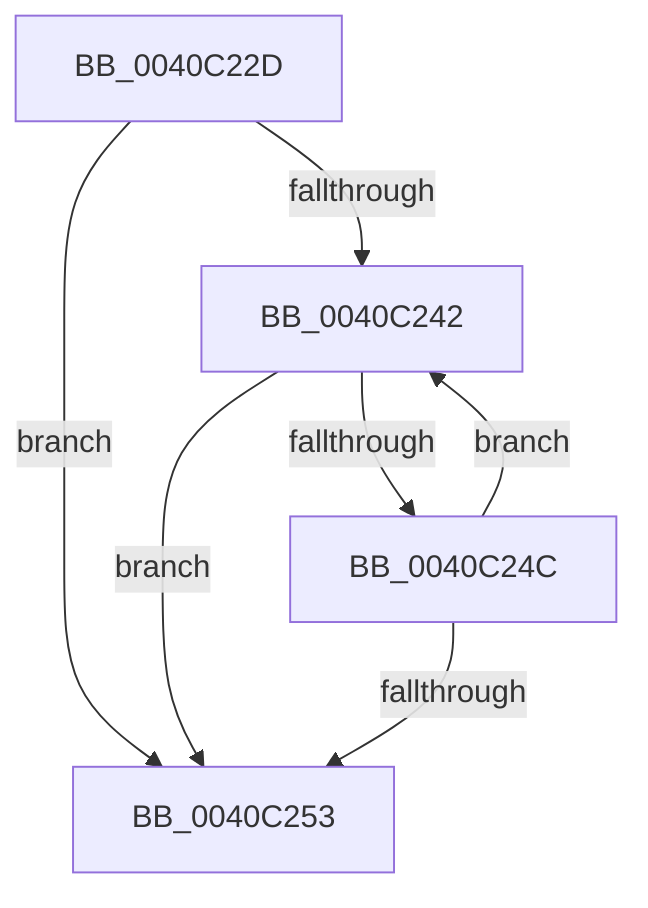

# sub_0040C22D

- RVA: `0x0040C22D`–`0x0040C28B` (길이 `94` bytes)
- VA: `0x000000014040C22D`
- 실행 섹션: `.text`
- PDB 이름 있음: `아니요`; PDB Function 태그: `아니요`
- unwind 정보 RVA: `0x0009B0C0`
- 디코드: `28`개 명령, `94/94` bytes 표시
- 미해석 바이트: `0` (있으면 어셈블리에 `.byte`로 보존)

> 이 문서는 커널 이미지의 기계어와 PDB 기호를 분석해 생성했습니다. 4번과 5번은 함수 원형과 자료형을 바이너리 사용 방식에서 추정한 C 해석이며 원본 소스 복구 결과는 아닙니다.

## 1. Dependencies

- 직접 호출 지점: **0**; 고유 호출 대상: **0**
- 직접 호출자로 확인된 함수: **0**
- RIP 상대 이미지 참조: **0**

### Outgoing calls
- 직접 디코드된 call 명령이 없습니다.

### Direct callers
- 이 함수 시작 RVA로 연결되는 직접 call은 확인되지 않았습니다. 간접 호출은 완전히 역산할 수 없습니다.

### Static image references
- 디코드된 RIP-relative 메모리 참조가 없습니다.

## 2. Other-region calls and transfers

- 다른 실행 섹션으로 향하는 call: **0**
- call이 아닌 외부 분기/꼬리 이동: **1**
  - `0x0040C289` → [sub_0040C28B + 0x1F](Unknown_function_0040C28B.md) (`tail-transfer`)

## 3. Assembly (complete function range)

```asm
0040C22D  48 89 7C 24 10                  mov qword ptr [rsp + 0x10], rdi
0040C232  41 0F B7 39                     movzx edi, word ptr [r9]
0040C236  66 83 FF 5C                     cmp di, 0x5c
0040C23A  0F 94 C0                        sete al
0040C23D  41 3B C0                        cmp eax, r8d
0040C240  73 11                           jae 0x14040c253
0040C242  8B C8                           mov ecx, eax
0040C244  66 41 83 3C 49 5C               cmp word ptr [r9 + rcx*2], 0x5c
0040C24A  74 07                           je 0x14040c253
0040C24C  FF C0                           inc eax
0040C24E  41 3B C0                        cmp eax, r8d
0040C251  72 EF                           jb 0x14040c242
0040C253  41 8B CA                        mov ecx, r10d
0040C256  66 83 FF 5C                     cmp di, 0x5c
0040C25A  0F B7 D0                        movzx edx, ax
0040C25D  0F 94 C1                        sete cl
0040C260  66 2B D1                        sub dx, cx
0040C263  B9 02 00 00 00                  mov ecx, 2
0040C268  66 03 D2                        add dx, dx
0040C26B  66 83 FF 5C                     cmp di, 0x5c
0040C26F  66 89 13                        mov word ptr [rbx], dx
0040C272  48 8B 7C 24 10                  mov rdi, qword ptr [rsp + 0x10]
0040C277  4C 0F 44 D1                     cmove r10, rcx
0040C27B  66 89 53 02                     mov word ptr [rbx + 2], dx
0040C27F  4D 03 D1                        add r10, r9
0040C282  4C 89 53 08                     mov qword ptr [rbx + 8], r10
0040C286  41 3B C0                        cmp eax, r8d
0040C289  73 1F                           jae 0x14040c2aa
```

## 4. C-style interpretation (structured pseudocode)

```c
__int64 __fastcall sub_0040C22D(__int64 a1, __int64 a2, int a3, __int64 a4)
{
    __int64 result;
    __int64 v_r10;
    unsigned __int64 v_stack_p10;

    v_stack_p10 = v_rdi;
    result = (((unsigned __int16)(*(unsigned __int16 *)(a4))) == 92) ? 1 : 0;
    if (((unsigned int)(result)) >= a3) goto loc_0040C253;
loc_0040C242:
    if ((*(unsigned __int16 *)(a4 + (unsigned int)((unsigned int)(result)) * 2)) == 92) goto loc_0040C253;
    result = (unsigned int)((result) + 1);
    if (((unsigned int)(result)) < a3) goto loc_0040C242;
loc_0040C253:
    a1 = (((unsigned __int16)(*(unsigned __int16 *)(a4))) == 92) ? 1 : 0;
    a2 = (unsigned __int16)(((unsigned __int16)(result)) - ((unsigned __int16)(a1)));
    a2 = (unsigned __int16)((a2) + ((unsigned __int16)(a2)));
    *(unsigned __int16 *)(v_rbx) = (unsigned __int16)(a2);
    if (((unsigned __int16)(*(unsigned __int16 *)(a4))) == 92) { v_r10 = 2; }
    *(unsigned __int16 *)(v_rbx + 2) = (unsigned __int16)(a2);
    v_r10 = (v_r10) + (a4);
    *(unsigned __int64 *)(v_rbx + 8) = v_r10;
}
```

## 5. (Beta) C Style

```c
int64_t sub_0040C22D(int64_t Arg1, int64_t Arg2, int32_t Arg3, void *Arg4)
{
    uint8_t *arg4 = (uint8_t *)Arg4;

    int64_t result;
    int64_t local_r10;
    uint64_t v_stack_p10;

    v_stack_p10 = local_rdi;
    result = (((uint16_t)(*(uint16_t *)(arg4))) == 92) ? 1 : 0;
    if (((uint32_t)(result)) >= Arg3) goto loc_0040C253;
loc_0040C242:
    if ((*(uint16_t *)(arg4 + (uint32_t)((uint32_t)(result)) * 2)) == 92) goto loc_0040C253;
    result = (uint32_t)((result) + 1);
    if (((uint32_t)(result)) < Arg3) goto loc_0040C242;
loc_0040C253:
    Arg1 = (((uint16_t)(*(uint16_t *)(arg4))) == 92) ? 1 : 0;
    Arg2 = (uint16_t)(((uint16_t)(result)) - ((uint16_t)(Arg1)));
    Arg2 = (uint16_t)((Arg2) + ((uint16_t)(Arg2)));
    *(uint16_t *)(local_rbx) = (uint16_t)(Arg2);
    if (((uint16_t)(*(uint16_t *)(arg4))) == 92) { local_r10 = 2; }
    *(uint16_t *)(local_rbx + 0x2) = (uint16_t)(Arg2);
    local_r10 = (local_r10) + (Arg4);
    *(uint64_t *)(local_rbx + 0x8) = local_r10;
}
```

### 관측된 메모리 오프셋

구조체 형식이 확인되지 않은 접근은 인자 기준의 오프셋으로만 기록했습니다.

| 기준 인자 | 오프셋 표현 | 폭 (bit) | 접근 |
|---|---:|---:|---|
| `Arg4` | `+ 0x0` | `16` | `R` |
| `Arg4` | `+ 0x0 + rcx*2` | `16` | `R` |

## 6. Execution-region graph

[열기: 2D/3D 그래프와 함수 탐색 컨트롤 패널](../../../control-panel.html?section=text&rva=0x0040C22D&view=graph)

- 2D 그래프는 위에서 아래로 흐르고, 3D 그래프는 빈 공간을 드래그해 회전합니다. Shift+드래그는 이동, 휠은 확대·축소, 함수 노드 선택은 대상 보고서 이동입니다.

### Static fallback


