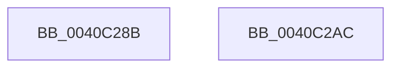

# sub_0040C28B

- RVA: `0x0040C28B`–`0x0040C2AD` (길이 `34` bytes)
- VA: `0x000000014040C28B`
- 실행 섹션: `.text`
- PDB 이름 있음: `아니요`; PDB Function 태그: `아니요`
- unwind 정보 RVA: `0x0009B0D4`
- 디코드: `11`개 명령, `34/34` bytes 표시
- 미해석 바이트: `0` (있으면 어셈블리에 `.byte`로 보존)

> 이 문서는 커널 이미지의 기계어와 PDB 기호를 분석해 생성했습니다. 4번과 5번은 함수 원형과 자료형을 바이너리 사용 방식에서 추정한 C 해석이며 원본 소스 복구 결과는 아닙니다.

## 1. Dependencies

- 직접 호출 지점: **0**; 고유 호출 대상: **0**
- 직접 호출자로 확인된 함수: **0**
- RIP 상대 이미지 참조: **0**

### Outgoing calls
- 직접 디코드된 call 명령이 없습니다.

### Direct callers
- 이 함수 시작 RVA로 연결되는 직접 call은 확인되지 않았습니다. 간접 호출은 완전히 역산할 수 없습니다.

### Static image references
- 디코드된 RIP-relative 메모리 참조가 없습니다.

## 2. Other-region calls and transfers

- 다른 실행 섹션으로 향하는 call: **0**
- 별도 외부 분기/꼬리 이동을 확인하지 못했습니다.

## 3. Assembly (complete function range)

```asm
0040C28B  66 44 2B C0                     sub r8w, ax
0040C28F  66 45 03 C0                     add r8w, r8w
0040C293  66 44 2B C1                     sub r8w, cx
0040C297  FF C0                           inc eax
0040C299  66 45 89 03                     mov word ptr [r11], r8w
0040C29D  66 45 89 43 02                  mov word ptr [r11 + 2], r8w
0040C2A2  49 8D 04 41                     lea rax, [r9 + rax*2]
0040C2A6  49 89 43 08                     mov qword ptr [r11 + 8], rax
0040C2AA  5B                              pop rbx
0040C2AB  C3                              ret
0040C2AC  CC                              int3
```

## 4. C-style interpretation (structured pseudocode)

```c
__int64 __fastcall sub_0040C28B(unsigned __int16 a1, __int64 a2, unsigned __int16 a3, __int64 a4)
{
    __int64 result;

    a3 = (unsigned __int16)((a3) - ((unsigned __int16)(result)));
    a3 = (unsigned __int16)((a3) + (a3));
    a3 = (unsigned __int16)((a3) - (a1));
    result = (unsigned int)((result) + 1);
    *(unsigned __int16 *)(v_r11) = a3;
    *(unsigned __int16 *)(v_r11 + 2) = a3;
    *(unsigned __int64 *)(v_r11 + 8) = a4 + result * 2;
    return a4 + result * 2;
}
```

## 5. (Beta) C Style

```c
int64_t sub_0040C28B(uint16_t Arg1, int64_t Arg2, uint16_t Arg3, void *Arg4)
{
    uint8_t *arg4 = (uint8_t *)Arg4;

    int64_t result;

    Arg3 = (uint16_t)((Arg3) - ((uint16_t)(result)));
    Arg3 = (uint16_t)((Arg3) + (Arg3));
    Arg3 = (uint16_t)((Arg3) - (Arg1));
    result = (uint32_t)((result) + 1);
    *(uint16_t *)(local_r11) = Arg3;
    *(uint16_t *)(local_r11 + 0x2) = Arg3;
    *(void **)(local_r11 + 0x8) = Arg4 + result * 2;
    return Arg4 + result * 2;
}
```

### 관측된 메모리 오프셋

구조체 형식이 확인되지 않은 접근은 인자 기준의 오프셋으로만 기록했습니다.

| 기준 인자 | 오프셋 표현 | 폭 (bit) | 접근 |
|---|---:|---:|---|
| `Arg4` | `+ 0x0 + rax*2` | `64` | `R` |

## 6. Execution-region graph

[열기: 2D/3D 그래프와 함수 탐색 컨트롤 패널](../../../control-panel.html?section=text&rva=0x0040C28B&view=graph)

- 2D 그래프는 위에서 아래로 흐르고, 3D 그래프는 빈 공간을 드래그해 회전합니다. Shift+드래그는 이동, 휠은 확대·축소, 함수 노드 선택은 대상 보고서 이동입니다.

### Static fallback


