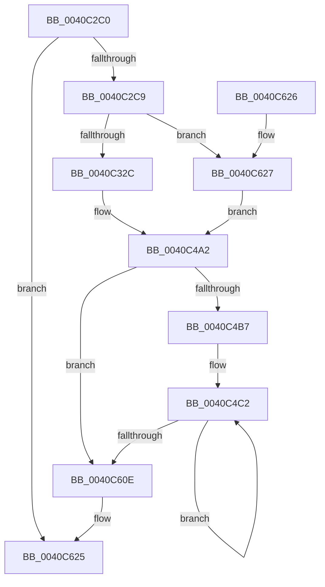

# sub_0040C2C0

- RVA: `0x0040C2C0`–`0x0040C635` (길이 `885` bytes)
- VA: `0x000000014040C2C0`
- 실행 섹션: `.text`
- PDB 이름 있음: `아니요`; PDB Function 태그: `아니요`
- unwind 정보 RVA: `0x0009B0E8`
- 디코드: `238`개 명령, `885/885` bytes 표시
- 미해석 바이트: `0` (있으면 어셈블리에 `.byte`로 보존)

> 이 문서는 커널 이미지의 기계어와 PDB 기호를 분석해 생성했습니다. 4번과 5번은 함수 원형과 자료형을 바이너리 사용 방식에서 추정한 C 해석이며 원본 소스 복구 결과는 아닙니다.

## 1. Dependencies

- 직접 호출 지점: **23**; 고유 호출 대상: **3**
- 직접 호출자로 확인된 함수: **2**
- RIP 상대 이미지 참조: **0**

### Outgoing calls
- `0x0040C337` → [sub_0040C9D0](Unknown_function_0040C9D0.md) (function, `0x0040C9D0`)
- `0x0040C357` → [sub_0040C9D0](Unknown_function_0040C9D0.md) (function, `0x0040C9D0`)
- `0x0040C36F` → [sub_0040C9D0](Unknown_function_0040C9D0.md) (function, `0x0040C9D0`)
- `0x0040C386` → [sub_0040C9D0](Unknown_function_0040C9D0.md) (function, `0x0040C9D0`)
- `0x0040C39D` → [sub_0040C9D0](Unknown_function_0040C9D0.md) (function, `0x0040C9D0`)
- `0x0040C3B4` → [sub_0040C9D0](Unknown_function_0040C9D0.md) (function, `0x0040C9D0`)
- `0x0040C3CB` → [sub_0040C9D0](Unknown_function_0040C9D0.md) (function, `0x0040C9D0`)
- `0x0040C3E2` → [sub_0040C9D0](Unknown_function_0040C9D0.md) (function, `0x0040C9D0`)
- `0x0040C3F9` → [sub_0040C9D0](Unknown_function_0040C9D0.md) (function, `0x0040C9D0`)
- `0x0040C40D` → [sub_0040C9D0](Unknown_function_0040C9D0.md) (function, `0x0040C9D0`)
- `0x0040C434` → [memcpy](../6C/memcpy_function_006C6840.md) (function, `0x006C6840`)
- `0x0040C469` → [memset](../6C/memset_function_006C6C40.md) (function, `0x006C6C40`)
- `0x0040C47E` → [memcpy](../6C/memcpy_function_006C6840.md) (function, `0x006C6840`)
- `0x0040C4D4` → [sub_0040C9D0](Unknown_function_0040C9D0.md) (function, `0x0040C9D0`)
- `0x0040C4F3` → [sub_0040C9D0](Unknown_function_0040C9D0.md) (function, `0x0040C9D0`)
- `0x0040C510` → [sub_0040C9D0](Unknown_function_0040C9D0.md) (function, `0x0040C9D0`)
- `0x0040C531` → [sub_0040C9D0](Unknown_function_0040C9D0.md) (function, `0x0040C9D0`)
- `0x0040C54A` → [sub_0040C9D0](Unknown_function_0040C9D0.md) (function, `0x0040C9D0`)
- `0x0040C562` → [sub_0040C9D0](Unknown_function_0040C9D0.md) (function, `0x0040C9D0`)
- `0x0040C57B` → [sub_0040C9D0](Unknown_function_0040C9D0.md) (function, `0x0040C9D0`)
- `0x0040C594` → [sub_0040C9D0](Unknown_function_0040C9D0.md) (function, `0x0040C9D0`)
- `0x0040C5AC` → [sub_0040C9D0](Unknown_function_0040C9D0.md) (function, `0x0040C9D0`)
- `0x0040C5CA` → [sub_0040C9D0](Unknown_function_0040C9D0.md) (function, `0x0040C9D0`)

### Direct callers
- [sub_009A11E0](../../page/9A/Unknown_function_009A11E0.md) at `0x009A1340`
- [sub_00A34F4C](../../page/A3/Unknown_function_00A34F4C.md) at `0x00A35013`

### Static image references
- 디코드된 RIP-relative 메모리 참조가 없습니다.

## 2. Other-region calls and transfers

- 다른 실행 섹션으로 향하는 call: **0**
- 별도 외부 분기/꼬리 이동을 확인하지 못했습니다.

## 3. Assembly (complete function range)

```asm
0040C2C0  45 85 C9                        test r9d, r9d
0040C2C3  0F 84 5C 03 00 00               je 0x14040c625
0040C2C9  48 89 5C 24 10                  mov qword ptr [rsp + 0x10], rbx
0040C2CE  4C 89 44 24 18                  mov qword ptr [rsp + 0x18], r8
0040C2D3  48 89 4C 24 08                  mov qword ptr [rsp + 8], rcx
0040C2D8  55                              push rbp
0040C2D9  56                              push rsi
0040C2DA  57                              push rdi
0040C2DB  41 54                           push r12
0040C2DD  41 55                           push r13
0040C2DF  41 56                           push r14
0040C2E1  41 57                           push r15
0040C2E3  48 83 EC 40                     sub rsp, 0x40
0040C2E7  44 8B AC 24 A8 00 00 00         mov r13d, dword ptr [rsp + 0xa8]
0040C2EF  41 8D 41 FF                     lea eax, [r9 - 1]
0040C2F3  44 8A 1C 10                     mov r11b, byte ptr [rax + rdx]
0040C2F7  45 8B FD                        mov r15d, r13d
0040C2FA  48 8B 84 24 B0 00 00 00         mov rax, qword ptr [rsp + 0xb0]
0040C302  45 8B F1                        mov r14d, r9d
0040C305  48 8B BC 24 A0 00 00 00         mov rdi, qword ptr [rsp + 0xa0]
0040C30D  4C 8B E2                        mov r12, rdx
0040C310  48 8B E9                        mov rbp, rcx
0040C313  41 F7 D7                        not r15d
0040C316  44 88 18                        mov byte ptr [rax], r11b
0040C319  41 8B C1                        mov eax, r9d
0040C31C  83 E0 07                        and eax, 7
0040C31F  89 84 24 98 00 00 00            mov dword ptr [rsp + 0x98], eax
0040C326  0F 84 FB 02 00 00               je 0x14040c627
0040C32C  45 8B CD                        mov r9d, r13d
0040C32F  4C 8B C7                        mov r8, rdi
0040C332  BA 09 00 00 00                  mov edx, 9
0040C337  E8 94 06 00 00                  call 0x14040c9d0
0040C33C  8B D8                           mov ebx, eax
0040C33E  4C 8B C7                        mov r8, rdi
0040C341  41 33 DF                        xor ebx, r15d
0040C344  BA 08 00 00 00                  mov edx, 8
0040C349  4C 8B BC 24 80 00 00 00         mov r15, qword ptr [rsp + 0x80]
0040C351  44 8B CB                        mov r9d, ebx
0040C354  49 8B CF                        mov rcx, r15
0040C357  E8 74 06 00 00                  call 0x14040c9d0
0040C35C  8B F0                           mov esi, eax
0040C35E  4C 8B C7                        mov r8, rdi
0040C361  41 33 F5                        xor esi, r13d
0040C364  BA 07 00 00 00                  mov edx, 7
0040C369  44 8B CE                        mov r9d, esi
0040C36C  49 8B CF                        mov rcx, r15
0040C36F  E8 5C 06 00 00                  call 0x14040c9d0
0040C374  8B E8                           mov ebp, eax
0040C376  4C 8B C7                        mov r8, rdi
0040C379  33 EB                           xor ebp, ebx
0040C37B  BA 06 00 00 00                  mov edx, 6
0040C380  44 8B CD                        mov r9d, ebp
0040C383  49 8B CF                        mov rcx, r15
0040C386  E8 45 06 00 00                  call 0x14040c9d0
0040C38B  8B D8                           mov ebx, eax
0040C38D  4C 8B C7                        mov r8, rdi
0040C390  33 DE                           xor ebx, esi
0040C392  BA 05 00 00 00                  mov edx, 5
0040C397  44 8B CB                        mov r9d, ebx
0040C39A  49 8B CF                        mov rcx, r15
0040C39D  E8 2E 06 00 00                  call 0x14040c9d0
0040C3A2  8B F0                           mov esi, eax
0040C3A4  4C 8B C7                        mov r8, rdi
0040C3A7  33 F5                           xor esi, ebp
0040C3A9  BA 04 00 00 00                  mov edx, 4
0040C3AE  44 8B CE                        mov r9d, esi
0040C3B1  49 8B CF                        mov rcx, r15
0040C3B4  E8 17 06 00 00                  call 0x14040c9d0
0040C3B9  8B E8                           mov ebp, eax
0040C3BB  4C 8B C7                        mov r8, rdi
0040C3BE  33 EB                           xor ebp, ebx
0040C3C0  BA 03 00 00 00                  mov edx, 3
0040C3C5  44 8B CD                        mov r9d, ebp
0040C3C8  49 8B CF                        mov rcx, r15
0040C3CB  E8 00 06 00 00                  call 0x14040c9d0
0040C3D0  8B D8                           mov ebx, eax
0040C3D2  4C 8B C7                        mov r8, rdi
0040C3D5  33 DE                           xor ebx, esi
0040C3D7  BA 02 00 00 00                  mov edx, 2
0040C3DC  44 8B CB                        mov r9d, ebx
0040C3DF  49 8B CF                        mov rcx, r15
0040C3E2  E8 E9 05 00 00                  call 0x14040c9d0
0040C3E7  8B F0                           mov esi, eax
0040C3E9  4C 8B C7                        mov r8, rdi
0040C3EC  33 F5                           xor esi, ebp
0040C3EE  BA 01 00 00 00                  mov edx, 1
0040C3F3  44 8B CE                        mov r9d, esi
0040C3F6  49 8B CF                        mov rcx, r15
0040C3F9  E8 D2 05 00 00                  call 0x14040c9d0
0040C3FE  8B E8                           mov ebp, eax
0040C400  4C 8B C7                        mov r8, rdi
0040C403  33 EB                           xor ebp, ebx
0040C405  33 D2                           xor edx, edx
0040C407  44 8B CD                        mov r9d, ebp
0040C40A  49 8B CF                        mov rcx, r15
0040C40D  E8 BE 05 00 00                  call 0x14040c9d0
0040C412  44 8B BC 24 98 00 00 00         mov r15d, dword ptr [rsp + 0x98]
0040C41A  48 8D 4C 24 28                  lea rcx, [rsp + 0x28]
0040C41F  48 83 64 24 28 00               and qword ptr [rsp + 0x28], 0
0040C425  8B D8                           mov ebx, eax
0040C427  45 8B C7                        mov r8d, r15d
0040C42A  4C 89 7C 24 30                  mov qword ptr [rsp + 0x30], r15
0040C42F  49 8B D4                        mov rdx, r12
0040C432  33 DE                           xor ebx, esi
0040C434  E8 07 A4 2B 00                  call 0x1406c6840
0040C439  48 8B 74 24 28                  mov rsi, qword ptr [rsp + 0x28]
0040C43E  33 EE                           xor ebp, esi
0040C440  48 8B CE                        mov rcx, rsi
0040C443  89 6C 24 20                     mov dword ptr [rsp + 0x20], ebp
0040C447  48 C1 E9 20                     shr rcx, 0x20
0040C44B  41 B8 08 00 00 00               mov r8d, 8
0040C451  33 CB                           xor ecx, ebx
0040C453  48 89 74 24 28                  mov qword ptr [rsp + 0x28], rsi
0040C458  89 4C 24 24                     mov dword ptr [rsp + 0x24], ecx
0040C45C  45 2B C7                        sub r8d, r15d
0040C45F  48 8D 4C 24 20                  lea rcx, [rsp + 0x20]
0040C464  33 D2                           xor edx, edx
0040C466  49 03 CF                        add rcx, r15
0040C469  E8 D2 A7 2B 00                  call 0x1406c6c40
0040C46E  48 8B 8C 24 90 00 00 00         mov rcx, qword ptr [rsp + 0x90]
0040C476  48 8D 54 24 20                  lea rdx, [rsp + 0x20]
0040C47B  45 8B C7                        mov r8d, r15d
0040C47E  E8 BD A3 2B 00                  call 0x1406c6840
0040C483  4C 8B 84 24 90 00 00 00         mov r8, qword ptr [rsp + 0x90]
0040C48B  48 8B 44 24 30                  mov rax, qword ptr [rsp + 0x30]
0040C490  44 8B 6C 24 24                  mov r13d, dword ptr [rsp + 0x24]
0040C495  44 8B 7C 24 20                  mov r15d, dword ptr [rsp + 0x20]
0040C49A  48 8B AC 24 80 00 00 00         mov rbp, qword ptr [rsp + 0x80]
0040C4A2  49 03 C0                        add rax, r8
0040C4A5  41 C1 EE 03                     shr r14d, 3
0040C4A9  48 89 44 24 20                  mov qword ptr [rsp + 0x20], rax
0040C4AE  45 85 F6                        test r14d, r14d
0040C4B1  0F 84 57 01 00 00               je 0x14040c60e
0040C4B7  41 8B CE                        mov ecx, r14d
0040C4BA  4D 2B E0                        sub r12, r8
0040C4BD  48 89 4C 24 30                  mov qword ptr [rsp + 0x30], rcx
0040C4C2  49 8B 1C 04                     mov rbx, qword ptr [r12 + rax]
0040C4C6  4C 8B C7                        mov r8, rdi
0040C4C9  44 33 FB                        xor r15d, ebx
0040C4CC  33 D2                           xor edx, edx
0040C4CE  45 8B CF                        mov r9d, r15d
0040C4D1  48 8B CD                        mov rcx, rbp
0040C4D4  E8 F7 04 00 00                  call 0x14040c9d0
0040C4D9  48 8B CB                        mov rcx, rbx
0040C4DC  4C 8B C7                        mov r8, rdi
0040C4DF  48 C1 E9 20                     shr rcx, 0x20
0040C4E3  BA 01 00 00 00                  mov edx, 1
0040C4E8  33 C1                           xor eax, ecx
0040C4EA  48 8B CD                        mov rcx, rbp
0040C4ED  44 33 E8                        xor r13d, eax
0040C4F0  45 8B CD                        mov r9d, r13d
0040C4F3  E8 D8 04 00 00                  call 0x14040c9d0
0040C4F8  48 8B 8C 24 80 00 00 00         mov rcx, qword ptr [rsp + 0x80]
0040C500  8B E8                           mov ebp, eax
0040C502  41 33 EF                        xor ebp, r15d
0040C505  4C 8B C7                        mov r8, rdi
0040C508  44 8B CD                        mov r9d, ebp
0040C50B  BA 02 00 00 00                  mov edx, 2
0040C510  E8 BB 04 00 00                  call 0x14040c9d0
0040C515  44 8B F0                        mov r14d, eax
0040C518  4C 8B C7                        mov r8, rdi
0040C51B  45 33 F5                        xor r14d, r13d
0040C51E  BA 03 00 00 00                  mov edx, 3
0040C523  4C 8B AC 24 80 00 00 00         mov r13, qword ptr [rsp + 0x80]
0040C52B  45 8B CE                        mov r9d, r14d
0040C52E  49 8B CD                        mov rcx, r13
0040C531  E8 9A 04 00 00                  call 0x14040c9d0
0040C536  44 8B F8                        mov r15d, eax
0040C539  4C 8B C7                        mov r8, rdi
0040C53C  44 33 FD                        xor r15d, ebp
0040C53F  BA 04 00 00 00                  mov edx, 4
0040C544  45 8B CF                        mov r9d, r15d
0040C547  49 8B CD                        mov rcx, r13
0040C54A  E8 81 04 00 00                  call 0x14040c9d0
0040C54F  8B E8                           mov ebp, eax
0040C551  4C 8B C7                        mov r8, rdi
0040C554  41 33 EE                        xor ebp, r14d
0040C557  BA 05 00 00 00                  mov edx, 5
0040C55C  44 8B CD                        mov r9d, ebp
0040C55F  49 8B CD                        mov rcx, r13
0040C562  E8 69 04 00 00                  call 0x14040c9d0
0040C567  44 8B F0                        mov r14d, eax
0040C56A  4C 8B C7                        mov r8, rdi
0040C56D  45 33 F7                        xor r14d, r15d
0040C570  BA 06 00 00 00                  mov edx, 6
0040C575  45 8B CE                        mov r9d, r14d
0040C578  49 8B CD                        mov rcx, r13
0040C57B  E8 50 04 00 00                  call 0x14040c9d0
0040C580  44 8B F8                        mov r15d, eax
0040C583  4C 8B C7                        mov r8, rdi
0040C586  44 33 FD                        xor r15d, ebp
0040C589  BA 07 00 00 00                  mov edx, 7
0040C58E  45 8B CF                        mov r9d, r15d
0040C591  49 8B CD                        mov rcx, r13
0040C594  E8 37 04 00 00                  call 0x14040c9d0
0040C599  8B E8                           mov ebp, eax
0040C59B  4C 8B C7                        mov r8, rdi
0040C59E  41 33 EE                        xor ebp, r14d
0040C5A1  BA 08 00 00 00                  mov edx, 8
0040C5A6  44 8B CD                        mov r9d, ebp
0040C5A9  49 8B CD                        mov rcx, r13
0040C5AC  E8 1F 04 00 00                  call 0x14040c9d0
0040C5B1  48 8B 8C 24 80 00 00 00         mov rcx, qword ptr [rsp + 0x80]
0040C5B9  44 8B E8                        mov r13d, eax
0040C5BC  45 33 EF                        xor r13d, r15d
0040C5BF  4C 8B C7                        mov r8, rdi
0040C5C2  45 8B CD                        mov r9d, r13d
0040C5C5  BA 09 00 00 00                  mov edx, 9
0040C5CA  E8 01 04 00 00                  call 0x14040c9d0
0040C5CF  44 8B F8                        mov r15d, eax
0040C5D2  48 8B 44 24 20                  mov rax, qword ptr [rsp + 0x20]
0040C5D7  44 33 FD                        xor r15d, ebp
0040C5DA  44 33 FE                        xor r15d, esi
0040C5DD  48 8B F3                        mov rsi, rbx
0040C5E0  44 33 6C 24 2C                  xor r13d, dword ptr [rsp + 0x2c]
0040C5E5  48 89 5C 24 28                  mov qword ptr [rsp + 0x28], rbx
0040C5EA  44 89 38                        mov dword ptr [rax], r15d
0040C5ED  48 8B AC 24 80 00 00 00         mov rbp, qword ptr [rsp + 0x80]
0040C5F5  44 89 68 04                     mov dword ptr [rax + 4], r13d
0040C5F9  48 83 C0 08                     add rax, 8
0040C5FD  48 83 6C 24 30 01               sub qword ptr [rsp + 0x30], 1
0040C603  48 89 44 24 20                  mov qword ptr [rsp + 0x20], rax
0040C608  0F 85 B4 FE FF FF               jne 0x14040c4c2
0040C60E  48 8B 9C 24 88 00 00 00         mov rbx, qword ptr [rsp + 0x88]
0040C616  48 83 C4 40                     add rsp, 0x40
0040C61A  41 5F                           pop r15
0040C61C  41 5E                           pop r14
0040C61E  41 5D                           pop r13
0040C620  41 5C                           pop r12
0040C622  5F                              pop rdi
0040C623  5E                              pop rsi
0040C624  5D                              pop rbp
0040C625  C3                              ret
0040C626  CC                              int3
0040C627  33 F6                           xor esi, esi
0040C629  48 89 74 24 28                  mov qword ptr [rsp + 0x28], rsi
0040C62E  33 C0                           xor eax, eax
0040C630  E9 6D FE FF FF                  jmp 0x14040c4a2
```

## 4. C-style interpretation (structured pseudocode)

```c
__int64 __fastcall sub_0040C2C0(__int64 a1, __int64 a2, __int64 a3, __int64 a4, __int64 a5, unsigned int a6, __int64 a7)
{
    __int64 result;
    __int64 v_r12;
    __int64 v_r13;
    __int64 v_r14;
    __int64 v_r15;
    __int64 v_rbp;
    __int64 v_rbx;
    __int64 v_rsi;
    __int64 v_rsp;
    unsigned __int64 v_stack_m48;
    unsigned int v_stack_m4C;
    unsigned __int64 v_stack_m50;
    unsigned int v_stack_m54;
    unsigned int v_stack_m58;
    unsigned __int64 v_stack_p10;
    unsigned __int64 v_stack_p18;
    unsigned int v_stack_p20;
    unsigned __int64 v_stack_p28;
    unsigned __int64 v_stack_p8;

    if ((unsigned int)(a4) == 0) goto loc_0040C625;
    v_stack_p10 = v_rbx;
    v_stack_p18 = a3;
    v_stack_p8 = a1;
    v_rsp = (v_rsp) - (64);
    v_r15 = (unsigned int)(~((unsigned int)((unsigned int)((unsigned int)(a6)))));
    *(unsigned __int8 *)(a7) = (unsigned __int8)(*(unsigned __int8 *)(a4 - 1 + a2 * 1));
    result = (unsigned int)(((unsigned int)((unsigned int)(a4))) & (7));
    v_stack_p20 = (unsigned int)(result);
    if (condition_is_equal) goto loc_0040C627;
    result = sub_0040C9D0(a1, 9, a5, (unsigned int)((unsigned int)((unsigned int)(a6))));
    v_rbx = (unsigned int)(((unsigned int)((unsigned int)(result))) ^ ((unsigned int)(v_r15)));
    result = sub_0040C9D0(v_stack_p8, 8, a5, (unsigned int)((unsigned int)(v_rbx)));
    v_rsi = (unsigned int)(((unsigned int)((unsigned int)(result))) ^ ((unsigned int)((unsigned int)(a6))));
    result = sub_0040C9D0(v_stack_p8, 7, a5, (unsigned int)((unsigned int)(v_rsi)));
    v_rbp = (unsigned int)(((unsigned int)((unsigned int)(result))) ^ ((unsigned int)(v_rbx)));
    result = sub_0040C9D0(v_stack_p8, 6, a5, (unsigned int)((unsigned int)(v_rbp)));
    v_rbx = (unsigned int)(((unsigned int)((unsigned int)(result))) ^ ((unsigned int)(v_rsi)));
    result = sub_0040C9D0(v_stack_p8, 5, a5, (unsigned int)((unsigned int)(v_rbx)));
    v_rsi = (unsigned int)(((unsigned int)((unsigned int)(result))) ^ ((unsigned int)(v_rbp)));
    result = sub_0040C9D0(v_stack_p8, 4, a5, (unsigned int)((unsigned int)(v_rsi)));
    v_rbp = (unsigned int)(((unsigned int)((unsigned int)(result))) ^ ((unsigned int)(v_rbx)));
    result = sub_0040C9D0(v_stack_p8, 3, a5, (unsigned int)((unsigned int)(v_rbp)));
    v_rbx = (unsigned int)(((unsigned int)((unsigned int)(result))) ^ ((unsigned int)(v_rsi)));
    result = sub_0040C9D0(v_stack_p8, 2, a5, (unsigned int)((unsigned int)(v_rbx)));
    v_rsi = (unsigned int)(((unsigned int)((unsigned int)(result))) ^ ((unsigned int)(v_rbp)));
    result = sub_0040C9D0(v_stack_p8, 1, a5, (unsigned int)((unsigned int)(v_rsi)));
    v_rbp = (unsigned int)(((unsigned int)((unsigned int)(result))) ^ ((unsigned int)(v_rbx)));
    a2 = 0;
    result = sub_0040C9D0(v_stack_p8, a2, a5, (unsigned int)((unsigned int)(v_rbp)));
    v_stack_m48 = (unsigned int)(v_stack_p20);
    v_rbx = (unsigned int)(((unsigned int)((unsigned int)(result))) ^ ((unsigned int)(v_rsi)));
    result = memcpy(v_stack_m50, 0, (unsigned int)((unsigned int)((unsigned int)(v_stack_p20))), (unsigned int)((unsigned int)(v_rbp)));
    v_rbp = (unsigned int)((v_rbp) ^ ((unsigned int)(v_stack_m50)));
    v_stack_m58 = (unsigned int)(v_rbp);
    a1 = (v_stack_m50) >> (32);
    a1 = (unsigned int)((a1) ^ ((unsigned int)(v_rbx)));
    v_stack_m50 = v_stack_m50;
    v_stack_m54 = (unsigned int)(a1);
    a3 = (unsigned int)((8) - ((unsigned int)((unsigned int)(v_stack_p20))));
    a2 = 0;
    a1 = (v_stack_m58) + ((unsigned int)(v_stack_p20));
    result = memset(a1, a2, a3, (unsigned int)((unsigned int)(v_rbp)));
    result = memcpy(v_stack_p18, v_stack_m58, (unsigned int)((unsigned int)((unsigned int)(v_stack_p20))), (unsigned int)((unsigned int)(v_rbp)));
loc_0040C4A2:
    result = (v_stack_m48) + (v_stack_p18);
    v_r14 = (unsigned int)(((unsigned int)((unsigned int)(a4))) >> (3));
    v_stack_m58 = result;
    if ((unsigned int)(v_r14) == 0) goto loc_0040C60E;
    v_r12 = (a2) - (v_stack_p18);
    v_stack_m48 = (unsigned int)((unsigned int)(v_r14));
loc_0040C4C2:
    v_r15 = (unsigned int)(((unsigned int)(v_stack_m58)) ^ ((unsigned int)(*(unsigned __int64 *)(v_r12 + result * 1))));
    a2 = 0;
    result = sub_0040C9D0(v_stack_p8, a2, a5, (unsigned int)((unsigned int)(v_r15)));
    a1 = (*(unsigned __int64 *)(v_r12 + result * 1)) >> (32);
    result = (unsigned int)((result) ^ ((unsigned int)(a1)));
    v_r13 = (unsigned int)(((unsigned int)(v_stack_m54)) ^ ((unsigned int)(result)));
    result = sub_0040C9D0(v_stack_p8, 1, a5, (unsigned int)((unsigned int)(v_r13)));
    v_rbp = (unsigned int)(((unsigned int)((unsigned int)(result))) ^ ((unsigned int)(v_r15)));
    result = sub_0040C9D0(v_stack_p8, 2, a5, (unsigned int)((unsigned int)(v_rbp)));
    v_r14 = (unsigned int)(((unsigned int)((unsigned int)(result))) ^ ((unsigned int)(v_r13)));
    result = sub_0040C9D0(v_stack_p8, 3, a5, (unsigned int)((unsigned int)(v_r14)));
    v_r15 = (unsigned int)(((unsigned int)((unsigned int)(result))) ^ ((unsigned int)(v_rbp)));
    result = sub_0040C9D0(v_stack_p8, 4, a5, (unsigned int)((unsigned int)(v_r15)));
    v_rbp = (unsigned int)(((unsigned int)((unsigned int)(result))) ^ ((unsigned int)(v_r14)));
    result = sub_0040C9D0(v_stack_p8, 5, a5, (unsigned int)((unsigned int)(v_rbp)));
    v_r14 = (unsigned int)(((unsigned int)((unsigned int)(result))) ^ ((unsigned int)(v_r15)));
    result = sub_0040C9D0(v_stack_p8, 6, a5, (unsigned int)((unsigned int)(v_r14)));
    v_r15 = (unsigned int)(((unsigned int)((unsigned int)(result))) ^ ((unsigned int)(v_rbp)));
    result = sub_0040C9D0(v_stack_p8, 7, a5, (unsigned int)((unsigned int)(v_r15)));
    v_rbp = (unsigned int)(((unsigned int)((unsigned int)(result))) ^ ((unsigned int)(v_r14)));
    result = sub_0040C9D0(v_stack_p8, 8, a5, (unsigned int)((unsigned int)(v_rbp)));
    v_r13 = (unsigned int)(((unsigned int)((unsigned int)(result))) ^ ((unsigned int)(v_r15)));
    result = sub_0040C9D0(v_stack_p8, 9, a5, (unsigned int)((unsigned int)(v_r13)));
    v_r15 = (unsigned int)(((unsigned int)((unsigned int)(result))) ^ ((unsigned int)(v_rbp)));
    v_r15 = (unsigned int)((v_r15) ^ ((unsigned int)(v_stack_m50)));
    v_r13 = (unsigned int)((v_r13) ^ (v_stack_m4C));
    v_stack_m50 = *(unsigned __int64 *)(v_r12 + result * 1);
    *(unsigned int *)(v_stack_m58) = (unsigned int)(v_r15);
    *(unsigned int *)(v_stack_m58 + 4) = (unsigned int)(v_r13);
    result = (v_stack_m58) + (8);
    v_stack_m58 = result;
    if (condition_is_not_equal) goto loc_0040C4C2;
loc_0040C60E:
    v_rsp = (v_rsp) + (64);
loc_0040C625:
    return result;
loc_0040C627:
    v_rsi = 0;
    v_stack_p28 = 0;
    result = 0;
    goto loc_0040C4A2;
}
```

## 5. (Beta) C Style

```c
int64_t sub_0040C2C0(int64_t Arg1, void *Arg2, int64_t Arg3, int64_t Arg4, int64_t Arg5, uint32_t Arg6, void *Arg7)
{
    uint8_t *arg2 = (uint8_t *)Arg2;
    uint8_t *arg7 = (uint8_t *)Arg7;

    int64_t result;
    int64_t local_r12;
    int64_t local_r13;
    int64_t local_r14;
    int64_t local_r15;
    int64_t local_rbp;
    int64_t local_rbx;
    int64_t local_rsi;
    int64_t local_rsp;
    uint64_t v_stack_m48;
    uint32_t v_stack_m4C;
    uint64_t v_stack_m50;
    uint32_t v_stack_m54;
    uint32_t v_stack_m58;
    uint64_t v_stack_p10;
    uint64_t v_stack_p18;
    uint32_t v_stack_p20;
    uint64_t v_stack_p28;
    uint64_t v_stack_p8;

    if ((uint32_t)(Arg4) == 0) goto loc_0040C625;
    v_stack_p10 = local_rbx;
    v_stack_p18 = Arg3;
    v_stack_p8 = Arg1;
    local_rsp = (local_rsp) - (64);
    local_r15 = (uint32_t)(~((uint32_t)((uint32_t)((uint32_t)(Arg6)))));
    *(uint8_t *)(arg7) = (uint8_t)(*(uint8_t *)(Arg4 - 0x1 + arg2 * 1));
    result = (uint32_t)(((uint32_t)((uint32_t)(Arg4))) & (7));
    v_stack_p20 = (uint32_t)(result);
    if (condition_is_equal) goto loc_0040C627;
    result = sub_0040C9D0(Arg1, 9, Arg5, (uint32_t)((uint32_t)((uint32_t)(Arg6))));
    local_rbx = (uint32_t)(((uint32_t)((uint32_t)(result))) ^ ((uint32_t)(local_r15)));
    result = sub_0040C9D0(v_stack_p8, 8, Arg5, (uint32_t)((uint32_t)(local_rbx)));
    local_rsi = (uint32_t)(((uint32_t)((uint32_t)(result))) ^ ((uint32_t)((uint32_t)(Arg6))));
    result = sub_0040C9D0(v_stack_p8, 7, Arg5, (uint32_t)((uint32_t)(local_rsi)));
    local_rbp = (uint32_t)(((uint32_t)((uint32_t)(result))) ^ ((uint32_t)(local_rbx)));
    result = sub_0040C9D0(v_stack_p8, 6, Arg5, (uint32_t)((uint32_t)(local_rbp)));
    local_rbx = (uint32_t)(((uint32_t)((uint32_t)(result))) ^ ((uint32_t)(local_rsi)));
    result = sub_0040C9D0(v_stack_p8, 5, Arg5, (uint32_t)((uint32_t)(local_rbx)));
    local_rsi = (uint32_t)(((uint32_t)((uint32_t)(result))) ^ ((uint32_t)(local_rbp)));
    result = sub_0040C9D0(v_stack_p8, 4, Arg5, (uint32_t)((uint32_t)(local_rsi)));
    local_rbp = (uint32_t)(((uint32_t)((uint32_t)(result))) ^ ((uint32_t)(local_rbx)));
    result = sub_0040C9D0(v_stack_p8, 3, Arg5, (uint32_t)((uint32_t)(local_rbp)));
    local_rbx = (uint32_t)(((uint32_t)((uint32_t)(result))) ^ ((uint32_t)(local_rsi)));
    result = sub_0040C9D0(v_stack_p8, 2, Arg5, (uint32_t)((uint32_t)(local_rbx)));
    local_rsi = (uint32_t)(((uint32_t)((uint32_t)(result))) ^ ((uint32_t)(local_rbp)));
    result = sub_0040C9D0(v_stack_p8, 1, Arg5, (uint32_t)((uint32_t)(local_rsi)));
    local_rbp = (uint32_t)(((uint32_t)((uint32_t)(result))) ^ ((uint32_t)(local_rbx)));
    Arg2 = 0;
    result = sub_0040C9D0(v_stack_p8, Arg2, Arg5, (uint32_t)((uint32_t)(local_rbp)));
    v_stack_m48 = (uint32_t)(v_stack_p20);
    local_rbx = (uint32_t)(((uint32_t)((uint32_t)(result))) ^ ((uint32_t)(local_rsi)));
    result = memcpy(v_stack_m50, 0, (uint32_t)((uint32_t)((uint32_t)(v_stack_p20))), (uint32_t)((uint32_t)(local_rbp)));
    local_rbp = (uint32_t)((local_rbp) ^ ((uint32_t)(v_stack_m50)));
    v_stack_m58 = (uint32_t)(local_rbp);
    Arg1 = (v_stack_m50) >> (32);
    Arg1 = (uint32_t)((Arg1) ^ ((uint32_t)(local_rbx)));
    v_stack_m50 = v_stack_m50;
    v_stack_m54 = (uint32_t)(Arg1);
    Arg3 = (uint32_t)((8) - ((uint32_t)((uint32_t)(v_stack_p20))));
    Arg2 = 0;
    Arg1 = (v_stack_m58) + ((uint32_t)(v_stack_p20));
    result = memset(Arg1, Arg2, Arg3, (uint32_t)((uint32_t)(local_rbp)));
    result = memcpy(v_stack_p18, v_stack_m58, (uint32_t)((uint32_t)((uint32_t)(v_stack_p20))), (uint32_t)((uint32_t)(local_rbp)));
loc_0040C4A2:
    result = (v_stack_m48) + (v_stack_p18);
    local_r14 = (uint32_t)(((uint32_t)((uint32_t)(Arg4))) >> (3));
    v_stack_m58 = result;
    if ((uint32_t)(local_r14) == 0) goto loc_0040C60E;
    local_r12 = (Arg2) - (v_stack_p18);
    v_stack_m48 = (uint32_t)((uint32_t)(local_r14));
loc_0040C4C2:
    local_r15 = (uint32_t)(((uint32_t)(v_stack_m58)) ^ ((uint32_t)(*(uint64_t *)(local_r12 + result * 1))));
    Arg2 = 0;
    result = sub_0040C9D0(v_stack_p8, Arg2, Arg5, (uint32_t)((uint32_t)(local_r15)));
    Arg1 = (*(uint64_t *)(local_r12 + result * 1)) >> (32);
    result = (uint32_t)((result) ^ ((uint32_t)(Arg1)));
    local_r13 = (uint32_t)(((uint32_t)(v_stack_m54)) ^ ((uint32_t)(result)));
    result = sub_0040C9D0(v_stack_p8, 1, Arg5, (uint32_t)((uint32_t)(local_r13)));
    local_rbp = (uint32_t)(((uint32_t)((uint32_t)(result))) ^ ((uint32_t)(local_r15)));
    result = sub_0040C9D0(v_stack_p8, 2, Arg5, (uint32_t)((uint32_t)(local_rbp)));
    local_r14 = (uint32_t)(((uint32_t)((uint32_t)(result))) ^ ((uint32_t)(local_r13)));
    result = sub_0040C9D0(v_stack_p8, 3, Arg5, (uint32_t)((uint32_t)(local_r14)));
    local_r15 = (uint32_t)(((uint32_t)((uint32_t)(result))) ^ ((uint32_t)(local_rbp)));
    result = sub_0040C9D0(v_stack_p8, 4, Arg5, (uint32_t)((uint32_t)(local_r15)));
    local_rbp = (uint32_t)(((uint32_t)((uint32_t)(result))) ^ ((uint32_t)(local_r14)));
    result = sub_0040C9D0(v_stack_p8, 5, Arg5, (uint32_t)((uint32_t)(local_rbp)));
    local_r14 = (uint32_t)(((uint32_t)((uint32_t)(result))) ^ ((uint32_t)(local_r15)));
    result = sub_0040C9D0(v_stack_p8, 6, Arg5, (uint32_t)((uint32_t)(local_r14)));
    local_r15 = (uint32_t)(((uint32_t)((uint32_t)(result))) ^ ((uint32_t)(local_rbp)));
    result = sub_0040C9D0(v_stack_p8, 7, Arg5, (uint32_t)((uint32_t)(local_r15)));
    local_rbp = (uint32_t)(((uint32_t)((uint32_t)(result))) ^ ((uint32_t)(local_r14)));
    result = sub_0040C9D0(v_stack_p8, 8, Arg5, (uint32_t)((uint32_t)(local_rbp)));
    local_r13 = (uint32_t)(((uint32_t)((uint32_t)(result))) ^ ((uint32_t)(local_r15)));
    result = sub_0040C9D0(v_stack_p8, 9, Arg5, (uint32_t)((uint32_t)(local_r13)));
    local_r15 = (uint32_t)(((uint32_t)((uint32_t)(result))) ^ ((uint32_t)(local_rbp)));
    local_r15 = (uint32_t)((local_r15) ^ ((uint32_t)(v_stack_m50)));
    local_r13 = (uint32_t)((local_r13) ^ (v_stack_m4C));
    v_stack_m50 = *(uint64_t *)(local_r12 + result * 1);
    *(uint32_t *)(v_stack_m58) = (uint32_t)(local_r15);
    *(uint32_t *)(v_stack_m58 + 0x4) = (uint32_t)(local_r13);
    result = (v_stack_m58) + (8);
    v_stack_m58 = result;
    if (condition_is_not_equal) goto loc_0040C4C2;
loc_0040C60E:
    local_rsp = (local_rsp) + (64);
loc_0040C625:
    return result;
loc_0040C627:
    local_rsi = 0;
    v_stack_p28 = 0;
    result = 0;
    goto loc_0040C4A2;
}
```

### 관측된 메모리 오프셋

구조체 형식이 확인되지 않은 접근은 인자 기준의 오프셋으로만 기록했습니다.

| 기준 인자 | 오프셋 표현 | 폭 (bit) | 접근 |
|---|---:|---:|---|
| `Arg2` | `+ 0x0 + rax*1` | `64` | `R` |
| `Arg7` | `+ 0x0` | `8` | `W` |

## 6. Execution-region graph

[열기: 2D/3D 그래프와 함수 탐색 컨트롤 패널](../../../control-panel.html?section=text&rva=0x0040C2C0&view=graph)

- 2D 그래프는 위에서 아래로 흐르고, 3D 그래프는 빈 공간을 드래그해 회전합니다. Shift+드래그는 이동, 휠은 확대·축소, 함수 노드 선택은 대상 보고서 이동입니다.

### Static fallback


