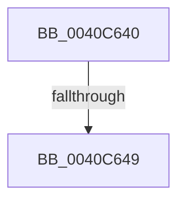

# sub_0040C640

- RVA: `0x0040C640`–`0x0040C65D` (길이 `29` bytes)
- VA: `0x000000014040C640`
- 실행 섹션: `.text`
- PDB 이름 있음: `아니요`; PDB Function 태그: `아니요`
- unwind 정보 RVA: `0x0009B104`
- 디코드: `9`개 명령, `29/29` bytes 표시
- 미해석 바이트: `0` (있으면 어셈블리에 `.byte`로 보존)

> 이 문서는 커널 이미지의 기계어와 PDB 기호를 분석해 생성했습니다. 4번과 5번은 함수 원형과 자료형을 바이너리 사용 방식에서 추정한 C 해석이며 원본 소스 복구 결과는 아닙니다.

## 1. Dependencies

- 직접 호출 지점: **0**; 고유 호출 대상: **0**
- 직접 호출자로 확인된 함수: **3**
- RIP 상대 이미지 참조: **0**

### Outgoing calls
- 직접 디코드된 call 명령이 없습니다.

### Direct callers
- [WbCreateHeapExecutedBlock](../../page/8D/WbCreateHeapExecutedBlock_function_008D4BE8.md) at `0x008D4F44`
- [WbCreateHeapExecutedBlock](../../page/8D/WbCreateHeapExecutedBlock_function_008D4BE8.md) at `0x008D50CB`
- [sub_009A0EC4](../../page/9A/Unknown_function_009A0EC4.md) at `0x009A1088`
- [sub_00A34F4C](../../page/A3/Unknown_function_00A34F4C.md) at `0x00A35033`

### Static image references
- 디코드된 RIP-relative 메모리 참조가 없습니다.

## 2. Other-region calls and transfers

- 다른 실행 섹션으로 향하는 call: **0**
- call이 아닌 외부 분기/꼬리 이동: **1**
  - `0x0040C643` → [sub_0040C65D + 0x366](Unknown_function_0040C65D.md) (`tail-transfer`)

## 3. Assembly (complete function range)

```asm
0040C640  45 85 C9                        test r9d, r9d
0040C643  0F 84 7A 03 00 00               je 0x14040c9c3
0040C649  48 8B C4                        mov rax, rsp
0040C64C  44 89 48 20                     mov dword ptr [rax + 0x20], r9d
0040C650  4C 89 40 18                     mov qword ptr [rax + 0x18], r8
0040C654  56                              push rsi
0040C655  41 54                           push r12
0040C657  41 55                           push r13
0040C659  48 83 EC 60                     sub rsp, 0x60
```

## 4. C-style interpretation (structured pseudocode)

```c
__int64 __fastcall sub_0040C640(__int64 a1, __int64 a2, __int64 a3, int a4)
{
    __int64 v_rsp;

    *(unsigned int *)(v_rsp + 32) = a4;
    *(unsigned __int64 *)(v_rsp + 24) = a3;
    v_rsp = (v_rsp) - (96);
    return v_rsp;
}
```

## 5. (Beta) C Style

```c
int64_t sub_0040C640(int64_t Arg1, int64_t Arg2, int64_t Arg3, int32_t Arg4)
{
    int64_t local_rsp;

    *(uint32_t *)(local_rsp + 0x20) = Arg4;
    *(uint64_t *)(local_rsp + 0x18) = Arg3;
    local_rsp = (local_rsp) - (96);
    return local_rsp;
}
```

## 6. Execution-region graph

[열기: 2D/3D 그래프와 함수 탐색 컨트롤 패널](../../../control-panel.html?section=text&rva=0x0040C640&view=graph)

- 2D 그래프는 위에서 아래로 흐르고, 3D 그래프는 빈 공간을 드래그해 회전합니다. Shift+드래그는 이동, 휠은 확대·축소, 함수 노드 선택은 대상 보고서 이동입니다.

### Static fallback


