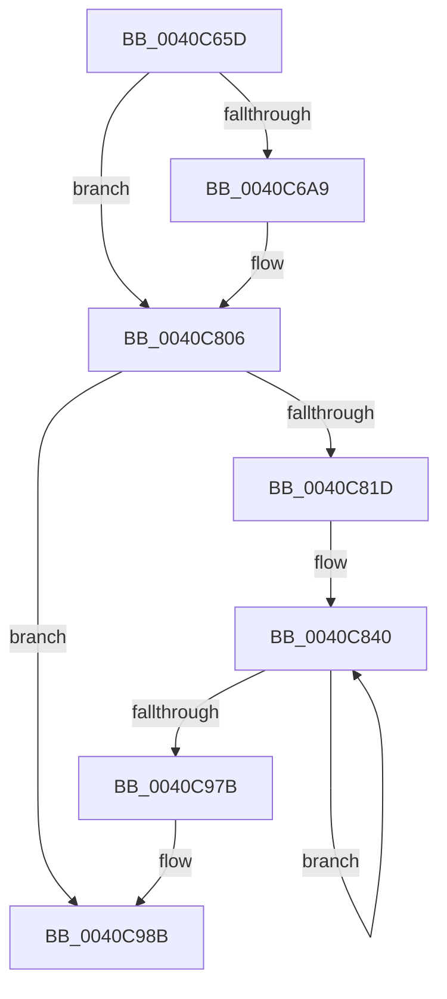

# sub_0040C65D

- RVA: `0x0040C65D`–`0x0040C9C4` (길이 `871` bytes)
- VA: `0x000000014040C65D`
- 실행 섹션: `.text`
- PDB 이름 있음: `아니요`; PDB Function 태그: `아니요`
- unwind 정보 RVA: `0x0009B110`
- 디코드: `226`개 명령, `871/871` bytes 표시
- 미해석 바이트: `0` (있으면 어셈블리에 `.byte`로 보존)

> 이 문서는 커널 이미지의 기계어와 PDB 기호를 분석해 생성했습니다. 4번과 5번은 함수 원형과 자료형을 바이너리 사용 방식에서 추정한 C 해석이며 원본 소스 복구 결과는 아닙니다.

## 1. Dependencies

- 직접 호출 지점: **23**; 고유 호출 대상: **3**
- 직접 호출자로 확인된 함수: **0**
- RIP 상대 이미지 참조: **0**

### Outgoing calls
- `0x0040C6B4` → [sub_0040C9D0](Unknown_function_0040C9D0.md) (function, `0x0040C9D0`)
- `0x0040C6CB` → [sub_0040C9D0](Unknown_function_0040C9D0.md) (function, `0x0040C9D0`)
- `0x0040C6E3` → [sub_0040C9D0](Unknown_function_0040C9D0.md) (function, `0x0040C9D0`)
- `0x0040C6FC` → [sub_0040C9D0](Unknown_function_0040C9D0.md) (function, `0x0040C9D0`)
- `0x0040C713` → [sub_0040C9D0](Unknown_function_0040C9D0.md) (function, `0x0040C9D0`)
- `0x0040C72B` → [sub_0040C9D0](Unknown_function_0040C9D0.md) (function, `0x0040C9D0`)
- `0x0040C744` → [sub_0040C9D0](Unknown_function_0040C9D0.md) (function, `0x0040C9D0`)
- `0x0040C75B` → [sub_0040C9D0](Unknown_function_0040C9D0.md) (function, `0x0040C9D0`)
- `0x0040C773` → [sub_0040C9D0](Unknown_function_0040C9D0.md) (function, `0x0040C9D0`)
- `0x0040C789` → [sub_0040C9D0](Unknown_function_0040C9D0.md) (function, `0x0040C9D0`)
- `0x0040C7A6` → [memcpy](../6C/memcpy_function_006C6840.md) (function, `0x006C6840`)
- `0x0040C7D8` → [memset](../6C/memset_function_006C6C40.md) (function, `0x006C6C40`)
- `0x0040C7ED` → [memcpy](../6C/memcpy_function_006C6840.md) (function, `0x006C6840`)
- `0x0040C85C` → [sub_0040C9D0](Unknown_function_0040C9D0.md) (function, `0x0040C9D0`)
- `0x0040C875` → [sub_0040C9D0](Unknown_function_0040C9D0.md) (function, `0x0040C9D0`)
- `0x0040C88D` → [sub_0040C9D0](Unknown_function_0040C9D0.md) (function, `0x0040C9D0`)
- `0x0040C8A6` → [sub_0040C9D0](Unknown_function_0040C9D0.md) (function, `0x0040C9D0`)
- `0x0040C8BF` → [sub_0040C9D0](Unknown_function_0040C9D0.md) (function, `0x0040C9D0`)
- `0x0040C8D7` → [sub_0040C9D0](Unknown_function_0040C9D0.md) (function, `0x0040C9D0`)
- `0x0040C8F0` → [sub_0040C9D0](Unknown_function_0040C9D0.md) (function, `0x0040C9D0`)
- `0x0040C909` → [sub_0040C9D0](Unknown_function_0040C9D0.md) (function, `0x0040C9D0`)
- `0x0040C921` → [sub_0040C9D0](Unknown_function_0040C9D0.md) (function, `0x0040C9D0`)
- `0x0040C93A` → [sub_0040C9D0](Unknown_function_0040C9D0.md) (function, `0x0040C9D0`)

### Direct callers
- 이 함수 시작 RVA로 연결되는 직접 call은 확인되지 않았습니다. 간접 호출은 완전히 역산할 수 없습니다.

### Static image references
- 디코드된 RIP-relative 메모리 참조가 없습니다.

## 2. Other-region calls and transfers

- 다른 실행 섹션으로 향하는 call: **0**
- 별도 외부 분기/꼬리 이동을 확인하지 못했습니다.

## 3. Assembly (complete function range)

```asm
0040C65D  48 89 58 08                     mov qword ptr [rax + 8], rbx
0040C661  45 8B E9                        mov r13d, r9d
0040C664  48 8B 9C 24 A0 00 00 00         mov rbx, qword ptr [rsp + 0xa0]
0040C66C  4C 8B E2                        mov r12, rdx
0040C66F  48 89 78 D8                     mov qword ptr [rax - 0x28], rdi
0040C673  48 8B F1                        mov rsi, rcx
0040C676  4C 89 70 D0                     mov qword ptr [rax - 0x30], r14
0040C67A  44 8B B4 24 A8 00 00 00         mov r14d, dword ptr [rsp + 0xa8]
0040C682  41 8B FE                        mov edi, r14d
0040C685  4C 89 78 C8                     mov qword ptr [rax - 0x38], r15
0040C689  F7 D7                           not edi
0040C68B  45 8B F9                        mov r15d, r9d
0040C68E  48 89 68 E0                     mov qword ptr [rax - 0x20], rbp
0040C692  48 C7 40 A8 00 00 00 00         mov qword ptr [rax - 0x58], 0
0040C69A  4C 89 74 24 28                  mov qword ptr [rsp + 0x28], r14
0040C69F  41 83 E7 07                     and r15d, 7
0040C6A3  0F 84 5D 01 00 00               je 0x14040c806
0040C6A9  45 8B CE                        mov r9d, r14d
0040C6AC  4C 8B C3                        mov r8, rbx
0040C6AF  BA 09 00 00 00                  mov edx, 9
0040C6B4  E8 17 03 00 00                  call 0x14040c9d0
0040C6B9  8B E8                           mov ebp, eax
0040C6BB  4C 8B C3                        mov r8, rbx
0040C6BE  33 EF                           xor ebp, edi
0040C6C0  BA 08 00 00 00                  mov edx, 8
0040C6C5  44 8B CD                        mov r9d, ebp
0040C6C8  48 8B CE                        mov rcx, rsi
0040C6CB  E8 00 03 00 00                  call 0x14040c9d0
0040C6D0  8B F8                           mov edi, eax
0040C6D2  4C 8B C3                        mov r8, rbx
0040C6D5  41 33 FE                        xor edi, r14d
0040C6D8  BA 07 00 00 00                  mov edx, 7
0040C6DD  44 8B CF                        mov r9d, edi
0040C6E0  48 8B CE                        mov rcx, rsi
0040C6E3  E8 E8 02 00 00                  call 0x14040c9d0
0040C6E8  44 8B F0                        mov r14d, eax
0040C6EB  4C 8B C3                        mov r8, rbx
0040C6EE  44 33 F5                        xor r14d, ebp
0040C6F1  BA 06 00 00 00                  mov edx, 6
0040C6F6  45 8B CE                        mov r9d, r14d
0040C6F9  48 8B CE                        mov rcx, rsi
0040C6FC  E8 CF 02 00 00                  call 0x14040c9d0
0040C701  8B E8                           mov ebp, eax
0040C703  4C 8B C3                        mov r8, rbx
0040C706  33 EF                           xor ebp, edi
0040C708  BA 05 00 00 00                  mov edx, 5
0040C70D  44 8B CD                        mov r9d, ebp
0040C710  48 8B CE                        mov rcx, rsi
0040C713  E8 B8 02 00 00                  call 0x14040c9d0
0040C718  8B F8                           mov edi, eax
0040C71A  4C 8B C3                        mov r8, rbx
0040C71D  41 33 FE                        xor edi, r14d
0040C720  BA 04 00 00 00                  mov edx, 4
0040C725  44 8B CF                        mov r9d, edi
0040C728  48 8B CE                        mov rcx, rsi
0040C72B  E8 A0 02 00 00                  call 0x14040c9d0
0040C730  44 8B F0                        mov r14d, eax
0040C733  4C 8B C3                        mov r8, rbx
0040C736  44 33 F5                        xor r14d, ebp
0040C739  BA 03 00 00 00                  mov edx, 3
0040C73E  45 8B CE                        mov r9d, r14d
0040C741  48 8B CE                        mov rcx, rsi
0040C744  E8 87 02 00 00                  call 0x14040c9d0
0040C749  8B E8                           mov ebp, eax
0040C74B  4C 8B C3                        mov r8, rbx
0040C74E  33 EF                           xor ebp, edi
0040C750  BA 02 00 00 00                  mov edx, 2
0040C755  44 8B CD                        mov r9d, ebp
0040C758  48 8B CE                        mov rcx, rsi
0040C75B  E8 70 02 00 00                  call 0x14040c9d0
0040C760  8B F8                           mov edi, eax
0040C762  4C 8B C3                        mov r8, rbx
0040C765  41 33 FE                        xor edi, r14d
0040C768  BA 01 00 00 00                  mov edx, 1
0040C76D  44 8B CF                        mov r9d, edi
0040C770  48 8B CE                        mov rcx, rsi
0040C773  E8 58 02 00 00                  call 0x14040c9d0
0040C778  44 8B F0                        mov r14d, eax
0040C77B  4C 8B C3                        mov r8, rbx
0040C77E  44 33 F5                        xor r14d, ebp
0040C781  33 D2                           xor edx, edx
0040C783  45 8B CE                        mov r9d, r14d
0040C786  48 8B CE                        mov rcx, rsi
0040C789  E8 42 02 00 00                  call 0x14040c9d0
0040C78E  8B E8                           mov ebp, eax
0040C790  48 C7 44 24 28 00 00 00 00      mov qword ptr [rsp + 0x28], 0
0040C799  45 8B C7                        mov r8d, r15d
0040C79C  48 8D 4C 24 28                  lea rcx, [rsp + 0x28]
0040C7A1  49 8B D4                        mov rdx, r12
0040C7A4  33 EF                           xor ebp, edi
0040C7A6  E8 95 A0 2B 00                  call 0x1406c6840
0040C7AB  48 8B 7C 24 28                  mov rdi, qword ptr [rsp + 0x28]
0040C7B0  44 33 F7                        xor r14d, edi
0040C7B3  48 8B CF                        mov rcx, rdi
0040C7B6  48 C1 E9 20                     shr rcx, 0x20
0040C7BA  33 CD                           xor ecx, ebp
0040C7BC  44 89 74 24 20                  mov dword ptr [rsp + 0x20], r14d
0040C7C1  89 4C 24 24                     mov dword ptr [rsp + 0x24], ecx
0040C7C5  41 B8 08 00 00 00               mov r8d, 8
0040C7CB  48 8D 4C 24 20                  lea rcx, [rsp + 0x20]
0040C7D0  45 2B C7                        sub r8d, r15d
0040C7D3  49 03 CF                        add rcx, r15
0040C7D6  33 D2                           xor edx, edx
0040C7D8  E8 63 A4 2B 00                  call 0x1406c6c40
0040C7DD  48 8B 8C 24 90 00 00 00         mov rcx, qword ptr [rsp + 0x90]
0040C7E5  48 8D 54 24 20                  lea rdx, [rsp + 0x20]
0040C7EA  45 8B C7                        mov r8d, r15d
0040C7ED  E8 4E A0 2B 00                  call 0x1406c6840
0040C7F2  4C 8B 84 24 90 00 00 00         mov r8, qword ptr [rsp + 0x90]
0040C7FA  4C 8B F7                        mov r14, rdi
0040C7FD  49 C1 EE 20                     shr r14, 0x20
0040C801  4C 89 74 24 28                  mov qword ptr [rsp + 0x28], r14
0040C806  41 8B CD                        mov ecx, r13d
0040C809  4B 8D 04 07                     lea rax, [r15 + r8]
0040C80D  C1 E9 03                        shr ecx, 3
0040C810  48 89 44 24 30                  mov qword ptr [rsp + 0x30], rax
0040C815  85 C9                           test ecx, ecx
0040C817  0F 84 6E 01 00 00               je 0x14040c98b
0040C81D  44 8B 74 24 24                  mov r14d, dword ptr [rsp + 0x24]
0040C822  4D 2B E0                        sub r12, r8
0040C825  44 8B 7C 24 20                  mov r15d, dword ptr [rsp + 0x20]
0040C82A  4C 89 A4 24 88 00 00 00         mov qword ptr [rsp + 0x88], r12
0040C832  48 89 4C 24 38                  mov qword ptr [rsp + 0x38], rcx
0040C837  66 0F 1F 84 00 00 00 00 00      nop word ptr [rax + rax]
0040C840  4D 8B 24 04                     mov r12, qword ptr [r12 + rax]
0040C844  4C 8B C3                        mov r8, rbx
0040C847  4D 8B EC                        mov r13, r12
0040C84A  BA 09 00 00 00                  mov edx, 9
0040C84F  49 C1 ED 20                     shr r13, 0x20
0040C853  48 8B CE                        mov rcx, rsi
0040C856  45 33 F5                        xor r14d, r13d
0040C859  45 8B CE                        mov r9d, r14d
0040C85C  E8 6F 01 00 00                  call 0x14040c9d0
0040C861  41 33 C4                        xor eax, r12d
0040C864  4C 8B C3                        mov r8, rbx
0040C867  44 33 F8                        xor r15d, eax
0040C86A  BA 08 00 00 00                  mov edx, 8
0040C86F  45 8B CF                        mov r9d, r15d
0040C872  48 8B CE                        mov rcx, rsi
0040C875  E8 56 01 00 00                  call 0x14040c9d0
0040C87A  8B E8                           mov ebp, eax
0040C87C  4C 8B C3                        mov r8, rbx
0040C87F  41 33 EE                        xor ebp, r14d
0040C882  BA 07 00 00 00                  mov edx, 7
0040C887  44 8B CD                        mov r9d, ebp
0040C88A  48 8B CE                        mov rcx, rsi
0040C88D  E8 3E 01 00 00                  call 0x14040c9d0
0040C892  44 8B F0                        mov r14d, eax
0040C895  4C 8B C3                        mov r8, rbx
0040C898  45 33 F7                        xor r14d, r15d
0040C89B  BA 06 00 00 00                  mov edx, 6
0040C8A0  45 8B CE                        mov r9d, r14d
0040C8A3  48 8B CE                        mov rcx, rsi
0040C8A6  E8 25 01 00 00                  call 0x14040c9d0
0040C8AB  44 8B F8                        mov r15d, eax
0040C8AE  4C 8B C3                        mov r8, rbx
0040C8B1  44 33 FD                        xor r15d, ebp
0040C8B4  BA 05 00 00 00                  mov edx, 5
0040C8B9  45 8B CF                        mov r9d, r15d
0040C8BC  48 8B CE                        mov rcx, rsi
0040C8BF  E8 0C 01 00 00                  call 0x14040c9d0
0040C8C4  8B E8                           mov ebp, eax
0040C8C6  4C 8B C3                        mov r8, rbx
0040C8C9  41 33 EE                        xor ebp, r14d
0040C8CC  BA 04 00 00 00                  mov edx, 4
0040C8D1  44 8B CD                        mov r9d, ebp
0040C8D4  48 8B CE                        mov rcx, rsi
0040C8D7  E8 F4 00 00 00                  call 0x14040c9d0
0040C8DC  44 8B F0                        mov r14d, eax
0040C8DF  4C 8B C3                        mov r8, rbx
0040C8E2  45 33 F7                        xor r14d, r15d
0040C8E5  BA 03 00 00 00                  mov edx, 3
0040C8EA  45 8B CE                        mov r9d, r14d
0040C8ED  48 8B CE                        mov rcx, rsi
0040C8F0  E8 DB 00 00 00                  call 0x14040c9d0
0040C8F5  44 8B F8                        mov r15d, eax
0040C8F8  4C 8B C3                        mov r8, rbx
0040C8FB  44 33 FD                        xor r15d, ebp
0040C8FE  BA 02 00 00 00                  mov edx, 2
0040C903  45 8B CF                        mov r9d, r15d
0040C906  48 8B CE                        mov rcx, rsi
0040C909  E8 C2 00 00 00                  call 0x14040c9d0
0040C90E  8B E8                           mov ebp, eax
0040C910  4C 8B C3                        mov r8, rbx
0040C913  41 33 EE                        xor ebp, r14d
0040C916  BA 01 00 00 00                  mov edx, 1
0040C91B  44 8B CD                        mov r9d, ebp
0040C91E  48 8B CE                        mov rcx, rsi
0040C921  E8 AA 00 00 00                  call 0x14040c9d0
0040C926  41 33 C7                        xor eax, r15d
0040C929  4C 8B C3                        mov r8, rbx
0040C92C  44 8B F8                        mov r15d, eax
0040C92F  44 8B C8                        mov r9d, eax
0040C932  33 D2                           xor edx, edx
0040C934  48 8B CE                        mov rcx, rsi
0040C937  44 33 FF                        xor r15d, edi
0040C93A  E8 91 00 00 00                  call 0x14040c9d0
0040C93F  44 8B F0                        mov r14d, eax
0040C942  48 8B 44 24 30                  mov rax, qword ptr [rsp + 0x30]
0040C947  44 33 F5                        xor r14d, ebp
0040C94A  44 33 74 24 28                  xor r14d, dword ptr [rsp + 0x28]
0040C94F  44 89 38                        mov dword ptr [rax], r15d
0040C952  44 89 70 04                     mov dword ptr [rax + 4], r14d
0040C956  48 83 C0 08                     add rax, 8
0040C95A  48 89 44 24 30                  mov qword ptr [rsp + 0x30], rax
0040C95F  48 83 6C 24 38 01               sub qword ptr [rsp + 0x38], 1
0040C965  41 8B FC                        mov edi, r12d
0040C968  4C 8B A4 24 88 00 00 00         mov r12, qword ptr [rsp + 0x88]
0040C970  44 89 6C 24 28                  mov dword ptr [rsp + 0x28], r13d
0040C975  0F 85 C5 FE FF FF               jne 0x14040c840
0040C97B  44 8B AC 24 98 00 00 00         mov r13d, dword ptr [rsp + 0x98]
0040C983  4C 8B 84 24 90 00 00 00         mov r8, qword ptr [rsp + 0x90]
0040C98B  4C 8B 7C 24 40                  mov r15, qword ptr [rsp + 0x40]
0040C990  41 8D 45 FF                     lea eax, [r13 - 1]
0040C994  42 0F B6 14 00                  movzx edx, byte ptr [rax + r8]
0040C999  48 8B 84 24 B0 00 00 00         mov rax, qword ptr [rsp + 0xb0]
0040C9A1  4C 8B 74 24 48                  mov r14, qword ptr [rsp + 0x48]
0040C9A6  48 8B 7C 24 50                  mov rdi, qword ptr [rsp + 0x50]
0040C9AB  48 8B 6C 24 58                  mov rbp, qword ptr [rsp + 0x58]
0040C9B0  48 8B 9C 24 80 00 00 00         mov rbx, qword ptr [rsp + 0x80]
0040C9B8  88 10                           mov byte ptr [rax], dl
0040C9BA  48 83 C4 60                     add rsp, 0x60
0040C9BE  41 5D                           pop r13
0040C9C0  41 5C                           pop r12
0040C9C2  5E                              pop rsi
0040C9C3  C3                              ret
```

## 4. C-style interpretation (structured pseudocode)

```c
__int64 __fastcall sub_0040C65D(__int64 a1, __int64 a2, __int64 a3, int a4, unsigned int a5, __int64 a6, __int64 a7, __int64 a8, __int64 a9, __int64 a10, __int64 a11, __int64 a12, __int64 a13, __int64 a14, __int64 a15, __int64 a16, __int64 a17, __int64 a18, unsigned int a19, __int64 a20, unsigned int a21, __int64 a22)
{
    __int64 result;
    __int64 v_r12;
    __int64 v_r13;
    __int64 v_r14;
    __int64 v_r15;
    __int64 v_rbp;
    __int64 v_rdi;
    __int64 v_rsp;
    unsigned int v_stack_p20;
    unsigned int v_stack_p24;
    unsigned __int64 v_stack_p28;
    unsigned __int64 v_stack_p30;
    unsigned __int64 v_stack_p38;
    unsigned __int64 v_stack_p88;

    *(unsigned __int64 *)(result + 8) = v_rbx;
    *(unsigned __int64 *)(result - 40) = v_rdi;
    *(unsigned __int64 *)(result - 48) = v_r14;
    *(unsigned __int64 *)(result - 56) = v_r15;
    v_rdi = (unsigned int)(~((unsigned int)((unsigned int)((unsigned int)(a21)))));
    *(unsigned __int64 *)(result - 32) = v_rbp;
    *(unsigned __int64 *)(result - 88) = 0;
    v_stack_p28 = (unsigned int)(a21);
    v_r15 = (unsigned int)(((unsigned int)(a4)) & (7));
    v_r14 = (unsigned int)(a21);
    if (!(condition_is_equal)) {
        a4 = (unsigned int)((unsigned int)(a21));
        a3 = a20;
        a2 = 9;
        result = sub_0040C9D0(a1, a2, a3, a4);
        v_rbp = (unsigned int)(result);
        a3 = a20;
        v_rbp = (unsigned int)((v_rbp) ^ ((unsigned int)(v_rdi)));
        a2 = 8;
        a4 = (unsigned int)(v_rbp);
        a1 = a1;
        result = sub_0040C9D0(a1, a2, a3, a4);
        v_rdi = (unsigned int)(result);
        a3 = a20;
        v_rdi = (unsigned int)((v_rdi) ^ ((unsigned int)((unsigned int)(a21))));
        a2 = 7;
        a4 = (unsigned int)(v_rdi);
        a1 = a1;
        result = sub_0040C9D0(a1, a2, a3, a4);
        v_r14 = (unsigned int)(result);
        a3 = a20;
        v_r14 = (unsigned int)((v_r14) ^ ((unsigned int)(v_rbp)));
        a2 = 6;
        a4 = (unsigned int)(v_r14);
        a1 = a1;
        result = sub_0040C9D0(a1, a2, a3, a4);
        v_rbp = (unsigned int)(result);
        a3 = a20;
        v_rbp = (unsigned int)((v_rbp) ^ ((unsigned int)(v_rdi)));
        a2 = 5;
        a4 = (unsigned int)(v_rbp);
        a1 = a1;
        result = sub_0040C9D0(a1, a2, a3, a4);
        v_rdi = (unsigned int)(result);
        a3 = a20;
        v_rdi = (unsigned int)((v_rdi) ^ ((unsigned int)(v_r14)));
        a2 = 4;
        a4 = (unsigned int)(v_rdi);
        a1 = a1;
        result = sub_0040C9D0(a1, a2, a3, a4);
        v_r14 = (unsigned int)(result);
        a3 = a20;
        v_r14 = (unsigned int)((v_r14) ^ ((unsigned int)(v_rbp)));
        a2 = 3;
        a4 = (unsigned int)(v_r14);
        a1 = a1;
        result = sub_0040C9D0(a1, a2, a3, a4);
        v_rbp = (unsigned int)(result);
        a3 = a20;
        v_rbp = (unsigned int)((v_rbp) ^ ((unsigned int)(v_rdi)));
        a2 = 2;
        a4 = (unsigned int)(v_rbp);
        a1 = a1;
        result = sub_0040C9D0(a1, a2, a3, a4);
        v_rdi = (unsigned int)(result);
        a3 = a20;
        v_rdi = (unsigned int)((v_rdi) ^ ((unsigned int)(v_r14)));
        a2 = 1;
        a4 = (unsigned int)(v_rdi);
        a1 = a1;
        result = sub_0040C9D0(a1, a2, a3, a4);
        v_r14 = (unsigned int)(result);
        a3 = a20;
        v_r14 = (unsigned int)((v_r14) ^ ((unsigned int)(v_rbp)));
        a2 = 0;
        a4 = (unsigned int)(v_r14);
        a1 = a1;
        result = sub_0040C9D0(a1, a2, a3, a4);
        v_rbp = (unsigned int)(result);
        v_stack_p28 = 0;
        a3 = (unsigned int)(v_r15);
        a1 = a5;
        a2 = 0;
        v_rbp = (unsigned int)((v_rbp) ^ ((unsigned int)(v_rdi)));
        result = memcpy(a1, a2, a3, a4);
        v_rdi = a5;
        v_r14 = (unsigned int)((v_r14) ^ ((unsigned int)(v_rdi)));
        a1 = v_rdi;
        a1 = (a1) >> (32);
        a1 = (unsigned int)((a1) ^ ((unsigned int)(v_rbp)));
        v_stack_p20 = (unsigned int)(v_r14);
        v_stack_p24 = (unsigned int)(a1);
        a3 = 8;
        a1 = v_stack_p20;
        a3 = (unsigned int)((a3) - ((unsigned int)(v_r15)));
        a1 = (a1) + (v_r15);
        a2 = 0;
        result = memset(a1, a2, a3, a4);
        a1 = a18;
        a2 = v_stack_p20;
        a3 = (unsigned int)(v_r15);
        result = memcpy(a1, a2, a3, a4);
        a3 = a18;
        v_r14 = v_rdi;
        v_r14 = (v_r14) >> (32);
        v_stack_p28 = v_r14;
    }
    a1 = (unsigned int)(((unsigned int)((unsigned int)((unsigned int)(a4)))) >> (3));
    v_stack_p30 = v_r15 + a3 * 1;
    if ((unsigned int)(a1) == 0) goto loc_0040C98B;
    v_r12 = (a2) - (a3);
    v_stack_p88 = v_r12;
    v_stack_p38 = a1;
loc_0040C840:
    v_r13 = (*(unsigned __int64 *)(v_r12 + v_r15 + a3 * 1 * 1)) >> (32);
    v_r14 = (unsigned int)(((unsigned int)(v_stack_p24)) ^ ((unsigned int)(v_r13)));
    result = sub_0040C9D0(a1, 9, a20, (unsigned int)((unsigned int)(v_r14)));
    result = (unsigned int)((result) ^ ((unsigned int)(*(unsigned __int64 *)(v_r12 + v_r15 + a3 * 1 * 1))));
    v_r15 = (unsigned int)(((unsigned int)(v_stack_p20)) ^ ((unsigned int)(result)));
    result = sub_0040C9D0(a1, 8, a20, (unsigned int)((unsigned int)(v_r15)));
    v_rbp = (unsigned int)(((unsigned int)((unsigned int)(result))) ^ ((unsigned int)(v_r14)));
    result = sub_0040C9D0(a1, 7, a20, (unsigned int)((unsigned int)(v_rbp)));
    v_r14 = (unsigned int)(((unsigned int)((unsigned int)(result))) ^ ((unsigned int)(v_r15)));
    result = sub_0040C9D0(a1, 6, a20, (unsigned int)((unsigned int)(v_r14)));
    v_r15 = (unsigned int)(((unsigned int)((unsigned int)(result))) ^ ((unsigned int)(v_rbp)));
    result = sub_0040C9D0(a1, 5, a20, (unsigned int)((unsigned int)(v_r15)));
    v_rbp = (unsigned int)(((unsigned int)((unsigned int)(result))) ^ ((unsigned int)(v_r14)));
    result = sub_0040C9D0(a1, 4, a20, (unsigned int)((unsigned int)(v_rbp)));
    v_r14 = (unsigned int)(((unsigned int)((unsigned int)(result))) ^ ((unsigned int)(v_r15)));
    result = sub_0040C9D0(a1, 3, a20, (unsigned int)((unsigned int)(v_r14)));
    v_r15 = (unsigned int)(((unsigned int)((unsigned int)(result))) ^ ((unsigned int)(v_rbp)));
    result = sub_0040C9D0(a1, 2, a20, (unsigned int)((unsigned int)(v_r15)));
    v_rbp = (unsigned int)(((unsigned int)((unsigned int)(result))) ^ ((unsigned int)(v_r14)));
    result = sub_0040C9D0(a1, 1, a20, (unsigned int)((unsigned int)(v_rbp)));
    result = (unsigned int)((result) ^ ((unsigned int)(v_r15)));
    a2 = 0;
    v_r15 = (unsigned int)(((unsigned int)((unsigned int)(result))) ^ ((unsigned int)(v_rdi)));
    result = sub_0040C9D0(a1, a2, a20, (unsigned int)((unsigned int)(result)));
    v_r14 = (unsigned int)(((unsigned int)((unsigned int)(result))) ^ ((unsigned int)(v_rbp)));
    v_r14 = (unsigned int)((v_r14) ^ (a5));
    *(unsigned int *)(a6) = (unsigned int)(v_r15);
    *(unsigned int *)(a6 + 4) = (unsigned int)(v_r14);
    result = (a6) + (8);
    v_stack_p30 = result;
    v_stack_p28 = (unsigned int)(v_r13);
    if (condition_is_not_equal) goto loc_0040C840;
loc_0040C98B:
    *(unsigned __int8 *)(a22) = (unsigned __int8)(*(unsigned __int8 *)((unsigned int)(a19) - 1 + a18 * 1));
    v_rsp = (v_rsp) + (96);
    return a22;
}
```

## 5. (Beta) C Style

```c
void *sub_0040C65D(int64_t Arg1, int64_t Arg2, int64_t Arg3, void *Arg4, uint32_t Arg5, void *Arg6, int64_t Arg7, int64_t Arg8, int64_t Arg9, int64_t Arg10, int64_t Arg11, uint64_t Arg12, uint64_t Arg13, uint64_t Arg14, uint64_t Arg15, int64_t Arg16, int64_t Arg17, int64_t Arg18, uint32_t Arg19, int64_t Arg20, uint32_t Arg21, void *Arg22)
{
    uint8_t *arg4 = (uint8_t *)Arg4;
    uint8_t *arg6 = (uint8_t *)Arg6;
    uint8_t *arg22 = (uint8_t *)Arg22;

    int64_t result;
    int64_t local_r12;
    int64_t local_r13;
    int64_t local_r14;
    int64_t local_r15;
    int64_t local_rbp;
    int64_t local_rdi;
    int64_t local_rsp;
    uint32_t v_stack_p20;
    uint32_t v_stack_p24;
    uint64_t v_stack_p28;
    uint64_t v_stack_p30;
    uint64_t v_stack_p38;
    uint64_t v_stack_p88;

    *(uint64_t *)(result + 0x8) = local_rbx;
    *(uint64_t *)(result - 0x28) = local_rdi;
    *(uint64_t *)(result - 0x30) = local_r14;
    *(uint64_t *)(result - 0x38) = local_r15;
    local_rdi = (uint32_t)(~((uint32_t)((uint32_t)((uint32_t)(Arg21)))));
    *(uint64_t *)(result - 0x20) = local_rbp;
    *(uint64_t *)(result - 0x58) = 0;
    v_stack_p28 = (uint32_t)(Arg21);
    local_r15 = (uint32_t)(((uint32_t)(Arg4)) & (7));
    local_r14 = (uint32_t)(Arg21);
    if (!(condition_is_equal)) {
        Arg4 = (uint32_t)((uint32_t)(Arg21));
        Arg3 = Arg20;
        Arg2 = 9;
        result = sub_0040C9D0(Arg1, Arg2, Arg3, Arg4);
        local_rbp = (uint32_t)(result);
        Arg3 = Arg20;
        local_rbp = (uint32_t)((local_rbp) ^ ((uint32_t)(local_rdi)));
        Arg2 = 8;
        Arg4 = (uint32_t)(local_rbp);
        Arg1 = Arg1;
        result = sub_0040C9D0(Arg1, Arg2, Arg3, Arg4);
        local_rdi = (uint32_t)(result);
        Arg3 = Arg20;
        local_rdi = (uint32_t)((local_rdi) ^ ((uint32_t)((uint32_t)(Arg21))));
        Arg2 = 7;
        Arg4 = (uint32_t)(local_rdi);
        Arg1 = Arg1;
        result = sub_0040C9D0(Arg1, Arg2, Arg3, Arg4);
        local_r14 = (uint32_t)(result);
        Arg3 = Arg20;
        local_r14 = (uint32_t)((local_r14) ^ ((uint32_t)(local_rbp)));
        Arg2 = 6;
        Arg4 = (uint32_t)(local_r14);
        Arg1 = Arg1;
        result = sub_0040C9D0(Arg1, Arg2, Arg3, Arg4);
        local_rbp = (uint32_t)(result);
        Arg3 = Arg20;
        local_rbp = (uint32_t)((local_rbp) ^ ((uint32_t)(local_rdi)));
        Arg2 = 5;
        Arg4 = (uint32_t)(local_rbp);
        Arg1 = Arg1;
        result = sub_0040C9D0(Arg1, Arg2, Arg3, Arg4);
        local_rdi = (uint32_t)(result);
        Arg3 = Arg20;
        local_rdi = (uint32_t)((local_rdi) ^ ((uint32_t)(local_r14)));
        Arg2 = 4;
        Arg4 = (uint32_t)(local_rdi);
        Arg1 = Arg1;
        result = sub_0040C9D0(Arg1, Arg2, Arg3, Arg4);
        local_r14 = (uint32_t)(result);
        Arg3 = Arg20;
        local_r14 = (uint32_t)((local_r14) ^ ((uint32_t)(local_rbp)));
        Arg2 = 3;
        Arg4 = (uint32_t)(local_r14);
        Arg1 = Arg1;
        result = sub_0040C9D0(Arg1, Arg2, Arg3, Arg4);
        local_rbp = (uint32_t)(result);
        Arg3 = Arg20;
        local_rbp = (uint32_t)((local_rbp) ^ ((uint32_t)(local_rdi)));
        Arg2 = 2;
        Arg4 = (uint32_t)(local_rbp);
        Arg1 = Arg1;
        result = sub_0040C9D0(Arg1, Arg2, Arg3, Arg4);
        local_rdi = (uint32_t)(result);
        Arg3 = Arg20;
        local_rdi = (uint32_t)((local_rdi) ^ ((uint32_t)(local_r14)));
        Arg2 = 1;
        Arg4 = (uint32_t)(local_rdi);
        Arg1 = Arg1;
        result = sub_0040C9D0(Arg1, Arg2, Arg3, Arg4);
        local_r14 = (uint32_t)(result);
        Arg3 = Arg20;
        local_r14 = (uint32_t)((local_r14) ^ ((uint32_t)(local_rbp)));
        Arg2 = 0;
        Arg4 = (uint32_t)(local_r14);
        Arg1 = Arg1;
        result = sub_0040C9D0(Arg1, Arg2, Arg3, Arg4);
        local_rbp = (uint32_t)(result);
        v_stack_p28 = 0;
        Arg3 = (uint32_t)(local_r15);
        Arg1 = Arg5;
        Arg2 = 0;
        local_rbp = (uint32_t)((local_rbp) ^ ((uint32_t)(local_rdi)));
        result = memcpy(Arg1, Arg2, Arg3, Arg4);
        local_rdi = Arg5;
        local_r14 = (uint32_t)((local_r14) ^ ((uint32_t)(local_rdi)));
        Arg1 = local_rdi;
        Arg1 = (Arg1) >> (32);
        Arg1 = (uint32_t)((Arg1) ^ ((uint32_t)(local_rbp)));
        v_stack_p20 = (uint32_t)(local_r14);
        v_stack_p24 = (uint32_t)(Arg1);
        Arg3 = 8;
        Arg1 = v_stack_p20;
        Arg3 = (uint32_t)((Arg3) - ((uint32_t)(local_r15)));
        Arg1 = (Arg1) + (local_r15);
        Arg2 = 0;
        result = memset(Arg1, Arg2, Arg3, Arg4);
        Arg1 = Arg18;
        Arg2 = v_stack_p20;
        Arg3 = (uint32_t)(local_r15);
        result = memcpy(Arg1, Arg2, Arg3, Arg4);
        Arg3 = Arg18;
        local_r14 = local_rdi;
        local_r14 = (local_r14) >> (32);
        v_stack_p28 = local_r14;
    }
    Arg1 = (uint32_t)(((uint32_t)((uint32_t)((uint32_t)(Arg4)))) >> (3));
    v_stack_p30 = local_r15 + Arg3 * 1;
    if ((uint32_t)(Arg1) == 0) goto loc_0040C98B;
    local_r12 = (Arg2) - (Arg3);
    v_stack_p88 = local_r12;
    v_stack_p38 = Arg1;
loc_0040C840:
    local_r13 = (*(uint64_t *)(local_r12 + local_r15 + Arg3 * 1 * 1)) >> (32);
    local_r14 = (uint32_t)(((uint32_t)(v_stack_p24)) ^ ((uint32_t)(local_r13)));
    result = sub_0040C9D0(Arg1, 9, Arg20, (uint32_t)((uint32_t)(local_r14)));
    result = (uint32_t)((result) ^ ((uint32_t)(*(uint64_t *)(local_r12 + local_r15 + Arg3 * 1 * 1))));
    local_r15 = (uint32_t)(((uint32_t)(v_stack_p20)) ^ ((uint32_t)(result)));
    result = sub_0040C9D0(Arg1, 8, Arg20, (uint32_t)((uint32_t)(local_r15)));
    local_rbp = (uint32_t)(((uint32_t)((uint32_t)(result))) ^ ((uint32_t)(local_r14)));
    result = sub_0040C9D0(Arg1, 7, Arg20, (uint32_t)((uint32_t)(local_rbp)));
    local_r14 = (uint32_t)(((uint32_t)((uint32_t)(result))) ^ ((uint32_t)(local_r15)));
    result = sub_0040C9D0(Arg1, 6, Arg20, (uint32_t)((uint32_t)(local_r14)));
    local_r15 = (uint32_t)(((uint32_t)((uint32_t)(result))) ^ ((uint32_t)(local_rbp)));
    result = sub_0040C9D0(Arg1, 5, Arg20, (uint32_t)((uint32_t)(local_r15)));
    local_rbp = (uint32_t)(((uint32_t)((uint32_t)(result))) ^ ((uint32_t)(local_r14)));
    result = sub_0040C9D0(Arg1, 4, Arg20, (uint32_t)((uint32_t)(local_rbp)));
    local_r14 = (uint32_t)(((uint32_t)((uint32_t)(result))) ^ ((uint32_t)(local_r15)));
    result = sub_0040C9D0(Arg1, 3, Arg20, (uint32_t)((uint32_t)(local_r14)));
    local_r15 = (uint32_t)(((uint32_t)((uint32_t)(result))) ^ ((uint32_t)(local_rbp)));
    result = sub_0040C9D0(Arg1, 2, Arg20, (uint32_t)((uint32_t)(local_r15)));
    local_rbp = (uint32_t)(((uint32_t)((uint32_t)(result))) ^ ((uint32_t)(local_r14)));
    result = sub_0040C9D0(Arg1, 1, Arg20, (uint32_t)((uint32_t)(local_rbp)));
    result = (uint32_t)((result) ^ ((uint32_t)(local_r15)));
    Arg2 = 0;
    local_r15 = (uint32_t)(((uint32_t)((uint32_t)(result))) ^ ((uint32_t)(local_rdi)));
    result = sub_0040C9D0(Arg1, Arg2, Arg20, (uint32_t)((uint32_t)(result)));
    local_r14 = (uint32_t)(((uint32_t)((uint32_t)(result))) ^ ((uint32_t)(local_rbp)));
    local_r14 = (uint32_t)((local_r14) ^ (Arg5));
    *(uint32_t *)(arg6) = (uint32_t)(local_r15);
    *(uint32_t *)(arg6 + 0x4) = (uint32_t)(local_r14);
    result = (Arg6) + (8);
    v_stack_p30 = result;
    v_stack_p28 = (uint32_t)(local_r13);
    if (condition_is_not_equal) goto loc_0040C840;
loc_0040C98B:
    *(uint8_t *)(arg22) = (uint8_t)(*(uint8_t *)((uint32_t)(Arg19) - 0x1 + Arg18 * 1));
    local_rsp = (local_rsp) + (96);
    return Arg22;
}
```

### 관측된 메모리 오프셋

구조체 형식이 확인되지 않은 접근은 인자 기준의 오프셋으로만 기록했습니다.

| 기준 인자 | 오프셋 표현 | 폭 (bit) | 접근 |
|---|---:|---:|---|
| `Arg4` | `+ 0x0 + r8*1` | `64` | `R` |
| `Arg4` | `+ 0x0 + rax*1` | `16` | `R` |
| `Arg6` | `+ 0x0` | `32` | `W` |
| `Arg6` | `+ 0x4` | `32` | `W` |
| `Arg22` | `+ 0x0` | `8` | `W` |

## 6. Execution-region graph

[열기: 2D/3D 그래프와 함수 탐색 컨트롤 패널](../../../control-panel.html?section=text&rva=0x0040C65D&view=graph)

- 2D 그래프는 위에서 아래로 흐르고, 3D 그래프는 빈 공간을 드래그해 회전합니다. Shift+드래그는 이동, 휠은 확대·축소, 함수 노드 선택은 대상 보고서 이동입니다.

### Static fallback


