# sub_0040C9D0

- RVA: `0x0040C9D0`–`0x0040D45B` (길이 `2,699` bytes)
- VA: `0x000000014040C9D0`
- 실행 섹션: `.text`
- PDB 이름 있음: `아니요`; PDB Function 태그: `아니요`
- unwind 정보 RVA: `0x0009B148`
- 디코드: `815`개 명령, `2,699/2,699` bytes 표시
- 미해석 바이트: `0` (있으면 어셈블리에 `.byte`로 보존)

> 이 문서는 커널 이미지의 기계어와 PDB 기호를 분석해 생성했습니다. 4번과 5번은 함수 원형과 자료형을 바이너리 사용 방식에서 추정한 C 해석이며 원본 소스 복구 결과는 아닙니다.

## 1. Dependencies

- 직접 호출 지점: **1**; 고유 호출 대상: **1**
- 직접 호출자로 확인된 함수: **2**
- RIP 상대 이미지 참조: **2**

### Outgoing calls
- `0x0040CAA0` → [_security_check_cookie](../6A/_security_check_cookie_function_006AC640.md) (function, `0x006AC640`)

### Direct callers
- [sub_0040C2C0](Unknown_function_0040C2C0.md) at `0x0040C337`
- [sub_0040C2C0](Unknown_function_0040C2C0.md) at `0x0040C357`
- [sub_0040C2C0](Unknown_function_0040C2C0.md) at `0x0040C36F`
- [sub_0040C2C0](Unknown_function_0040C2C0.md) at `0x0040C386`
- [sub_0040C2C0](Unknown_function_0040C2C0.md) at `0x0040C39D`
- [sub_0040C2C0](Unknown_function_0040C2C0.md) at `0x0040C3B4`
- [sub_0040C2C0](Unknown_function_0040C2C0.md) at `0x0040C3CB`
- [sub_0040C2C0](Unknown_function_0040C2C0.md) at `0x0040C3E2`
- [sub_0040C2C0](Unknown_function_0040C2C0.md) at `0x0040C3F9`
- [sub_0040C2C0](Unknown_function_0040C2C0.md) at `0x0040C40D`
- [sub_0040C2C0](Unknown_function_0040C2C0.md) at `0x0040C4D4`
- [sub_0040C2C0](Unknown_function_0040C2C0.md) at `0x0040C4F3`
- [sub_0040C2C0](Unknown_function_0040C2C0.md) at `0x0040C510`
- [sub_0040C2C0](Unknown_function_0040C2C0.md) at `0x0040C531`
- [sub_0040C2C0](Unknown_function_0040C2C0.md) at `0x0040C54A`
- [sub_0040C2C0](Unknown_function_0040C2C0.md) at `0x0040C562`
- [sub_0040C2C0](Unknown_function_0040C2C0.md) at `0x0040C57B`
- [sub_0040C2C0](Unknown_function_0040C2C0.md) at `0x0040C594`
- [sub_0040C2C0](Unknown_function_0040C2C0.md) at `0x0040C5AC`
- [sub_0040C2C0](Unknown_function_0040C2C0.md) at `0x0040C5CA`
- [sub_0040C65D](Unknown_function_0040C65D.md) at `0x0040C6B4`
- [sub_0040C65D](Unknown_function_0040C65D.md) at `0x0040C6CB`
- [sub_0040C65D](Unknown_function_0040C65D.md) at `0x0040C6E3`
- [sub_0040C65D](Unknown_function_0040C65D.md) at `0x0040C6FC`
- [sub_0040C65D](Unknown_function_0040C65D.md) at `0x0040C713`
- [sub_0040C65D](Unknown_function_0040C65D.md) at `0x0040C72B`
- [sub_0040C65D](Unknown_function_0040C65D.md) at `0x0040C744`
- [sub_0040C65D](Unknown_function_0040C65D.md) at `0x0040C75B`
- [sub_0040C65D](Unknown_function_0040C65D.md) at `0x0040C773`
- [sub_0040C65D](Unknown_function_0040C65D.md) at `0x0040C789`
- [sub_0040C65D](Unknown_function_0040C65D.md) at `0x0040C85C`
- [sub_0040C65D](Unknown_function_0040C65D.md) at `0x0040C875`
- [sub_0040C65D](Unknown_function_0040C65D.md) at `0x0040C88D`
- [sub_0040C65D](Unknown_function_0040C65D.md) at `0x0040C8A6`
- [sub_0040C65D](Unknown_function_0040C65D.md) at `0x0040C8BF`
- [sub_0040C65D](Unknown_function_0040C65D.md) at `0x0040C8D7`
- [sub_0040C65D](Unknown_function_0040C65D.md) at `0x0040C8F0`
- [sub_0040C65D](Unknown_function_0040C65D.md) at `0x0040C909`
- [sub_0040C65D](Unknown_function_0040C65D.md) at `0x0040C921`
- [sub_0040C65D](Unknown_function_0040C65D.md) at `0x0040C93A`

### Static image references
- `0x0040C9E2` → RVA `0x00E0A740` (`.data`; read)
- `0x0040CA0D` → RVA `0x00000000` (`image boundary/outside`; read)

## 2. Other-region calls and transfers

- 다른 실행 섹션으로 향하는 call: **0**
- 별도 외부 분기/꼬리 이동을 확인하지 못했습니다.

## 3. Assembly (complete function range)

```asm
0040C9D0  48 89 5C 24 08                  mov qword ptr [rsp + 8], rbx
0040C9D5  48 89 7C 24 10                  mov qword ptr [rsp + 0x10], rdi
0040C9DA  55                              push rbp
0040C9DB  48 8B EC                        mov rbp, rsp
0040C9DE  48 83 EC 20                     sub rsp, 0x20
0040C9E2  48 8B 05 57 DD 9F 00            mov rax, qword ptr [rip + 0x9fdd57]
0040C9E9  48 33 C4                        xor rax, rsp
0040C9EC  48 89 45 F0                     mov qword ptr [rbp - 0x10], rax
0040C9F0  8B DA                           mov ebx, edx
0040C9F2  41 8B F9                        mov edi, r9d
0040C9F5  44 8B D2                        mov r10d, edx
0040C9F8  8B D2                           mov edx, edx
0040C9FA  48 C1 E2 04                     shl rdx, 4
0040C9FE  48 03 D1                        add rdx, rcx
0040CA01  8B 42 08                        mov eax, dword ptr [rdx + 8]
0040CA04  83 F8 1E                        cmp eax, 0x1e
0040CA07  0F 87 47 0A 00 00               ja 0x14040d454
0040CA0D  4C 8D 0D EC 35 BF FF            lea r9, [rip - 0x40ca14]
0040CA14  41 8B 8C 81 20 30 04 00         mov ecx, dword ptr [r9 + rax*4 + 0x43020]
0040CA1C  49 03 C9                        add rcx, r9
0040CA1F  FF E1                           jmp rcx
0040CA21  CC                              int3
0040CA22  CC                              int3
0040CA23  CC                              int3
0040CA24  CC                              int3
0040CA25  8B 4A 10                        mov ecx, dword ptr [rdx + 0x10]
0040CA28  B8 85 10 42 08                  mov eax, 0x8421085
0040CA2D  44 8B 5A 14                     mov r11d, dword ptr [rdx + 0x14]
0040CA31  F7 E1                           mul ecx
0040CA33  8B C1                           mov eax, ecx
0040CA35  D1 EB                           shr ebx, 1
0040CA37  2B C2                           sub eax, edx
0040CA39  4C 89 45 E8                     mov qword ptr [rbp - 0x18], r8
0040CA3D  D1 E8                           shr eax, 1
0040CA3F  03 C2                           add eax, edx
0040CA41  4C 89 45 E0                     mov qword ptr [rbp - 0x20], r8
0040CA45  C1 E8 04                        shr eax, 4
0040CA48  6B C0 1F                        imul eax, eax, 0x1f
0040CA4B  2B C8                           sub ecx, eax
0040CA4D  8D 43 FF                        lea eax, [rbx - 1]
0040CA50  83 E0 01                        and eax, 1
0040CA53  FF C1                           inc ecx
0040CA55  44 8B 4C 85 E8                  mov r9d, dword ptr [rbp + rax*4 - 0x18]
0040CA5A  44 2B CF                        sub r9d, edi
0040CA5D  41 D3 C9                        ror r9d, cl
0040CA60  41 83 E2 03                     and r10d, 3
0040CA64  42 0F B7 44 55 E0               movzx eax, word ptr [rbp + r10*2 - 0x20]
0040CA6A  44 0F AF C8                     imul r9d, eax
0040CA6E  45 8B C3                        mov r8d, r11d
0040CA71  B8 85 10 42 08                  mov eax, 0x8421085
0040CA76  41 F7 E3                        mul r11d
0040CA79  44 2B C2                        sub r8d, edx
0040CA7C  41 D1 E8                        shr r8d, 1
0040CA7F  44 03 C2                        add r8d, edx
0040CA82  41 C1 E8 04                     shr r8d, 4
0040CA86  41 6B D0 1F                     imul edx, r8d, 0x1f
0040CA8A  44 2B DA                        sub r11d, edx
0040CA8D  41 8D 4B 01                     lea ecx, [r11 + 1]
0040CA91  D3 CF                           ror edi, cl
0040CA93  44 2B CF                        sub r9d, edi
0040CA96  41 8B C1                        mov eax, r9d
0040CA99  48 8B 4D F0                     mov rcx, qword ptr [rbp - 0x10]
0040CA9D  48 33 CC                        xor rcx, rsp
0040CAA0  E8 9B FB 29 00                  call 0x1406ac640
0040CAA5  48 8B 5C 24 30                  mov rbx, qword ptr [rsp + 0x30]
0040CAAA  48 8B 7C 24 38                  mov rdi, qword ptr [rsp + 0x38]
0040CAAF  48 83 C4 20                     add rsp, 0x20
0040CAB3  5D                              pop rbp
0040CAB4  C3                              ret
0040CAB5  CC                              int3
0040CAB6  D1 EB                           shr ebx, 1
0040CAB8  41 83 E2 03                     and r10d, 3
0040CABC  4C 89 45 E8                     mov qword ptr [rbp - 0x18], r8
0040CAC0  4C 89 45 E0                     mov qword ptr [rbp - 0x20], r8
0040CAC4  8D 43 FF                        lea eax, [rbx - 1]
0040CAC7  83 E0 01                        and eax, 1
0040CACA  2B 7C 85 E8                     sub edi, dword ptr [rbp + rax*4 - 0x18]
0040CACE  42 0F B7 44 55 E0               movzx eax, word ptr [rbp + r10*2 - 0x20]
0040CAD4  2B F8                           sub edi, eax
0040CAD6  8B C7                           mov eax, edi
0040CAD8  EB BF                           jmp 0x14040ca99
0040CADA  8D 43 FF                        lea eax, [rbx - 1]
0040CADD  4C 89 45 E0                     mov qword ptr [rbp - 0x20], r8
0040CAE1  83 E0 01                        and eax, 1
0040CAE4  4C 89 45 E8                     mov qword ptr [rbp - 0x18], r8
0040CAE8  41 83 E2 01                     and r10d, 1
0040CAEC  8B 44 85 E0                     mov eax, dword ptr [rbp + rax*4 - 0x20]
0040CAF0  42 33 7C 95 E8                  xor edi, dword ptr [rbp + r10*4 - 0x18]
0040CAF5  2B C7                           sub eax, edi
0040CAF7  EB A0                           jmp 0x14040ca99
0040CAF9  8B 4A 0C                        mov ecx, dword ptr [rdx + 0xc]
0040CAFC  B8 AB AA AA AA                  mov eax, 0xaaaaaaab
0040CB01  44 8B 5A 10                     mov r11d, dword ptr [rdx + 0x10]
0040CB05  44 8B CF                        mov r9d, edi
0040CB08  F7 E1                           mul ecx
0040CB0A  4C 89 45 E8                     mov qword ptr [rbp - 0x18], r8
0040CB0E  D1 EA                           shr edx, 1
0040CB10  4C 89 45 E0                     mov qword ptr [rbp - 0x20], r8
0040CB14  8D 04 52                        lea eax, [rdx + rdx*2]
0040CB17  2B C8                           sub ecx, eax
0040CB19  8D 43 01                        lea eax, [rbx + 1]
0040CB1C  03 C1                           add eax, ecx
0040CB1E  83 E0 03                        and eax, 3
0040CB21  0F B7 4C 45 E8                  movzx ecx, word ptr [rbp + rax*2 - 0x18]
0040CB26  44 2B C9                        sub r9d, ecx
0040CB29  41 83 E2 03                     and r10d, 3
0040CB2D  42 0F B7 44 55 E0               movzx eax, word ptr [rbp + r10*2 - 0x20]
0040CB33  44 0F AF C8                     imul r9d, eax
0040CB37  B8 89 88 88 88                  mov eax, 0x88888889
0040CB3C  41 F7 E3                        mul r11d
0040CB3F  C1 EA 03                        shr edx, 3
0040CB42  44 6B C2 0F                     imul r8d, edx, 0xf
0040CB46  45 2B D8                        sub r11d, r8d
0040CB49  41 8D 4B 01                     lea ecx, [r11 + 1]
0040CB4D  D3 EF                           shr edi, cl
0040CB4F  E9 3F FF FF FF                  jmp 0x14040ca93
0040CB54  8B 4A 10                        mov ecx, dword ptr [rdx + 0x10]
0040CB57  B8 85 10 42 08                  mov eax, 0x8421085
0040CB5C  44 8B 5A 14                     mov r11d, dword ptr [rdx + 0x14]
0040CB60  44 8B CF                        mov r9d, edi
0040CB63  F7 E1                           mul ecx
0040CB65  8B C1                           mov eax, ecx
0040CB67  D1 EB                           shr ebx, 1
0040CB69  2B C2                           sub eax, edx
0040CB6B  4C 89 45 E8                     mov qword ptr [rbp - 0x18], r8
0040CB6F  D1 E8                           shr eax, 1
0040CB71  03 C2                           add eax, edx
0040CB73  4C 89 45 E0                     mov qword ptr [rbp - 0x20], r8
0040CB77  C1 E8 04                        shr eax, 4
0040CB7A  6B C0 1F                        imul eax, eax, 0x1f
0040CB7D  2B C8                           sub ecx, eax
0040CB7F  8D 43 FF                        lea eax, [rbx - 1]
0040CB82  83 E0 01                        and eax, 1
0040CB85  FF C1                           inc ecx
0040CB87  44 33 4C 85 E8                  xor r9d, dword ptr [rbp + rax*4 - 0x18]
0040CB8C  41 D3 C9                        ror r9d, cl
0040CB8F  41 83 E2 03                     and r10d, 3
0040CB93  42 0F B7 44 55 E0               movzx eax, word ptr [rbp + r10*2 - 0x20]
0040CB99  44 0F AF C8                     imul r9d, eax
0040CB9D  45 8B C3                        mov r8d, r11d
0040CBA0  B8 85 10 42 08                  mov eax, 0x8421085
0040CBA5  41 F7 E3                        mul r11d
0040CBA8  44 2B C2                        sub r8d, edx
0040CBAB  41 D1 E8                        shr r8d, 1
0040CBAE  44 03 C2                        add r8d, edx
0040CBB1  41 C1 E8 04                     shr r8d, 4
0040CBB5  41 6B D0 1F                     imul edx, r8d, 0x1f
0040CBB9  44 2B DA                        sub r11d, edx
0040CBBC  41 8D 4B 01                     lea ecx, [r11 + 1]
0040CBC0  D3 CF                           ror edi, cl
0040CBC2  42 8D 04 0F                     lea eax, [rdi + r9]
0040CBC6  E9 CE FE FF FF                  jmp 0x14040ca99
0040CBCB  44 8B 5A 14                     mov r11d, dword ptr [rdx + 0x14]
0040CBCF  B8 25 49 92 24                  mov eax, 0x24924925
0040CBD4  8B 4A 10                        mov ecx, dword ptr [rdx + 0x10]
0040CBD7  41 83 E2 03                     and r10d, 3
0040CBDB  44 8B 4A 0C                     mov r9d, dword ptr [rdx + 0xc]
0040CBDF  F7 E1                           mul ecx
0040CBE1  8B C1                           mov eax, ecx
0040CBE3  4C 89 45 E8                     mov qword ptr [rbp - 0x18], r8
0040CBE7  2B C2                           sub eax, edx
0040CBE9  4C 89 45 E0                     mov qword ptr [rbp - 0x20], r8
0040CBED  D1 E8                           shr eax, 1
0040CBEF  03 C2                           add eax, edx
0040CBF1  C1 E8 02                        shr eax, 2
0040CBF4  6B C0 07                        imul eax, eax, 7
0040CBF7  2B C8                           sub ecx, eax
0040CBF9  B8 AB AA AA AA                  mov eax, 0xaaaaaaab
0040CBFE  41 F7 E1                        mul r9d
0040CC01  FF C1                           inc ecx
0040CC03  D1 EA                           shr edx, 1
0040CC05  8D 04 52                        lea eax, [rdx + rdx*2]
0040CC08  44 2B C8                        sub r9d, eax
0040CC0B  8D 43 01                        lea eax, [rbx + 1]
0040CC0E  41 03 C1                        add eax, r9d
0040CC11  44 8B CF                        mov r9d, edi
0040CC14  83 E0 03                        and eax, 3
0040CC17  0F B7 54 45 E8                  movzx edx, word ptr [rbp + rax*2 - 0x18]
0040CC1C  42 0F B7 44 55 E0               movzx eax, word ptr [rbp + r10*2 - 0x20]
0040CC22  44 2B CA                        sub r9d, edx
0040CC25  41 D3 C1                        rol r9d, cl
0040CC28  44 0F AF C8                     imul r9d, eax
0040CC2C  B8 89 88 88 88                  mov eax, 0x88888889
0040CC31  41 F7 E3                        mul r11d
0040CC34  C1 EA 03                        shr edx, 3
0040CC37  44 6B C2 0F                     imul r8d, edx, 0xf
0040CC3B  45 2B D8                        sub r11d, r8d
0040CC3E  41 8D 4B 01                     lea ecx, [r11 + 1]
0040CC42  D3 EF                           shr edi, cl
0040CC44  44 33 CF                        xor r9d, edi
0040CC47  E9 4A FE FF FF                  jmp 0x14040ca96
0040CC4C  8B 4A 10                        mov ecx, dword ptr [rdx + 0x10]
0040CC4F  B8 25 49 92 24                  mov eax, 0x24924925
0040CC54  44 8B 4A 0C                     mov r9d, dword ptr [rdx + 0xc]
0040CC58  44 8B 5A 14                     mov r11d, dword ptr [rdx + 0x14]
0040CC5C  F7 E1                           mul ecx
0040CC5E  8B C1                           mov eax, ecx
0040CC60  4C 89 45 E8                     mov qword ptr [rbp - 0x18], r8
0040CC64  2B C2                           sub eax, edx
0040CC66  4C 89 45 E0                     mov qword ptr [rbp - 0x20], r8
0040CC6A  D1 E8                           shr eax, 1
0040CC6C  03 C2                           add eax, edx
0040CC6E  C1 E8 02                        shr eax, 2
0040CC71  6B C0 07                        imul eax, eax, 7
0040CC74  2B C8                           sub ecx, eax
0040CC76  B8 AB AA AA AA                  mov eax, 0xaaaaaaab
0040CC7B  41 F7 E1                        mul r9d
0040CC7E  FF C1                           inc ecx
0040CC80  D1 EA                           shr edx, 1
0040CC82  8D 04 52                        lea eax, [rdx + rdx*2]
0040CC85  44 2B C8                        sub r9d, eax
0040CC88  8D 43 01                        lea eax, [rbx + 1]
0040CC8B  41 03 C1                        add eax, r9d
0040CC8E  83 E0 03                        and eax, 3
0040CC91  44 0F B7 4C 45 E8               movzx r9d, word ptr [rbp + rax*2 - 0x18]
0040CC97  44 33 CF                        xor r9d, edi
0040CC9A  41 D3 C1                        rol r9d, cl
0040CC9D  41 83 E2 03                     and r10d, 3
0040CCA1  42 0F B7 44 55 E0               movzx eax, word ptr [rbp + r10*2 - 0x20]
0040CCA7  E9 BE FD FF FF                  jmp 0x14040ca6a
0040CCAC  44 8B 5A 14                     mov r11d, dword ptr [rdx + 0x14]
0040CCB0  B8 25 49 92 24                  mov eax, 0x24924925
0040CCB5  8B 4A 10                        mov ecx, dword ptr [rdx + 0x10]
0040CCB8  41 83 E2 03                     and r10d, 3
0040CCBC  44 8B 4A 0C                     mov r9d, dword ptr [rdx + 0xc]
0040CCC0  F7 E1                           mul ecx
0040CCC2  8B C1                           mov eax, ecx
0040CCC4  4C 89 45 E8                     mov qword ptr [rbp - 0x18], r8
0040CCC8  2B C2                           sub eax, edx
0040CCCA  4C 89 45 E0                     mov qword ptr [rbp - 0x20], r8
0040CCCE  D1 E8                           shr eax, 1
0040CCD0  03 C2                           add eax, edx
0040CCD2  C1 E8 02                        shr eax, 2
0040CCD5  6B C0 07                        imul eax, eax, 7
0040CCD8  2B C8                           sub ecx, eax
0040CCDA  B8 AB AA AA AA                  mov eax, 0xaaaaaaab
0040CCDF  41 F7 E1                        mul r9d
0040CCE2  FF C1                           inc ecx
0040CCE4  D1 EA                           shr edx, 1
0040CCE6  8D 04 52                        lea eax, [rdx + rdx*2]
0040CCE9  44 2B C8                        sub r9d, eax
0040CCEC  8D 43 01                        lea eax, [rbx + 1]
0040CCEF  41 03 C1                        add eax, r9d
0040CCF2  83 E0 03                        and eax, 3
0040CCF5  44 0F B7 4C 45 E8               movzx r9d, word ptr [rbp + rax*2 - 0x18]
0040CCFB  42 0F B7 44 55 E0               movzx eax, word ptr [rbp + r10*2 - 0x20]
0040CD01  44 33 CF                        xor r9d, edi
0040CD04  41 D3 C1                        rol r9d, cl
0040CD07  44 0F AF C8                     imul r9d, eax
0040CD0B  B8 89 88 88 88                  mov eax, 0x88888889
0040CD10  41 F7 E3                        mul r11d
0040CD13  C1 EA 03                        shr edx, 3
0040CD16  44 6B C2 0F                     imul r8d, edx, 0xf
0040CD1A  45 2B D8                        sub r11d, r8d
0040CD1D  41 8D 4B 01                     lea ecx, [r11 + 1]
0040CD21  D3 EF                           shr edi, cl
0040CD23  42 8D 04 0F                     lea eax, [rdi + r9]
0040CD27  E9 6D FD FF FF                  jmp 0x14040ca99
0040CD2C  8B 4A 10                        mov ecx, dword ptr [rdx + 0x10]
0040CD2F  B8 85 10 42 08                  mov eax, 0x8421085
0040CD34  44 8B 5A 14                     mov r11d, dword ptr [rdx + 0x14]
0040CD38  F7 E1                           mul ecx
0040CD3A  8B C1                           mov eax, ecx
0040CD3C  D1 EB                           shr ebx, 1
0040CD3E  2B C2                           sub eax, edx
0040CD40  4C 89 45 E8                     mov qword ptr [rbp - 0x18], r8
0040CD44  D1 E8                           shr eax, 1
0040CD46  03 C2                           add eax, edx
0040CD48  4C 89 45 E0                     mov qword ptr [rbp - 0x20], r8
0040CD4C  C1 E8 04                        shr eax, 4
0040CD4F  6B C0 1F                        imul eax, eax, 0x1f
0040CD52  2B C8                           sub ecx, eax
0040CD54  8D 43 FF                        lea eax, [rbx - 1]
0040CD57  83 E0 01                        and eax, 1
0040CD5A  FF C1                           inc ecx
0040CD5C  44 8B 4C 85 E8                  mov r9d, dword ptr [rbp + rax*4 - 0x18]
0040CD61  44 03 CF                        add r9d, edi
0040CD64  41 D3 C9                        ror r9d, cl
0040CD67  41 83 E2 03                     and r10d, 3
0040CD6B  42 0F B7 44 55 E0               movzx eax, word ptr [rbp + r10*2 - 0x20]
0040CD71  E9 F4 FC FF FF                  jmp 0x14040ca6a
0040CD76  8B 4A 10                        mov ecx, dword ptr [rdx + 0x10]
0040CD79  B8 89 88 88 88                  mov eax, 0x88888889
0040CD7E  44 8B 4A 0C                     mov r9d, dword ptr [rdx + 0xc]
0040CD82  41 83 E2 03                     and r10d, 3
0040CD86  F7 E1                           mul ecx
0040CD88  4C 89 45 E8                     mov qword ptr [rbp - 0x18], r8
0040CD8C  C1 EA 03                        shr edx, 3
0040CD8F  6B C2 0F                        imul eax, edx, 0xf
0040CD92  4C 89 45 E0                     mov qword ptr [rbp - 0x20], r8
0040CD96  44 8B C7                        mov r8d, edi
0040CD99  2B C8                           sub ecx, eax
0040CD9B  B8 AB AA AA AA                  mov eax, 0xaaaaaaab
0040CDA0  FF C1                           inc ecx
0040CDA2  41 F7 E1                        mul r9d
0040CDA5  41 D3 C8                        ror r8d, cl
0040CDA8  D1 EA                           shr edx, 1
0040CDAA  8D 0C 52                        lea ecx, [rdx + rdx*2]
0040CDAD  44 2B C9                        sub r9d, ecx
0040CDB0  8D 4B 01                        lea ecx, [rbx + 1]
0040CDB3  41 03 C9                        add ecx, r9d
0040CDB6  83 E1 03                        and ecx, 3
0040CDB9  0F B7 44 4D E8                  movzx eax, word ptr [rbp + rcx*2 - 0x18]
0040CDBE  42 0F B7 4C 55 E0               movzx ecx, word ptr [rbp + r10*2 - 0x20]
0040CDC4  33 C7                           xor eax, edi
0040CDC6  0F AF C1                        imul eax, ecx
0040CDC9  41 03 C0                        add eax, r8d
0040CDCC  E9 C8 FC FF FF                  jmp 0x14040ca99
0040CDD1  8B 4A 10                        mov ecx, dword ptr [rdx + 0x10]
0040CDD4  B8 89 88 88 88                  mov eax, 0x88888889
0040CDD9  44 8B 4A 0C                     mov r9d, dword ptr [rdx + 0xc]
0040CDDD  41 83 E2 03                     and r10d, 3
0040CDE1  F7 E1                           mul ecx
0040CDE3  4C 89 45 E0                     mov qword ptr [rbp - 0x20], r8
0040CDE7  C1 EA 03                        shr edx, 3
0040CDEA  6B C2 0F                        imul eax, edx, 0xf
0040CDED  4C 89 45 E8                     mov qword ptr [rbp - 0x18], r8
0040CDF1  44 8B C7                        mov r8d, edi
0040CDF4  2B C8                           sub ecx, eax
0040CDF6  B8 AB AA AA AA                  mov eax, 0xaaaaaaab
0040CDFB  FF C1                           inc ecx
0040CDFD  41 F7 E1                        mul r9d
0040CE00  41 D3 E8                        shr r8d, cl
0040CE03  D1 EA                           shr edx, 1
0040CE05  8D 0C 52                        lea ecx, [rdx + rdx*2]
0040CE08  44 2B C9                        sub r9d, ecx
0040CE0B  8D 4B 01                        lea ecx, [rbx + 1]
0040CE0E  41 03 C9                        add ecx, r9d
0040CE11  83 E1 03                        and ecx, 3
0040CE14  0F B7 44 4D E0                  movzx eax, word ptr [rbp + rcx*2 - 0x20]
0040CE19  42 0F B7 4C 55 E8               movzx ecx, word ptr [rbp + r10*2 - 0x18]
0040CE1F  33 C7                           xor eax, edi
0040CE21  0F AF C1                        imul eax, ecx
0040CE24  41 03 C0                        add eax, r8d
0040CE27  E9 6D FC FF FF                  jmp 0x14040ca99
0040CE2C  8B 4A 10                        mov ecx, dword ptr [rdx + 0x10]
0040CE2F  B8 85 10 42 08                  mov eax, 0x8421085
0040CE34  44 8B 5A 14                     mov r11d, dword ptr [rdx + 0x14]
0040CE38  F7 E1                           mul ecx
0040CE3A  8B C1                           mov eax, ecx
0040CE3C  D1 EB                           shr ebx, 1
0040CE3E  2B C2                           sub eax, edx
0040CE40  4C 89 45 E8                     mov qword ptr [rbp - 0x18], r8
0040CE44  D1 E8                           shr eax, 1
0040CE46  03 C2                           add eax, edx
0040CE48  4C 89 45 E0                     mov qword ptr [rbp - 0x20], r8
0040CE4C  C1 E8 04                        shr eax, 4
0040CE4F  6B C0 1F                        imul eax, eax, 0x1f
0040CE52  2B C8                           sub ecx, eax
0040CE54  8D 43 FF                        lea eax, [rbx - 1]
0040CE57  83 E0 01                        and eax, 1
0040CE5A  FF C1                           inc ecx
0040CE5C  44 8B 4C 85 E8                  mov r9d, dword ptr [rbp + rax*4 - 0x18]
0040CE61  44 2B CF                        sub r9d, edi
0040CE64  41 D3 C9                        ror r9d, cl
0040CE67  41 83 E2 03                     and r10d, 3
0040CE6B  42 0F B7 44 55 E0               movzx eax, word ptr [rbp + r10*2 - 0x20]
0040CE71  44 0F AF C8                     imul r9d, eax
0040CE75  45 8B C3                        mov r8d, r11d
0040CE78  B8 85 10 42 08                  mov eax, 0x8421085
0040CE7D  41 F7 E3                        mul r11d
0040CE80  44 2B C2                        sub r8d, edx
0040CE83  41 D1 E8                        shr r8d, 1
0040CE86  44 03 C2                        add r8d, edx
0040CE89  41 C1 E8 04                     shr r8d, 4
0040CE8D  41 6B D0 1F                     imul edx, r8d, 0x1f
0040CE91  44 2B DA                        sub r11d, edx
0040CE94  41 8D 4B 01                     lea ecx, [r11 + 1]
0040CE98  D3 CF                           ror edi, cl
0040CE9A  44 33 CF                        xor r9d, edi
0040CE9D  E9 F4 FB FF FF                  jmp 0x14040ca96
0040CEA2  41 83 E2 03                     and r10d, 3
0040CEA6  D1 EB                           shr ebx, 1
0040CEA8  4C 89 45 E8                     mov qword ptr [rbp - 0x18], r8
0040CEAC  4C 89 45 E0                     mov qword ptr [rbp - 0x20], r8
0040CEB0  42 0F B7 44 55 E8               movzx eax, word ptr [rbp + r10*2 - 0x18]
0040CEB6  2B F8                           sub edi, eax
0040CEB8  8D 43 FF                        lea eax, [rbx - 1]
0040CEBB  83 E0 01                        and eax, 1
0040CEBE  33 7C 85 E0                     xor edi, dword ptr [rbp + rax*4 - 0x20]
0040CEC2  8B C7                           mov eax, edi
0040CEC4  E9 D0 FB FF FF                  jmp 0x14040ca99
0040CEC9  44 8B 4A 10                     mov r9d, dword ptr [rdx + 0x10]
0040CECD  B8 89 88 88 88                  mov eax, 0x88888889
0040CED2  8B 4A 0C                        mov ecx, dword ptr [rdx + 0xc]
0040CED5  41 83 E2 03                     and r10d, 3
0040CED9  F7 E1                           mul ecx
0040CEDB  4C 89 45 E8                     mov qword ptr [rbp - 0x18], r8
0040CEDF  C1 EA 03                        shr edx, 3
0040CEE2  6B C2 0F                        imul eax, edx, 0xf
0040CEE5  4C 89 45 E0                     mov qword ptr [rbp - 0x20], r8
0040CEE9  2B C8                           sub ecx, eax
0040CEEB  42 0F B7 44 55 E8               movzx eax, word ptr [rbp + r10*2 - 0x18]
0040CEF1  FF C1                           inc ecx
0040CEF3  D3 CF                           ror edi, cl
0040CEF5  2B F8                           sub edi, eax
0040CEF7  B8 AB AA AA AA                  mov eax, 0xaaaaaaab
0040CEFC  41 F7 E1                        mul r9d
0040CEFF  D1 EA                           shr edx, 1
0040CF01  8D 04 52                        lea eax, [rdx + rdx*2]
0040CF04  44 2B C8                        sub r9d, eax
0040CF07  8D 43 01                        lea eax, [rbx + 1]
0040CF0A  41 03 C1                        add eax, r9d
0040CF0D  83 E0 03                        and eax, 3
0040CF10  0F B7 44 45 E0                  movzx eax, word ptr [rbp + rax*2 - 0x20]
0040CF15  0F AF C7                        imul eax, edi
0040CF18  E9 7C FB FF FF                  jmp 0x14040ca99
0040CF1D  8B 4A 10                        mov ecx, dword ptr [rdx + 0x10]
0040CF20  B8 85 10 42 08                  mov eax, 0x8421085
0040CF25  44 8B 5A 14                     mov r11d, dword ptr [rdx + 0x14]
0040CF29  44 8B CF                        mov r9d, edi
0040CF2C  F7 E1                           mul ecx
0040CF2E  8B C1                           mov eax, ecx
0040CF30  D1 EB                           shr ebx, 1
0040CF32  2B C2                           sub eax, edx
0040CF34  4C 89 45 E8                     mov qword ptr [rbp - 0x18], r8
0040CF38  D1 E8                           shr eax, 1
0040CF3A  03 C2                           add eax, edx
0040CF3C  4C 89 45 E0                     mov qword ptr [rbp - 0x20], r8
0040CF40  C1 E8 04                        shr eax, 4
0040CF43  6B C0 1F                        imul eax, eax, 0x1f
0040CF46  2B C8                           sub ecx, eax
0040CF48  8D 43 FF                        lea eax, [rbx - 1]
0040CF4B  83 E0 01                        and eax, 1
0040CF4E  FF C1                           inc ecx
0040CF50  44 2B 4C 85 E8                  sub r9d, dword ptr [rbp + rax*4 - 0x18]
0040CF55  41 D3 C9                        ror r9d, cl
0040CF58  41 83 E2 03                     and r10d, 3
0040CF5C  42 0F B7 44 55 E0               movzx eax, word ptr [rbp + r10*2 - 0x20]
0040CF62  E9 0A FF FF FF                  jmp 0x14040ce71
0040CF67  8D 43 FF                        lea eax, [rbx - 1]
0040CF6A  4C 89 45 E0                     mov qword ptr [rbp - 0x20], r8
0040CF6E  83 E0 01                        and eax, 1
0040CF71  4C 89 45 E8                     mov qword ptr [rbp - 0x18], r8
0040CF75  41 83 E2 01                     and r10d, 1
0040CF79  8B 44 85 E0                     mov eax, dword ptr [rbp + rax*4 - 0x20]
0040CF7D  42 33 44 95 E8                  xor eax, dword ptr [rbp + r10*4 - 0x18]
0040CF82  33 C7                           xor eax, edi
0040CF84  E9 10 FB FF FF                  jmp 0x14040ca99
0040CF89  8B 4A 10                        mov ecx, dword ptr [rdx + 0x10]
0040CF8C  B8 85 10 42 08                  mov eax, 0x8421085
0040CF91  44 8B 5A 14                     mov r11d, dword ptr [rdx + 0x14]
0040CF95  44 8B CF                        mov r9d, edi
0040CF98  F7 E1                           mul ecx
0040CF9A  8B C1                           mov eax, ecx
0040CF9C  D1 EB                           shr ebx, 1
0040CF9E  2B C2                           sub eax, edx
0040CFA0  4C 89 45 E8                     mov qword ptr [rbp - 0x18], r8
0040CFA4  D1 E8                           shr eax, 1
0040CFA6  03 C2                           add eax, edx
0040CFA8  4C 89 45 E0                     mov qword ptr [rbp - 0x20], r8
0040CFAC  C1 E8 04                        shr eax, 4
0040CFAF  6B C0 1F                        imul eax, eax, 0x1f
0040CFB2  2B C8                           sub ecx, eax
0040CFB4  8D 43 FF                        lea eax, [rbx - 1]
0040CFB7  83 E0 01                        and eax, 1
0040CFBA  FF C1                           inc ecx
0040CFBC  44 2B 4C 85 E8                  sub r9d, dword ptr [rbp + rax*4 - 0x18]
0040CFC1  41 D3 C9                        ror r9d, cl
0040CFC4  41 83 E2 03                     and r10d, 3
0040CFC8  42 0F B7 44 55 E0               movzx eax, word ptr [rbp + r10*2 - 0x20]
0040CFCE  E9 C6 FB FF FF                  jmp 0x14040cb99
0040CFD3  8B 4A 10                        mov ecx, dword ptr [rdx + 0x10]
0040CFD6  B8 85 10 42 08                  mov eax, 0x8421085
0040CFDB  44 8B 5A 14                     mov r11d, dword ptr [rdx + 0x14]
0040CFDF  44 8B CF                        mov r9d, edi
0040CFE2  F7 E1                           mul ecx
0040CFE4  8B C1                           mov eax, ecx
0040CFE6  D1 EB                           shr ebx, 1
0040CFE8  2B C2                           sub eax, edx
0040CFEA  4C 89 45 E8                     mov qword ptr [rbp - 0x18], r8
0040CFEE  D1 E8                           shr eax, 1
0040CFF0  03 C2                           add eax, edx
0040CFF2  4C 89 45 E0                     mov qword ptr [rbp - 0x20], r8
0040CFF6  C1 E8 04                        shr eax, 4
0040CFF9  6B C0 1F                        imul eax, eax, 0x1f
0040CFFC  2B C8                           sub ecx, eax
0040CFFE  8D 43 FF                        lea eax, [rbx - 1]
0040D001  83 E0 01                        and eax, 1
0040D004  FF C1                           inc ecx
0040D006  44 2B 4C 85 E8                  sub r9d, dword ptr [rbp + rax*4 - 0x18]
0040D00B  41 D3 C9                        ror r9d, cl
0040D00E  41 83 E2 03                     and r10d, 3
0040D012  42 0F B7 44 55 E0               movzx eax, word ptr [rbp + r10*2 - 0x20]
0040D018  E9 4D FA FF FF                  jmp 0x14040ca6a
0040D01D  8B 4A 10                        mov ecx, dword ptr [rdx + 0x10]
0040D020  B8 85 10 42 08                  mov eax, 0x8421085
0040D025  44 8B 5A 14                     mov r11d, dword ptr [rdx + 0x14]
0040D029  44 8B CF                        mov r9d, edi
0040D02C  F7 E1                           mul ecx
0040D02E  8B C1                           mov eax, ecx
0040D030  D1 EB                           shr ebx, 1
0040D032  2B C2                           sub eax, edx
0040D034  4C 89 45 E8                     mov qword ptr [rbp - 0x18], r8
0040D038  D1 E8                           shr eax, 1
0040D03A  03 C2                           add eax, edx
0040D03C  4C 89 45 E0                     mov qword ptr [rbp - 0x20], r8
0040D040  C1 E8 04                        shr eax, 4
0040D043  6B C0 1F                        imul eax, eax, 0x1f
0040D046  2B C8                           sub ecx, eax
0040D048  8D 43 FF                        lea eax, [rbx - 1]
0040D04B  83 E0 01                        and eax, 1
0040D04E  FF C1                           inc ecx
0040D050  44 33 4C 85 E8                  xor r9d, dword ptr [rbp + rax*4 - 0x18]
0040D055  41 D3 C9                        ror r9d, cl
0040D058  41 83 E2 03                     and r10d, 3
0040D05C  42 0F B7 44 55 E0               movzx eax, word ptr [rbp + r10*2 - 0x20]
0040D062  E9 03 FA FF FF                  jmp 0x14040ca6a
0040D067  8B 4A 10                        mov ecx, dword ptr [rdx + 0x10]
0040D06A  B8 25 49 92 24                  mov eax, 0x24924925
0040D06F  44 8B 5A 14                     mov r11d, dword ptr [rdx + 0x14]
0040D073  44 8B CF                        mov r9d, edi
0040D076  F7 E1                           mul ecx
0040D078  8B C1                           mov eax, ecx
0040D07A  D1 EB                           shr ebx, 1
0040D07C  2B C2                           sub eax, edx
0040D07E  4C 89 45 E8                     mov qword ptr [rbp - 0x18], r8
0040D082  D1 E8                           shr eax, 1
0040D084  03 C2                           add eax, edx
0040D086  4C 89 45 E0                     mov qword ptr [rbp - 0x20], r8
0040D08A  C1 E8 02                        shr eax, 2
0040D08D  6B C0 07                        imul eax, eax, 7
0040D090  2B C8                           sub ecx, eax
0040D092  8D 43 FF                        lea eax, [rbx - 1]
0040D095  83 E0 01                        and eax, 1
0040D098  FF C1                           inc ecx
0040D09A  44 33 4C 85 E8                  xor r9d, dword ptr [rbp + rax*4 - 0x18]
0040D09F  41 D3 C1                        rol r9d, cl
0040D0A2  41 83 E2 03                     and r10d, 3
0040D0A6  42 0F B7 44 55 E0               movzx eax, word ptr [rbp + r10*2 - 0x20]
0040D0AC  E9 82 FA FF FF                  jmp 0x14040cb33
0040D0B1  8B 4A 10                        mov ecx, dword ptr [rdx + 0x10]
0040D0B4  B8 89 88 88 88                  mov eax, 0x88888889
0040D0B9  44 8B 4A 0C                     mov r9d, dword ptr [rdx + 0xc]
0040D0BD  41 83 E2 03                     and r10d, 3
0040D0C1  F7 E1                           mul ecx
0040D0C3  4C 89 45 E8                     mov qword ptr [rbp - 0x18], r8
0040D0C7  C1 EA 03                        shr edx, 3
0040D0CA  6B C2 0F                        imul eax, edx, 0xf
0040D0CD  4C 89 45 E0                     mov qword ptr [rbp - 0x20], r8
0040D0D1  44 8B C7                        mov r8d, edi
0040D0D4  2B C8                           sub ecx, eax
0040D0D6  B8 AB AA AA AA                  mov eax, 0xaaaaaaab
0040D0DB  41 F7 E1                        mul r9d
0040D0DE  FF C1                           inc ecx
0040D0E0  D1 EA                           shr edx, 1
0040D0E2  41 D3 C8                        ror r8d, cl
0040D0E5  42 0F B7 4C 55 E0               movzx ecx, word ptr [rbp + r10*2 - 0x20]
0040D0EB  8D 04 52                        lea eax, [rdx + rdx*2]
0040D0EE  44 2B C8                        sub r9d, eax
0040D0F1  8D 43 01                        lea eax, [rbx + 1]
0040D0F4  41 03 C1                        add eax, r9d
0040D0F7  83 E0 03                        and eax, 3
0040D0FA  0F B7 44 45 E8                  movzx eax, word ptr [rbp + rax*2 - 0x18]
0040D0FF  33 C7                           xor eax, edi
0040D101  0F AF C1                        imul eax, ecx
0040D104  41 2B C0                        sub eax, r8d
0040D107  E9 8D F9 FF FF                  jmp 0x14040ca99
0040D10C  8B 4A 10                        mov ecx, dword ptr [rdx + 0x10]
0040D10F  B8 85 10 42 08                  mov eax, 0x8421085
0040D114  44 8B 5A 14                     mov r11d, dword ptr [rdx + 0x14]
0040D118  44 8B CF                        mov r9d, edi
0040D11B  F7 E1                           mul ecx
0040D11D  8B C1                           mov eax, ecx
0040D11F  D1 EB                           shr ebx, 1
0040D121  2B C2                           sub eax, edx
0040D123  4C 89 45 E8                     mov qword ptr [rbp - 0x18], r8
0040D127  D1 E8                           shr eax, 1
0040D129  03 C2                           add eax, edx
0040D12B  4C 89 45 E0                     mov qword ptr [rbp - 0x20], r8
0040D12F  C1 E8 04                        shr eax, 4
0040D132  6B C0 1F                        imul eax, eax, 0x1f
0040D135  2B C8                           sub ecx, eax
0040D137  8D 43 FF                        lea eax, [rbx - 1]
0040D13A  83 E0 01                        and eax, 1
0040D13D  FF C1                           inc ecx
0040D13F  44 33 4C 85 E8                  xor r9d, dword ptr [rbp + rax*4 - 0x18]
0040D144  41 D3 C9                        ror r9d, cl
0040D147  41 83 E2 03                     and r10d, 3
0040D14B  42 0F B7 44 55 E0               movzx eax, word ptr [rbp + r10*2 - 0x20]
0040D151  E9 1B FD FF FF                  jmp 0x14040ce71
0040D156  8B 4A 10                        mov ecx, dword ptr [rdx + 0x10]
0040D159  B8 89 88 88 88                  mov eax, 0x88888889
0040D15E  44 8B 4A 0C                     mov r9d, dword ptr [rdx + 0xc]
0040D162  41 83 E2 03                     and r10d, 3
0040D166  F7 E1                           mul ecx
0040D168  4C 89 45 E8                     mov qword ptr [rbp - 0x18], r8
0040D16C  C1 EA 03                        shr edx, 3
0040D16F  6B C2 0F                        imul eax, edx, 0xf
0040D172  4C 89 45 E0                     mov qword ptr [rbp - 0x20], r8
0040D176  44 8B C7                        mov r8d, edi
0040D179  2B C8                           sub ecx, eax
0040D17B  B8 AB AA AA AA                  mov eax, 0xaaaaaaab
0040D180  FF C1                           inc ecx
0040D182  41 F7 E1                        mul r9d
0040D185  41 D3 E8                        shr r8d, cl
0040D188  D1 EA                           shr edx, 1
0040D18A  8D 0C 52                        lea ecx, [rdx + rdx*2]
0040D18D  44 2B C9                        sub r9d, ecx
0040D190  8D 4B 01                        lea ecx, [rbx + 1]
0040D193  41 03 C9                        add ecx, r9d
0040D196  83 E1 03                        and ecx, 3
0040D199  0F B7 44 4D E8                  movzx eax, word ptr [rbp + rcx*2 - 0x18]
0040D19E  42 0F B7 4C 55 E0               movzx ecx, word ptr [rbp + r10*2 - 0x20]
0040D1A4  33 C7                           xor eax, edi
0040D1A6  0F AF C1                        imul eax, ecx
0040D1A9  41 33 C0                        xor eax, r8d
0040D1AC  E9 E8 F8 FF FF                  jmp 0x14040ca99
0040D1B1  44 8B 4A 10                     mov r9d, dword ptr [rdx + 0x10]
0040D1B5  B8 89 88 88 88                  mov eax, 0x88888889
0040D1BA  8B 4A 0C                        mov ecx, dword ptr [rdx + 0xc]
0040D1BD  41 83 E2 03                     and r10d, 3
0040D1C1  F7 E1                           mul ecx
0040D1C3  4C 89 45 E8                     mov qword ptr [rbp - 0x18], r8
0040D1C7  C1 EA 03                        shr edx, 3
0040D1CA  6B C2 0F                        imul eax, edx, 0xf
0040D1CD  4C 89 45 E0                     mov qword ptr [rbp - 0x20], r8
0040D1D1  2B C8                           sub ecx, eax
0040D1D3  42 0F B7 44 55 E8               movzx eax, word ptr [rbp + r10*2 - 0x18]
0040D1D9  FF C1                           inc ecx
0040D1DB  D3 CF                           ror edi, cl
0040D1DD  33 F8                           xor edi, eax
0040D1DF  B8 AB AA AA AA                  mov eax, 0xaaaaaaab
0040D1E4  41 F7 E1                        mul r9d
0040D1E7  D1 EA                           shr edx, 1
0040D1E9  8D 04 52                        lea eax, [rdx + rdx*2]
0040D1EC  44 2B C8                        sub r9d, eax
0040D1EF  8D 43 01                        lea eax, [rbx + 1]
0040D1F2  41 03 C1                        add eax, r9d
0040D1F5  83 E0 03                        and eax, 3
0040D1F8  0F B7 44 45 E0                  movzx eax, word ptr [rbp + rax*2 - 0x20]
0040D1FD  0F AF C7                        imul eax, edi
0040D200  E9 94 F8 FF FF                  jmp 0x14040ca99
0040D205  8B 4A 10                        mov ecx, dword ptr [rdx + 0x10]
0040D208  B8 89 88 88 88                  mov eax, 0x88888889
0040D20D  44 8B 4A 0C                     mov r9d, dword ptr [rdx + 0xc]
0040D211  41 83 E2 03                     and r10d, 3
0040D215  F7 E1                           mul ecx
0040D217  4C 89 45 E8                     mov qword ptr [rbp - 0x18], r8
0040D21B  C1 EA 03                        shr edx, 3
0040D21E  6B C2 0F                        imul eax, edx, 0xf
0040D221  4C 89 45 E0                     mov qword ptr [rbp - 0x20], r8
0040D225  44 8B C7                        mov r8d, edi
0040D228  2B C8                           sub ecx, eax
0040D22A  B8 AB AA AA AA                  mov eax, 0xaaaaaaab
0040D22F  FF C1                           inc ecx
0040D231  41 F7 E1                        mul r9d
0040D234  41 D3 C8                        ror r8d, cl
0040D237  D1 EA                           shr edx, 1
0040D239  8D 0C 52                        lea ecx, [rdx + rdx*2]
0040D23C  44 2B C9                        sub r9d, ecx
0040D23F  8D 4B 01                        lea ecx, [rbx + 1]
0040D242  41 03 C9                        add ecx, r9d
0040D245  83 E1 03                        and ecx, 3
0040D248  0F B7 44 4D E8                  movzx eax, word ptr [rbp + rcx*2 - 0x18]
0040D24D  42 0F B7 4C 55 E0               movzx ecx, word ptr [rbp + r10*2 - 0x20]
0040D253  33 C7                           xor eax, edi
0040D255  0F AF C1                        imul eax, ecx
0040D258  41 33 C0                        xor eax, r8d
0040D25B  E9 39 F8 FF FF                  jmp 0x14040ca99
0040D260  8B 4A 10                        mov ecx, dword ptr [rdx + 0x10]
0040D263  B8 85 10 42 08                  mov eax, 0x8421085
0040D268  44 8B 5A 14                     mov r11d, dword ptr [rdx + 0x14]
0040D26C  44 8B CF                        mov r9d, edi
0040D26F  F7 E1                           mul ecx
0040D271  8B C1                           mov eax, ecx
0040D273  D1 EB                           shr ebx, 1
0040D275  2B C2                           sub eax, edx
0040D277  4C 89 45 E8                     mov qword ptr [rbp - 0x18], r8
0040D27B  D1 E8                           shr eax, 1
0040D27D  03 C2                           add eax, edx
0040D27F  4C 89 45 E0                     mov qword ptr [rbp - 0x20], r8
0040D283  C1 E8 04                        shr eax, 4
0040D286  6B C0 1F                        imul eax, eax, 0x1f
0040D289  2B C8                           sub ecx, eax
0040D28B  8D 43 FF                        lea eax, [rbx - 1]
0040D28E  83 E0 01                        and eax, 1
0040D291  FF C1                           inc ecx
0040D293  44 2B 4C 85 E8                  sub r9d, dword ptr [rbp + rax*4 - 0x18]
0040D298  41 D3 C9                        ror r9d, cl
0040D29B  41 83 E2 03                     and r10d, 3
0040D29F  42 0F B7 44 55 E0               movzx eax, word ptr [rbp + r10*2 - 0x20]
0040D2A5  E9 C7 FB FF FF                  jmp 0x14040ce71
0040D2AA  8B 4A 10                        mov ecx, dword ptr [rdx + 0x10]
0040D2AD  B8 25 49 92 24                  mov eax, 0x24924925
0040D2B2  44 8B 4A 0C                     mov r9d, dword ptr [rdx + 0xc]
0040D2B6  44 8B 5A 14                     mov r11d, dword ptr [rdx + 0x14]
0040D2BA  F7 E1                           mul ecx
0040D2BC  8B C1                           mov eax, ecx
0040D2BE  4C 89 45 E8                     mov qword ptr [rbp - 0x18], r8
0040D2C2  2B C2                           sub eax, edx
0040D2C4  4C 89 45 E0                     mov qword ptr [rbp - 0x20], r8
0040D2C8  D1 E8                           shr eax, 1
0040D2CA  03 C2                           add eax, edx
0040D2CC  C1 E8 02                        shr eax, 2
0040D2CF  6B C0 07                        imul eax, eax, 7
0040D2D2  2B C8                           sub ecx, eax
0040D2D4  B8 AB AA AA AA                  mov eax, 0xaaaaaaab
0040D2D9  41 F7 E1                        mul r9d
0040D2DC  FF C1                           inc ecx
0040D2DE  D1 EA                           shr edx, 1
0040D2E0  8D 04 52                        lea eax, [rdx + rdx*2]
0040D2E3  44 2B C8                        sub r9d, eax
0040D2E6  8D 43 01                        lea eax, [rbx + 1]
0040D2E9  41 03 C1                        add eax, r9d
0040D2EC  83 E0 03                        and eax, 3
0040D2EF  44 0F B7 4C 45 E8               movzx r9d, word ptr [rbp + rax*2 - 0x18]
0040D2F5  44 33 CF                        xor r9d, edi
0040D2F8  41 D3 C1                        rol r9d, cl
0040D2FB  41 83 E2 03                     and r10d, 3
0040D2FF  42 0F B7 44 55 E0               movzx eax, word ptr [rbp + r10*2 - 0x20]
0040D305  E9 8F F8 FF FF                  jmp 0x14040cb99
0040D30A  44 8B 4A 10                     mov r9d, dword ptr [rdx + 0x10]
0040D30E  B8 89 88 88 88                  mov eax, 0x88888889
0040D313  8B 4A 0C                        mov ecx, dword ptr [rdx + 0xc]
0040D316  41 83 E2 03                     and r10d, 3
0040D31A  F7 E1                           mul ecx
0040D31C  F7 D7                           not edi
0040D31E  4C 89 45 E8                     mov qword ptr [rbp - 0x18], r8
0040D322  C1 EA 03                        shr edx, 3
0040D325  6B C2 0F                        imul eax, edx, 0xf
0040D328  4C 89 45 E0                     mov qword ptr [rbp - 0x20], r8
0040D32C  2B C8                           sub ecx, eax
0040D32E  42 0F B7 44 55 E8               movzx eax, word ptr [rbp + r10*2 - 0x18]
0040D334  FF C1                           inc ecx
0040D336  D3 CF                           ror edi, cl
0040D338  03 F8                           add edi, eax
0040D33A  B8 AB AA AA AA                  mov eax, 0xaaaaaaab
0040D33F  41 F7 E1                        mul r9d
0040D342  D1 EA                           shr edx, 1
0040D344  8D 04 52                        lea eax, [rdx + rdx*2]
0040D347  44 2B C8                        sub r9d, eax
0040D34A  8D 43 01                        lea eax, [rbx + 1]
0040D34D  41 03 C1                        add eax, r9d
0040D350  83 E0 03                        and eax, 3
0040D353  0F B7 44 45 E0                  movzx eax, word ptr [rbp + rax*2 - 0x20]
0040D358  0F AF C7                        imul eax, edi
0040D35B  E9 39 F7 FF FF                  jmp 0x14040ca99
0040D360  8B 4A 10                        mov ecx, dword ptr [rdx + 0x10]
0040D363  B8 85 10 42 08                  mov eax, 0x8421085
0040D368  44 8B 5A 14                     mov r11d, dword ptr [rdx + 0x14]
0040D36C  F7 E1                           mul ecx
0040D36E  8B C1                           mov eax, ecx
0040D370  D1 EB                           shr ebx, 1
0040D372  2B C2                           sub eax, edx
0040D374  4C 89 45 E8                     mov qword ptr [rbp - 0x18], r8
0040D378  D1 E8                           shr eax, 1
0040D37A  03 C2                           add eax, edx
0040D37C  4C 89 45 E0                     mov qword ptr [rbp - 0x20], r8
0040D380  C1 E8 04                        shr eax, 4
0040D383  6B C0 1F                        imul eax, eax, 0x1f
0040D386  2B C8                           sub ecx, eax
0040D388  8D 43 FF                        lea eax, [rbx - 1]
0040D38B  83 E0 01                        and eax, 1
0040D38E  FF C1                           inc ecx
0040D390  44 8B 4C 85 E8                  mov r9d, dword ptr [rbp + rax*4 - 0x18]
0040D395  44 03 CF                        add r9d, edi
0040D398  41 D3 C9                        ror r9d, cl
0040D39B  41 83 E2 03                     and r10d, 3
0040D39F  42 0F B7 44 55 E0               movzx eax, word ptr [rbp + r10*2 - 0x20]
0040D3A5  E9 EF F7 FF FF                  jmp 0x14040cb99
0040D3AA  8B 4A 10                        mov ecx, dword ptr [rdx + 0x10]
0040D3AD  B8 25 49 92 24                  mov eax, 0x24924925
0040D3B2  44 8B 4A 0C                     mov r9d, dword ptr [rdx + 0xc]
0040D3B6  44 8B 5A 14                     mov r11d, dword ptr [rdx + 0x14]
0040D3BA  F7 E1                           mul ecx
0040D3BC  8B C1                           mov eax, ecx
0040D3BE  4C 89 45 E8                     mov qword ptr [rbp - 0x18], r8
0040D3C2  2B C2                           sub eax, edx
0040D3C4  4C 89 45 E0                     mov qword ptr [rbp - 0x20], r8
0040D3C8  D1 E8                           shr eax, 1
0040D3CA  03 C2                           add eax, edx
0040D3CC  C1 E8 02                        shr eax, 2
0040D3CF  6B C0 07                        imul eax, eax, 7
0040D3D2  2B C8                           sub ecx, eax
0040D3D4  B8 AB AA AA AA                  mov eax, 0xaaaaaaab
0040D3D9  41 F7 E1                        mul r9d
0040D3DC  FF C1                           inc ecx
0040D3DE  D1 EA                           shr edx, 1
0040D3E0  8D 04 52                        lea eax, [rdx + rdx*2]
0040D3E3  44 2B C8                        sub r9d, eax
0040D3E6  8D 43 01                        lea eax, [rbx + 1]
0040D3E9  41 03 C1                        add eax, r9d
0040D3EC  83 E0 03                        and eax, 3
0040D3EF  44 0F B7 4C 45 E8               movzx r9d, word ptr [rbp + rax*2 - 0x18]
0040D3F5  44 33 CF                        xor r9d, edi
0040D3F8  41 D3 C1                        rol r9d, cl
0040D3FB  41 83 E2 03                     and r10d, 3
0040D3FF  42 0F B7 44 55 E0               movzx eax, word ptr [rbp + r10*2 - 0x20]
0040D405  E9 67 FA FF FF                  jmp 0x14040ce71
0040D40A  8B 4A 10                        mov ecx, dword ptr [rdx + 0x10]
0040D40D  B8 85 10 42 08                  mov eax, 0x8421085
0040D412  44 8B 5A 14                     mov r11d, dword ptr [rdx + 0x14]
0040D416  F7 E1                           mul ecx
0040D418  8B C1                           mov eax, ecx
0040D41A  D1 EB                           shr ebx, 1
0040D41C  2B C2                           sub eax, edx
0040D41E  4C 89 45 E8                     mov qword ptr [rbp - 0x18], r8
0040D422  D1 E8                           shr eax, 1
0040D424  03 C2                           add eax, edx
0040D426  4C 89 45 E0                     mov qword ptr [rbp - 0x20], r8
0040D42A  C1 E8 04                        shr eax, 4
0040D42D  6B C0 1F                        imul eax, eax, 0x1f
0040D430  2B C8                           sub ecx, eax
0040D432  8D 43 FF                        lea eax, [rbx - 1]
0040D435  83 E0 01                        and eax, 1
0040D438  FF C1                           inc ecx
0040D43A  44 8B 4C 85 E8                  mov r9d, dword ptr [rbp + rax*4 - 0x18]
0040D43F  44 2B CF                        sub r9d, edi
0040D442  41 D3 C9                        ror r9d, cl
0040D445  41 83 E2 03                     and r10d, 3
0040D449  42 0F B7 44 55 E0               movzx eax, word ptr [rbp + r10*2 - 0x20]
0040D44F  E9 45 F7 FF FF                  jmp 0x14040cb99
0040D454  33 C0                           xor eax, eax
0040D456  E9 3E F6 FF FF                  jmp 0x14040ca99
```

## 4. C-style interpretation (structured pseudocode)

```c
__int64 __fastcall sub_0040C9D0(__int64 a1, int a2, __int64 a3, int a4)
{
    __int64 result;
    __int64 v_rsp;
    unsigned __int64 v_stack_m18;
    unsigned __int64 v_stack_m20;
    unsigned __int64 v_stack_m28;
    unsigned __int64 v_stack_p10;
    unsigned __int64 v_stack_p8;

    v_stack_p8 = v_rbx;
    v_stack_p10 = v_rdi;
    v_rsp = (v_rsp) - (32);
    result = (*(unsigned __int64 *)(v_rip + 10476887)) ^ (v_rsp);
    v_stack_m18 = result;
    a2 = ((unsigned int)(a2)) << (4);
    a2 = (a2) + (a1);
    if (((unsigned int)((unsigned int)(*(unsigned int *)(a2 + 8)))) > 30) goto loc_0040D454;
    a1 = ((unsigned int)(*(unsigned int *)(v_rip - 4246036 + (unsigned int)(*(unsigned int *)(a2 + 8)) * 4 + 274464))) + (v_rip - 4246036);
loc_0040CA99:
    a1 = (v_stack_m18) ^ (v_rsp);
    result = _security_check_cookie(a1, a2, a3, v_rip - 4246036);
    v_rsp = (v_rsp) + (32);
    return result;
loc_0040D454:
    result = 0;
    goto loc_0040CA99;
}
```

## 5. (Beta) C Style

```c
int64_t sub_0040C9D0(int64_t Arg1, int32_t Arg2, int64_t Arg3, int32_t Arg4)
{
    int64_t result;
    int64_t local_rsp;
    uint64_t v_stack_m18;
    uint64_t v_stack_m20;
    uint64_t v_stack_m28;
    uint64_t v_stack_p10;
    uint64_t v_stack_p8;

    v_stack_p8 = local_rbx;
    v_stack_p10 = local_rdi;
    local_rsp = (local_rsp) - (32);
    result = (*(uint64_t *)(v_rip + 0x9FDD57)) ^ (local_rsp);
    v_stack_m18 = result;
    Arg2 = ((uint32_t)(Arg2)) << (4);
    Arg2 = (Arg2) + (Arg1);
    if (((uint32_t)((uint32_t)(*(uint32_t *)(Arg2 + 0x8)))) > 30) goto loc_0040D454;
    Arg1 = ((uint32_t)(*(uint32_t *)(v_rip - 0x40CA14 + (uint32_t)(*(uint32_t *)(Arg2 + 0x8)) * 4 + 0x43020))) + (v_rip - 4246036);
loc_0040CA99:
    Arg1 = (v_stack_m18) ^ (local_rsp);
    result = _security_check_cookie(Arg1, Arg2, Arg3, v_rip - 4246036);
    local_rsp = (local_rsp) + (32);
    return result;
loc_0040D454:
    result = 0;
    goto loc_0040CA99;
}
```

## 6. Execution-region graph

[열기: 2D/3D 그래프와 함수 탐색 컨트롤 패널](../../../control-panel.html?section=text&rva=0x0040C9D0&view=graph)

- 2D 그래프는 위에서 아래로 흐르고, 3D 그래프는 빈 공간을 드래그해 회전합니다. Shift+드래그는 이동, 휠은 확대·축소, 함수 노드 선택은 대상 보고서 이동입니다.

### Static fallback

```mermaid
flowchart TD
  bb_0040C9D0[BB_0040C9D0]
  bb_0040CA0D[BB_0040CA0D]
  bb_0040CA21[BB_0040CA21]
  bb_0040CA6A[BB_0040CA6A]
  bb_0040CA93[BB_0040CA93]
  bb_0040CA96[BB_0040CA96]
  bb_0040CA99[BB_0040CA99]
  bb_0040CAB5[BB_0040CAB5]
  bb_0040CADA[BB_0040CADA]
  bb_0040CAF9[BB_0040CAF9]
  bb_0040CB33[BB_0040CB33]
  bb_0040CB54[BB_0040CB54]
  bb_0040CB99[BB_0040CB99]
  bb_0040CBCB[BB_0040CBCB]
  bb_0040CC4C[BB_0040CC4C]
  bb_0040CCAC[BB_0040CCAC]
  bb_0040CD2C[BB_0040CD2C]
  bb_0040CD76[BB_0040CD76]
  bb_0040CDD1[BB_0040CDD1]
  bb_0040CE2C[BB_0040CE2C]
  bb_0040CE71[BB_0040CE71]
  bb_0040CEA2[BB_0040CEA2]
  bb_0040CEC9[BB_0040CEC9]
  bb_0040CF1D[BB_0040CF1D]
  bb_0040CF67[BB_0040CF67]
  bb_0040CF89[BB_0040CF89]
  bb_0040CFD3[BB_0040CFD3]
  bb_0040D01D[BB_0040D01D]
  bb_0040D067[BB_0040D067]
  bb_0040D0B1[BB_0040D0B1]
  bb_0040D10C[BB_0040D10C]
  bb_0040D156[BB_0040D156]
  bb_0040D1B1[BB_0040D1B1]
  bb_0040D205[BB_0040D205]
  bb_0040D260[BB_0040D260]
  bb_0040D2AA[BB_0040D2AA]
  bb_0040D30A[BB_0040D30A]
  bb_0040D360[BB_0040D360]
  bb_0040D3AA[BB_0040D3AA]
  bb_0040D40A[BB_0040D40A]
  bb_0040D454[BB_0040D454]
  bb_0040C9D0 -->|branch| bb_0040D454
  bb_0040C9D0 -->|fallthrough| bb_0040CA0D
  bb_0040CA21 -->|flow| bb_0040CA6A
  bb_0040CA6A -->|flow| bb_0040CA93
  bb_0040CA93 -->|flow| bb_0040CA96
  bb_0040CA96 -->|flow| bb_0040CA99
  bb_0040CAB5 -->|branch| bb_0040CA99
  bb_0040CADA -->|branch| bb_0040CA99
  bb_0040CAF9 -->|flow| bb_0040CB33
  bb_0040CB33 -->|branch| bb_0040CA93
  bb_0040CB54 -->|flow| bb_0040CB99
  bb_0040CB99 -->|branch| bb_0040CA99
  bb_0040CBCB -->|branch| bb_0040CA96
  bb_0040CC4C -->|branch| bb_0040CA6A
  bb_0040CCAC -->|branch| bb_0040CA99
  bb_0040CD2C -->|branch| bb_0040CA6A
  bb_0040CD76 -->|branch| bb_0040CA99
  bb_0040CDD1 -->|branch| bb_0040CA99
  bb_0040CE2C -->|flow| bb_0040CE71
  bb_0040CE71 -->|branch| bb_0040CA96
  bb_0040CEA2 -->|branch| bb_0040CA99
  bb_0040CEC9 -->|branch| bb_0040CA99
  bb_0040CF1D -->|branch| bb_0040CE71
  bb_0040CF67 -->|branch| bb_0040CA99
  bb_0040CF89 -->|branch| bb_0040CB99
  bb_0040CFD3 -->|branch| bb_0040CA6A
  bb_0040D01D -->|branch| bb_0040CA6A
  bb_0040D067 -->|branch| bb_0040CB33
  bb_0040D0B1 -->|branch| bb_0040CA99
  bb_0040D10C -->|branch| bb_0040CE71
  bb_0040D156 -->|branch| bb_0040CA99
  bb_0040D1B1 -->|branch| bb_0040CA99
  bb_0040D205 -->|branch| bb_0040CA99
  bb_0040D260 -->|branch| bb_0040CE71
  bb_0040D2AA -->|branch| bb_0040CB99
  bb_0040D30A -->|branch| bb_0040CA99
  bb_0040D360 -->|branch| bb_0040CB99
  bb_0040D3AA -->|branch| bb_0040CE71
  bb_0040D40A -->|branch| bb_0040CB99
  bb_0040D454 -->|branch| bb_0040CA99
```


