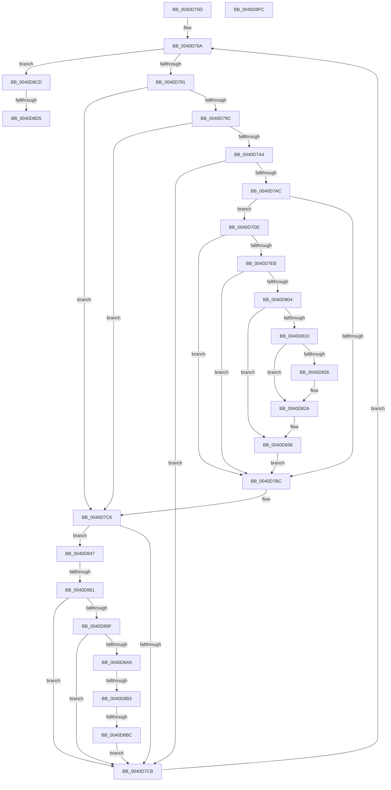

# sub_0040D75D

- RVA: `0x0040D75D`–`0x0040D8FD` (길이 `416` bytes)
- VA: `0x000000014040D75D`
- 실행 섹션: `.text`
- PDB 이름 있음: `아니요`; PDB Function 태그: `아니요`
- unwind 정보 RVA: `0x0009B1B4`
- 디코드: `103`개 명령, `416/416` bytes 표시
- 미해석 바이트: `0` (있으면 어셈블리에 `.byte`로 보존)

> 이 문서는 커널 이미지의 기계어와 PDB 기호를 분석해 생성했습니다. 4번과 5번은 함수 원형과 자료형을 바이너리 사용 방식에서 추정한 C 해석이며 원본 소스 복구 결과는 아닙니다.

## 1. Dependencies

- 직접 호출 지점: **2**; 고유 호출 대상: **2**
- 직접 호출자로 확인된 함수: **0**
- RIP 상대 이미지 참조: **1**

### Outgoing calls
- `0x0040D871` → [MI_READ_PTE_LOCK_FREE](../28/MI_READ_PTE_LOCK_FREE_function_002828A0.md) (function, `0x002828A0`)
- `0x0040D8EA` → [_security_check_cookie](../6A/_security_check_cookie_function_006AC640.md) (function, `0x006AC640`)

### Direct callers
- 이 함수 시작 RVA로 연결되는 직접 call은 확인되지 않았습니다. 간접 호출은 완전히 역산할 수 없습니다.

### Static image references
- `0x0040D7DE` → RVA `0x00FC6A88` (`ALMOSTRO`; read)

## 2. Other-region calls and transfers

- 다른 실행 섹션으로 향하는 call: **0**
- call이 아닌 외부 분기/꼬리 이동: **4**
  - `0x0040D85B` → [sub_0040D91B + 0x13B](Unknown_function_0040D91B.md) (`tail-transfer`)
  - `0x0040D8AD` → [sub_0040D91B + 0x154](Unknown_function_0040D91B.md) (`tail-transfer`)
  - `0x0040D8B6` → [sub_0040D91B + 0x4E](Unknown_function_0040D91B.md) (`tail-transfer`)
  - `0x0040D8D3` → [sub_0040D91B](Unknown_function_0040D91B.md) (`tail-transfer`)

## 3. Assembly (complete function range)

```asm
0040D75D  4C 89 B4 24 C0 00 00 00         mov qword ptr [rsp + 0xc0], r14
0040D765  4C 89 7C 24 70                  mov qword ptr [rsp + 0x70], r15
0040D76A  48 B9 F8 D7 BE 7D FB F6 FF FF   movabs rcx, 0xfffff6fb7dbed7f8
0040D774  49 B8 F8 FF FF FF 7F 00 00 00   movabs r8, 0x7ffffffff8
0040D77E  48 B8 00 D0 BE 7D FB F6 FF FF   movabs rax, 0xfffff6fb7dbed000
0040D788  48 85 ED                        test rbp, rbp
0040D78B  0F 84 3C 01 00 00               je 0x14040d8cd
0040D791  48 8B 1E                        mov rbx, qword ptr [rsi]
0040D794  48 8B C0                        mov rax, rax
0040D797  48 3B F0                        cmp rsi, rax
0040D79A  72 2A                           jb 0x14040d7c6
0040D79C  48 8B C1                        mov rax, rcx
0040D79F  48 3B F0                        cmp rsi, rax
0040D7A2  77 22                           ja 0x14040d7c6
0040D7A4  48 8B C3                        mov rax, rbx
0040D7A7  F6 C3 01                        test bl, 1
0040D7AA  74 1F                           je 0x14040d7cb
0040D7AC  F6 C3 42                        test bl, 0x42
0040D7AF  0F 95 C2                        setne dl
0040D7B2  F6 C3 20                        test bl, 0x20
0040D7B5  0F 95 C1                        setne cl
0040D7B8  84 D1                           test cl, dl
0040D7BA  74 22                           je 0x14040d7de
0040D7BC  48 BA 00 00 00 00 80 F6 FF FF   movabs rdx, 0xfffff68000000000
0040D7C6  F6 C3 01                        test bl, 1
0040D7C9  75 7C                           jne 0x14040d847
0040D7CB  48 83 C6 08                     add rsi, 8
0040D7CF  48 BA 00 00 00 00 80 F6 FF FF   movabs rdx, 0xfffff68000000000
0040D7D9  48 FF CD                        dec rbp
0040D7DC  EB 8C                           jmp 0x14040d76a
0040D7DE  48 F7 05 9F 92 BB 00 00 00 60 00  test qword ptr [rip + 0xbb929f], 0x600000
0040D7E9  74 D1                           je 0x14040d7bc
0040D7EB  65 48 8B 0C 25 88 01 00 00      mov rcx, qword ptr gs:[0x188]
0040D7F4  48 8B 91 B8 00 00 00            mov rdx, qword ptr [rcx + 0xb8]
0040D7FB  80 BA 60 01 00 00 01            cmp byte ptr [rdx + 0x160], 1
0040D802  74 B8                           je 0x14040d7bc
0040D804  4C 8B 82 08 05 00 00            mov r8, qword ptr [rdx + 0x508]
0040D80B  4D 85 C0                        test r8, r8
0040D80E  74 28                           je 0x14040d838
0040D810  48 8B CE                        mov rcx, rsi
0040D813  48 C1 E9 03                     shr rcx, 3
0040D817  81 E1 FF 01 00 00               and ecx, 0x1ff
0040D81D  49 8B 0C C8                     mov rcx, qword ptr [r8 + rcx*8]
0040D821  F6 C1 20                        test cl, 0x20
0040D824  74 04                           je 0x14040d82a
0040D826  48 83 C8 20                     or rax, 0x20
0040D82A  48 8B D8                        mov rbx, rax
0040D82D  48 83 CB 42                     or rbx, 0x42
0040D831  F6 C1 42                        test cl, 0x42
0040D834  48 0F 44 D8                     cmove rbx, rax
0040D838  49 B8 F8 FF FF FF 7F 00 00 00   movabs r8, 0x7ffffffff8
0040D842  E9 75 FF FF FF                  jmp 0x14040d7bc
0040D847  4C 8B F6                        mov r14, rsi
0040D84A  40 32 FF                        xor dil, dil
0040D84D  49 C1 E6 19                     shl r14, 0x19
0040D851  4D 2B F4                        sub r14, r12
0040D854  49 C1 FE 10                     sar r14, 0x10
0040D858  45 85 ED                        test r13d, r13d
0040D85B  0F 85 F5 01 00 00               jne 0x14040da56
0040D861  49 8B CE                        mov rcx, r14
0040D864  48 C1 E9 09                     shr rcx, 9
0040D868  49 23 C8                        and rcx, r8
0040D86B  48 8B C2                        mov rax, rdx
0040D86E  48 03 C8                        add rcx, rax
0040D871  E8 2A 50 E7 FF                  call 0x1402828a0
0040D876  4C 8B F8                        mov r15, rax
0040D879  48 8B F8                        mov rdi, rax
0040D87C  48 C1 EF 3C                     shr rdi, 0x3c
0040D880  49 C1 EF 38                     shr r15, 0x38
0040D884  40 80 E7 07                     and dil, 7
0040D888  41 80 E7 0F                     and r15b, 0xf
0040D88C  40 C0 E7 04                     shl dil, 4
0040D890  41 0A FF                        or dil, r15b
0040D893  41 8D 47 F8                     lea eax, [r15 - 8]
0040D897  3C 02                           cmp al, 2
0040D899  0F 86 2C FF FF FF               jbe 0x14040d7cb
0040D89F  41 80 FF FF                     cmp r15b, 0xff
0040D8A3  0F 84 22 FF FF FF               je 0x14040d7cb
0040D8A9  41 80 FF 08                     cmp r15b, 8
0040D8AD  0F 83 BC 01 00 00               jae 0x14040da6f
0040D8B3  45 84 FF                        test r15b, r15b
0040D8B6  0F 85 AD 00 00 00               jne 0x14040d969
0040D8BC  48 8B 4C 24 40                  mov rcx, qword ptr [rsp + 0x40]
0040D8C1  41 0F B6 C7                     movzx eax, r15b
0040D8C5  FF 04 81                        inc dword ptr [rcx + rax*4]
0040D8C8  E9 FE FE FF FF                  jmp 0x14040d7cb
0040D8CD  8B 5C 24 30                     mov ebx, dword ptr [rsp + 0x30]
0040D8D1  85 DB                           test ebx, ebx
0040D8D3  75 46                           jne 0x14040d91b
0040D8D5  4C 8B 7C 24 70                  mov r15, qword ptr [rsp + 0x70]
0040D8DA  4C 8B B4 24 C0 00 00 00         mov r14, qword ptr [rsp + 0xc0]
0040D8E2  48 8B 4C 24 68                  mov rcx, qword ptr [rsp + 0x68]
0040D8E7  48 33 CC                        xor rcx, rsp
0040D8EA  E8 51 ED 29 00                  call 0x1406ac640
0040D8EF  48 83 C4 78                     add rsp, 0x78
0040D8F3  41 5D                           pop r13
0040D8F5  41 5C                           pop r12
0040D8F7  5F                              pop rdi
0040D8F8  5E                              pop rsi
0040D8F9  5D                              pop rbp
0040D8FA  5B                              pop rbx
0040D8FB  C3                              ret
0040D8FC  CC                              int3
```

## 4. C-style interpretation (structured pseudocode)

```c
__int64 __fastcall sub_0040D75D(__int64 a1, __int64 a2, __int64 a3, __int64 a4, __int64 a5, unsigned int a6, __int64 a7, __int64 a8, __int64 a9, __int64 a10, __int64 a11, __int64 a12, __int64 a13, __int64 a14, __int64 a15, __int64 a16, __int64 a17, __int64 a18, __int64 a19, __int64 a20, __int64 a21, __int64 a22, __int64 a23, __int64 a24)
{
    __int64 result;
    __int64 v_r14;
    __int64 v_r15;
    __int64 v_rbp;
    __int64 v_rbx;
    __int64 v_rdi;
    __int64 v_rsi;
    __int64 v_rsp;
    unsigned __int64 v_stack_p70;
    unsigned __int64 v_stack_pC0;

    v_stack_pC0 = v_r14;
    v_stack_p70 = v_r15;
loc_0040D76A:
    if (v_rbp == 0) goto loc_0040D8CD;
    if (v_rsi < result) goto loc_0040D7C6;
    if (v_rsi > a1) goto loc_0040D7C6;
    if ((((unsigned __int8)(*(unsigned __int64 *)(v_rsi))) & (1)) == 0) goto loc_0040D7CB;
    a2 = ((((unsigned __int8)(*(unsigned __int64 *)(v_rsi))) & (66)) != 0) ? 1 : 0;
    a1 = ((((unsigned __int8)(*(unsigned __int64 *)(v_rsi))) & (32)) != 0) ? 1 : 0;
    if ((((unsigned __int8)(a1)) & ((unsigned __int8)(a2))) == 0) goto loc_0040D7DE;
loc_0040D7BC:
loc_0040D7C6:
    if ((((unsigned __int8)(*(unsigned __int64 *)(v_rsi))) & (1)) != 0) goto loc_0040D847;
loc_0040D7CB:
    v_rsi = (v_rsi) + (8);
    v_rbp = (v_rbp) - 1;
    goto loc_0040D76A;
loc_0040D7DE:
    if (((*(unsigned __int64 *)(v_rip + 12292767)) & (0x600000ULL)) == 0) goto loc_0040D7BC;
    if ((*(unsigned __int8 *)(*(unsigned __int64 *)(*(unsigned __int64 *)(gs_base + (0 + 392)) + 184) + 352)) == 1) goto loc_0040D7BC;
    if (*(unsigned __int64 *)(*(unsigned __int64 *)(*(unsigned __int64 *)(gs_base + (0 + 392)) + 184) + 1288) == 0) goto loc_0040D838;
    a1 = (v_rsi) >> (3);
    a1 = (unsigned int)((a1) & (511));
    result = *(unsigned __int64 *)(v_rsi);
    if ((((unsigned __int8)(*(unsigned __int64 *)(*(unsigned __int64 *)(*(unsigned __int64 *)(*(unsigned __int64 *)(gs_base + (0 + 392)) + 184) + 1288) + a1 * 8))) & (32)) != 0) {
        result = (*(unsigned __int64 *)(v_rsi)) | (32);
    }
    v_rbx = (result) | (66);
    if ((((unsigned __int8)(*(unsigned __int64 *)(*(unsigned __int64 *)(*(unsigned __int64 *)(*(unsigned __int64 *)(gs_base + (0 + 392)) + 184) + 1288) + a1 * 8))) & (66)) == 0) { v_rbx = result; }
loc_0040D838:
    goto loc_0040D7BC;
loc_0040D847:
    v_rdi = 0;
    v_r14 = (v_rsi) << (25);
    v_r14 = (v_r14) - (v_r12);
    v_r14 = (v_r14) >> (16);
    a1 = (v_r14) >> (9);
    a1 = (a1) & (*(unsigned __int64 *)(*(unsigned __int64 *)(*(unsigned __int64 *)(gs_base + (0 + 392)) + 184) + 1288));
    a1 = (a1) + (*(unsigned __int64 *)(*(unsigned __int64 *)(gs_base + (0 + 392)) + 184));
    result = MI_READ_PTE_LOCK_FREE(a1, *(unsigned __int64 *)(*(unsigned __int64 *)(gs_base + (0 + 392)) + 184), *(unsigned __int64 *)(*(unsigned __int64 *)(*(unsigned __int64 *)(gs_base + (0 + 392)) + 184) + 1288), a4);
    v_rdi = (result) >> (60);
    v_r15 = (result) >> (56);
    v_rdi = (unsigned __int8)((v_rdi) & (7));
    v_r15 = (unsigned __int8)((v_r15) & (15));
    v_rdi = (unsigned __int8)((v_rdi) << (4));
    v_rdi = (unsigned __int8)((v_rdi) | ((unsigned __int8)(v_r15)));
    if (((unsigned __int8)(v_r15 - 8)) <= 2) goto loc_0040D7CB;
    if (((unsigned __int8)(v_r15)) == 255) goto loc_0040D7CB;
    goto loc_0040D7CB;
loc_0040D8CD:
    a1 = (a13) ^ (v_rsp);
    result = _security_check_cookie(a1, *(unsigned __int64 *)(*(unsigned __int64 *)(gs_base + (0 + 392)) + 184), *(unsigned __int64 *)(*(unsigned __int64 *)(*(unsigned __int64 *)(gs_base + (0 + 392)) + 184) + 1288), a4);
    v_rsp = (v_rsp) + (120);
    return result;
}
```

## 5. (Beta) C Style

```c
int64_t sub_0040D75D(int64_t Arg1, int64_t Arg2, int64_t Arg3, int64_t Arg4, uint64_t Arg5, uint32_t Arg6, uint64_t Arg7, void *Arg8, uint64_t Arg9, uint64_t Arg10, uint64_t Arg11, uint64_t Arg12, int64_t Arg13, int64_t Arg14, uint64_t Arg15, uint64_t Arg16, uint64_t Arg17, uint64_t Arg18, uint64_t Arg19, uint64_t Arg20, uint64_t Arg21, uint64_t Arg22, uint64_t Arg23, int64_t Arg24)
{
    uint8_t *arg8 = (uint8_t *)Arg8;

    int64_t result;
    int64_t local_r14;
    int64_t local_r15;
    int64_t local_rbp;
    int64_t local_rbx;
    int64_t local_rdi;
    int64_t local_rsi;
    int64_t local_rsp;
    uint64_t v_stack_p70;
    uint64_t v_stack_pC0;

    v_stack_pC0 = local_r14;
    v_stack_p70 = local_r15;
loc_0040D76A:
    if (local_rbp == 0) goto loc_0040D8CD;
    if (local_rsi < result) goto loc_0040D7C6;
    if (local_rsi > Arg1) goto loc_0040D7C6;
    if ((((uint8_t)(*(uint64_t *)(local_rsi))) & (1)) == 0) goto loc_0040D7CB;
    Arg2 = ((((uint8_t)(*(uint64_t *)(local_rsi))) & (66)) != 0) ? 1 : 0;
    Arg1 = ((((uint8_t)(*(uint64_t *)(local_rsi))) & (32)) != 0) ? 1 : 0;
    if ((((uint8_t)(Arg1)) & ((uint8_t)(Arg2))) == 0) goto loc_0040D7DE;
loc_0040D7BC:
loc_0040D7C6:
    if ((((uint8_t)(*(uint64_t *)(local_rsi))) & (1)) != 0) goto loc_0040D847;
loc_0040D7CB:
    local_rsi = (local_rsi) + (8);
    local_rbp = (local_rbp) - 1;
    goto loc_0040D76A;
loc_0040D7DE:
    if (((*(uint64_t *)(v_rip + 0xBB929F)) & (0x600000ULL)) == 0) goto loc_0040D7BC;
    if ((*(uint8_t *)(*(uint64_t *)(*(uint64_t *)(gs_base + (0 + 0x188)) + 0xB8) + 0x160)) == 1) goto loc_0040D7BC;
    if (*(uint64_t *)(*(uint64_t *)(*(uint64_t *)(gs_base + (0 + 0x188)) + 0xB8) + 0x508) == 0) goto loc_0040D838;
    Arg1 = (local_rsi) >> (3);
    Arg1 = (uint32_t)((Arg1) & (511));
    result = *(uint64_t *)(local_rsi);
    if ((((uint8_t)(*(uint64_t *)(*(uint64_t *)(*(uint64_t *)(*(uint64_t *)(gs_base + (0 + 0x188)) + 0xB8) + 0x508) + Arg1 * 8))) & (32)) != 0) {
        result = (*(uint64_t *)(local_rsi)) | (32);
    }
    local_rbx = (result) | (66);
    if ((((uint8_t)(*(uint64_t *)(*(uint64_t *)(*(uint64_t *)(*(uint64_t *)(gs_base + (0 + 0x188)) + 0xB8) + 0x508) + Arg1 * 8))) & (66)) == 0) { local_rbx = result; }
loc_0040D838:
    goto loc_0040D7BC;
loc_0040D847:
    local_rdi = 0;
    local_r14 = (local_rsi) << (25);
    local_r14 = (local_r14) - (local_r12);
    local_r14 = (local_r14) >> (16);
    Arg1 = (local_r14) >> (9);
    Arg1 = (Arg1) & (*(uint64_t *)(*(uint64_t *)(*(uint64_t *)(gs_base + (0 + 0x188)) + 0xB8) + 0x508));
    Arg1 = (Arg1) + (*(uint64_t *)(*(uint64_t *)(gs_base + (0 + 0x188)) + 0xB8));
    result = MI_READ_PTE_LOCK_FREE(Arg1, *(uint64_t *)(*(uint64_t *)(gs_base + (0 + 0x188)) + 0xB8), *(uint64_t *)(*(uint64_t *)(*(uint64_t *)(gs_base + (0 + 0x188)) + 0xB8) + 0x508), Arg4);
    local_rdi = (result) >> (60);
    local_r15 = (result) >> (56);
    local_rdi = (uint8_t)((local_rdi) & (7));
    local_r15 = (uint8_t)((local_r15) & (15));
    local_rdi = (uint8_t)((local_rdi) << (4));
    local_rdi = (uint8_t)((local_rdi) | ((uint8_t)(local_r15)));
    if (((uint8_t)(local_r15 - 8)) <= 2) goto loc_0040D7CB;
    if (((uint8_t)(local_r15)) == 255) goto loc_0040D7CB;
    goto loc_0040D7CB;
loc_0040D8CD:
    Arg1 = (Arg13) ^ (local_rsp);
    result = _security_check_cookie(Arg1, *(uint64_t *)(*(uint64_t *)(gs_base + (0 + 0x188)) + 0xB8), *(uint64_t *)(*(uint64_t *)(*(uint64_t *)(gs_base + (0 + 0x188)) + 0xB8) + 0x508), Arg4);
    local_rsp = (local_rsp) + (120);
    return result;
}
```

### 관측된 메모리 오프셋

구조체 형식이 확인되지 않은 접근은 인자 기준의 오프셋으로만 기록했습니다.

| 기준 인자 | 오프셋 표현 | 폭 (bit) | 접근 |
|---|---:|---:|---|
| `Arg8` | `+ 0x0 + rax*4` | `32` | `R/W` |

## 6. Execution-region graph

[열기: 2D/3D 그래프와 함수 탐색 컨트롤 패널](../../../control-panel.html?section=text&rva=0x0040D75D&view=graph)

- 2D 그래프는 위에서 아래로 흐르고, 3D 그래프는 빈 공간을 드래그해 회전합니다. Shift+드래그는 이동, 휠은 확대·축소, 함수 노드 선택은 대상 보고서 이동입니다.

### Static fallback


