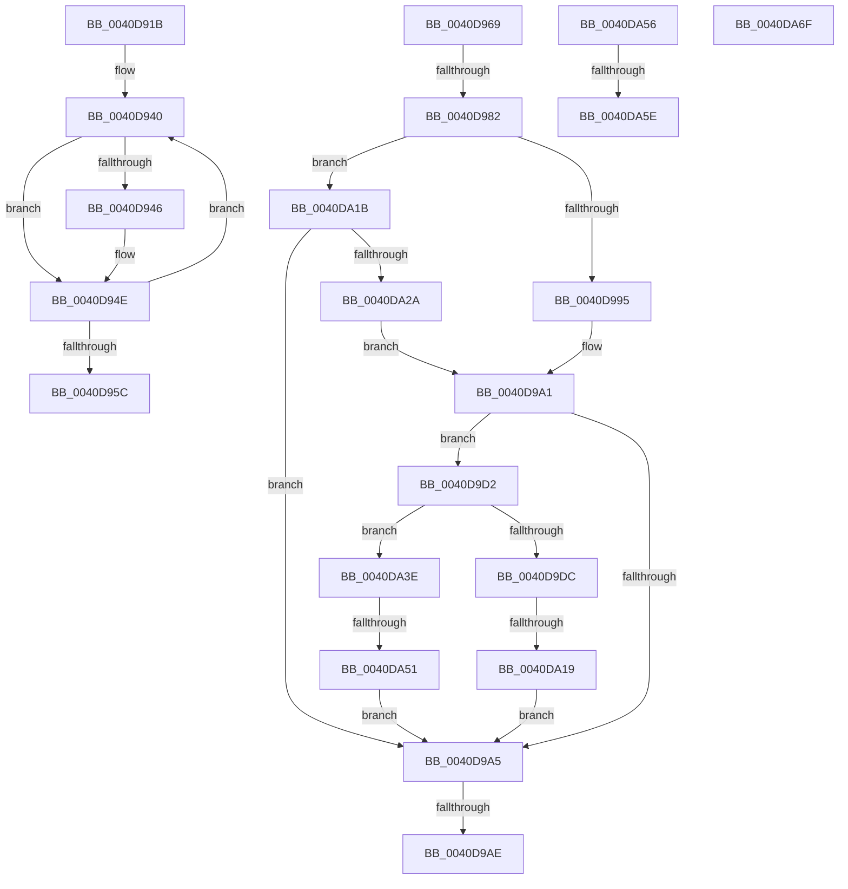

# sub_0040D91B

- RVA: `0x0040D91B`–`0x0040DA8E` (길이 `371` bytes)
- VA: `0x000000014040D91B`
- 실행 섹션: `.text`
- PDB 이름 있음: `아니요`; PDB Function 태그: `아니요`
- unwind 정보 RVA: `0x0009B1E0`
- 디코드: `89`개 명령, `371/371` bytes 표시
- 미해석 바이트: `0` (있으면 어셈블리에 `.byte`로 보존)

> 이 문서는 커널 이미지의 기계어와 PDB 기호를 분석해 생성했습니다. 4번과 5번은 함수 원형과 자료형을 바이너리 사용 방식에서 추정한 C 해석이며 원본 소스 복구 결과는 아닙니다.

## 1. Dependencies

- 직접 호출 지점: **6**; 고유 호출 대상: **6**
- 직접 호출자로 확인된 함수: **0**
- RIP 상대 이미지 참조: **1**

### Outgoing calls
- `0x0040D923` → [MiLockWorkingSetCoreShared](../27/MiLockWorkingSetCoreShared_function_0027C3E0.md) (function, `0x0027C3E0`)
- `0x0040D95F` → [MiUnlockWorkingSetCoreShared](../29/MiUnlockWorkingSetCoreShared_function_00292B00.md) (function, `0x00292B00`)
- `0x0040D9B9` → [MiWriteWsle](../29/MiWriteWsle_function_00292CA0.md) (function, `0x00292CA0`)
- `0x0040DA0C` → [MiGetPagePrivilege](../28/MiGetPagePrivilege_function_00285420.md) (function, `0x00285420`)
- `0x0040DA61` → [MiGetVaAge](../24/MiGetVaAge_function_00240AC0.md) (function, `0x00240AC0`)
- `0x0040DA88` → [KeBugCheckEx](../4F/KeBugCheckEx_function_004FD660.md) (function, `0x004FD660`)

### Direct callers
- 이 함수 시작 RVA로 연결되는 직접 call은 확인되지 않았습니다. 간접 호출은 완전히 역산할 수 없습니다.

### Static image references
- `0x0040DA1B` → RVA `0x00FC6A88` (`ALMOSTRO`; read)

## 2. Other-region calls and transfers

- 다른 실행 섹션으로 향하는 call: **0**
- call이 아닌 외부 분기/꼬리 이동: **8**
  - `0x0040D964` → [sub_0040D75D + 0x178](Unknown_function_0040D75D.md) (`tail-transfer`)
  - `0x0040D97C` → [sub_0040D75D + 0x15F](Unknown_function_0040D75D.md) (`tail-transfer`)
  - `0x0040D9A8` → [sub_006EC9CA](../6E/Unknown_function_006EC9CA.md) (`tail-transfer`)
  - `0x0040D9CD` → [sub_0040D75D + 0x15F](Unknown_function_0040D75D.md) (`tail-transfer`)
  - `0x0040DA13` → [sub_0040D75D + 0x15F](Unknown_function_0040D75D.md) (`tail-transfer`)
  - `0x0040DA4B` → [sub_0040D75D + 0x15F](Unknown_function_0040D75D.md) (`tail-transfer`)
  - `0x0040DA58` → [sub_0040D75D + 0x6E](Unknown_function_0040D75D.md) (`tail-transfer`)
  - `0x0040DA6A` → [sub_0040D75D + 0x142](Unknown_function_0040D75D.md) (`tail-transfer`)

## 3. Assembly (complete function range)

```asm
0040D91B  48 8B 7C 24 38                  mov rdi, qword ptr [rsp + 0x38]
0040D920  48 8B CF                        mov rcx, rdi
0040D923  E8 B8 EA E6 FF                  call 0x14027c3e0
0040D928  48 8B C3                        mov rax, rbx
0040D92B  F0 48 01 47 28                  lock add qword ptr [rdi + 0x28], rax
0040D930  41 B8 30 00 00 00               mov r8d, 0x30
0040D936  48 8D 54 24 4C                  lea rdx, [rsp + 0x4c]
0040D93B  45 8D 48 D7                     lea r9d, [r8 - 0x29]
0040D93F  90                              nop
0040D940  8B 02                           mov eax, dword ptr [rdx]
0040D942  85 C0                           test eax, eax
0040D944  74 08                           je 0x14040d94e
0040D946  48 F7 D8                        neg rax
0040D949  F0 4A 01 04 07                  lock add qword ptr [rdi + r8], rax
0040D94E  49 83 C0 08                     add r8, 8
0040D952  48 83 C2 04                     add rdx, 4
0040D956  49 83 E9 01                     sub r9, 1
0040D95A  75 E4                           jne 0x14040d940
0040D95C  48 8B CF                        mov rcx, rdi
0040D95F  E8 9C 51 E8 FF                  call 0x140292b00
0040D964  E9 6C FF FF FF                  jmp 0x14040d8d5
0040D969  F6 C3 20                        test bl, 0x20
0040D96C  0F 95 C1                        setne cl
0040D96F  F6 84 24 D0 00 00 00 01         test byte ptr [rsp + 0xd0], 1
0040D977  0F 95 C0                        setne al
0040D97A  84 C8                           test al, cl
0040D97C  0F 84 3A FF FF FF               je 0x14040d8bc
0040D982  48 8B 4C 24 38                  mov rcx, qword ptr [rsp + 0x38]
0040D987  8B 81 B8 00 00 00               mov eax, dword ptr [rcx + 0xb8]
0040D98D  A8 0F                           test al, 0xf
0040D98F  0F 85 86 00 00 00               jne 0x14040da1b
0040D995  33 C0                           xor eax, eax
0040D997  48 39 81 70 02 00 00            cmp qword ptr [rcx + 0x270], rax
0040D99E  0F 95 C0                        setne al
0040D9A1  85 C0                           test eax, eax
0040D9A3  75 2D                           jne 0x14040d9d2
0040D9A5  45 85 ED                        test r13d, r13d
0040D9A8  0F 85 1C F0 2D 00               jne 0x1406ec9ca
0040D9AE  40 80 E7 F0                     and dil, 0xf0
0040D9B2  49 8B D6                        mov rdx, r14
0040D9B5  44 0F B6 C7                     movzx r8d, dil
0040D9B9  E8 E2 52 E8 FF                  call 0x140292ca0
0040D9BE  FF 44 24 30                     inc dword ptr [rsp + 0x30]
0040D9C2  41 0F B6 C7                     movzx eax, r15b
0040D9C6  FF 44 84 48                     inc dword ptr [rsp + rax*4 + 0x48]
0040D9CA  45 32 FF                        xor r15b, r15b
0040D9CD  E9 EA FE FF FF                  jmp 0x14040d8bc
0040D9D2  8B 81 B8 00 00 00               mov eax, dword ptr [rcx + 0xb8]
0040D9D8  A8 0F                           test al, 0xf
0040D9DA  74 62                           je 0x14040da3e
0040D9DC  48 B8 FF FF FF FF FF 00 00 00   movabs rax, 0xffffffffff
0040D9E6  48 C1 EB 0C                     shr rbx, 0xc
0040D9EA  48 23 D8                        and rbx, rax
0040D9ED  48 B8 00 00 00 00 00 DE FF FF   movabs rax, 0xffffde0000000000
0040D9F7  48 8D 0C 5B                     lea rcx, [rbx + rbx*2]
0040D9FB  48 C1 E1 04                     shl rcx, 4
0040D9FF  48 8B C0                        mov rax, rax
0040DA02  45 33 C0                        xor r8d, r8d
0040DA05  48 03 C8                        add rcx, rax
0040DA08  41 8D 50 02                     lea edx, [r8 + 2]
0040DA0C  E8 0F 7A E7 FF                  call 0x140285420
0040DA11  A8 41                           test al, 0x41
0040DA13  0F 85 A3 FE FF FF               jne 0x14040d8bc
0040DA19  EB 8A                           jmp 0x14040d9a5
0040DA1B  48 0F BA 25 64 90 BB 00 24      bt qword ptr [rip + 0xbb9064], 0x24
0040DA24  0F 83 7B FF FF FF               jae 0x14040d9a5
0040DA2A  8B 81 B8 00 00 00               mov eax, dword ptr [rcx + 0xb8]
0040DA30  C1 E8 08                        shr eax, 8
0040DA33  C1 E8 03                        shr eax, 3
0040DA36  83 E0 01                        and eax, 1
0040DA39  E9 63 FF FF FF                  jmp 0x14040d9a1
0040DA3E  48 B8 FF FF FE FF FF 7F 00 00   movabs rax, 0x7ffffffeffff
0040DA48  4C 3B F0                        cmp r14, rax
0040DA4B  0F 86 6B FE FF FF               jbe 0x14040d8bc
0040DA51  E9 4F FF FF FF                  jmp 0x14040d9a5
0040DA56  84 DB                           test bl, bl
0040DA58  0F 88 6D FD FF FF               js 0x14040d7cb
0040DA5E  49 8B D6                        mov rdx, r14
0040DA61  E8 5A 30 E3 FF                  call 0x140240ac0
0040DA66  44 0F B6 F8                     movzx r15d, al
0040DA6A  E9 30 FE FF FF                  jmp 0x14040d89f
0040DA6F  40 0F B6 C7                     movzx eax, dil
0040DA73  4C 8B CB                        mov r9, rbx
0040DA76  4D 8B C6                        mov r8, r14
0040DA79  48 89 44 24 20                  mov qword ptr [rsp + 0x20], rax
0040DA7E  BA 80 12 04 00                  mov edx, 0x41280
0040DA83  B9 1A 00 00 00                  mov ecx, 0x1a
0040DA88  E8 D3 FB 0E 00                  call 0x1404fd660
0040DA8D  CC                              int3
```

## 4. C-style interpretation (structured pseudocode)

```c
__int64 __fastcall sub_0040D91B(__int64 a1, __int64 a2, __int64 a3, __int64 a4, __int64 a5, __int64 a6, __int64 a7)
{
    __int64 result;
    unsigned __int64 v_stack_p20;
    unsigned int v_stack_p30;
    unsigned __int64 v_stack_p38;
    unsigned __int64 v_stack_p4C;
    unsigned __int8 v_stack_pD0;

    result = MiLockWorkingSetCoreShared(a7, a2, a3, a4);
loc_0040D940:
    result = (unsigned int)(*(unsigned int *)(v_stack_p4C));
    if ((unsigned int)((unsigned int)(*(unsigned int *)(v_stack_p4C))) != 0) {
        result = -((unsigned int)(*(unsigned int *)(v_stack_p4C)));
    }
    a3 = (48) + (8);
    a2 = (v_stack_p4C) + (4);
    a4 = (48 - 41) - (1);
    if (condition_is_not_equal) goto loc_0040D940;
    result = MiUnlockWorkingSetCoreShared(a7, a2, a3, a4);
}
```

## 5. (Beta) C Style

```c
int64_t sub_0040D91B(int64_t Arg1, int64_t Arg2, int64_t Arg3, int64_t Arg4, uint64_t Arg5, uint64_t Arg6, void *Arg7)
{
    uint8_t *arg7 = (uint8_t *)Arg7;

    int64_t result;
    uint64_t v_stack_p20;
    uint32_t v_stack_p30;
    uint64_t v_stack_p38;
    uint64_t v_stack_p4C;
    uint8_t v_stack_pD0;

    result = MiLockWorkingSetCoreShared(Arg7, Arg2, Arg3, Arg4);
loc_0040D940:
    result = (uint32_t)(*(uint32_t *)(v_stack_p4C));
    if ((uint32_t)((uint32_t)(*(uint32_t *)(v_stack_p4C))) != 0) {
        result = -((uint32_t)(*(uint32_t *)(v_stack_p4C)));
    }
    Arg3 = (48) + (8);
    Arg2 = (v_stack_p4C) + (4);
    Arg4 = (48 - 41) - (1);
    if (condition_is_not_equal) goto loc_0040D940;
    result = MiUnlockWorkingSetCoreShared(Arg7, Arg2, Arg3, Arg4);
}
```

### 관측된 메모리 오프셋

구조체 형식이 확인되지 않은 접근은 인자 기준의 오프셋으로만 기록했습니다.

| 기준 인자 | 오프셋 표현 | 폭 (bit) | 접근 |
|---|---:|---:|---|
| `Arg7` | `+ 0x0 + r8*1` | `64` | `R/W` |
| `Arg7` | `+ 0x28` | `64` | `R/W` |

## 6. Execution-region graph

[열기: 2D/3D 그래프와 함수 탐색 컨트롤 패널](../../../control-panel.html?section=text&rva=0x0040D91B&view=graph)

- 2D 그래프는 위에서 아래로 흐르고, 3D 그래프는 빈 공간을 드래그해 회전합니다. Shift+드래그는 이동, 휠은 확대·축소, 함수 노드 선택은 대상 보고서 이동입니다.

### Static fallback


