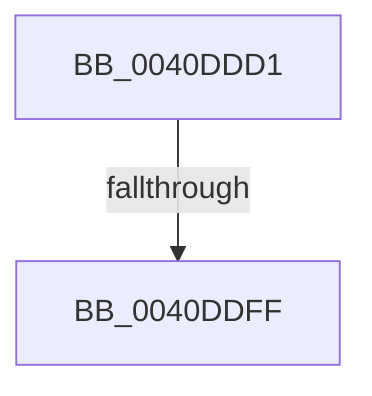

# sub_0040DDD1

- RVA: `0x0040DDD1`–`0x0040DE09` (길이 `56` bytes)
- VA: `0x000000014040DDD1`
- 실행 섹션: `.text`
- PDB 이름 있음: `아니요`; PDB Function 태그: `아니요`
- unwind 정보 RVA: `0x0009B6CC`
- 디코드: `13`개 명령, `56/56` bytes 표시
- 미해석 바이트: `0` (있으면 어셈블리에 `.byte`로 보존)

> 이 문서는 커널 이미지의 기계어와 PDB 기호를 분석해 생성했습니다. 4번과 5번은 함수 원형과 자료형을 바이너리 사용 방식에서 추정한 C 해석이며 원본 소스 복구 결과는 아닙니다.

## 1. Dependencies

- 직접 호출 지점: **0**; 고유 호출 대상: **0**
- 직접 호출자로 확인된 함수: **0**
- RIP 상대 이미지 참조: **1**

### Outgoing calls
- 직접 디코드된 call 명령이 없습니다.

### Direct callers
- 이 함수 시작 RVA로 연결되는 직접 call은 확인되지 않았습니다. 간접 호출은 완전히 역산할 수 없습니다.

### Static image references
- `0x0040DDF3` → RVA `0x00FC6ED8` (`ALMOSTRO`; read)

## 2. Other-region calls and transfers

- 다른 실행 섹션으로 향하는 call: **0**
- call이 아닌 외부 분기/꼬리 이동: **2**
  - `0x0040DDFD` → [sub_0040DE18](Unknown_function_0040DE18.md) (`tail-transfer`)
  - `0x0040DE07` → [sub_0040DE09 + 0x5](Unknown_function_0040DE09.md) (`tail-transfer`)

## 3. Assembly (complete function range)

```asm
0040DDD1  48 89 74 24 40                  mov qword ptr [rsp + 0x40], rsi
0040DDD6  48 8B F3                        mov rsi, rbx
0040DDD9  48 89 7C 24 48                  mov qword ptr [rsp + 0x48], rdi
0040DDDE  48 BF 00 00 00 00 00 80 00 00   movabs rdi, 0x800000000000
0040DDE8  48 03 F9                        add rdi, rcx
0040DDEB  48 C1 EE 03                     shr rsi, 3
0040DDEF  48 C1 EF 03                     shr rdi, 3
0040DDF3  48 03 3D DE 90 BB 00            add rdi, qword ptr [rip + 0xbb90de]
0040DDFA  48 85 F6                        test rsi, rsi
0040DDFD  75 19                           jne 0x14040de18
0040DDFF  48 8B 74 24 40                  mov rsi, qword ptr [rsp + 0x40]
0040DE04  F6 C3 07                        test bl, 7
0040DE07  74 05                           je 0x14040de0e
```

## 4. C-style interpretation (structured pseudocode)

```c
void __fastcall sub_0040DDD1(__int64 a1, __int64 a2, __int64 a3, __int64 a4, __int64 a5, __int64 a6, __int64 a7, __int64 a8)
{
    __int64 v_rdi;
    __int64 v_rsi;
    unsigned __int64 v_stack_p40;
    unsigned __int64 v_stack_p48;

    v_stack_p40 = v_rsi;
    v_stack_p48 = v_rdi;
    v_rdi = (v_rdi) + (a1);
    v_rsi = (v_rbx) >> (3);
    v_rdi = (v_rdi) >> (3);
    v_rdi = (v_rdi) + (*(unsigned __int64 *)(v_rip + 12292318));
}
```

## 5. (Beta) C Style

```c
void sub_0040DDD1(int64_t Arg1, int64_t Arg2, int64_t Arg3, int64_t Arg4, uint64_t Arg5, uint64_t Arg6, uint64_t Arg7, int64_t Arg8)
{
    int64_t local_rdi;
    int64_t local_rsi;
    uint64_t v_stack_p40;
    uint64_t v_stack_p48;

    v_stack_p40 = local_rsi;
    v_stack_p48 = local_rdi;
    local_rdi = (local_rdi) + (Arg1);
    local_rsi = (local_rbx) >> (3);
    local_rdi = (local_rdi) >> (3);
    local_rdi = (local_rdi) + (*(uint64_t *)(v_rip + 0xBB90DE));
}
```

## 6. Execution-region graph

[열기: 2D/3D 그래프와 함수 탐색 컨트롤 패널](../../../control-panel.html?section=text&rva=0x0040DDD1&view=graph)

- 2D 그래프는 위에서 아래로 흐르고, 3D 그래프는 빈 공간을 드래그해 회전합니다. Shift+드래그는 이동, 휠은 확대·축소, 함수 노드 선택은 대상 보고서 이동입니다.

### Static fallback


