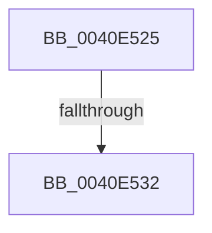

# sub_0040E525

- RVA: `0x0040E525`–`0x0040E53A` (길이 `21` bytes)
- VA: `0x000000014040E525`
- 실행 섹션: `.text`
- PDB 이름 있음: `아니요`; PDB Function 태그: `아니요`
- unwind 정보 RVA: `0x0009B8BC`
- 디코드: `5`개 명령, `21/21` bytes 표시
- 미해석 바이트: `0` (있으면 어셈블리에 `.byte`로 보존)

> 이 문서는 커널 이미지의 기계어와 PDB 기호를 분석해 생성했습니다. 4번과 5번은 함수 원형과 자료형을 바이너리 사용 방식에서 추정한 C 해석이며 원본 소스 복구 결과는 아닙니다.

## 1. Dependencies

- 직접 호출 지점: **0**; 고유 호출 대상: **0**
- 직접 호출자로 확인된 함수: **0**
- RIP 상대 이미지 참조: **0**

### Outgoing calls
- 직접 디코드된 call 명령이 없습니다.

### Direct callers
- 이 함수 시작 RVA로 연결되는 직접 call은 확인되지 않았습니다. 간접 호출은 완전히 역산할 수 없습니다.

### Static image references
- 디코드된 RIP-relative 메모리 참조가 없습니다.

## 2. Other-region calls and transfers

- 다른 실행 섹션으로 향하는 call: **0**
- call이 아닌 외부 분기/꼬리 이동: **1**
  - `0x0040E52C` → [sub_0040E632](Unknown_function_0040E632.md) (`tail-transfer`)

## 3. Assembly (complete function range)

```asm
0040E525  48 89 7C 24 40                  mov qword ptr [rsp + 0x40], rdi
0040E52A  3C 06                           cmp al, 6
0040E52C  0F 83 00 01 00 00               jae 0x14040e632
0040E532  8B 81 B8 00 00 00               mov eax, dword ptr [rcx + 0xb8]
0040E538  24 0F                           and al, 0xf
```

## 4. C-style interpretation (structured pseudocode)

```c
__int64 __fastcall sub_0040E525(__int64 a1)
{
    __int64 result;
    unsigned __int64 v_stack_p40;

    v_stack_p40 = v_rdi;
    result = (unsigned __int8)(((unsigned int)(*(unsigned int *)(a1 + 184))) & (15));
    return result;
}
```

## 5. (Beta) C Style

```c
int64_t sub_0040E525(void *Arg1)
{
    uint8_t *arg1 = (uint8_t *)Arg1;

    int64_t result;
    uint64_t v_stack_p40;

    v_stack_p40 = local_rdi;
    result = (uint8_t)(((uint32_t)(*(uint32_t *)(arg1 + 0xB8))) & (15));
    return result;
}
```

### 관측된 메모리 오프셋

구조체 형식이 확인되지 않은 접근은 인자 기준의 오프셋으로만 기록했습니다.

| 기준 인자 | 오프셋 표현 | 폭 (bit) | 접근 |
|---|---:|---:|---|
| `Arg1` | `+ 0xB8` | `32` | `R` |

## 6. Execution-region graph

[열기: 2D/3D 그래프와 함수 탐색 컨트롤 패널](../../../control-panel.html?section=text&rva=0x0040E525&view=graph)

- 2D 그래프는 위에서 아래로 흐르고, 3D 그래프는 빈 공간을 드래그해 회전합니다. Shift+드래그는 이동, 휠은 확대·축소, 함수 노드 선택은 대상 보고서 이동입니다.

### Static fallback


