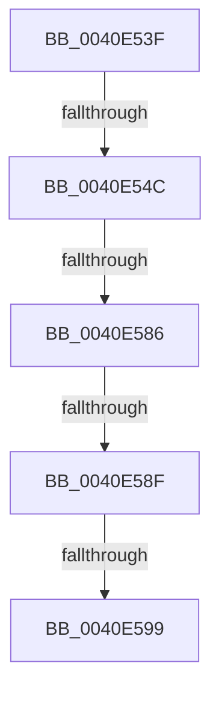

# sub_0040E53F

- RVA: `0x0040E53F`–`0x0040E5BF` (길이 `128` bytes)
- VA: `0x000000014040E53F`
- 실행 섹션: `.text`
- PDB 이름 있음: `아니요`; PDB Function 태그: `아니요`
- unwind 정보 RVA: `0x0009B8E4`
- 디코드: `29`개 명령, `128/128` bytes 표시
- 미해석 바이트: `0` (있으면 어셈블리에 `.byte`로 보존)

> 이 문서는 커널 이미지의 기계어와 PDB 기호를 분석해 생성했습니다. 4번과 5번은 함수 원형과 자료형을 바이너리 사용 방식에서 추정한 C 해석이며 원본 소스 복구 결과는 아닙니다.

## 1. Dependencies

- 직접 호출 지점: **1**; 고유 호출 대상: **1**
- 직접 호출자로 확인된 함수: **0**
- RIP 상대 이미지 참조: **4**

### Outgoing calls
- `0x0040E5A0` → [ExpAcquireSpinLockSharedAtDpcLevelInstrumented](../27/ExpAcquireSpinLockSharedAtDpcLevelInstrumented_function_0027CD20.md) (function, `0x0027CD20`)

### Direct callers
- 이 함수 시작 RVA로 연결되는 직접 call은 확인되지 않았습니다. 간접 호출은 완전히 역산할 수 없습니다.

### Static image references
- `0x0040E54C` → RVA `0x00E38840` (`.data`; read)
- `0x0040E579` → RVA `0x00FC6D20` (`ALMOSTRO`; read)
- `0x0040E586` → RVA `0x00FC6B06` (`ALMOSTRO`; read)
- `0x0040E58F` → RVA `0x00F0DE58` (`.data`; read)

## 2. Other-region calls and transfers

- 다른 실행 섹션으로 향하는 call: **0**
- call이 아닌 외부 분기/꼬리 이동: **5**
  - `0x0040E546` → [sub_0040E667](Unknown_function_0040E667.md) (`tail-transfer`)
  - `0x0040E580` → [sub_0040E5FD + 0x24](Unknown_function_0040E5FD.md) (`tail-transfer`)
  - `0x0040E58D` → [sub_0040E5FD](Unknown_function_0040E5FD.md) (`tail-transfer`)
  - `0x0040E597` → [sub_0040E5FD](Unknown_function_0040E5FD.md) (`tail-transfer`)
  - `0x0040E5BD` → [sub_0040E5BF + 0x6](Unknown_function_0040E5BF.md) (`tail-transfer`)

## 3. Assembly (complete function range)

```asm
0040E53F  48 89 74 24 38                  mov qword ptr [rsp + 0x38], rsi
0040E544  3C 01                           cmp al, 1
0040E546  0F 85 1B 01 00 00               jne 0x14040e667
0040E54C  48 8D 05 ED A2 A2 00            lea rax, [rip + 0xa2a2ed]
0040E553  65 8B 3C 25 A4 01 00 00         mov edi, dword ptr gs:[0x1a4]
0040E55B  48 8B 00                        mov rax, qword ptr [rax]
0040E55E  D1 EF                           shr edi, 1
0040E560  83 E7 03                        and edi, 3
0040E563  8B F7                           mov esi, edi
0040E565  48 C1 E6 06                     shl rsi, 6
0040E569  48 03 F0                        add rsi, rax
0040E56C  44 0F 20 C5                     mov rbp, cr8
0040E570  B8 02 00 00 00                  mov eax, 2
0040E575  44 0F 22 C0                     mov cr8, rax
0040E579  83 3D A0 87 BB 00 00            cmp dword ptr [rip + 0xbb87a0], 0
0040E580  0F 85 9B 00 00 00               jne 0x14040e621
0040E586  F6 05 79 85 BB 00 21            test byte ptr [rip + 0xbb8579], 0x21
0040E58D  74 6E                           je 0x14040e5fd
0040E58F  8B 05 C3 F8 AF 00               mov eax, dword ptr [rip + 0xaff8c3]
0040E595  85 C0                           test eax, eax
0040E597  75 64                           jne 0x14040e5fd
0040E599  40 0F B6 D5                     movzx edx, bpl
0040E59D  48 8B CE                        mov rcx, rsi
0040E5A0  E8 7B E7 E6 FF                  call 0x14027cd20
0040E5A5  65 48 8B 04 25 20 00 00 00      mov rax, qword ptr gs:[0x20]
0040E5AE  48 8B 74 24 38                  mov rsi, qword ptr [rsp + 0x38]
0040E5B3  48 8B 88 38 88 00 00            mov rcx, qword ptr [rax + 0x8838]
0040E5BA  48 85 C9                        test rcx, rcx
0040E5BD  74 06                           je 0x14040e5c5
```

## 4. C-style interpretation (structured pseudocode)

```c
__int64 __fastcall sub_0040E53F(__int64 a1, __int64 a2, __int64 a3, __int64 a4, __int64 a5, __int64 a6, __int64 a7)
{
    __int64 result;
    __int64 v_rdi;
    __int64 v_rsi;
    unsigned __int64 v_stack_p38;

    v_stack_p38 = v_rsi;
    v_rdi = (unsigned int)(((unsigned int)(*(unsigned int *)(gs_base + (0 + 420)))) >> (1));
    v_rdi = (unsigned int)((v_rdi) & (3));
    v_rsi = ((unsigned int)((unsigned int)(v_rdi))) << (6);
    v_rsi = (v_rsi) + (*(unsigned __int64 *)(v_rip + 10658541));
    result = ExpAcquireSpinLockSharedAtDpcLevelInstrumented(v_rsi, (unsigned __int8)(v_cr8), a3, a4);
}
```

## 5. (Beta) C Style

```c
int64_t sub_0040E53F(int64_t Arg1, int64_t Arg2, int64_t Arg3, int64_t Arg4, uint64_t Arg5, uint64_t Arg6, int64_t Arg7)
{
    int64_t result;
    int64_t local_rdi;
    int64_t local_rsi;
    uint64_t v_stack_p38;

    v_stack_p38 = local_rsi;
    local_rdi = (uint32_t)(((uint32_t)(*(uint32_t *)(gs_base + (0 + 0x1A4)))) >> (1));
    local_rdi = (uint32_t)((local_rdi) & (3));
    local_rsi = ((uint32_t)((uint32_t)(local_rdi))) << (6);
    local_rsi = (local_rsi) + (*(uint64_t *)(v_rip + 0xA2A2ED));
    result = ExpAcquireSpinLockSharedAtDpcLevelInstrumented(local_rsi, (uint8_t)(v_cr8), Arg3, Arg4);
}
```

## 6. Execution-region graph

[열기: 2D/3D 그래프와 함수 탐색 컨트롤 패널](../../../control-panel.html?section=text&rva=0x0040E53F&view=graph)

- 2D 그래프는 위에서 아래로 흐르고, 3D 그래프는 빈 공간을 드래그해 회전합니다. Shift+드래그는 이동, 휠은 확대·축소, 함수 노드 선택은 대상 보고서 이동입니다.

### Static fallback


