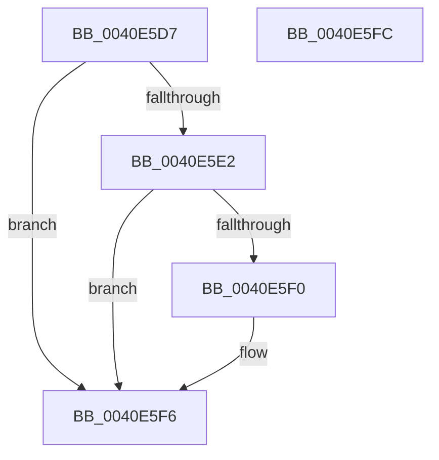

# sub_0040E5D7

- RVA: `0x0040E5D7`–`0x0040E5FD` (길이 `38` bytes)
- VA: `0x000000014040E5D7`
- 실행 섹션: `.text`
- PDB 이름 있음: `아니요`; PDB Function 태그: `아니요`
- unwind 정보 RVA: `0x0009B918`
- 디코드: `14`개 명령, `38/38` bytes 표시
- 미해석 바이트: `0` (있으면 어셈블리에 `.byte`로 보존)

> 이 문서는 커널 이미지의 기계어와 PDB 기호를 분석해 생성했습니다. 4번과 5번은 함수 원형과 자료형을 바이너리 사용 방식에서 추정한 C 해석이며 원본 소스 복구 결과는 아닙니다.

## 1. Dependencies

- 직접 호출 지점: **0**; 고유 호출 대상: **0**
- 직접 호출자로 확인된 함수: **0**
- RIP 상대 이미지 참조: **0**

### Outgoing calls
- 직접 디코드된 call 명령이 없습니다.

### Direct callers
- 이 함수 시작 RVA로 연결되는 직접 call은 확인되지 않았습니다. 간접 호출은 완전히 역산할 수 없습니다.

### Static image references
- 디코드된 RIP-relative 메모리 참조가 없습니다.

## 2. Other-region calls and transfers

- 다른 실행 섹션으로 향하는 call: **0**
- 별도 외부 분기/꼬리 이동을 확인하지 못했습니다.

## 3. Assembly (complete function range)

```asm
0040E5D7  8B 4B 48                        mov ecx, dword ptr [rbx + 0x48]
0040E5DA  8B C1                           mov eax, ecx
0040E5DC  24 0F                           and al, 0xf
0040E5DE  3C 01                           cmp al, 1
0040E5E0  75 14                           jne 0x14040e5f6
0040E5E2  48 8B 43 58                     mov rax, qword ptr [rbx + 0x58]
0040E5E6  48 83 B8 80 02 00 00 00         cmp qword ptr [rax + 0x280], 0
0040E5EE  74 06                           je 0x14040e5f6
0040E5F0  83 C9 10                        or ecx, 0x10
0040E5F3  89 4B 48                        mov dword ptr [rbx + 0x48], ecx
0040E5F6  48 83 C4 20                     add rsp, 0x20
0040E5FA  5B                              pop rbx
0040E5FB  C3                              ret
0040E5FC  CC                              int3
```

## 4. C-style interpretation (structured pseudocode)

```c
__int64 __fastcall sub_0040E5D7(void)
{
    __int64 result;
    __int64 v_rsp;

    result = (unsigned __int8)(((unsigned int)((unsigned int)((unsigned int)(*(unsigned int *)(v_rbx + 72))))) & (15));
    if (((unsigned __int8)(result)) != 1) goto loc_0040E5F6;
    if ((*(unsigned __int64 *)(*(unsigned __int64 *)(v_rbx + 88) + 640)) != 0) {
        a1 = (unsigned int)(((unsigned int)(*(unsigned int *)(v_rbx + 72))) | (16));
        *(unsigned int *)(v_rbx + 72) = (unsigned int)(a1);
    }
    v_rsp = (v_rsp) + (32);
    return *(unsigned __int64 *)(v_rbx + 88);
}
```

## 5. (Beta) C Style

```c
void sub_0040E5D7(void)
{
    int64_t result;
    int64_t local_rsp;

    result = (uint8_t)(((uint32_t)((uint32_t)((uint32_t)(*(uint32_t *)(local_rbx + 0x48))))) & (15));
    if (((uint8_t)(result)) != 1) goto loc_0040E5F6;
    if ((*(uint64_t *)(*(uint64_t *)(local_rbx + 0x58) + 0x280)) != 0) {
        a1 = (uint32_t)(((uint32_t)(*(uint32_t *)(local_rbx + 0x48))) | (16));
        *(uint32_t *)(local_rbx + 0x48) = (uint32_t)(a1);
    }
    local_rsp = (local_rsp) + (32);
    return *(uint64_t *)(local_rbx + 0x58);
}
```

## 6. Execution-region graph

[열기: 2D/3D 그래프와 함수 탐색 컨트롤 패널](../../../control-panel.html?section=text&rva=0x0040E5D7&view=graph)

- 2D 그래프는 위에서 아래로 흐르고, 3D 그래프는 빈 공간을 드래그해 회전합니다. Shift+드래그는 이동, 휠은 확대·축소, 함수 노드 선택은 대상 보고서 이동입니다.

### Static fallback


