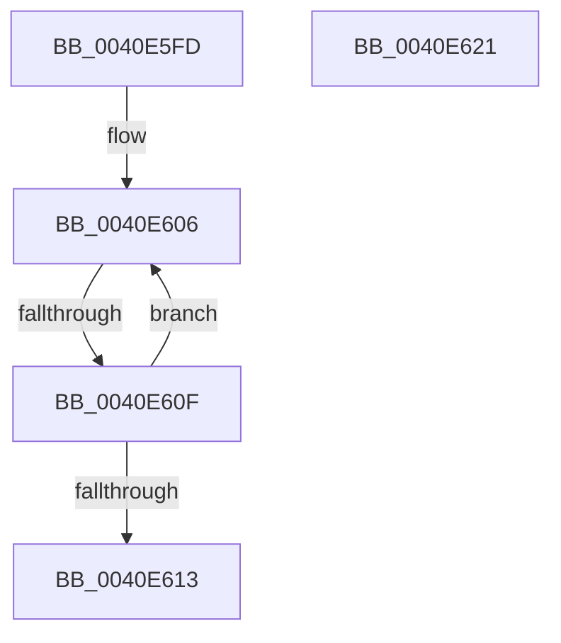

# sub_0040E5FD

- RVA: `0x0040E5FD`–`0x0040E632` (길이 `53` bytes)
- VA: `0x000000014040E5FD`
- 실행 섹션: `.text`
- PDB 이름 있음: `아니요`; PDB Function 태그: `아니요`
- unwind 정보 RVA: `0x0009B92C`
- 디코드: `16`개 명령, `53/53` bytes 표시
- 미해석 바이트: `0` (있으면 어셈블리에 `.byte`로 보존)

> 이 문서는 커널 이미지의 기계어와 PDB 기호를 분석해 생성했습니다. 4번과 5번은 함수 원형과 자료형을 바이너리 사용 방식에서 추정한 C 해석이며 원본 소스 복구 결과는 아닙니다.

## 1. Dependencies

- 직접 호출 지점: **2**; 고유 호출 대상: **2**
- 직접 호출자로 확인된 함수: **0**
- RIP 상대 이미지 참조: **0**

### Outgoing calls
- `0x0040E61A` → [ExpWaitForSpinLockSharedAndAcquire](../36/ExpWaitForSpinLockSharedAndAcquire_function_00362380.md) (function, `0x00362380`)
- `0x0040E628` → [KiRaiseIrqlProcessIrqlFlags](../4F/KiRaiseIrqlProcessIrqlFlags_function_004F56FC.md) (function, `0x004F56FC`)

### Direct callers
- 이 함수 시작 RVA로 연결되는 직접 call은 확인되지 않았습니다. 간접 호출은 완전히 역산할 수 없습니다.

### Static image references
- 디코드된 RIP-relative 메모리 참조가 없습니다.

## 2. Other-region calls and transfers

- 다른 실행 섹션으로 향하는 call: **0**
- call이 아닌 외부 분기/꼬리 이동: **3**
  - `0x0040E60D` → [sub_0040E53F + 0x66](Unknown_function_0040E53F.md) (`tail-transfer`)
  - `0x0040E61F` → [sub_0040E53F + 0x66](Unknown_function_0040E53F.md) (`tail-transfer`)
  - `0x0040E62D` → [sub_0040E53F + 0x47](Unknown_function_0040E53F.md) (`tail-transfer`)

## 3. Assembly (complete function range)

```asm
0040E5FD  0F 0D 0E                        prefetchw byte ptr [rsi]
0040E600  8B 06                           mov eax, dword ptr [rsi]
0040E602  0F BA F0 1F                     btr eax, 0x1f
0040E606  8D 48 01                        lea ecx, [rax + 1]
0040E609  F0 0F B1 0E                     lock cmpxchg dword ptr [rsi], ecx
0040E60D  74 96                           je 0x14040e5a5
0040E60F  85 C0                           test eax, eax
0040E611  79 F3                           jns 0x14040e606
0040E613  40 0F B6 D5                     movzx edx, bpl
0040E617  48 8B CE                        mov rcx, rsi
0040E61A  E8 61 3D F5 FF                  call 0x140362380
0040E61F  EB 84                           jmp 0x14040e5a5
0040E621  0F B6 D0                        movzx edx, al
0040E624  40 0F B6 CD                     movzx ecx, bpl
0040E628  E8 CF 70 0E 00                  call 0x1404f56fc
0040E62D  E9 54 FF FF FF                  jmp 0x14040e586
```

## 4. C-style interpretation (structured pseudocode)

```c
__int64 __fastcall sub_0040E5FD(void)
{
    __int64 result;

loc_0040E606:
    if (!sign_flag) goto loc_0040E606;
    result = ExpWaitForSpinLockSharedAndAcquire(v_rsi, (unsigned __int8)(v_rbp), a3, a4);
}
```

## 5. (Beta) C Style

```c
void sub_0040E5FD(void)
{
    int64_t result;

loc_0040E606:
    if (!sign_flag) goto loc_0040E606;
    result = ExpWaitForSpinLockSharedAndAcquire(local_rsi, (uint8_t)(local_rbp), a3, a4);
}
```

## 6. Execution-region graph

[열기: 2D/3D 그래프와 함수 탐색 컨트롤 패널](../../../control-panel.html?section=text&rva=0x0040E5FD&view=graph)

- 2D 그래프는 위에서 아래로 흐르고, 3D 그래프는 빈 공간을 드래그해 회전합니다. Shift+드래그는 이동, 휠은 확대·축소, 함수 노드 선택은 대상 보고서 이동입니다.

### Static fallback


