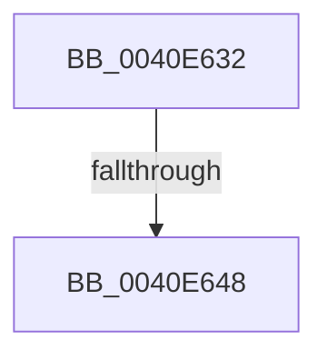

# sub_0040E632

- RVA: `0x0040E632`–`0x0040E659` (길이 `39` bytes)
- VA: `0x000000014040E632`
- 실행 섹션: `.text`
- PDB 이름 있음: `아니요`; PDB Function 태그: `아니요`
- unwind 정보 RVA: `0x0009B948`
- 디코드: `9`개 명령, `39/39` bytes 표시
- 미해석 바이트: `0` (있으면 어셈블리에 `.byte`로 보존)

> 이 문서는 커널 이미지의 기계어와 PDB 기호를 분석해 생성했습니다. 4번과 5번은 함수 원형과 자료형을 바이너리 사용 방식에서 추정한 C 해석이며 원본 소스 복구 결과는 아닙니다.

## 1. Dependencies

- 직접 호출 지점: **1**; 고유 호출 대상: **1**
- 직접 호출자로 확인된 함수: **0**
- RIP 상대 이미지 참조: **1**

### Outgoing calls
- `0x0040E64F` → [KiRaiseIrqlProcessIrqlFlags](../4F/KiRaiseIrqlProcessIrqlFlags_function_004F56FC.md) (function, `0x004F56FC`)

### Direct callers
- 이 함수 시작 RVA로 연결되는 직접 call은 확인되지 않았습니다. 간접 호출은 완전히 역산할 수 없습니다.

### Static image references
- `0x0040E63F` → RVA `0x00FC6D20` (`ALMOSTRO`; read)

## 2. Other-region calls and transfers

- 다른 실행 섹션으로 향하는 call: **0**
- call이 아닌 외부 분기/꼬리 이동: **2**
  - `0x0040E646` → [sub_0040E5CE](Unknown_function_0040E5CE.md) (`tail-transfer`)
  - `0x0040E654` → [sub_0040E5CE](Unknown_function_0040E5CE.md) (`tail-transfer`)

## 3. Assembly (complete function range)

```asm
0040E632  44 0F 20 C7                     mov rdi, cr8
0040E636  B8 02 00 00 00                  mov eax, 2
0040E63B  44 0F 22 C0                     mov cr8, rax
0040E63F  83 3D DA 86 BB 00 00            cmp dword ptr [rip + 0xbb86da], 0
0040E646  74 86                           je 0x14040e5ce
0040E648  0F B6 D0                        movzx edx, al
0040E64B  40 0F B6 CF                     movzx ecx, dil
0040E64F  E8 A8 70 0E 00                  call 0x1404f56fc
0040E654  E9 75 FF FF FF                  jmp 0x14040e5ce
```

## 4. C-style interpretation (structured pseudocode)

```c
__int64 __fastcall sub_0040E632(void)
{
    __int64 result;

    result = KiRaiseIrqlProcessIrqlFlags((unsigned __int8)(v_cr8), 2, a3, a4);
}
```

## 5. (Beta) C Style

```c
void sub_0040E632(void)
{
    int64_t result;

    result = KiRaiseIrqlProcessIrqlFlags((uint8_t)(v_cr8), 2, a3, a4);
}
```

## 6. Execution-region graph

[열기: 2D/3D 그래프와 함수 탐색 컨트롤 패널](../../../control-panel.html?section=text&rva=0x0040E632&view=graph)

- 2D 그래프는 위에서 아래로 흐르고, 3D 그래프는 빈 공간을 드래그해 회전합니다. Shift+드래그는 이동, 휠은 확대·축소, 함수 노드 선택은 대상 보고서 이동입니다.

### Static fallback


