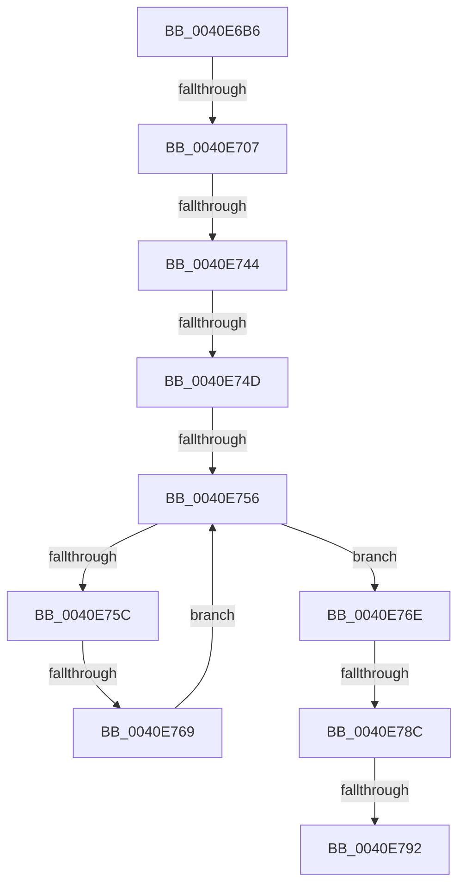

# sub_0040E6B6

- RVA: `0x0040E6B6`–`0x0040E7B7` (길이 `257` bytes)
- VA: `0x000000014040E6B6`
- 실행 섹션: `.text`
- PDB 이름 있음: `아니요`; PDB Function 태그: `아니요`
- unwind 정보 RVA: `0x0009B998`
- 디코드: `76`개 명령, `257/257` bytes 표시
- 미해석 바이트: `0` (있으면 어셈블리에 `.byte`로 보존)

> 이 문서는 커널 이미지의 기계어와 PDB 기호를 분석해 생성했습니다. 4번과 5번은 함수 원형과 자료형을 바이너리 사용 방식에서 추정한 C 해석이며 원본 소스 복구 결과는 아닙니다.

## 1. Dependencies

- 직접 호출 지점: **0**; 고유 호출 대상: **0**
- 직접 호출자로 확인된 함수: **0**
- RIP 상대 이미지 참조: **0**

### Outgoing calls
- 직접 디코드된 call 명령이 없습니다.

### Direct callers
- 이 함수 시작 RVA로 연결되는 직접 call은 확인되지 않았습니다. 간접 호출은 완전히 역산할 수 없습니다.

### Static image references
- 디코드된 RIP-relative 메모리 참조가 없습니다.

## 2. Other-region calls and transfers

- 다른 실행 섹션으로 향하는 call: **0**
- call이 아닌 외부 분기/꼬리 이동: **7**
  - `0x0040E701` → [sub_0040EA10 + 0x5D](Unknown_function_0040EA10.md) (`tail-transfer`)
  - `0x0040E73E` → [sub_0040E7B8 + 0x118](Unknown_function_0040E7B8.md) (`tail-transfer`)
  - `0x0040E747` → [sub_0040E7B8 + 0xD8](Unknown_function_0040E7B8.md) (`tail-transfer`)
  - `0x0040E750` → [sub_0040E7B8 + 0x63](Unknown_function_0040E7B8.md) (`tail-transfer`)
  - `0x0040E763` → [sub_0040E7B8 + 0x32](Unknown_function_0040E7B8.md) (`tail-transfer`)
  - `0x0040E786` → [sub_0040E7B8 + 0x5B](Unknown_function_0040E7B8.md) (`tail-transfer`)
  - `0x0040E790` → [sub_0040E7B8 + 0x38](Unknown_function_0040E7B8.md) (`tail-transfer`)

## 3. Assembly (complete function range)

```asm
0040E6B6  48 89 5C 24 58                  mov qword ptr [rsp + 0x58], rbx
0040E6BB  48 89 6C 24 10                  mov qword ptr [rsp + 0x10], rbp
0040E6C0  49 8B E8                        mov rbp, r8
0040E6C3  83 E5 04                        and ebp, 4
0040E6C6  48 89 7C 24 08                  mov qword ptr [rsp + 8], rdi
0040E6CB  8B C5                           mov eax, ebp
0040E6CD  4C 89 3C 24                     mov qword ptr [rsp], r15
0040E6D1  48 F7 D8                        neg rax
0040E6D4  1B FF                           sbb edi, edi
0040E6D6  83 E7 20                        and edi, 0x20
0040E6D9  48 8B C5                        mov rax, rbp
0040E6DC  44 89 5C 24 48                  mov dword ptr [rsp + 0x48], r11d
0040E6E1  48 F7 D8                        neg rax
0040E6E4  46 8D 14 0F                     lea r10d, [rdi + r9]
0040E6E8  42 8D 14 37                     lea edx, [rdi + r14]
0040E6EC  41 8B C2                        mov eax, r10d
0040E6EF  48 1B C9                        sbb rcx, rcx
0040E6F2  4D 8B F8                        mov r15, r8
0040E6F5  83 E1 04                        and ecx, 4
0040E6F8  2B C2                           sub eax, edx
0040E6FA  4C 2B F9                        sub r15, rcx
0040E6FD  FF C0                           inc eax
0040E6FF  3B C6                           cmp eax, esi
0040E701  0F 82 66 03 00 00               jb 0x14040ea6d
0040E707  41 8B DA                        mov ebx, r10d
0040E70A  8B CA                           mov ecx, edx
0040E70C  2B DE                           sub ebx, esi
0040E70E  80 E1 3F                        and cl, 0x3f
0040E711  FF C3                           inc ebx
0040E713  41 B8 01 00 00 00               mov r8d, 1
0040E719  49 D3 E0                        shl r8, cl
0040E71C  49 FF C8                        dec r8
0040E71F  8B C3                           mov eax, ebx
0040E721  48 C1 E8 06                     shr rax, 6
0040E725  89 5C 24 48                     mov dword ptr [rsp + 0x48], ebx
0040E729  4D 8D 0C C7                     lea r9, [r15 + rax*8]
0040E72D  8B C2                           mov eax, edx
0040E72F  48 C1 E8 06                     shr rax, 6
0040E733  4D 0B 04 C7                     or r8, qword ptr [r15 + rax*8]
0040E737  49 8D 04 C7                     lea rax, [r15 + rax*8]
0040E73B  83 FE 7F                        cmp esi, 0x7f
0040E73E  0F 87 8C 01 00 00               ja 0x14040e8d0
0040E744  83 FE 40                        cmp esi, 0x40
0040E747  0F 83 43 01 00 00               jae 0x14040e890
0040E74D  83 FE 01                        cmp esi, 1
0040E750  0F 87 C5 00 00 00               ja 0x14040e81b
0040E756  49 83 F8 FF                     cmp r8, -1
0040E75A  75 12                           jne 0x14040e76e
0040E75C  48 83 C0 08                     add rax, 8
0040E760  49 3B C1                        cmp rax, r9
0040E763  0F 87 81 00 00 00               ja 0x14040e7ea
0040E769  4C 8B 00                        mov r8, qword ptr [rax]
0040E76C  EB E8                           jmp 0x14040e756
0040E76E  49 2B C7                        sub rax, r15
0040E771  49 F7 D0                        not r8
0040E774  48 C1 F8 03                     sar rax, 3
0040E778  49 0F BC C8                     bsf rcx, r8
0040E77C  C1 E0 06                        shl eax, 6
0040E77F  03 C1                           add eax, ecx
0040E781  44 8B D0                        mov r10d, eax
0040E784  3B C3                           cmp eax, ebx
0040E786  0F 87 87 00 00 00               ja 0x14040e813
0040E78C  41 83 FA FF                     cmp r10d, -1
0040E790  74 5E                           je 0x14040e7f0
0040E792  44 2B D7                        sub r10d, edi
0040E795  4C 8B 3C 24                     mov r15, qword ptr [rsp]
0040E799  41 8B C2                        mov eax, r10d
0040E79C  48 8B 7C 24 08                  mov rdi, qword ptr [rsp + 8]
0040E7A1  48 8B 6C 24 10                  mov rbp, qword ptr [rsp + 0x10]
0040E7A6  48 8B 5C 24 58                  mov rbx, qword ptr [rsp + 0x58]
0040E7AB  48 83 C4 18                     add rsp, 0x18
0040E7AF  41 5E                           pop r14
0040E7B1  41 5D                           pop r13
0040E7B3  41 5C                           pop r12
0040E7B5  5E                              pop rsi
0040E7B6  C3                              ret
```

## 4. C-style interpretation (structured pseudocode)

```c
__int64 __fastcall sub_0040E6B6(__int64 a1, __int64 a2, __int64 a3, __int64 a4, __int64 a5, __int64 a6, __int64 a7, __int64 a8, __int64 a9, __int64 a10, __int64 a11)
{
    __int64 result;
    __int64 v_r10;
    __int64 v_r15;
    __int64 v_rbp;
    __int64 v_rbx;
    __int64 v_rdi;
    __int64 v_rsp;
    unsigned __int64 v_stack_p0;
    unsigned __int64 v_stack_p10;
    unsigned int v_stack_p48;
    unsigned __int64 v_stack_p58;
    unsigned __int64 v_stack_p8;

    v_stack_p58 = v_rbx;
    v_stack_p10 = v_rbp;
    v_rbp = (unsigned int)((a3) & (4));
    v_stack_p8 = v_rdi;
    v_stack_p0 = v_r15;
    result = -((unsigned int)((unsigned int)(v_rbp)));
    v_rdi = (unsigned int)((v_rdi) & (32));
    v_stack_p48 = (unsigned int)(v_r11);
    result = -(v_rbp);
    a1 = (unsigned int)((a1) & (4));
    result = (unsigned int)(((unsigned int)((unsigned int)(v_rdi + a4 * 1))) - ((unsigned int)(v_rdi + v_r14 * 1)));
    v_r15 = (a3) - (a1);
    result = (unsigned int)((result) + 1);
    v_rbx = (unsigned int)(((unsigned int)((unsigned int)(v_rdi + a4 * 1))) - ((unsigned int)(v_rsi)));
    a1 = (unsigned __int8)(((unsigned int)((unsigned int)(v_rdi + v_r14 * 1))) & (63));
    v_rbx = (unsigned int)((v_rbx) + 1);
    a3 = (1) << ((unsigned __int8)(a1));
    a3 = (a3) - 1;
    result = ((unsigned int)((unsigned int)(v_rbx))) >> (6);
    v_stack_p48 = (unsigned int)(v_rbx);
    result = ((unsigned int)((unsigned int)(v_rdi + v_r14 * 1))) >> (6);
    a3 = (a3) | (*(unsigned __int64 *)(v_r15 + result * 8));
loc_0040E756:
    if (a3 != -1) goto loc_0040E76E;
    result = (v_r15 + result * 8) + (8);
    goto loc_0040E756;
loc_0040E76E:
    result = (result) - (v_r15);
    a3 = ~(*(unsigned __int64 *)(result));
    result = (result) >> (3);
    result = (unsigned int)((result) << (6));
    result = (unsigned int)((result) + ((unsigned int)(a1)));
    v_r10 = (unsigned int)(((unsigned int)((unsigned int)(result))) - ((unsigned int)(v_rdi)));
    v_rsp = (v_rsp) + (24);
    return (unsigned int)((unsigned int)(v_r10));
}
```

## 5. (Beta) C Style

```c
int64_t sub_0040E6B6(int64_t Arg1, int64_t Arg2, void *Arg3, int64_t Arg4, uint64_t Arg5, uint64_t Arg6, uint64_t Arg7, uint64_t Arg8, uint64_t Arg9, uint64_t Arg10, int64_t Arg11)
{
    uint8_t *arg3 = (uint8_t *)Arg3;

    int64_t result;
    int64_t local_r10;
    int64_t local_r15;
    int64_t local_rbp;
    int64_t local_rbx;
    int64_t local_rdi;
    int64_t local_rsp;
    uint64_t v_stack_p0;
    uint64_t v_stack_p10;
    uint32_t v_stack_p48;
    uint64_t v_stack_p58;
    uint64_t v_stack_p8;

    v_stack_p58 = local_rbx;
    v_stack_p10 = local_rbp;
    local_rbp = (uint32_t)((Arg3) & (4));
    v_stack_p8 = local_rdi;
    v_stack_p0 = local_r15;
    result = -((uint32_t)((uint32_t)(local_rbp)));
    local_rdi = (uint32_t)((local_rdi) & (32));
    v_stack_p48 = (uint32_t)(local_r11);
    result = -(local_rbp);
    Arg1 = (uint32_t)((Arg1) & (4));
    result = (uint32_t)(((uint32_t)((uint32_t)(local_rdi + Arg4 * 1))) - ((uint32_t)(local_rdi + local_r14 * 1)));
    local_r15 = (Arg3) - (Arg1);
    result = (uint32_t)((result) + 1);
    local_rbx = (uint32_t)(((uint32_t)((uint32_t)(local_rdi + Arg4 * 1))) - ((uint32_t)(local_rsi)));
    Arg1 = (uint8_t)(((uint32_t)((uint32_t)(local_rdi + local_r14 * 1))) & (63));
    local_rbx = (uint32_t)((local_rbx) + 1);
    Arg3 = (1) << ((uint8_t)(Arg1));
    Arg3 = (Arg3) - 1;
    result = ((uint32_t)((uint32_t)(local_rbx))) >> (6);
    v_stack_p48 = (uint32_t)(local_rbx);
    result = ((uint32_t)((uint32_t)(local_rdi + local_r14 * 1))) >> (6);
    Arg3 = (Arg3) | (*(uint64_t *)(local_r15 + result * 8));
loc_0040E756:
    if (Arg3 != -1) goto loc_0040E76E;
    result = (local_r15 + result * 8) + (8);
    goto loc_0040E756;
loc_0040E76E:
    result = (result) - (local_r15);
    Arg3 = ~(*(uint64_t *)(result));
    result = (result) >> (3);
    result = (uint32_t)((result) << (6));
    result = (uint32_t)((result) + ((uint32_t)(Arg1)));
    local_r10 = (uint32_t)(((uint32_t)((uint32_t)(result))) - ((uint32_t)(local_rdi)));
    local_rsp = (local_rsp) + (24);
    return (uint32_t)((uint32_t)(local_r10));
}
```

### 관측된 메모리 오프셋

구조체 형식이 확인되지 않은 접근은 인자 기준의 오프셋으로만 기록했습니다.

| 기준 인자 | 오프셋 표현 | 폭 (bit) | 접근 |
|---|---:|---:|---|
| `Arg3` | `+ 0x0 + rax*8` | `64` | `R` |

## 6. Execution-region graph

[열기: 2D/3D 그래프와 함수 탐색 컨트롤 패널](../../../control-panel.html?section=text&rva=0x0040E6B6&view=graph)

- 2D 그래프는 위에서 아래로 흐르고, 3D 그래프는 빈 공간을 드래그해 회전합니다. Shift+드래그는 이동, 휠은 확대·축소, 함수 노드 선택은 대상 보고서 이동입니다.

### Static fallback


