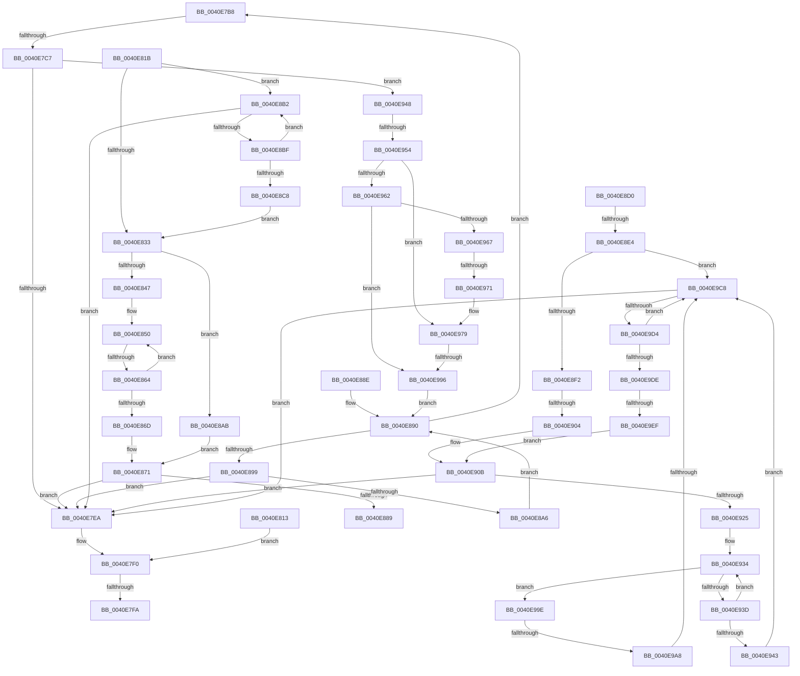

# sub_0040E7B8

- RVA: `0x0040E7B8`–`0x0040E9FC` (길이 `580` bytes)
- VA: `0x000000014040E7B8`
- 실행 섹션: `.text`
- PDB 이름 있음: `아니요`; PDB Function 태그: `아니요`
- unwind 정보 RVA: `0x0009B9CC`
- 디코드: `152`개 명령, `580/580` bytes 표시
- 미해석 바이트: `0` (있으면 어셈블리에 `.byte`로 보존)

> 이 문서는 커널 이미지의 기계어와 PDB 기호를 분석해 생성했습니다. 4번과 5번은 함수 원형과 자료형을 바이너리 사용 방식에서 추정한 C 해석이며 원본 소스 복구 결과는 아닙니다.

## 1. Dependencies

- 직접 호출 지점: **0**; 고유 호출 대상: **0**
- 직접 호출자로 확인된 함수: **0**
- RIP 상대 이미지 참조: **0**

### Outgoing calls
- 직접 디코드된 call 명령이 없습니다.

### Direct callers
- 이 함수 시작 RVA로 연결되는 직접 call은 확인되지 않았습니다. 간접 호출은 완전히 역산할 수 없습니다.

### Static image references
- 디코드된 RIP-relative 메모리 참조가 없습니다.

## 2. Other-region calls and transfers

- 다른 실행 섹션으로 향하는 call: **0**
- call이 아닌 외부 분기/꼬리 이동: **13**
  - `0x0040E7C1` → [sub_0040EA10 + 0x1B](Unknown_function_0040EA10.md) (`tail-transfer`)
  - `0x0040E7F8` → [sub_0040E6B6 + 0xDF](Unknown_function_0040E6B6.md) (`tail-transfer`)
  - `0x0040E80E` → [sub_0040E6B6 + 0x23](Unknown_function_0040E6B6.md) (`tail-transfer`)
  - `0x0040E85E` → [sub_0040EA10 + 0x25](Unknown_function_0040EA10.md) (`tail-transfer`)
  - `0x0040E889` → [sub_0040E6B6 + 0xD6](Unknown_function_0040E6B6.md) (`tail-transfer`)
  - `0x0040E8DE` → [sub_0040EA10](Unknown_function_0040EA10.md) (`tail-transfer`)
  - `0x0040E8FE` → [sub_0040EA10 + 0x7](Unknown_function_0040EA10.md) (`tail-transfer`)
  - `0x0040E94E` → [sub_0040E6B6 + 0xD6](Unknown_function_0040E6B6.md) (`tail-transfer`)
  - `0x0040E96B` → [sub_0040E6B6 + 0xD6](Unknown_function_0040E6B6.md) (`tail-transfer`)
  - `0x0040E990` → [sub_0040E6B6 + 0xD6](Unknown_function_0040E6B6.md) (`tail-transfer`)
  - `0x0040E9A2` → [sub_0040E6B6 + 0xD6](Unknown_function_0040E6B6.md) (`tail-transfer`)
  - `0x0040E9C2` → [sub_0040E6B6 + 0xD6](Unknown_function_0040E6B6.md) (`tail-transfer`)
  - `0x0040E9ED` → [sub_0040EA10 + 0x11](Unknown_function_0040EA10.md) (`tail-transfer`)

## 3. Assembly (complete function range)

```asm
0040E7B8  49 0F BD C8                     bsr rcx, r8
0040E7BC  44 89 5C 24 48                  mov dword ptr [rsp + 0x48], r11d
0040E7C1  0F 84 64 02 00 00               je 0x14040ea2b
0040E7C7  BA 3F 00 00 00                  mov edx, 0x3f
0040E7CC  2B D1                           sub edx, ecx
0040E7CE  48 8B C8                        mov rcx, rax
0040E7D1  49 2B CF                        sub rcx, r15
0040E7D4  48 C1 F9 03                     sar rcx, 3
0040E7D8  FF C1                           inc ecx
0040E7DA  C1 E1 06                        shl ecx, 6
0040E7DD  2B CA                           sub ecx, edx
0040E7DF  44 8B D1                        mov r10d, ecx
0040E7E2  3B CB                           cmp ecx, ebx
0040E7E4  0F 86 5E 01 00 00               jbe 0x14040e948
0040E7EA  41 BA FF FF FF FF               mov r10d, 0xffffffff
0040E7F0  4C 8B 44 24 40                  mov r8, qword ptr [rsp + 0x40]
0040E7F5  45 85 F6                        test r14d, r14d
0040E7F8  74 9B                           je 0x14040e795
0040E7FA  46 8D 0C 26                     lea r9d, [rsi + r12]
0040E7FE  45 3B CD                        cmp r9d, r13d
0040E801  45 0F 47 CD                     cmova r9d, r13d
0040E805  41 FF C9                        dec r9d
0040E808  45 33 DB                        xor r11d, r11d
0040E80B  45 8B F3                        mov r14d, r11d
0040E80E  E9 C6 FE FF FF                  jmp 0x14040e6d9
0040E813  41 BA FF FF FF FF               mov r10d, 0xffffffff
0040E819  EB D5                           jmp 0x14040e7f0
0040E81B  41 8B CA                        mov ecx, r10d
0040E81E  41 8B D3                        mov edx, r11d
0040E821  48 C1 E9 06                     shr rcx, 6
0040E825  49 8D 1C CF                     lea rbx, [r15 + rcx*8]
0040E829  49 83 F8 FF                     cmp r8, -1
0040E82D  0F 84 7F 00 00 00               je 0x14040e8b2
0040E833  49 0F BC C8                     bsf rcx, r8
0040E837  41 BA 40 00 00 00               mov r10d, 0x40
0040E83D  41 0F 44 CA                     cmove ecx, r10d
0040E841  03 CA                           add ecx, edx
0040E843  3B CE                           cmp ecx, esi
0040E845  73 64                           jae 0x14040e8ab
0040E847  4D 8B D0                        mov r10, r8
0040E84A  44 8B DE                        mov r11d, esi
0040E84D  49 F7 D2                        not r10
0040E850  49 8B D2                        mov rdx, r10
0040E853  41 8B CB                        mov ecx, r11d
0040E856  D1 E9                           shr ecx, 1
0040E858  48 D3 EA                        shr rdx, cl
0040E85B  4C 23 D2                        and r10, rdx
0040E85E  0F 84 D1 01 00 00               je 0x14040ea35
0040E864  44 2B D9                        sub r11d, ecx
0040E867  41 83 FB 01                     cmp r11d, 1
0040E86B  77 E3                           ja 0x14040e850
0040E86D  4D 0F BC D2                     bsf r10, r10
0040E871  49 2B C7                        sub rax, r15
0040E874  48 C1 F8 03                     sar rax, 3
0040E878  C1 E0 06                        shl eax, 6
0040E87B  44 03 D0                        add r10d, eax
0040E87E  44 3B 54 24 48                  cmp r10d, dword ptr [rsp + 0x48]
0040E883  0F 87 61 FF FF FF               ja 0x14040e7ea
0040E889  E9 FE FE FF FF                  jmp 0x14040e78c
0040E88E  66 90                           nop
0040E890  4D 85 C0                        test r8, r8
0040E893  0F 89 1F FF FF FF               jns 0x14040e7b8
0040E899  48 83 C0 08                     add rax, 8
0040E89D  49 3B C1                        cmp rax, r9
0040E8A0  0F 87 44 FF FF FF               ja 0x14040e7ea
0040E8A6  4C 8B 00                        mov r8, qword ptr [rax]
0040E8A9  EB E5                           jmp 0x14040e890
0040E8AB  F7 DA                           neg edx
0040E8AD  44 8B D2                        mov r10d, edx
0040E8B0  EB BF                           jmp 0x14040e871
0040E8B2  48 83 C0 08                     add rax, 8
0040E8B6  49 3B C1                        cmp rax, r9
0040E8B9  0F 87 2B FF FF FF               ja 0x14040e7ea
0040E8BF  4C 8B 00                        mov r8, qword ptr [rax]
0040E8C2  49 83 F8 FF                     cmp r8, -1
0040E8C6  74 EA                           je 0x14040e8b2
0040E8C8  41 8B D3                        mov edx, r11d
0040E8CB  E9 63 FF FF FF                  jmp 0x14040e833
0040E8D0  F6 C3 3F                        test bl, 0x3f
0040E8D3  4D 8D 59 08                     lea r11, [r9 + 8]
0040E8D7  4D 0F 44 D9                     cmove r11, r9
0040E8DB  4D 85 C0                        test r8, r8
0040E8DE  0F 84 2C 01 00 00               je 0x14040ea10
0040E8E4  48 83 C0 08                     add rax, 8
0040E8E8  48 83 38 00                     cmp qword ptr [rax], 0
0040E8EC  0F 85 D6 00 00 00               jne 0x14040e9c8
0040E8F2  49 0F BD C8                     bsr rcx, r8
0040E8F6  C7 44 24 48 00 00 00 00         mov dword ptr [rsp + 0x48], 0
0040E8FE  0F 84 13 01 00 00               je 0x14040ea17
0040E904  BA 3F 00 00 00                  mov edx, 0x3f
0040E909  2B D1                           sub edx, ecx
0040E90B  4C 8B D0                        mov r10, rax
0040E90E  4D 2B D7                        sub r10, r15
0040E911  49 C1 FA 03                     sar r10, 3
0040E915  41 C1 E2 06                     shl r10d, 6
0040E919  44 2B D2                        sub r10d, edx
0040E91C  44 3B D3                        cmp r10d, ebx
0040E91F  0F 87 C5 FE FF FF               ja 0x14040e7ea
0040E925  8B CE                           mov ecx, esi
0040E927  2B CA                           sub ecx, edx
0040E929  44 8B C1                        mov r8d, ecx
0040E92C  48 C1 E9 06                     shr rcx, 6
0040E930  48 8D 14 C8                     lea rdx, [rax + rcx*8]
0040E934  48 83 C0 08                     add rax, 8
0040E938  48 3B C2                        cmp rax, rdx
0040E93B  74 61                           je 0x14040e99e
0040E93D  48 83 38 00                     cmp qword ptr [rax], 0
0040E941  74 F1                           je 0x14040e934
0040E943  E9 80 00 00 00                  jmp 0x14040e9c8
0040E948  44 8B DE                        mov r11d, esi
0040E94B  44 2B DA                        sub r11d, edx
0040E94E  0F 84 38 FE FF FF               je 0x14040e78c
0040E954  4C 8B 40 08                     mov r8, qword ptr [rax + 8]
0040E958  48 83 C0 08                     add rax, 8
0040E95C  41 83 FB 40                     cmp r11d, 0x40
0040E960  72 17                           jb 0x14040e979
0040E962  4D 85 C0                        test r8, r8
0040E965  75 2F                           jne 0x14040e996
0040E967  41 83 C3 C0                     add r11d, -0x40
0040E96B  0F 84 1B FE FF FF               je 0x14040e78c
0040E971  4C 8B 40 08                     mov r8, qword ptr [rax + 8]
0040E975  48 83 C0 08                     add rax, 8
0040E979  49 0F BC C8                     bsf rcx, r8
0040E97D  BA 40 00 00 00                  mov edx, 0x40
0040E982  C7 44 24 48 00 00 00 00         mov dword ptr [rsp + 0x48], 0
0040E98A  0F 44 CA                        cmove ecx, edx
0040E98D  41 3B CB                        cmp ecx, r11d
0040E990  0F 83 F6 FD FF FF               jae 0x14040e78c
0040E996  45 33 DB                        xor r11d, r11d
0040E999  E9 F2 FE FF FF                  jmp 0x14040e890
0040E99E  41 83 E0 3F                     and r8d, 0x3f
0040E9A2  0F 84 E4 FD FF FF               je 0x14040e78c
0040E9A8  48 8B 08                        mov rcx, qword ptr [rax]
0040E9AB  48 0F BC D1                     bsf rdx, rcx
0040E9AF  B9 40 00 00 00                  mov ecx, 0x40
0040E9B4  C7 44 24 48 00 00 00 00         mov dword ptr [rsp + 0x48], 0
0040E9BC  0F 44 D1                        cmove edx, ecx
0040E9BF  41 3B D0                        cmp edx, r8d
0040E9C2  0F 83 C4 FD FF FF               jae 0x14040e78c
0040E9C8  48 8B D0                        mov rdx, rax
0040E9CB  49 3B C3                        cmp rax, r11
0040E9CE  0F 87 16 FE FF FF               ja 0x14040e7ea
0040E9D4  48 83 C0 08                     add rax, 8
0040E9D8  48 83 38 00                     cmp qword ptr [rax], 0
0040E9DC  75 EA                           jne 0x14040e9c8
0040E9DE  48 8B 0A                        mov rcx, qword ptr [rdx]
0040E9E1  4C 0F BD C1                     bsr r8, rcx
0040E9E5  C7 44 24 48 00 00 00 00         mov dword ptr [rsp + 0x48], 0
0040E9ED  74 32                           je 0x14040ea21
0040E9EF  BA 3F 00 00 00                  mov edx, 0x3f
0040E9F4  41 2B D0                        sub edx, r8d
0040E9F7  E9 0F FF FF FF                  jmp 0x14040e90b
```

## 4. C-style interpretation (structured pseudocode)

```c
__int64 __fastcall sub_0040E7B8(__int64 a1, __int64 a2, __int64 a3, __int64 a4, __int64 a5, __int64 a6, __int64 a7, __int64 a8)
{
    __int64 result;
    __int64 v_r11;
    unsigned int v_stack_p48;

    v_stack_p48 = (unsigned int)(v_r11);
    a2 = (unsigned int)((63) - ((unsigned int)(a1)));
    a1 = (result) - (v_r15);
    a1 = (a1) >> (3);
    a1 = (unsigned int)((a1) + 1);
    a1 = (unsigned int)((a1) << (6));
    a1 = (unsigned int)((a1) - ((unsigned int)(a2)));
    if (((unsigned int)(a1)) <= ((unsigned int)(v_rbx))) goto loc_0040E948;
loc_0040E7EA:
loc_0040E7F0:
    a4 = v_rsi + v_r12 * 1;
    if (((unsigned int)(v_rsi + v_r12 * 1)) > ((unsigned int)(v_r13))) { a4 = (unsigned int)(v_r13); }
    a4 = (unsigned int)((a4) - 1);
    v_r11 = 0;
loc_0040E890:
    if (!sign_flag) goto loc_0040E7B8;
    result = (result) + (8);
    if (result > a4) goto loc_0040E7EA;
    goto loc_0040E890;
loc_0040E948:
    v_r11 = (unsigned int)(((unsigned int)((unsigned int)(v_rsi))) - ((unsigned int)(a2)));
    result = (result) + (8);
    if (((unsigned int)(v_r11)) < 64) goto loc_0040E979;
    if (*(unsigned __int64 *)(result + 8) != 0) goto loc_0040E996;
    v_r11 = (unsigned int)((v_r11) + (-64));
    result = (result) + (8);
loc_0040E979:
    v_stack_p48 = 0;
    if (condition_is_equal) { a1 = 64; }
loc_0040E996:
    v_r11 = 0;
    goto loc_0040E890;
}
```

## 5. (Beta) C Style

```c
int64_t sub_0040E7B8(int64_t Arg1, int64_t Arg2, int64_t Arg3, int64_t Arg4, uint64_t Arg5, uint64_t Arg6, uint64_t Arg7, int64_t Arg8)
{
    int64_t result;
    int64_t local_r11;
    uint32_t v_stack_p48;

    v_stack_p48 = (uint32_t)(local_r11);
    Arg2 = (uint32_t)((63) - ((uint32_t)(Arg1)));
    Arg1 = (result) - (local_r15);
    Arg1 = (Arg1) >> (3);
    Arg1 = (uint32_t)((Arg1) + 1);
    Arg1 = (uint32_t)((Arg1) << (6));
    Arg1 = (uint32_t)((Arg1) - ((uint32_t)(Arg2)));
    if (((uint32_t)(Arg1)) <= ((uint32_t)(local_rbx))) goto loc_0040E948;
loc_0040E7EA:
loc_0040E7F0:
    Arg4 = local_rsi + local_r12 * 1;
    if (((uint32_t)(local_rsi + local_r12 * 1)) > ((uint32_t)(local_r13))) { Arg4 = (uint32_t)(local_r13); }
    Arg4 = (uint32_t)((Arg4) - 1);
    local_r11 = 0;
loc_0040E890:
    if (!sign_flag) goto loc_0040E7B8;
    result = (result) + (8);
    if (result > Arg4) goto loc_0040E7EA;
    goto loc_0040E890;
loc_0040E948:
    local_r11 = (uint32_t)(((uint32_t)((uint32_t)(local_rsi))) - ((uint32_t)(Arg2)));
    result = (result) + (8);
    if (((uint32_t)(local_r11)) < 64) goto loc_0040E979;
    if (*(uint64_t *)(result + 0x8) != 0) goto loc_0040E996;
    local_r11 = (uint32_t)((local_r11) + (-64));
    result = (result) + (8);
loc_0040E979:
    v_stack_p48 = 0;
    if (condition_is_equal) { Arg1 = 64; }
loc_0040E996:
    local_r11 = 0;
    goto loc_0040E890;
}
```

## 6. Execution-region graph

[열기: 2D/3D 그래프와 함수 탐색 컨트롤 패널](../../../control-panel.html?section=text&rva=0x0040E7B8&view=graph)

- 2D 그래프는 위에서 아래로 흐르고, 3D 그래프는 빈 공간을 드래그해 회전합니다. Shift+드래그는 이동, 휠은 확대·축소, 함수 노드 선택은 대상 보고서 이동입니다.

### Static fallback


