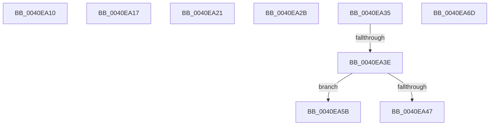

# sub_0040EA10

- RVA: `0x0040EA10`–`0x0040EA78` (길이 `104` bytes)
- VA: `0x000000014040EA10`
- 실행 섹션: `.text`
- PDB 이름 있음: `아니요`; PDB Function 태그: `아니요`
- unwind 정보 RVA: `0x0009BA00`
- 디코드: `24`개 명령, `104/104` bytes 표시
- 미해석 바이트: `0` (있으면 어셈블리에 `.byte`로 보존)

> 이 문서는 커널 이미지의 기계어와 PDB 기호를 분석해 생성했습니다. 4번과 5번은 함수 원형과 자료형을 바이너리 사용 방식에서 추정한 C 해석이며 원본 소스 복구 결과는 아닙니다.

## 1. Dependencies

- 직접 호출 지점: **0**; 고유 호출 대상: **0**
- 직접 호출자로 확인된 함수: **0**
- RIP 상대 이미지 참조: **0**

### Outgoing calls
- 직접 디코드된 call 명령이 없습니다.

### Direct callers
- 이 함수 시작 RVA로 연결되는 직접 call은 확인되지 않았습니다. 간접 호출은 완전히 역산할 수 없습니다.

### Static image references
- 디코드된 RIP-relative 메모리 참조가 없습니다.

## 2. Other-region calls and transfers

- 다른 실행 섹션으로 향하는 call: **0**
- call이 아닌 외부 분기/꼬리 이동: **8**
  - `0x0040EA12` → [sub_0040E7B8 + 0x153](Unknown_function_0040E7B8.md) (`tail-transfer`)
  - `0x0040EA1C` → [sub_0040E7B8 + 0x153](Unknown_function_0040E7B8.md) (`tail-transfer`)
  - `0x0040EA26` → [sub_0040E7B8 + 0x153](Unknown_function_0040E7B8.md) (`tail-transfer`)
  - `0x0040EA30` → [sub_0040E7B8 + 0x16](Unknown_function_0040E7B8.md) (`tail-transfer`)
  - `0x0040EA38` → [sub_0040E7B8 + 0x32](Unknown_function_0040E7B8.md) (`tail-transfer`)
  - `0x0040EA56` → [sub_0040E7B8 + 0x71](Unknown_function_0040E7B8.md) (`tail-transfer`)
  - `0x0040EA68` → [sub_0040E7B8 + 0x71](Unknown_function_0040E7B8.md) (`tail-transfer`)
  - `0x0040EA73` → [sub_0040E7B8 + 0x3D](Unknown_function_0040E7B8.md) (`tail-transfer`)

## 3. Assembly (complete function range)

```asm
0040EA10  33 D2                           xor edx, edx
0040EA12  E9 F4 FE FF FF                  jmp 0x14040e90b
0040EA17  BA 40 00 00 00                  mov edx, 0x40
0040EA1C  E9 EA FE FF FF                  jmp 0x14040e90b
0040EA21  BA 40 00 00 00                  mov edx, 0x40
0040EA26  E9 E0 FE FF FF                  jmp 0x14040e90b
0040EA2B  BA 40 00 00 00                  mov edx, 0x40
0040EA30  E9 99 FD FF FF                  jmp 0x14040e7ce
0040EA35  48 3B C3                        cmp rax, rbx
0040EA38  0F 84 AC FD FF FF               je 0x14040e7ea
0040EA3E  45 33 DB                        xor r11d, r11d
0040EA41  49 0F BD C8                     bsr rcx, r8
0040EA45  74 14                           je 0x14040ea5b
0040EA47  4C 8B 40 08                     mov r8, qword ptr [rax + 8]
0040EA4B  BA 3F 00 00 00                  mov edx, 0x3f
0040EA50  2B D1                           sub edx, ecx
0040EA52  48 83 C0 08                     add rax, 8
0040EA56  E9 CE FD FF FF                  jmp 0x14040e829
0040EA5B  4C 8B 40 08                     mov r8, qword ptr [rax + 8]
0040EA5F  48 83 C0 08                     add rax, 8
0040EA63  BA 40 00 00 00                  mov edx, 0x40
0040EA68  E9 BC FD FF FF                  jmp 0x14040e829
0040EA6D  41 BA FF FF FF FF               mov r10d, 0xffffffff
0040EA73  E9 7D FD FF FF                  jmp 0x14040e7f5
```

## 4. C-style interpretation (structured pseudocode)

```c
__int64 __fastcall sub_0040EA10(__int64 a1, int a2, __int64 a3)
{
    a2 = 0;
}
```

## 5. (Beta) C Style

```c
int64_t sub_0040EA10(int64_t Arg1, int32_t Arg2, int64_t Arg3)
{
    Arg2 = 0;
}
```

## 6. Execution-region graph

[열기: 2D/3D 그래프와 함수 탐색 컨트롤 패널](../../../control-panel.html?section=text&rva=0x0040EA10&view=graph)

- 2D 그래프는 위에서 아래로 흐르고, 3D 그래프는 빈 공간을 드래그해 회전합니다. Shift+드래그는 이동, 휠은 확대·축소, 함수 노드 선택은 대상 보고서 이동입니다.

### Static fallback


