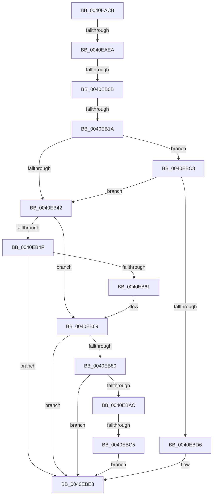

# sub_0040EACB

- RVA: `0x0040EACB`–`0x0040EBF1` (길이 `294` bytes)
- VA: `0x000000014040EACB`
- 실행 섹션: `.text`
- PDB 이름 있음: `아니요`; PDB Function 태그: `아니요`
- unwind 정보 RVA: `0x0009BA40`
- 디코드: `68`개 명령, `294/294` bytes 표시
- 미해석 바이트: `0` (있으면 어셈블리에 `.byte`로 보존)

> 이 문서는 커널 이미지의 기계어와 PDB 기호를 분석해 생성했습니다. 4번과 5번은 함수 원형과 자료형을 바이너리 사용 방식에서 추정한 C 해석이며 원본 소스 복구 결과는 아닙니다.

## 1. Dependencies

- 직접 호출 지점: **4**; 고유 호출 대상: **4**
- 직접 호출자로 확인된 함수: **0**
- RIP 상대 이미지 참조: **4**

### Outgoing calls
- `0x0040EB64` → [KxWaitForLockChainValid](../21/KxWaitForLockChainValid_function_00217AA0.md) (function, `0x00217AA0`)
- `0x0040EB93` → [KeDisableInterrupts](../21/KeDisableInterrupts_function_00217BE0.md) (function, `0x00217BE0`)
- `0x0040EBA2` → [KiHaltOnAddressWakeEntireList](../21/KiHaltOnAddressWakeEntireList_function_00217AF4.md) (function, `0x00217AF4`)
- `0x0040EBDE` → [KiReleaseQueuedSpinLockInstrumented](../21/KiReleaseQueuedSpinLockInstrumented_function_002179F0.md) (function, `0x002179F0`)

### Direct callers
- 이 함수 시작 RVA로 연결되는 직접 call은 확인되지 않았습니다. 간접 호출은 완전히 역산할 수 없습니다.

### Static image references
- `0x0040EADD` → RVA `0x00FC6D20` (`ALMOSTRO`; read)
- `0x0040EAFE` → RVA `0x00FC6B06` (`ALMOSTRO`; read)
- `0x0040EB88` → RVA `0x00F21B20` (`.data`; read)
- `0x0040EBC8` → RVA `0x00F0DE58` (`.data`; read)

## 2. Other-region calls and transfers

- 다른 실행 섹션으로 향하는 call: **0**
- call이 아닌 외부 분기/꼬리 이동: **5**
  - `0x0040EAE4` → [sub_0040EC21 + 0x1B](Unknown_function_0040EC21.md) (`tail-transfer`)
  - `0x0040EB05` → [sub_0040EC21](Unknown_function_0040EC21.md) (`tail-transfer`)
  - `0x0040EB14` → [sub_0040EC21 + 0x2C](Unknown_function_0040EC21.md) (`tail-transfer`)
  - `0x0040EBBF` → [sub_0040EC21 + 0x36](Unknown_function_0040EC21.md) (`tail-transfer`)
  - `0x0040EBEF` → [sub_0040EBF1 + 0xD](Unknown_function_0040EBF1.md) (`tail-transfer`)

## 3. Assembly (complete function range)

```asm
0040EACB  48 89 7C 24 40                  mov qword ptr [rsp + 0x40], rdi
0040EAD0  44 0F 20 C6                     mov rsi, cr8
0040EAD4  B8 02 00 00 00                  mov eax, 2
0040EAD9  44 0F 22 C0                     mov cr8, rax
0040EADD  83 3D 3C 82 BB 00 00            cmp dword ptr [rip + 0xbb823c], 0
0040EAE4  0F 85 52 01 00 00               jne 0x14040ec3c
0040EAEA  65 48 8B 04 25 28 00 00 00      mov rax, qword ptr gs:[0x28]
0040EAF3  48 8D 88 90 00 00 00            lea rcx, [rax + 0x90]
0040EAFA  4C 8B 41 08                     mov r8, qword ptr [rcx + 8]
0040EAFE  F6 05 01 80 BB 00 21            test byte ptr [rip + 0xbb8001], 0x21
0040EB05  0F 85 16 01 00 00               jne 0x14040ec21
0040EB0B  48 8B D1                        mov rdx, rcx
0040EB0E  49 87 10                        xchg qword ptr [r8], rdx
0040EB11  48 85 D2                        test rdx, rdx
0040EB14  0F 85 33 01 00 00               jne 0x14040ec4d
0040EB1A  8B 43 1C                        mov eax, dword ptr [rbx + 0x1c]
0040EB1D  FF C8                           dec eax
0040EB1F  89 43 1C                        mov dword ptr [rbx + 0x1c], eax
0040EB22  8B 6B 1C                        mov ebp, dword ptr [rbx + 0x1c]
0040EB25  65 48 8B 04 25 28 00 00 00      mov rax, qword ptr gs:[0x28]
0040EB2E  F6 05 D1 7F BB 00 01            test byte ptr [rip + 0xbb7fd1], 1
0040EB35  48 8D B8 90 00 00 00            lea rdi, [rax + 0x90]
0040EB3C  0F 85 86 00 00 00               jne 0x14040ebc8
0040EB42  0F 0D 0F                        prefetchw byte ptr [rdi]
0040EB45  48 8B 07                        mov rax, qword ptr [rdi]
0040EB48  33 DB                           xor ebx, ebx
0040EB4A  48 85 C0                        test rax, rax
0040EB4D  75 1A                           jne 0x14040eb69
0040EB4F  48 8B 4F 08                     mov rcx, qword ptr [rdi + 8]
0040EB53  48 8B C7                        mov rax, rdi
0040EB56  F0 48 0F B1 19                  lock cmpxchg qword ptr [rcx], rbx
0040EB5B  0F 84 82 00 00 00               je 0x14040ebe3
0040EB61  48 8B CF                        mov rcx, rdi
0040EB64  E8 37 8F E0 FF                  call 0x140217aa0
0040EB69  4C 8D 40 08                     lea r8, [rax + 8]
0040EB6D  48 89 1F                        mov qword ptr [rdi], rbx
0040EB70  48 8B 4F 08                     mov rcx, qword ptr [rdi + 8]
0040EB74  48 8B C1                        mov rax, rcx
0040EB77  49 87 00                        xchg qword ptr [r8], rax
0040EB7A  32 C1                           xor al, cl
0040EB7C  A8 04                           test al, 4
0040EB7E  74 63                           je 0x14040ebe3
0040EB80  F0 09 1C 24                     lock or dword ptr [rsp], ebx
0040EB84  49 C1 E8 05                     shr r8, 5
0040EB88  4C 8D 0D 91 2F B1 00            lea r9, [rip + 0xb12f91]
0040EB8F  41 83 E0 7F                     and r8d, 0x7f
0040EB93  E8 48 90 E0 FF                  call 0x140217be0
0040EB98  4B 87 1C C1                     xchg qword ptr [r9 + r8*8], rbx
0040EB9C  48 8B D3                        mov rdx, rbx
0040EB9F  0F B6 F8                        movzx edi, al
0040EBA2  E8 4D 8F E0 FF                  call 0x140217af4
0040EBA7  40 84 FF                        test dil, dil
0040EBAA  74 37                           je 0x14040ebe3
0040EBAC  65 48 8B 0C 25 20 00 00 00      mov rcx, qword ptr gs:[0x20]
0040EBB5  4C 8B 81 B8 8E 00 00            mov r8, qword ptr [rcx + 0x8eb8]
0040EBBC  4D 85 C0                        test r8, r8
0040EBBF  0F 85 92 00 00 00               jne 0x14040ec57
0040EBC5  FB                              sti
0040EBC6  EB 1B                           jmp 0x14040ebe3
0040EBC8  8B 05 8A F2 AF 00               mov eax, dword ptr [rip + 0xaff28a]
0040EBCE  85 C0                           test eax, eax
0040EBD0  0F 85 6C FF FF FF               jne 0x14040eb42
0040EBD6  48 8B 54 24 28                  mov rdx, qword ptr [rsp + 0x28]
0040EBDB  48 8B CF                        mov rcx, rdi
0040EBDE  E8 0D 8E E0 FF                  call 0x1402179f0
0040EBE3  83 3D 36 81 BB 00 00            cmp dword ptr [rip + 0xbb8136], 0
0040EBEA  48 8B 7C 24 40                  mov rdi, qword ptr [rsp + 0x40]
0040EBEF  74 0D                           je 0x14040ebfe
```

## 4. C-style interpretation (structured pseudocode)

```c
__int64 __fastcall sub_0040EACB(__int64 a1, __int64 a2, __int64 a3, __int64 a4, __int64 a5, __int64 a6, __int64 a7, __int64 a8)
{
    __int64 result;
    __int64 v_rbx;
    unsigned int v_stack_p0;
    unsigned __int64 v_stack_p40;

    v_stack_p40 = v_rdi;
    result = (unsigned int)(((unsigned int)(*(unsigned int *)(v_rbx + 28))) - 1);
    *(unsigned int *)(v_rbx + 28) = (unsigned int)(result);
    if (((*(unsigned __int8 *)(v_rip + 12287953)) & (1)) != 0) goto loc_0040EBC8;
loc_0040EB42:
    v_rbx = 0;
    if (*(unsigned __int64 *)(*(unsigned __int64 *)(gs_base + (0 + 40)) + 144) != 0) goto loc_0040EB69;
    if (*(unsigned __int64 *)(*(unsigned __int64 *)(gs_base + (0 + 40)) + 144) == 0) goto loc_0040EBE3;
    result = KxWaitForLockChainValid(*(unsigned __int64 *)(gs_base + (0 + 40)) + 144, *(unsigned __int64 *)(gs_base + (0 + 40)) + 144, *(unsigned __int64 *)(*(unsigned __int64 *)(gs_base + (0 + 40)) + 144 + 8), a4);
loc_0040EB69:
    *(unsigned __int64 *)(*(unsigned __int64 *)(gs_base + (0 + 40)) + 144) = 0;
    result = (unsigned __int8)((*(unsigned __int64 *)(*(unsigned __int64 *)(gs_base + (0 + 40)) + 144 + 8)) ^ ((unsigned __int8)(*(unsigned __int64 *)(*(unsigned __int64 *)(gs_base + (0 + 40)) + 144 + 8))));
    if ((((unsigned __int8)(result)) & (4)) == 0) goto loc_0040EBE3;
    a3 = (result + 8) >> (5);
    a3 = (unsigned int)((a3) & (127));
    result = KeDisableInterrupts(*(unsigned __int64 *)(*(unsigned __int64 *)(gs_base + (0 + 40)) + 144 + 8), *(unsigned __int64 *)(gs_base + (0 + 40)) + 144, a3, v_rip + 11612049);
    result = KiHaltOnAddressWakeEntireList(*(unsigned __int64 *)(*(unsigned __int64 *)(gs_base + (0 + 40)) + 144 + 8), 0, a3, v_rip + 11612049);
    if ((unsigned __int8)((unsigned __int8)(result)) == 0) goto loc_0040EBE3;
    goto loc_0040EBE3;
loc_0040EBC8:
    if ((unsigned int)((unsigned int)(*(unsigned int *)(v_rip + 11530890))) != 0) goto loc_0040EB42;
    result = KiReleaseQueuedSpinLockInstrumented((unsigned __int8)(result), a5, *(unsigned __int64 *)(*(unsigned __int64 *)(gs_base + (0 + 32)) + 36536), v_rip + 11612049);
loc_0040EBE3:
}
```

## 5. (Beta) C Style

```c
int64_t sub_0040EACB(int64_t Arg1, int64_t Arg2, int64_t Arg3, int64_t Arg4, int64_t Arg5, uint64_t Arg6, uint64_t Arg7, int64_t Arg8)
{
    int64_t result;
    int64_t local_rbx;
    uint32_t v_stack_p0;
    uint64_t v_stack_p40;

    v_stack_p40 = local_rdi;
    result = (uint32_t)(((uint32_t)(*(uint32_t *)(local_rbx + 0x1C))) - 1);
    *(uint32_t *)(local_rbx + 0x1C) = (uint32_t)(result);
    if (((*(uint8_t *)(v_rip + 0xBB7FD1)) & (1)) != 0) goto loc_0040EBC8;
loc_0040EB42:
    local_rbx = 0;
    if (*(uint64_t *)(*(uint64_t *)(gs_base + (0 + 0x28)) + 0x90) != 0) goto loc_0040EB69;
    if (*(uint64_t *)(*(uint64_t *)(gs_base + (0 + 0x28)) + 0x90) == 0) goto loc_0040EBE3;
    result = KxWaitForLockChainValid(*(uint64_t *)(gs_base + (0 + 0x28)) + 144, *(uint64_t *)(gs_base + (0 + 0x28)) + 144, *(uint64_t *)(*(uint64_t *)(gs_base + (0 + 0x28)) + 0x90 + 0x8), Arg4);
loc_0040EB69:
    *(uint64_t *)(*(uint64_t *)(gs_base + (0 + 0x28)) + 0x90) = 0;
    result = (uint8_t)((*(uint64_t *)(*(uint64_t *)(gs_base + (0 + 0x28)) + 0x90 + 0x8)) ^ ((uint8_t)(*(uint64_t *)(*(uint64_t *)(gs_base + (0 + 0x28)) + 0x90 + 0x8))));
    if ((((uint8_t)(result)) & (4)) == 0) goto loc_0040EBE3;
    Arg3 = (result + 8) >> (5);
    Arg3 = (uint32_t)((Arg3) & (127));
    result = KeDisableInterrupts(*(uint64_t *)(*(uint64_t *)(gs_base + (0 + 0x28)) + 0x90 + 0x8), *(uint64_t *)(gs_base + (0 + 0x28)) + 144, Arg3, v_rip + 11612049);
    result = KiHaltOnAddressWakeEntireList(*(uint64_t *)(*(uint64_t *)(gs_base + (0 + 0x28)) + 0x90 + 0x8), 0, Arg3, v_rip + 11612049);
    if ((uint8_t)((uint8_t)(result)) == 0) goto loc_0040EBE3;
    goto loc_0040EBE3;
loc_0040EBC8:
    if ((uint32_t)((uint32_t)(*(uint32_t *)(v_rip + 0xAFF28A))) != 0) goto loc_0040EB42;
    result = KiReleaseQueuedSpinLockInstrumented((uint8_t)(result), Arg5, *(uint64_t *)(*(uint64_t *)(gs_base + (0 + 0x20)) + 0x8EB8), v_rip + 11612049);
loc_0040EBE3:
}
```

## 6. Execution-region graph

[열기: 2D/3D 그래프와 함수 탐색 컨트롤 패널](../../../control-panel.html?section=text&rva=0x0040EACB&view=graph)

- 2D 그래프는 위에서 아래로 흐르고, 3D 그래프는 빈 공간을 드래그해 회전합니다. Shift+드래그는 이동, 휠은 확대·축소, 함수 노드 선택은 대상 보고서 이동입니다.

### Static fallback


