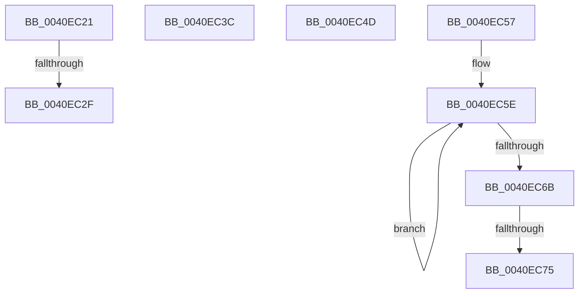

# sub_0040EC21

- RVA: `0x0040EC21`–`0x0040EC7F` (길이 `94` bytes)
- VA: `0x000000014040EC21`
- 실행 섹션: `.text`
- PDB 이름 있음: `아니요`; PDB Function 태그: `아니요`
- unwind 정보 RVA: `0x0009BA78`
- 디코드: `22`개 명령, `94/94` bytes 표시
- 미해석 바이트: `0` (있으면 어셈블리에 `.byte`로 보존)

> 이 문서는 커널 이미지의 기계어와 PDB 기호를 분석해 생성했습니다. 4번과 5번은 함수 원형과 자료형을 바이너리 사용 방식에서 추정한 C 해석이며 원본 소스 복구 결과는 아닙니다.

## 1. Dependencies

- 직접 호출 지점: **4**; 고유 호출 대상: **4**
- 직접 호출자로 확인된 함수: **0**
- RIP 상대 이미지 참조: **1**

### Outgoing calls
- `0x0040EC32` → [KiAcquireQueuedSpinLockInstrumented](../27/KiAcquireQueuedSpinLockInstrumented_function_00275850.md) (function, `0x00275850`)
- `0x0040EC43` → [KiRaiseIrqlProcessIrqlFlags](../4F/KiRaiseIrqlProcessIrqlFlags_function_004F56FC.md) (function, `0x004F56FC`)
- `0x0040EC4D` → [KxWaitForLockOwnerShip](../25/KxWaitForLockOwnerShip_function_00257EB0.md) (function, `0x00257EB0`)
- `0x0040EC75` → [KiRemoveSystemWorkPriorityKick](../26/KiRemoveSystemWorkPriorityKick_function_002631D0.md) (function, `0x002631D0`)

### Direct callers
- 이 함수 시작 RVA로 연결되는 직접 call은 확인되지 않았습니다. 간접 호출은 완전히 역산할 수 없습니다.

### Static image references
- `0x0040EC21` → RVA `0x00F0DE58` (`.data`; read)

## 2. Other-region calls and transfers

- 다른 실행 섹션으로 향하는 call: **0**
- call이 아닌 외부 분기/꼬리 이동: **6**
  - `0x0040EC29` → [sub_0040EACB + 0x40](Unknown_function_0040EACB.md) (`tail-transfer`)
  - `0x0040EC37` → [sub_0040EACB + 0x4F](Unknown_function_0040EACB.md) (`tail-transfer`)
  - `0x0040EC48` → [sub_0040EACB + 0x1F](Unknown_function_0040EACB.md) (`tail-transfer`)
  - `0x0040EC52` → [sub_0040EACB + 0x4F](Unknown_function_0040EACB.md) (`tail-transfer`)
  - `0x0040EC6F` → [sub_0040EACB + 0xFA](Unknown_function_0040EACB.md) (`tail-transfer`)
  - `0x0040EC7A` → [sub_0040EACB + 0xFA](Unknown_function_0040EACB.md) (`tail-transfer`)

## 3. Assembly (complete function range)

```asm
0040EC21  8B 05 31 F2 AF 00               mov eax, dword ptr [rip + 0xaff231]
0040EC27  85 C0                           test eax, eax
0040EC29  0F 85 DC FE FF FF               jne 0x14040eb0b
0040EC2F  49 8B D0                        mov rdx, r8
0040EC32  E8 19 6C E6 FF                  call 0x140275850
0040EC37  E9 DE FE FF FF                  jmp 0x14040eb1a
0040EC3C  0F B6 D0                        movzx edx, al
0040EC3F  40 0F B6 CE                     movzx ecx, sil
0040EC43  E8 B4 6A 0E 00                  call 0x1404f56fc
0040EC48  E9 9D FE FF FF                  jmp 0x14040eaea
0040EC4D  E8 5E 92 E4 FF                  call 0x140257eb0
0040EC52  E9 C3 FE FF FF                  jmp 0x14040eb1a
0040EC57  41 0F 0D 08                     prefetchw byte ptr [r8]
0040EC5B  41 8B 00                        mov eax, dword ptr [r8]
0040EC5E  8B D0                           mov edx, eax
0040EC60  0F BA F2 15                     btr edx, 0x15
0040EC64  F0 41 0F B1 10                  lock cmpxchg dword ptr [r8], edx
0040EC69  75 F3                           jne 0x14040ec5e
0040EC6B  0F BA E0 15                     bt eax, 0x15
0040EC6F  0F 83 50 FF FF FF               jae 0x14040ebc5
0040EC75  E8 56 45 E5 FF                  call 0x1402631d0
0040EC7A  E9 46 FF FF FF                  jmp 0x14040ebc5
```

## 4. C-style interpretation (structured pseudocode)

```c
__int64 __fastcall sub_0040EC21(__int64 a1, __int64 a2, __int64 a3)
{
    __int64 result;

    result = KiAcquireQueuedSpinLockInstrumented(a1, a3, a3, a4);
}
```

## 5. (Beta) C Style

```c
int64_t sub_0040EC21(int64_t Arg1, int64_t Arg2, int64_t Arg3)
{
    int64_t result;

    result = KiAcquireQueuedSpinLockInstrumented(Arg1, Arg3, Arg3, a4);
}
```

## 6. Execution-region graph

[열기: 2D/3D 그래프와 함수 탐색 컨트롤 패널](../../../control-panel.html?section=text&rva=0x0040EC21&view=graph)

- 2D 그래프는 위에서 아래로 흐르고, 3D 그래프는 빈 공간을 드래그해 회전합니다. Shift+드래그는 이동, 휠은 확대·축소, 함수 노드 선택은 대상 보고서 이동입니다.

### Static fallback


