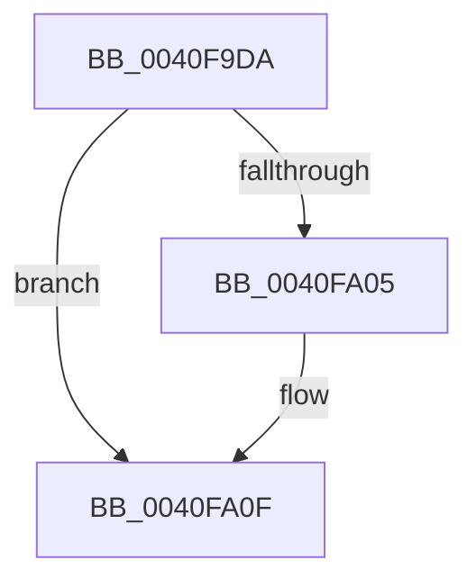

# sub_0040F9DA

- RVA: `0x0040F9DA`–`0x0040FA19` (길이 `63` bytes)
- VA: `0x000000014040F9DA`
- 실행 섹션: `.text`
- PDB 이름 있음: `아니요`; PDB Function 태그: `아니요`
- unwind 정보 RVA: `0x0009BB30`
- 디코드: `18`개 명령, `63/63` bytes 표시
- 미해석 바이트: `0` (있으면 어셈블리에 `.byte`로 보존)

> 이 문서는 커널 이미지의 기계어와 PDB 기호를 분석해 생성했습니다. 4번과 5번은 함수 원형과 자료형을 바이너리 사용 방식에서 추정한 C 해석이며 원본 소스 복구 결과는 아닙니다.

## 1. Dependencies

- 직접 호출 지점: **1**; 고유 호출 대상: **1**
- 직접 호출자로 확인된 함수: **0**
- RIP 상대 이미지 참조: **0**

### Outgoing calls
- `0x0040F9F0` → [memcpy](../6C/memcpy_function_006C6840.md) (function, `0x006C6840`)

### Direct callers
- 이 함수 시작 RVA로 연결되는 직접 call은 확인되지 않았습니다. 간접 호출은 완전히 역산할 수 없습니다.

### Static image references
- 디코드된 RIP-relative 메모리 참조가 없습니다.

## 2. Other-region calls and transfers

- 다른 실행 섹션으로 향하는 call: **0**
- 별도 외부 분기/꼬리 이동을 확인하지 못했습니다.

## 3. Assembly (complete function range)

```asm
0040F9DA  48 89 74 24 30                  mov qword ptr [rsp + 0x30], rsi
0040F9DF  48 8B D3                        mov rdx, rbx
0040F9E2  4C 89 74 24 38                  mov qword ptr [rsp + 0x38], r14
0040F9E7  8B F5                           mov esi, ebp
0040F9E9  4C 8D 34 48                     lea r14, [rax + rcx*2]
0040F9ED  49 8B CE                        mov rcx, r14
0040F9F0  E8 4B 6E 2B 00                  call 0x1406c6840
0040F9F5  66 01 2F                        add word ptr [rdi], bp
0040F9F8  0F B7 0F                        movzx ecx, word ptr [rdi]
0040F9FB  0F B7 47 02                     movzx eax, word ptr [rdi + 2]
0040F9FF  FF C1                           inc ecx
0040FA01  3B C8                           cmp ecx, eax
0040FA03  73 0A                           jae 0x14040fa0f
0040FA05  48 D1 EE                        shr rsi, 1
0040FA08  33 C0                           xor eax, eax
0040FA0A  66 41 89 04 76                  mov word ptr [r14 + rsi*2], ax
0040FA0F  48 8B 74 24 30                  mov rsi, qword ptr [rsp + 0x30]
0040FA14  4C 8B 74 24 38                  mov r14, qword ptr [rsp + 0x38]
```

## 4. C-style interpretation (structured pseudocode)

```c
__int64 __fastcall sub_0040F9DA(__int64 a1, __int64 a2, __int64 a3, __int64 a4, __int64 a5, __int64 a6, __int64 a7)
{
    __int64 result;
    __int64 v_rsi;
    unsigned __int64 v_stack_p30;
    unsigned __int64 v_stack_p38;

    v_stack_p30 = v_rsi;
    v_stack_p38 = v_r14;
    result = memcpy(result + a1 * 2, v_rbx, a3, a4);
    a1 = (unsigned int)((*(unsigned __int16 *)(v_rdi)) + 1);
    result = *(unsigned __int16 *)(v_rdi + 2);
    v_rsi = (unsigned int)((unsigned int)(v_rbp));
    if (((unsigned int)(a1)) < ((unsigned int)(*(unsigned __int16 *)(v_rdi + 2)))) {
        v_rsi = ((unsigned int)((unsigned int)(v_rbp))) >> (1);
        result = 0;
        *(unsigned __int16 *)(result + a1 * 2 + v_rsi * 2) = 0;
    }
    return result;
}
```

## 5. (Beta) C Style

```c
int64_t sub_0040F9DA(int64_t Arg1, int64_t Arg2, int64_t Arg3, int64_t Arg4, uint64_t Arg5, int64_t Arg6, int64_t Arg7)
{
    int64_t result;
    int64_t local_rsi;
    uint64_t v_stack_p30;
    uint64_t v_stack_p38;

    v_stack_p30 = local_rsi;
    v_stack_p38 = local_r14;
    result = memcpy(result + Arg1 * 2, local_rbx, Arg3, Arg4);
    Arg1 = (uint32_t)((*(uint16_t *)(local_rdi)) + 1);
    result = *(uint16_t *)(local_rdi + 0x2);
    local_rsi = (uint32_t)((uint32_t)(local_rbp));
    if (((uint32_t)(Arg1)) < ((uint32_t)(*(uint16_t *)(local_rdi + 0x2)))) {
        local_rsi = ((uint32_t)((uint32_t)(local_rbp))) >> (1);
        result = 0;
        *(uint16_t *)(result + Arg1 * 2 + local_rsi * 2) = 0;
    }
    return result;
}
```

## 6. Execution-region graph

[열기: 2D/3D 그래프와 함수 탐색 컨트롤 패널](../../../control-panel.html?section=text&rva=0x0040F9DA&view=graph)

- 2D 그래프는 위에서 아래로 흐르고, 3D 그래프는 빈 공간을 드래그해 회전합니다. Shift+드래그는 이동, 휠은 확대·축소, 함수 노드 선택은 대상 보고서 이동입니다.

### Static fallback


