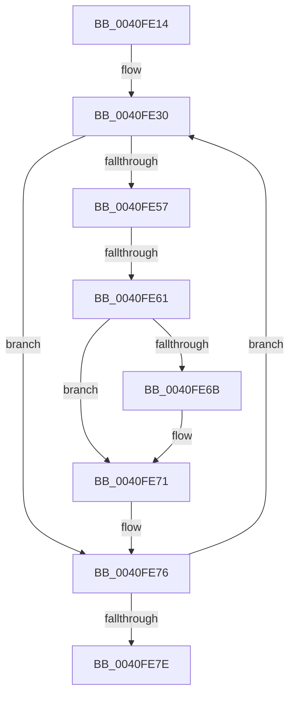

# sub_0040FE14

- RVA: `0x0040FE14`–`0x0040FE88` (길이 `116` bytes)
- VA: `0x000000014040FE14`
- 실행 섹션: `.text`
- PDB 이름 있음: `아니요`; PDB Function 태그: `아니요`
- unwind 정보 RVA: `0x0009BBE8`
- 디코드: `29`개 명령, `116/116` bytes 표시
- 미해석 바이트: `0` (있으면 어셈블리에 `.byte`로 보존)

> 이 문서는 커널 이미지의 기계어와 PDB 기호를 분석해 생성했습니다. 4번과 5번은 함수 원형과 자료형을 바이너리 사용 방식에서 추정한 C 해석이며 원본 소스 복구 결과는 아닙니다.

## 1. Dependencies

- 직접 호출 지점: **0**; 고유 호출 대상: **0**
- 직접 호출자로 확인된 함수: **0**
- RIP 상대 이미지 참조: **0**

### Outgoing calls
- 직접 디코드된 call 명령이 없습니다.

### Direct callers
- 이 함수 시작 RVA로 연결되는 직접 call은 확인되지 않았습니다. 간접 호출은 완전히 역산할 수 없습니다.

### Static image references
- 디코드된 RIP-relative 메모리 참조가 없습니다.

## 2. Other-region calls and transfers

- 다른 실행 섹션으로 향하는 call: **0**
- call이 아닌 외부 분기/꼬리 이동: **1**
  - `0x0040FE5F` → [sub_0040FEA0](Unknown_function_0040FEA0.md) (`tail-transfer`)

## 3. Assembly (complete function range)

```asm
0040FE14  48 89 6C 24 30                  mov qword ptr [rsp + 0x30], rbp
0040FE19  BD 1E 00 00 00                  mov ebp, 0x1e
0040FE1E  48 89 74 24 38                  mov qword ptr [rsp + 0x38], rsi
0040FE23  BE FF FF 00 00                  mov esi, 0xffff
0040FE28  0F 1F 84 00 00 00 00 00         nop dword ptr [rax + rax]
0040FE30  41 8B 48 D8                     mov ecx, dword ptr [r8 - 0x28]
0040FE34  8B D1                           mov edx, ecx
0040FE36  41 2B 50 14                     sub edx, dword ptr [r8 + 0x14]
0040FE3A  41 89 48 14                     mov dword ptr [r8 + 0x14], ecx
0040FE3E  41 8B 40 D4                     mov eax, dword ptr [r8 - 0x2c]
0040FE42  8B C8                           mov ecx, eax
0040FE44  41 2B 48 10                     sub ecx, dword ptr [r8 + 0x10]
0040FE48  45 0F B7 48 D2                  movzx r9d, word ptr [r8 - 0x2e]
0040FE4D  41 89 40 10                     mov dword ptr [r8 + 0x10], eax
0040FE51  66 44 3B CE                     cmp r9w, si
0040FE55  74 1F                           je 0x14040fe76
0040FE57  45 0F B7 50 D0                  movzx r10d, word ptr [r8 - 0x30]
0040FE5C  83 F9 4B                        cmp ecx, 0x4b
0040FE5F  73 3F                           jae 0x14040fea0
0040FE61  41 83 EA 0A                     sub r10d, 0xa
0040FE65  41 83 FA 04                     cmp r10d, 4
0040FE69  7D 06                           jge 0x14040fe71
0040FE6B  41 BA 04 00 00 00               mov r10d, 4
0040FE71  66 45 89 50 D0                  mov word ptr [r8 - 0x30], r10w
0040FE76  4D 8B 00                        mov r8, qword ptr [r8]
0040FE79  4C 3B C3                        cmp r8, rbx
0040FE7C  75 B2                           jne 0x14040fe30
0040FE7E  48 8B 74 24 38                  mov rsi, qword ptr [rsp + 0x38]
0040FE83  48 8B 6C 24 30                  mov rbp, qword ptr [rsp + 0x30]
```

## 4. C-style interpretation (structured pseudocode)

```c
__int64 __fastcall sub_0040FE14(__int64 a1, __int64 a2, __int64 a3, __int64 a4, __int64 a5, __int64 a6, __int64 a7)
{
    __int64 v_r10;
    unsigned __int64 v_stack_p30;
    unsigned __int64 v_stack_p38;

    v_stack_p30 = v_rbp;
    v_stack_p38 = v_rsi;
loc_0040FE30:
    a2 = (unsigned int)(((unsigned int)((unsigned int)((unsigned int)(*(unsigned int *)(a3 - 40))))) - (*(unsigned int *)(a3 + 20)));
    *(unsigned int *)(a3 + 20) = (unsigned int)((unsigned int)(*(unsigned int *)(a3 - 40)));
    a1 = (unsigned int)(((unsigned int)((unsigned int)((unsigned int)(*(unsigned int *)(a3 - 44))))) - (*(unsigned int *)(a3 + 16)));
    *(unsigned int *)(a3 + 16) = (unsigned int)((unsigned int)(*(unsigned int *)(a3 - 44)));
    if (((unsigned __int16)(*(unsigned __int16 *)(a3 - 46))) == ((unsigned __int16)((unsigned int)(0xFFFFULL)))) goto loc_0040FE76;
    v_r10 = (unsigned int)((*(unsigned __int16 *)(a3 - 48)) - (10));
    if (((unsigned int)(v_r10)) < 4) {
        v_r10 = 4;
    }
    *(unsigned __int16 *)(a3 - 48) = (unsigned __int16)(v_r10);
loc_0040FE76:
    if ((*(unsigned __int64 *)(a3)) != v_rbx) goto loc_0040FE30;
    return (unsigned int)(*(unsigned int *)(a3 - 44));
}
```

## 5. (Beta) C Style

```c
int64_t sub_0040FE14(int64_t Arg1, int64_t Arg2, int64_t Arg3, int64_t Arg4, uint64_t Arg5, int64_t Arg6, int64_t Arg7)
{
    int64_t local_r10;
    uint64_t v_stack_p30;
    uint64_t v_stack_p38;

    v_stack_p30 = local_rbp;
    v_stack_p38 = local_rsi;
loc_0040FE30:
    Arg2 = (uint32_t)(((uint32_t)((uint32_t)((uint32_t)(*(uint32_t *)(Arg3 - 0x28))))) - (*(uint32_t *)(Arg3 + 0x14)));
    *(uint32_t *)(Arg3 + 0x14) = (uint32_t)((uint32_t)(*(uint32_t *)(Arg3 - 0x28)));
    Arg1 = (uint32_t)(((uint32_t)((uint32_t)((uint32_t)(*(uint32_t *)(Arg3 - 0x2C))))) - (*(uint32_t *)(Arg3 + 0x10)));
    *(uint32_t *)(Arg3 + 0x10) = (uint32_t)((uint32_t)(*(uint32_t *)(Arg3 - 0x2C)));
    if (((uint16_t)(*(uint16_t *)(Arg3 - 0x2E))) == ((uint16_t)((uint32_t)(0xFFFFULL)))) goto loc_0040FE76;
    local_r10 = (uint32_t)((*(uint16_t *)(Arg3 - 0x30)) - (10));
    if (((uint32_t)(local_r10)) < 4) {
        local_r10 = 4;
    }
    *(uint16_t *)(Arg3 - 0x30) = (uint16_t)(local_r10);
loc_0040FE76:
    if ((*(uint64_t *)(Arg3)) != local_rbx) goto loc_0040FE30;
    return (uint32_t)(*(uint32_t *)(Arg3 - 0x2C));
}
```

## 6. Execution-region graph

[열기: 2D/3D 그래프와 함수 탐색 컨트롤 패널](../../../control-panel.html?section=text&rva=0x0040FE14&view=graph)

- 2D 그래프는 위에서 아래로 흐르고, 3D 그래프는 빈 공간을 드래그해 회전합니다. Shift+드래그는 이동, 휠은 확대·축소, 함수 노드 선택은 대상 보고서 이동입니다.

### Static fallback


