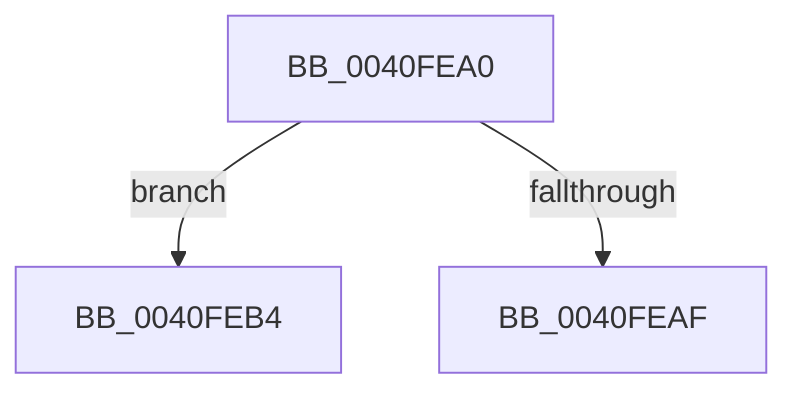

# sub_0040FEA0

- RVA: `0x0040FEA0`–`0x0040FEDB` (길이 `59` bytes)
- VA: `0x000000014040FEA0`
- 실행 섹션: `.text`
- PDB 이름 있음: `아니요`; PDB Function 태그: `아니요`
- unwind 정보 RVA: `0x0009BC14`
- 디코드: `20`개 명령, `59/59` bytes 표시
- 미해석 바이트: `0` (있으면 어셈블리에 `.byte`로 보존)

> 이 문서는 커널 이미지의 기계어와 PDB 기호를 분석해 생성했습니다. 4번과 5번은 함수 원형과 자료형을 바이너리 사용 방식에서 추정한 C 해석이며 원본 소스 복구 결과는 아닙니다.

## 1. Dependencies

- 직접 호출 지점: **0**; 고유 호출 대상: **0**
- 직접 호출자로 확인된 함수: **0**
- RIP 상대 이미지 참조: **0**

### Outgoing calls
- 직접 디코드된 call 명령이 없습니다.

### Direct callers
- 이 함수 시작 RVA로 연결되는 직접 call은 확인되지 않았습니다. 간접 호출은 완전히 역산할 수 없습니다.

### Static image references
- 디코드된 RIP-relative 메모리 참조가 없습니다.

## 2. Other-region calls and transfers

- 다른 실행 섹션으로 향하는 call: **0**
- call이 아닌 외부 분기/꼬리 이동: **2**
  - `0x0040FEB2` → [sub_0040FE14 + 0x51](Unknown_function_0040FE14.md) (`tail-transfer`)
  - `0x0040FED9` → [sub_0040FE14 + 0x5D](Unknown_function_0040FE14.md) (`tail-transfer`)

## 3. Assembly (complete function range)

```asm
0040FEA0  69 C2 E8 03 00 00               imul eax, edx, 0x3e8
0040FEA6  33 D2                           xor edx, edx
0040FEA8  F7 F1                           div ecx
0040FEAA  83 F8 05                        cmp eax, 5
0040FEAD  73 05                           jae 0x14040feb4
0040FEAF  41 FF CA                        dec r10d
0040FEB2  EB B1                           jmp 0x14040fe65
0040FEB4  41 8B C9                        mov ecx, r9d
0040FEB7  41 2B CA                        sub ecx, r10d
0040FEBA  0F AF C8                        imul ecx, eax
0040FEBD  B8 D3 4D 62 10                  mov eax, 0x10624dd3
0040FEC2  F7 E1                           mul ecx
0040FEC4  C1 EA 07                        shr edx, 7
0040FEC7  83 C2 05                        add edx, 5
0040FECA  3B D5                           cmp edx, ebp
0040FECC  0F 47 D5                        cmova edx, ebp
0040FECF  44 03 D2                        add r10d, edx
0040FED2  45 3B D1                        cmp r10d, r9d
0040FED5  45 0F 4F D1                     cmovg r10d, r9d
0040FED9  EB 96                           jmp 0x14040fe71
```

## 4. C-style interpretation (structured pseudocode)

```c
__int64 __fastcall sub_0040FEA0(int a1, int a2, __int64 a3, int a4)
{
    __int64 result;
    __int64 v_r10;

    result = (unsigned int)((result) * (a2));
    a2 = 0;
    if (((unsigned int)(result)) >= 5) goto loc_0040FEB4;
    v_r10 = (unsigned int)((v_r10) - 1);
loc_0040FEB4:
    a1 = (unsigned int)(((unsigned int)(a4)) - ((unsigned int)(v_r10)));
    a1 = (unsigned int)((a1) * ((unsigned int)(result)));
    a2 = (unsigned int)((a2) >> (7));
    a2 = (unsigned int)((a2) + (5));
    if (a2 > ((unsigned int)(v_rbp))) { a2 = (unsigned int)(v_rbp); }
    v_r10 = (unsigned int)((v_r10) + (a2));
    if (((unsigned int)(v_r10)) > a4) { v_r10 = a4; }
}
```

## 5. (Beta) C Style

```c
int64_t sub_0040FEA0(int32_t Arg1, int32_t Arg2, int64_t Arg3, int32_t Arg4)
{
    int64_t result;
    int64_t local_r10;

    result = (uint32_t)((result) * (Arg2));
    Arg2 = 0;
    if (((uint32_t)(result)) >= 5) goto loc_0040FEB4;
    local_r10 = (uint32_t)((local_r10) - 1);
loc_0040FEB4:
    Arg1 = (uint32_t)(((uint32_t)(Arg4)) - ((uint32_t)(local_r10)));
    Arg1 = (uint32_t)((Arg1) * ((uint32_t)(result)));
    Arg2 = (uint32_t)((Arg2) >> (7));
    Arg2 = (uint32_t)((Arg2) + (5));
    if (Arg2 > ((uint32_t)(local_rbp))) { Arg2 = (uint32_t)(local_rbp); }
    local_r10 = (uint32_t)((local_r10) + (Arg2));
    if (((uint32_t)(local_r10)) > Arg4) { local_r10 = Arg4; }
}
```

## 6. Execution-region graph

[열기: 2D/3D 그래프와 함수 탐색 컨트롤 패널](../../../control-panel.html?section=text&rva=0x0040FEA0&view=graph)

- 2D 그래프는 위에서 아래로 흐르고, 3D 그래프는 빈 공간을 드래그해 회전합니다. Shift+드래그는 이동, 휠은 확대·축소, 함수 노드 선택은 대상 보고서 이동입니다.

### Static fallback


