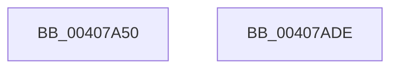

# VslMakeProtectedPageExecutable

- RVA: `0x00407A50`–`0x00407ADF` (길이 `143` bytes)
- VA: `0x0000000140407A50`
- 실행 섹션: `.text`
- PDB 이름 있음: `예`; PDB Function 태그: `아니요`
- unwind 정보 RVA: `0x0009A988`
- 디코드: `36`개 명령, `143/143` bytes 표시
- 미해석 바이트: `0` (있으면 어셈블리에 `.byte`로 보존)

> 이 문서는 커널 이미지의 기계어와 PDB 기호를 분석해 생성했습니다. 4번과 5번은 함수 원형과 자료형을 바이너리 사용 방식에서 추정한 C 해석이며 원본 소스 복구 결과는 아닙니다.

## 1. Dependencies

- 직접 호출 지점: **3**; 고유 호출 대상: **3**
- 직접 호출자로 확인된 함수: **5**
- RIP 상대 이미지 참조: **1**

### Outgoing calls
- `0x00407A88` → [memset](../6C/memset_function_006C6C40.md) (function, `0x006C6C40`)
- `0x00407AB4` → [VslpEnterIumSecureMode](../23/VslpEnterIumSecureMode_function_00235E50.md) (function, `0x00235E50`)
- `0x00407AC4` → [_security_check_cookie](../6A/_security_check_cookie_function_006AC640.md) (function, `0x006AC640`)

### Direct callers
- [sub_00336094](../33/Unknown_function_00336094.md) at `0x00336096`
- [sub_00336206](../33/Unknown_function_00336206.md) at `0x00336208`
- [MiRestoreTransitionPte](../33/MiRestoreTransitionPte_function_0033DD90.md) at `0x0033E234`
- [sub_0040710D](Unknown_function_0040710D.md) at `0x00407112`
- [KeSetPagePrivilege](KeSetPagePrivilege_function_00407970.md) at `0x004079AC`

### Static image references
- `0x00407A62` → RVA `0x00E0A740` (`.data`; read)

## 2. Other-region calls and transfers

- 다른 실행 섹션으로 향하는 call: **0**
- 별도 외부 분기/꼬리 이동을 확인하지 못했습니다.

## 3. Assembly (complete function range)

```asm
00407A50  48 89 5C 24 18                  mov qword ptr [rsp + 0x18], rbx
00407A55  48 89 74 24 20                  mov qword ptr [rsp + 0x20], rsi
00407A5A  57                              push rdi
00407A5B  48 81 EC A0 00 00 00            sub rsp, 0xa0
00407A62  48 8B 05 D7 2C A0 00            mov rax, qword ptr [rip + 0xa02cd7]
00407A69  48 33 C4                        xor rax, rsp
00407A6C  48 89 84 24 90 00 00 00         mov qword ptr [rsp + 0x90], rax
00407A74  48 8B FA                        mov rdi, rdx
00407A77  41 8B F0                        mov esi, r8d
00407A7A  33 D2                           xor edx, edx
00407A7C  48 8B D9                        mov rbx, rcx
00407A7F  48 8D 4C 24 20                  lea rcx, [rsp + 0x20]
00407A84  44 8D 42 68                     lea r8d, [rdx + 0x68]
00407A88  E8 B3 F1 2B 00                  call 0x1406c6c40
00407A8D  33 C0                           xor eax, eax
00407A8F  48 89 5C 24 28                  mov qword ptr [rsp + 0x28], rbx
00407A94  85 F6                           test esi, esi
00407A96  48 89 7C 24 30                  mov qword ptr [rsp + 0x30], rdi
00407A9B  BA FA 00 00 00                  mov edx, 0xfa
00407AA0  4C 8D 4C 24 20                  lea r9, [rsp + 0x20]
00407AA5  8D 48 01                        lea ecx, [rax + 1]
00407AA8  0F 45 C1                        cmovne eax, ecx
00407AAB  45 33 C0                        xor r8d, r8d
00407AAE  B1 02                           mov cl, 2
00407AB0  89 44 24 48                     mov dword ptr [rsp + 0x48], eax
00407AB4  E8 97 E3 E2 FF                  call 0x140235e50
00407AB9  48 8B 8C 24 90 00 00 00         mov rcx, qword ptr [rsp + 0x90]
00407AC1  48 33 CC                        xor rcx, rsp
00407AC4  E8 77 4B 2A 00                  call 0x1406ac640
00407AC9  4C 8D 9C 24 A0 00 00 00         lea r11, [rsp + 0xa0]
00407AD1  49 8B 5B 20                     mov rbx, qword ptr [r11 + 0x20]
00407AD5  49 8B 73 28                     mov rsi, qword ptr [r11 + 0x28]
00407AD9  49 8B E3                        mov rsp, r11
00407ADC  5F                              pop rdi
00407ADD  C3                              ret
00407ADE  CC                              int3
```

## 4. C-style interpretation (structured pseudocode)

```c
__int64 __fastcall VslMakeProtectedPageExecutable(__int64 a1, __int64 a2, int a3)
{
    __int64 result;
    __int64 v_rsp;
    unsigned __int64 v_stack_m18;
    unsigned int v_stack_m60;
    unsigned __int64 v_stack_m78;
    unsigned __int64 v_stack_m8;
    unsigned __int64 v_stack_m80;
    unsigned __int64 v_stack_m88;
    unsigned __int64 v_stack_p18;
    unsigned __int64 v_stack_p20;

    v_stack_p18 = v_rbx;
    v_stack_p20 = v_rsi;
    v_rsp = (v_rsp) - (160);
    result = (*(unsigned __int64 *)(v_rip + 10497239)) ^ (v_rsp);
    v_stack_m18 = result;
    a2 = 0;
    result = memset(v_stack_m88, a2, a2 + 104, a4);
    result = 0;
    v_stack_m80 = a1;
    v_stack_m78 = 0;
    if ((unsigned int)((unsigned int)(a3)) != 0) { result = (unsigned int)(result + 1); }
    a3 = 0;
    v_stack_m60 = (unsigned int)(result);
    result = VslpEnterIumSecureMode(2, 250, a3, v_stack_m88);
    a1 = (v_stack_m18) ^ (v_rsp);
    result = _security_check_cookie(a1, 250, a3, v_stack_m88);
    return result;
}
```

## 5. (Beta) C Style

```c
int64_t VslMakeProtectedPageExecutable(int64_t Arg1, int64_t Arg2, int32_t Arg3)
{
    int64_t result;
    int64_t local_rsp;
    uint64_t v_stack_m18;
    uint32_t v_stack_m60;
    uint64_t v_stack_m78;
    uint64_t v_stack_m8;
    uint64_t v_stack_m80;
    uint64_t v_stack_m88;
    uint64_t v_stack_p18;
    uint64_t v_stack_p20;

    v_stack_p18 = local_rbx;
    v_stack_p20 = local_rsi;
    local_rsp = (local_rsp) - (160);
    result = (*(uint64_t *)(v_rip + 0xA02CD7)) ^ (local_rsp);
    v_stack_m18 = result;
    Arg2 = 0;
    result = memset(v_stack_m88, Arg2, Arg2 + 104, a4);
    result = 0;
    v_stack_m80 = Arg1;
    v_stack_m78 = 0;
    if ((uint32_t)((uint32_t)(Arg3)) != 0) { result = (uint32_t)(result + 1); }
    Arg3 = 0;
    v_stack_m60 = (uint32_t)(result);
    result = VslpEnterIumSecureMode(2, 250, Arg3, v_stack_m88);
    Arg1 = (v_stack_m18) ^ (local_rsp);
    result = _security_check_cookie(Arg1, 250, Arg3, v_stack_m88);
    return result;
}
```

## 6. Execution-region graph

[열기: 2D/3D 그래프와 함수 탐색 컨트롤 패널](../../../control-panel.html?section=text&rva=0x00407A50&view=graph)

- 2D 그래프는 위에서 아래로 흐르고, 3D 그래프는 빈 공간을 드래그해 회전합니다. Shift+드래그는 이동, 휠은 확대·축소, 함수 노드 선택은 대상 보고서 이동입니다.

### Static fallback


