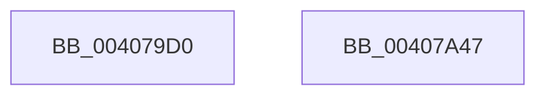

# VslRemoveProtectedPage

- RVA: `0x004079D0`–`0x00407A48` (길이 `120` bytes)
- VA: `0x00000001404079D0`
- 실행 섹션: `.text`
- PDB 이름 있음: `예`; PDB Function 태그: `아니요`
- unwind 정보 RVA: `0x0009A96C`
- 디코드: `32`개 명령, `120/120` bytes 표시
- 미해석 바이트: `0` (있으면 어셈블리에 `.byte`로 보존)

> 이 문서는 커널 이미지의 기계어와 PDB 기호를 분석해 생성했습니다. 4번과 5번은 함수 원형과 자료형을 바이너리 사용 방식에서 추정한 C 해석이며 원본 소스 복구 결과는 아닙니다.

## 1. Dependencies

- 직접 호출 지점: **3**; 고유 호출 대상: **3**
- 직접 호출자로 확인된 함수: **5**
- RIP 상대 이미지 참조: **1**

### Outgoing calls
- `0x00407A01` → [memset](../6C/memset_function_006C6C40.md) (function, `0x006C6C40`)
- `0x00407A27` → [VslpEnterIumSecureMode](../23/VslpEnterIumSecureMode_function_00235E50.md) (function, `0x00235E50`)
- `0x00407A37` → [_security_check_cookie](../6A/_security_check_cookie_function_006AC640.md) (function, `0x006AC640`)

### Direct callers
- [sub_003354FB](../33/Unknown_function_003354FB.md) at `0x00335F6E`
- [sub_0033603B](../33/Unknown_function_0033603B.md) at `0x00336078`
- [MiRestoreTransitionPte](../33/MiRestoreTransitionPte_function_0033DD90.md) at `0x0033E1F7`
- [sub_00407035](Unknown_function_00407035.md) at `0x004070D2`
- [KeSetPagePrivilege](KeSetPagePrivilege_function_00407970.md) at `0x00407997`

### Static image references
- `0x004079DB` → RVA `0x00E0A740` (`.data`; read)

## 2. Other-region calls and transfers

- 다른 실행 섹션으로 향하는 call: **0**
- 별도 외부 분기/꼬리 이동을 확인하지 못했습니다.

## 3. Assembly (complete function range)

```asm
004079D0  40 53                           push rbx
004079D2  56                              push rsi
004079D3  57                              push rdi
004079D4  48 81 EC A0 00 00 00            sub rsp, 0xa0
004079DB  48 8B 05 5E 2D A0 00            mov rax, qword ptr [rip + 0xa02d5e]
004079E2  48 33 C4                        xor rax, rsp
004079E5  48 89 84 24 90 00 00 00         mov qword ptr [rsp + 0x90], rax
004079ED  48 8B FA                        mov rdi, rdx
004079F0  41 8B F0                        mov esi, r8d
004079F3  33 D2                           xor edx, edx
004079F5  48 8B D9                        mov rbx, rcx
004079F8  48 8D 4C 24 20                  lea rcx, [rsp + 0x20]
004079FD  44 8D 42 68                     lea r8d, [rdx + 0x68]
00407A01  E8 3A F2 2B 00                  call 0x1406c6c40
00407A06  0F 10 07                        movups xmm0, xmmword ptr [rdi]
00407A09  BA F3 00 00 00                  mov edx, 0xf3
00407A0E  48 89 5C 24 28                  mov qword ptr [rsp + 0x28], rbx
00407A13  4C 8D 4C 24 20                  lea r9, [rsp + 0x20]
00407A18  89 74 24 48                     mov dword ptr [rsp + 0x48], esi
00407A1C  45 33 C0                        xor r8d, r8d
00407A1F  B1 02                           mov cl, 2
00407A21  F3 0F 7F 44 24 38               movdqu xmmword ptr [rsp + 0x38], xmm0
00407A27  E8 24 E4 E2 FF                  call 0x140235e50
00407A2C  48 8B 8C 24 90 00 00 00         mov rcx, qword ptr [rsp + 0x90]
00407A34  48 33 CC                        xor rcx, rsp
00407A37  E8 04 4C 2A 00                  call 0x1406ac640
00407A3C  48 81 C4 A0 00 00 00            add rsp, 0xa0
00407A43  5F                              pop rdi
00407A44  5E                              pop rsi
00407A45  5B                              pop rbx
00407A46  C3                              ret
00407A47  CC                              int3
```

## 4. C-style interpretation (structured pseudocode)

```c
__int64 __fastcall VslRemoveProtectedPage(__int64 a1, __int64 a2, int a3)
{
    __int64 result;
    __int64 v_rsp;
    unsigned __int64 v_stack_m28;
    unsigned int v_stack_m70;
    unsigned __int64 v_stack_m80;
    unsigned __int64 v_stack_m90;
    unsigned __int64 v_stack_m98;

    v_rsp = (v_rsp) - (160);
    result = (*(unsigned __int64 *)(v_rip + 10497374)) ^ (v_rsp);
    v_stack_m28 = result;
    a2 = 0;
    result = memset(v_stack_m98, a2, a2 + 104, a4);
    v_stack_m90 = a1;
    v_stack_m70 = (unsigned int)((unsigned int)(a3));
    a3 = 0;
    v_stack_m80 = v_xmm0;
    result = VslpEnterIumSecureMode(2, 243, a3, v_stack_m98);
    a1 = (v_stack_m28) ^ (v_rsp);
    result = _security_check_cookie(a1, 243, a3, v_stack_m98);
    v_rsp = (v_rsp) + (160);
    return result;
}
```

## 5. (Beta) C Style

```c
int64_t VslRemoveProtectedPage(int64_t Arg1, void *Arg2, int32_t Arg3)
{
    uint8_t *arg2 = (uint8_t *)Arg2;

    int64_t result;
    int64_t local_rsp;
    uint64_t v_stack_m28;
    uint32_t v_stack_m70;
    uint64_t v_stack_m80;
    uint64_t v_stack_m90;
    uint64_t v_stack_m98;

    local_rsp = (local_rsp) - (160);
    result = (*(uint64_t *)(v_rip + 0xA02D5E)) ^ (local_rsp);
    v_stack_m28 = result;
    Arg2 = 0;
    result = memset(v_stack_m98, Arg2, Arg2 + 104, a4);
    v_stack_m90 = Arg1;
    v_stack_m70 = (uint32_t)((uint32_t)(Arg3));
    Arg3 = 0;
    v_stack_m80 = v_xmm0;
    result = VslpEnterIumSecureMode(2, 243, Arg3, v_stack_m98);
    Arg1 = (v_stack_m28) ^ (local_rsp);
    result = _security_check_cookie(Arg1, 243, Arg3, v_stack_m98);
    local_rsp = (local_rsp) + (160);
    return result;
}
```

### 관측된 메모리 오프셋

구조체 형식이 확인되지 않은 접근은 인자 기준의 오프셋으로만 기록했습니다.

| 기준 인자 | 오프셋 표현 | 폭 (bit) | 접근 |
|---|---:|---:|---|
| `Arg2` | `+ 0x0` | `128` | `R` |

## 6. Execution-region graph

[열기: 2D/3D 그래프와 함수 탐색 컨트롤 패널](../../../control-panel.html?section=text&rva=0x004079D0&view=graph)

- 2D 그래프는 위에서 아래로 흐르고, 3D 그래프는 빈 공간을 드래그해 회전합니다. Shift+드래그는 이동, 휠은 확대·축소, 함수 노드 선택은 대상 보고서 이동입니다.

### Static fallback


