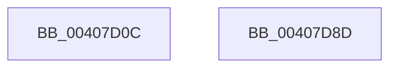

# VslSetPrivilegedPte

- RVA: `0x00407D0C`–`0x00407D8E` (길이 `130` bytes)
- VA: `0x0000000140407D0C`
- 실행 섹션: `.text`
- PDB 이름 있음: `예`; PDB Function 태그: `아니요`
- unwind 정보 RVA: `0x0009A9C4`
- 디코드: `36`개 명령, `130/130` bytes 표시
- 미해석 바이트: `0` (있으면 어셈블리에 `.byte`로 보존)

> 이 문서는 커널 이미지의 기계어와 PDB 기호를 분석해 생성했습니다. 4번과 5번은 함수 원형과 자료형을 바이너리 사용 방식에서 추정한 C 해석이며 원본 소스 복구 결과는 아닙니다.

## 1. Dependencies

- 직접 호출 지점: **3**; 고유 호출 대상: **3**
- 직접 호출자로 확인된 함수: **2**
- RIP 상대 이미지 참조: **1**

### Outgoing calls
- `0x00407D41` → [memset](../6C/memset_function_006C6C40.md) (function, `0x006C6C40`)
- `0x00407D6C` → [VslpEnterIumSecureMode](../23/VslpEnterIumSecureMode_function_00235E50.md) (function, `0x00235E50`)
- `0x00407D7C` → [_security_check_cookie](../6A/_security_check_cookie_function_006AC640.md) (function, `0x006AC640`)

### Direct callers
- [MiAllocateWsle](../33/MiAllocateWsle_function_003332C0.md) at `0x0033378E`
- [KeSetPagePrivilege](KeSetPagePrivilege_function_00407970.md) at `0x004079BB`

### Static image references
- `0x00407D18` → RVA `0x00E0A740` (`.data`; read)

## 2. Other-region calls and transfers

- 다른 실행 섹션으로 향하는 call: **0**
- 별도 외부 분기/꼬리 이동을 확인하지 못했습니다.

## 3. Assembly (complete function range)

```asm
00407D0C  40 53                           push rbx
00407D0E  55                              push rbp
00407D0F  56                              push rsi
00407D10  57                              push rdi
00407D11  48 81 EC A8 00 00 00            sub rsp, 0xa8
00407D18  48 8B 05 21 2A A0 00            mov rax, qword ptr [rip + 0xa02a21]
00407D1F  48 33 C4                        xor rax, rsp
00407D22  48 89 84 24 90 00 00 00         mov qword ptr [rsp + 0x90], rax
00407D2A  48 8B FA                        mov rdi, rdx
00407D2D  49 8B F0                        mov rsi, r8
00407D30  33 D2                           xor edx, edx
00407D32  48 8B D9                        mov rbx, rcx
00407D35  48 8D 4C 24 20                  lea rcx, [rsp + 0x20]
00407D3A  41 8B E9                        mov ebp, r9d
00407D3D  44 8D 42 68                     lea r8d, [rdx + 0x68]
00407D41  E8 FA EE 2B 00                  call 0x1406c6c40
00407D46  0F 10 06                        movups xmm0, xmmword ptr [rsi]
00407D49  BA F7 00 00 00                  mov edx, 0xf7
00407D4E  48 89 5C 24 28                  mov qword ptr [rsp + 0x28], rbx
00407D53  4C 8D 4C 24 20                  lea r9, [rsp + 0x20]
00407D58  48 89 7C 24 30                  mov qword ptr [rsp + 0x30], rdi
00407D5D  45 33 C0                        xor r8d, r8d
00407D60  89 6C 24 48                     mov dword ptr [rsp + 0x48], ebp
00407D64  B1 02                           mov cl, 2
00407D66  F3 0F 7F 44 24 38               movdqu xmmword ptr [rsp + 0x38], xmm0
00407D6C  E8 DF E0 E2 FF                  call 0x140235e50
00407D71  48 8B 8C 24 90 00 00 00         mov rcx, qword ptr [rsp + 0x90]
00407D79  48 33 CC                        xor rcx, rsp
00407D7C  E8 BF 48 2A 00                  call 0x1406ac640
00407D81  48 81 C4 A8 00 00 00            add rsp, 0xa8
00407D88  5F                              pop rdi
00407D89  5E                              pop rsi
00407D8A  5D                              pop rbp
00407D8B  5B                              pop rbx
00407D8C  C3                              ret
00407D8D  CC                              int3
```

## 4. C-style interpretation (structured pseudocode)

```c
__int64 __fastcall VslSetPrivilegedPte(__int64 a1, __int64 a2, __int64 a3, int a4)
{
    __int64 result;
    __int64 v_rsp;
    unsigned __int64 v_stack_m38;
    unsigned int v_stack_m80;
    unsigned __int64 v_stack_m90;
    unsigned __int64 v_stack_m98;
    unsigned __int64 v_stack_mA0;
    unsigned __int64 v_stack_mA8;

    v_rsp = (v_rsp) - (168);
    result = (*(unsigned __int64 *)(v_rip + 10496545)) ^ (v_rsp);
    v_stack_m38 = result;
    a2 = 0;
    result = memset(v_stack_mA8, a2, a2 + 104, a4);
    v_stack_mA0 = a1;
    v_stack_m98 = 0;
    a3 = 0;
    v_stack_m80 = (unsigned int)((unsigned int)(a4));
    v_stack_m90 = v_xmm0;
    result = VslpEnterIumSecureMode(2, 247, a3, v_stack_mA8);
    a1 = (v_stack_m38) ^ (v_rsp);
    result = _security_check_cookie(a1, 247, a3, v_stack_mA8);
    v_rsp = (v_rsp) + (168);
    return result;
}
```

## 5. (Beta) C Style

```c
int64_t VslSetPrivilegedPte(int64_t Arg1, int64_t Arg2, void *Arg3, int32_t Arg4)
{
    uint8_t *arg3 = (uint8_t *)Arg3;

    int64_t result;
    int64_t local_rsp;
    uint64_t v_stack_m38;
    uint32_t v_stack_m80;
    uint64_t v_stack_m90;
    uint64_t v_stack_m98;
    uint64_t v_stack_mA0;
    uint64_t v_stack_mA8;

    local_rsp = (local_rsp) - (168);
    result = (*(uint64_t *)(v_rip + 0xA02A21)) ^ (local_rsp);
    v_stack_m38 = result;
    Arg2 = 0;
    result = memset(v_stack_mA8, Arg2, Arg2 + 104, Arg4);
    v_stack_mA0 = Arg1;
    v_stack_m98 = 0;
    Arg3 = 0;
    v_stack_m80 = (uint32_t)((uint32_t)(Arg4));
    v_stack_m90 = v_xmm0;
    result = VslpEnterIumSecureMode(2, 247, Arg3, v_stack_mA8);
    Arg1 = (v_stack_m38) ^ (local_rsp);
    result = _security_check_cookie(Arg1, 247, Arg3, v_stack_mA8);
    local_rsp = (local_rsp) + (168);
    return result;
}
```

### 관측된 메모리 오프셋

구조체 형식이 확인되지 않은 접근은 인자 기준의 오프셋으로만 기록했습니다.

| 기준 인자 | 오프셋 표현 | 폭 (bit) | 접근 |
|---|---:|---:|---|
| `Arg3` | `+ 0x0` | `128` | `R` |

## 6. Execution-region graph

[열기: 2D/3D 그래프와 함수 탐색 컨트롤 패널](../../../control-panel.html?section=text&rva=0x00407D0C&view=graph)

- 2D 그래프는 위에서 아래로 흐르고, 3D 그래프는 빈 공간을 드래그해 회전합니다. Shift+드래그는 이동, 휠은 확대·축소, 함수 노드 선택은 대상 보고서 이동입니다.

### Static fallback


