# AlpcpLookasidePacketCallbackRoutine

- RVA: `0x00419D50`–`0x00419F93` (길이 `579` bytes)
- VA: `0x0000000140419D50`
- 실행 섹션: `.text`
- PDB 이름 있음: `예`; PDB Function 태그: `아니요`
- unwind 정보 RVA: `0x0009D284`
- 디코드: `152`개 명령, `579/579` bytes 표시
- 미해석 바이트: `0` (있으면 어셈블리에 `.byte`로 보존)

> 이 문서는 커널 이미지의 기계어와 PDB 기호를 분석해 생성했습니다. 4번과 5번은 함수 원형과 자료형을 바이너리 사용 방식에서 추정한 C 해석이며 원본 소스 복구 결과는 아닙니다.

## 1. Dependencies

- 직접 호출 지점: **12**; 고유 호출 대상: **12**
- 직접 호출자로 확인된 함수: **1**
- RIP 상대 이미지 참조: **3**

### Outgoing calls
- `0x00419E35` → [KxWaitForLockChainValid](../21/KxWaitForLockChainValid_function_00217AA0.md) (function, `0x00217AA0`)
- `0x00419E54` → [KeWakeAddressAll](../21/KeWakeAddressAll_function_00217C20.md) (function, `0x00217C20`)
- `0x00419E6F` → [KiReleaseQueuedSpinLockInstrumented](../21/KiReleaseQueuedSpinLockInstrumented_function_002179F0.md) (function, `0x002179F0`)
- `0x00419E89` → [KiLowerIrqlProcessIrqlFlags](../4F/KiLowerIrqlProcessIrqlFlags_function_004F5698.md) (function, `0x004F5698`)
- `0x00419EBB` → [IoFreeMiniCompletionPacket](../../page/9A/IoFreeMiniCompletionPacket_function_009A82B0.md) (function, `0x009A82B0`)
- `0x00419ECC` → [ExFreePoolWithTag](../../poolcode/B8/ExFreePoolWithTag_function_00B82870.md) (function, `0x00B82870`)
- `0x00419F06` → [KiAcquireQueuedSpinLockInstrumented](../27/KiAcquireQueuedSpinLockInstrumented_function_00275850.md) (function, `0x00275850`)
- `0x00419F22` → [KiRaiseIrqlProcessIrqlFlags](../4F/KiRaiseIrqlProcessIrqlFlags_function_004F56FC.md) (function, `0x004F56FC`)
- `0x00419F31` → [KxWaitForLockOwnerShip](../25/KxWaitForLockOwnerShip_function_00257EB0.md) (function, `0x00257EB0`)
- `0x00419F44` → [ObReferenceObjectSafeWithTag](../21/ObReferenceObjectSafeWithTag_function_00210EE0.md) (function, `0x00210EE0`)
- `0x00419F6B` → [AlpcpQueueIoCompletion](../39/AlpcpQueueIoCompletion_function_00397480.md) (function, `0x00397480`)
- `0x00419F78` → [ObfDereferenceObjectWithTag](../2F/ObfDereferenceObjectWithTag_function_002F78E0.md) (function, `0x002F78E0`)

### Direct callers
- [sub_009A8352](../../page/9A/Unknown_function_009A8352.md) at `0x009A8361`

### Static image references
- `0x00419D99` → RVA `0x00FC6D20` (`ALMOSTRO`; read)
- `0x00419DA5` → RVA `0x00FC6B06` (`ALMOSTRO`; read)
- `0x00419E5B` → RVA `0x00F0DE58` (`.data`; read)

## 2. Other-region calls and transfers

- 다른 실행 섹션으로 향하는 call: **2**
  - `0x00419EBB` → [IoFreeMiniCompletionPacket](../../page/9A/IoFreeMiniCompletionPacket_function_009A82B0.md) (`.text` → `PAGE`)
  - `0x00419ECC` → [ExFreePoolWithTag](../../poolcode/B8/ExFreePoolWithTag_function_00B82870.md) (`.text` → `POOLCODE`)
- 별도 외부 분기/꼬리 이동을 확인하지 못했습니다.

## 3. Assembly (complete function range)

```asm
00419D50  48 89 5C 24 08                  mov qword ptr [rsp + 8], rbx
00419D55  48 89 6C 24 10                  mov qword ptr [rsp + 0x10], rbp
00419D5A  48 89 74 24 18                  mov qword ptr [rsp + 0x18], rsi
00419D5F  57                              push rdi
00419D60  41 54                           push r12
00419D62  41 55                           push r13
00419D64  41 56                           push r14
00419D66  41 57                           push r15
00419D68  48 83 EC 50                     sub rsp, 0x50
00419D6C  48 8B 72 10                     mov rsi, qword ptr [rdx + 0x10]
00419D70  33 DB                           xor ebx, ebx
00419D72  4C 8B F2                        mov r14, rdx
00419D75  48 89 5C 24 40                  mov qword ptr [rsp + 0x40], rbx
00419D7A  4C 8B F9                        mov r15, rcx
00419D7D  8B EB                           mov ebp, ebx
00419D7F  44 8D 6B 02                     lea r13d, [rbx + 2]
00419D83  48 89 74 24 38                  mov qword ptr [rsp + 0x38], rsi
00419D88  4C 8B E3                        mov r12, rbx
00419D8B  48 89 5C 24 30                  mov qword ptr [rsp + 0x30], rbx
00419D90  90                              nop
00419D91  44 0F 20 C7                     mov rdi, cr8
00419D95  45 0F 22 C5                     mov cr8, r13
00419D99  39 1D 81 CF BA 00               cmp dword ptr [rip + 0xbacf81], ebx
00419D9F  0F 85 75 01 00 00               jne 0x140419f1a
00419DA5  F6 05 5A CD BA 00 21            test byte ptr [rip + 0xbacd5a], 0x21
00419DAC  40 88 7C 24 40                  mov byte ptr [rsp + 0x40], dil
00419DB1  0F 85 39 01 00 00               jne 0x140419ef0
00419DB7  48 8D 54 24 30                  lea rdx, [rsp + 0x30]
00419DBC  48 87 16                        xchg qword ptr [rsi], rdx
00419DBF  48 85 D2                        test rdx, rdx
00419DC2  0F 85 64 01 00 00               jne 0x140419f2c
00419DC8  8B 46 10                        mov eax, dword ptr [rsi + 0x10]
00419DCB  85 C0                           test eax, eax
00419DCD  0F 85 3D 01 00 00               jne 0x140419f10
00419DD3  8B 46 14                        mov eax, dword ptr [rsi + 0x14]
00419DD6  85 C0                           test eax, eax
00419DD8  0F 85 A4 01 00 00               jne 0x140419f82
00419DDE  FF 4E 0C                        dec dword ptr [rsi + 0xc]
00419DE1  4C 8B FB                        mov r15, rbx
00419DE4  48 8B 46 20                     mov rax, qword ptr [rsi + 0x20]
00419DE8  49 89 06                        mov qword ptr [r14], rax
00419DEB  4C 89 76 20                     mov qword ptr [rsi + 0x20], r14
00419DEF  39 5E 0C                        cmp dword ptr [rsi + 0xc], ebx
00419DF2  75 0B                           jne 0x140419dff
00419DF4  39 5E 18                        cmp dword ptr [rsi + 0x18], ebx
00419DF7  B8 01 00 00 00                  mov eax, 1
00419DFC  0F 45 E8                        cmovne ebp, eax
00419DFF  F6 05 00 CD BA 00 01            test byte ptr [rip + 0xbacd00], 1
00419E06  75 53                           jne 0x140419e5b
00419E08  0F 0D 4C 24 30                  prefetchw byte ptr [rsp + 0x30]
00419E0D  48 8B 44 24 30                  mov rax, qword ptr [rsp + 0x30]
00419E12  48 85 C0                        test rax, rax
00419E15  75 23                           jne 0x140419e3a
00419E17  48 8B 4C 24 38                  mov rcx, qword ptr [rsp + 0x38]
00419E1C  48 8D 44 24 30                  lea rax, [rsp + 0x30]
00419E21  F0 48 0F B1 19                  lock cmpxchg qword ptr [rcx], rbx
00419E26  48 8D 4C 24 30                  lea rcx, [rsp + 0x30]
00419E2B  48 3B C1                        cmp rax, rcx
00419E2E  74 44                           je 0x140419e74
00419E30  48 8D 4C 24 30                  lea rcx, [rsp + 0x30]
00419E35  E8 66 DC DF FF                  call 0x140217aa0
00419E3A  48 8D 48 08                     lea rcx, [rax + 8]
00419E3E  48 89 5C 24 30                  mov qword ptr [rsp + 0x30], rbx
00419E43  48 8B 54 24 38                  mov rdx, qword ptr [rsp + 0x38]
00419E48  48 8B C2                        mov rax, rdx
00419E4B  48 87 01                        xchg qword ptr [rcx], rax
00419E4E  32 C2                           xor al, dl
00419E50  A8 04                           test al, 4
00419E52  74 20                           je 0x140419e74
00419E54  E8 C7 DD DF FF                  call 0x140217c20
00419E59  EB 19                           jmp 0x140419e74
00419E5B  8B 05 F7 3F AF 00               mov eax, dword ptr [rip + 0xaf3ff7]
00419E61  85 C0                           test eax, eax
00419E63  75 A3                           jne 0x140419e08
00419E65  48 8B 54 24 78                  mov rdx, qword ptr [rsp + 0x78]
00419E6A  48 8D 4C 24 30                  lea rcx, [rsp + 0x30]
00419E6F  E8 7C DB DF FF                  call 0x1402179f0
00419E74  39 1D A6 CE BA 00               cmp dword ptr [rip + 0xbacea6], ebx
00419E7A  0F B6 7C 24 40                  movzx edi, byte ptr [rsp + 0x40]
00419E7F  74 0D                           je 0x140419e8e
00419E81  44 0F 20 C1                     mov rcx, cr8
00419E85  40 0F B6 D7                     movzx edx, dil
00419E89  E8 0A B8 0D 00                  call 0x1404f5698
00419E8E  44 0F 22 C7                     mov cr8, rdi
00419E92  4D 85 FF                        test r15, r15
00419E95  0F 85 A0 00 00 00               jne 0x140419f3b
00419E9B  85 ED                           test ebp, ebp
00419E9D  74 32                           je 0x140419ed1
00419E9F  39 5E 08                        cmp dword ptr [rsi + 8], ebx
00419EA2  76 23                           jbe 0x140419ec7
00419EA4  0F 1F 40 00                     nop dword ptr [rax]
00419EA8  0F 1F 84 00 00 00 00 00         nop dword ptr [rax + rax]
00419EB0  8B C3                           mov eax, ebx
00419EB2  48 8D 0C 40                     lea rcx, [rax + rax*2]
00419EB6  48 8B 4C CE 40                  mov rcx, qword ptr [rsi + rcx*8 + 0x40]
00419EBB  E8 F0 E3 58 00                  call 0x1409a82b0
00419EC0  FF C3                           inc ebx
00419EC2  3B 5E 08                        cmp ebx, dword ptr [rsi + 8]
00419EC5  72 E9                           jb 0x140419eb0
00419EC7  33 D2                           xor edx, edx
00419EC9  48 8B CE                        mov rcx, rsi
00419ECC  E8 9F 89 76 00                  call 0x140b82870
00419ED1  4C 8D 5C 24 50                  lea r11, [rsp + 0x50]
00419ED6  49 8B 5B 30                     mov rbx, qword ptr [r11 + 0x30]
00419EDA  49 8B 6B 38                     mov rbp, qword ptr [r11 + 0x38]
00419EDE  49 8B 73 40                     mov rsi, qword ptr [r11 + 0x40]
00419EE2  49 8B E3                        mov rsp, r11
00419EE5  41 5F                           pop r15
00419EE7  41 5E                           pop r14
00419EE9  41 5D                           pop r13
00419EEB  41 5C                           pop r12
00419EED  5F                              pop rdi
00419EEE  C3                              ret
00419EEF  CC                              int3
00419EF0  8B 05 62 3F AF 00               mov eax, dword ptr [rip + 0xaf3f62]
00419EF6  85 C0                           test eax, eax
00419EF8  0F 85 B9 FE FF FF               jne 0x140419db7
00419EFE  48 8B D6                        mov rdx, rsi
00419F01  48 8D 4C 24 30                  lea rcx, [rsp + 0x30]
00419F06  E8 45 B9 E5 FF                  call 0x140275850
00419F0B  E9 B8 FE FF FF                  jmp 0x140419dc8
00419F10  FF C8                           dec eax
00419F12  89 46 10                        mov dword ptr [rsi + 0x10], eax
00419F15  E9 E5 FE FF FF                  jmp 0x140419dff
00419F1A  41 0F B6 D5                     movzx edx, r13b
00419F1E  40 0F B6 CF                     movzx ecx, dil
00419F22  E8 D5 B7 0D 00                  call 0x1404f56fc
00419F27  E9 79 FE FF FF                  jmp 0x140419da5
00419F2C  48 8D 4C 24 30                  lea rcx, [rsp + 0x30]
00419F31  E8 7A DF E3 FF                  call 0x140257eb0
00419F36  E9 8D FE FF FF                  jmp 0x140419dc8
00419F3B  48 8B 4E 28                     mov rcx, qword ptr [rsi + 0x28]
00419F3F  BA 44 66 6C 74                  mov edx, 0x746c6644
00419F44  E8 97 6F DF FF                  call 0x140210ee0
00419F49  84 C0                           test al, al
00419F4B  0F 84 32 FE FF FF               je 0x140419d83
00419F51  48 8B 7E 28                     mov rdi, qword ptr [rsi + 0x28]
00419F55  4D 8B CF                        mov r9, r15
00419F58  48 8B 56 30                     mov rdx, qword ptr [rsi + 0x30]
00419F5C  4D 8B C4                        mov r8, r12
00419F5F  48 8B 4E 28                     mov rcx, qword ptr [rsi + 0x28]
00419F63  89 5C 24 28                     mov dword ptr [rsp + 0x28], ebx
00419F67  88 5C 24 20                     mov byte ptr [rsp + 0x20], bl
00419F6B  E8 10 D5 F7 FF                  call 0x140397480
00419F70  BA 44 66 6C 74                  mov edx, 0x746c6644
00419F75  48 8B CF                        mov rcx, rdi
00419F78  E8 63 D9 ED FF                  call 0x1402f78e0
00419F7D  E9 19 FF FF FF                  jmp 0x140419e9b
00419F82  FF C8                           dec eax
00419F84  49 C7 C4 FF FF FF FF            mov r12, 0xffffffffffffffff
00419F8B  89 46 14                        mov dword ptr [rsi + 0x14], eax
00419F8E  E9 6C FE FF FF                  jmp 0x140419dff
```

## 4. C-style interpretation (structured pseudocode)

```c
__int64 __fastcall AlpcpLookasidePacketCallbackRoutine(__int64 a1, __int64 a2)
{
    __int64 result;
    __int64 v_rbp;
    __int64 v_rbx;
    __int64 v_rsp;
    unsigned __int64 v_stack_m20;
    unsigned __int64 v_stack_m28;
    unsigned __int8 v_stack_m30;
    unsigned __int64 v_stack_m38;
    unsigned __int64 v_stack_m40;
    unsigned __int64 v_stack_m48;
    unsigned __int64 v_stack_p0;
    unsigned __int64 v_stack_p10;
    unsigned __int64 v_stack_p18;
    unsigned __int64 v_stack_p8;

    v_stack_p8 = v_rbx;
    v_stack_p10 = v_rbp;
    v_stack_p18 = v_rsi;
    v_rsp = (v_rsp) - (80);
    v_rbx = 0;
    v_stack_m38 = 0;
loc_00419D83:
    v_stack_m40 = *(unsigned __int64 *)(a2 + 16);
    v_stack_m48 = 0;
    if ((*(unsigned int *)(v_rip + 12242817)) != 0) goto loc_00419F1A;
loc_00419DA5:
    v_stack_m38 = (unsigned __int8)(v_cr8);
    if (((*(unsigned __int8 *)(v_rip + 12242266)) & (33)) != 0) goto loc_00419EF0;
loc_00419DB7:
    if (v_stack_m48 != 0) goto loc_00419F2C;
loc_00419DC8:
    if ((unsigned int)((unsigned int)(*(unsigned int *)(*(unsigned __int64 *)(a2 + 16) + 16))) != 0) goto loc_00419F10;
    if ((unsigned int)((unsigned int)(*(unsigned int *)(*(unsigned __int64 *)(a2 + 16) + 20))) != 0) goto loc_00419F82;
    *(unsigned __int64 *)(a2) = *(unsigned __int64 *)(*(unsigned __int64 *)(a2 + 16) + 32);
    *(unsigned __int64 *)(*(unsigned __int64 *)(a2 + 16) + 32) = a2;
    result = *(unsigned __int64 *)(*(unsigned __int64 *)(a2 + 16) + 32);
    v_rbp = 0;
    if ((*(unsigned int *)(*(unsigned __int64 *)(a2 + 16) + 12)) == 0) {
        result = 1;
        v_rbp = 0;
        if ((*(unsigned int *)(*(unsigned __int64 *)(a2 + 16) + 24)) != 0) { v_rbp = (unsigned int)(result); }
    }
    if (((*(unsigned __int8 *)(v_rip + 12242176)) & (1)) != 0) goto loc_00419E5B;
loc_00419E08:
    if (v_stack_m48 != 0) goto loc_00419E3A;
    if (v_stack_m48 == v_stack_m48) goto loc_00419E74;
    result = KxWaitForLockChainValid(v_stack_m48, v_stack_m48, a3, a4);
loc_00419E3A:
    v_stack_m48 = 0;
    result = (unsigned __int8)((v_stack_m40) ^ ((unsigned __int8)(v_stack_m40)));
    if ((((unsigned __int8)(result)) & (4)) == 0) goto loc_00419E74;
    result = KeWakeAddressAll(result + 8, v_stack_m40, a3, a4);
    goto loc_00419E74;
loc_00419E5B:
    if ((unsigned int)((unsigned int)(*(unsigned int *)(v_rip + 11485175))) != 0) goto loc_00419E08;
    result = KiReleaseQueuedSpinLockInstrumented(v_stack_m48, v_stack_p0, a3, a4);
loc_00419E74:
    if ((*(unsigned int *)(v_rip + 12242598)) != 0) {
        a1 = v_rbx + 2;
        a2 = (unsigned __int8)(v_stack_m38);
        result = KiLowerIrqlProcessIrqlFlags(a1, a2, a3, a4);
    }
    if (0 != 0) goto loc_00419F3B;
loc_00419E9B:
    if ((unsigned int)(v_rbp) == 0) goto loc_00419ED1;
    if ((*(unsigned int *)(*(unsigned __int64 *)(a2 + 16) + 8)) <= 0) goto loc_00419EC7;
loc_00419EB0:
    result = IoFreeMiniCompletionPacket(*(unsigned __int64 *)(*(unsigned __int64 *)(a2 + 16) + 0 + 0 * 2 * 8 + 64), a2, a3, a4);
    v_rbx = (unsigned int)((v_rbx) + 1);
    if (((unsigned int)(v_rbx)) < (*(unsigned int *)(*(unsigned __int64 *)(a2 + 16) + 8))) goto loc_00419EB0;
loc_00419EC7:
    a2 = 0;
    result = ExFreePoolWithTag(*(unsigned __int64 *)(a2 + 16), a2, a3, a4);
loc_00419ED1:
    return result;
loc_00419EF0:
    if ((unsigned int)((unsigned int)(*(unsigned int *)(v_rip + 11485026))) != 0) goto loc_00419DB7;
    result = KiAcquireQueuedSpinLockInstrumented(v_stack_m20, *(unsigned __int64 *)(v_stack_m28 + 64), a3, a4);
    goto loc_00419DC8;
loc_00419F10:
    result = (unsigned int)((result) - 1);
    *(unsigned int *)(*(unsigned __int64 *)(v_stack_m28 + 64) + 16) = (unsigned int)(result);
    goto loc_00419DFF;
loc_00419F1A:
    result = KiRaiseIrqlProcessIrqlFlags((unsigned __int8)(v_stack_m38), (unsigned __int8)(v_rbx + 2), a3, a4);
    goto loc_00419DA5;
loc_00419F2C:
    result = KxWaitForLockOwnerShip(v_stack_m20, (unsigned __int8)(v_rbx + 2), a3, a4);
    goto loc_00419DC8;
loc_00419F3B:
    result = ObReferenceObjectSafeWithTag(*(unsigned __int64 *)(*(unsigned __int64 *)(v_stack_m28 + 64) + 40), (unsigned int)(0x746C6644ULL), a3, a4);
    if ((unsigned __int8)(result) == 0) goto loc_00419D83;
    v_stack_m28 = (unsigned int)(*(unsigned __int64 *)(v_stack_m28 + 48));
    v_stack_m30 = (unsigned __int8)(*(unsigned __int64 *)(v_stack_m28 + 48));
    result = AlpcpQueueIoCompletion(*(unsigned __int64 *)(*(unsigned __int64 *)(v_stack_m28 + 64) + 40), *(unsigned __int64 *)(*(unsigned __int64 *)(v_stack_m28 + 64) + 48), 0, 0);
    result = ObfDereferenceObjectWithTag(*(unsigned __int64 *)(*(unsigned __int64 *)(v_stack_m28 + 64) + 40), (unsigned int)(0x746C6644ULL), 0, 0);
    goto loc_00419E9B;
loc_00419F82:
    result = (unsigned int)((result) - 1);
    *(unsigned int *)(*(unsigned __int64 *)(v_stack_m28 + 64) + 20) = (unsigned int)(result);
    goto loc_00419DFF;
}
```

## 5. (Beta) C Style

```c
int64_t AlpcpLookasidePacketCallbackRoutine(int64_t Arg1, void *Arg2)
{
    uint8_t *arg2 = (uint8_t *)Arg2;

    int64_t result;
    int64_t local_rbp;
    int64_t local_rbx;
    int64_t local_rsp;
    uint64_t v_stack_m20;
    uint64_t v_stack_m28;
    uint8_t v_stack_m30;
    uint64_t v_stack_m38;
    uint64_t v_stack_m40;
    uint64_t v_stack_m48;
    uint64_t v_stack_p0;
    uint64_t v_stack_p10;
    uint64_t v_stack_p18;
    uint64_t v_stack_p8;

    v_stack_p8 = local_rbx;
    v_stack_p10 = local_rbp;
    v_stack_p18 = local_rsi;
    local_rsp = (local_rsp) - (80);
    local_rbx = 0;
    v_stack_m38 = 0;
loc_00419D83:
    v_stack_m40 = *(uint64_t *)(arg2 + 0x10);
    v_stack_m48 = 0;
    if ((*(uint32_t *)(v_rip + 0xBACF81)) != 0) goto loc_00419F1A;
loc_00419DA5:
    v_stack_m38 = (uint8_t)(v_cr8);
    if (((*(uint8_t *)(v_rip + 0xBACD5A)) & (33)) != 0) goto loc_00419EF0;
loc_00419DB7:
    if (v_stack_m48 != 0) goto loc_00419F2C;
loc_00419DC8:
    if ((uint32_t)((uint32_t)(*(uint32_t *)(*(uint64_t *)(arg2 + 0x10) + 0x10))) != 0) goto loc_00419F10;
    if ((uint32_t)((uint32_t)(*(uint32_t *)(*(uint64_t *)(arg2 + 0x10) + 0x14))) != 0) goto loc_00419F82;
    *(uint64_t *)(arg2) = *(uint64_t *)(*(uint64_t *)(arg2 + 0x10) + 0x20);
    *(void **)(*(uint64_t *)(arg2 + 0x10) + 0x20) = Arg2;
    result = *(uint64_t *)(*(uint64_t *)(arg2 + 0x10) + 0x20);
    local_rbp = 0;
    if ((*(uint32_t *)(*(uint64_t *)(arg2 + 0x10) + 0xC)) == 0) {
        result = 1;
        local_rbp = 0;
        if ((*(uint32_t *)(*(uint64_t *)(arg2 + 0x10) + 0x18)) != 0) { local_rbp = (uint32_t)(result); }
    }
    if (((*(uint8_t *)(v_rip + 0xBACD00)) & (1)) != 0) goto loc_00419E5B;
loc_00419E08:
    if (v_stack_m48 != 0) goto loc_00419E3A;
    if (v_stack_m48 == v_stack_m48) goto loc_00419E74;
    result = KxWaitForLockChainValid(v_stack_m48, v_stack_m48, a3, a4);
loc_00419E3A:
    v_stack_m48 = 0;
    result = (uint8_t)((v_stack_m40) ^ ((uint8_t)(v_stack_m40)));
    if ((((uint8_t)(result)) & (4)) == 0) goto loc_00419E74;
    result = KeWakeAddressAll(result + 8, v_stack_m40, a3, a4);
    goto loc_00419E74;
loc_00419E5B:
    if ((uint32_t)((uint32_t)(*(uint32_t *)(v_rip + 0xAF3FF7))) != 0) goto loc_00419E08;
    result = KiReleaseQueuedSpinLockInstrumented(v_stack_m48, v_stack_p0, a3, a4);
loc_00419E74:
    if ((*(uint32_t *)(v_rip + 0xBACEA6)) != 0) {
        Arg1 = local_rbx + 2;
        Arg2 = (uint8_t)(v_stack_m38);
        result = KiLowerIrqlProcessIrqlFlags(Arg1, Arg2, a3, a4);
    }
    if (0 != 0) goto loc_00419F3B;
loc_00419E9B:
    if ((uint32_t)(local_rbp) == 0) goto loc_00419ED1;
    if ((*(uint32_t *)(*(uint64_t *)(arg2 + 0x10) + 0x8)) <= 0) goto loc_00419EC7;
loc_00419EB0:
    result = IoFreeMiniCompletionPacket(*(uint64_t *)(*(uint64_t *)(arg2 + 0x10) + 0x0 + 0x0 * 2 * 8 + 0x40), Arg2, a3, a4);
    local_rbx = (uint32_t)((local_rbx) + 1);
    if (((uint32_t)(local_rbx)) < (*(uint32_t *)(*(uint64_t *)(arg2 + 0x10) + 0x8))) goto loc_00419EB0;
loc_00419EC7:
    Arg2 = 0;
    result = ExFreePoolWithTag(*(uint64_t *)(arg2 + 0x10), Arg2, a3, a4);
loc_00419ED1:
    return result;
loc_00419EF0:
    if ((uint32_t)((uint32_t)(*(uint32_t *)(v_rip + 0xAF3F62))) != 0) goto loc_00419DB7;
    result = KiAcquireQueuedSpinLockInstrumented(v_stack_m20, *(uint64_t *)(v_stack_m28 + 0x40), a3, a4);
    goto loc_00419DC8;
loc_00419F10:
    result = (uint32_t)((result) - 1);
    *(uint32_t *)(*(uint64_t *)(v_stack_m28 + 0x40) + 0x10) = (uint32_t)(result);
    goto loc_00419DFF;
loc_00419F1A:
    result = KiRaiseIrqlProcessIrqlFlags((uint8_t)(v_stack_m38), (uint8_t)(local_rbx + 2), a3, a4);
    goto loc_00419DA5;
loc_00419F2C:
    result = KxWaitForLockOwnerShip(v_stack_m20, (uint8_t)(local_rbx + 2), a3, a4);
    goto loc_00419DC8;
loc_00419F3B:
    result = ObReferenceObjectSafeWithTag(*(uint64_t *)(*(uint64_t *)(v_stack_m28 + 0x40) + 0x28), (uint32_t)(0x746C6644ULL), a3, a4);
    if ((uint8_t)(result) == 0) goto loc_00419D83;
    v_stack_m28 = (uint32_t)(*(uint64_t *)(v_stack_m28 + 0x30));
    v_stack_m30 = (uint8_t)(*(uint64_t *)(v_stack_m28 + 0x30));
    result = AlpcpQueueIoCompletion(*(uint64_t *)(*(uint64_t *)(v_stack_m28 + 0x40) + 0x28), *(uint64_t *)(*(uint64_t *)(v_stack_m28 + 0x40) + 0x30), 0, 0);
    result = ObfDereferenceObjectWithTag(*(uint64_t *)(*(uint64_t *)(v_stack_m28 + 0x40) + 0x28), (uint32_t)(0x746C6644ULL), 0, 0);
    goto loc_00419E9B;
loc_00419F82:
    result = (uint32_t)((result) - 1);
    *(uint32_t *)(*(uint64_t *)(v_stack_m28 + 0x40) + 0x14) = (uint32_t)(result);
    goto loc_00419DFF;
}
```

### 관측된 메모리 오프셋

구조체 형식이 확인되지 않은 접근은 인자 기준의 오프셋으로만 기록했습니다.

| 기준 인자 | 오프셋 표현 | 폭 (bit) | 접근 |
|---|---:|---:|---|
| `Arg2` | `+ 0x0` | `64` | `W` |
| `Arg2` | `+ 0x10` | `64` | `R` |

## 6. Execution-region graph

[열기: 2D/3D 그래프와 함수 탐색 컨트롤 패널](../../../control-panel.html?section=text&rva=0x00419D50&view=graph)

- 2D 그래프는 위에서 아래로 흐르고, 3D 그래프는 빈 공간을 드래그해 회전합니다. Shift+드래그는 이동, 휠은 확대·축소, 함수 노드 선택은 대상 보고서 이동입니다.

### Static fallback

```mermaid
flowchart TD
  bb_00419D50[BB_00419D50]
  bb_00419D83[BB_00419D83]
  bb_00419DA5[BB_00419DA5]
  bb_00419DB7[BB_00419DB7]
  bb_00419DC8[BB_00419DC8]
  bb_00419DD3[BB_00419DD3]
  bb_00419DDE[BB_00419DDE]
  bb_00419DF4[BB_00419DF4]
  bb_00419DFF[BB_00419DFF]
  bb_00419E08[BB_00419E08]
  bb_00419E17[BB_00419E17]
  bb_00419E30[BB_00419E30]
  bb_00419E3A[BB_00419E3A]
  bb_00419E54[BB_00419E54]
  bb_00419E5B[BB_00419E5B]
  bb_00419E65[BB_00419E65]
  bb_00419E74[BB_00419E74]
  bb_00419E81[BB_00419E81]
  bb_00419E8E[BB_00419E8E]
  bb_00419E9B[BB_00419E9B]
  bb_00419E9F[BB_00419E9F]
  bb_00419EA4[BB_00419EA4]
  bb_00419EB0[BB_00419EB0]
  bb_00419EC7[BB_00419EC7]
  bb_00419ED1[BB_00419ED1]
  bb_00419EEF[BB_00419EEF]
  bb_00419EF0[BB_00419EF0]
  bb_00419EFE[BB_00419EFE]
  bb_00419F10[BB_00419F10]
  bb_00419F1A[BB_00419F1A]
  bb_00419F2C[BB_00419F2C]
  bb_00419F3B[BB_00419F3B]
  bb_00419F51[BB_00419F51]
  bb_00419F82[BB_00419F82]
  bb_00419D50 -->|flow| bb_00419D83
  bb_00419D83 -->|branch| bb_00419F1A
  bb_00419D83 -->|fallthrough| bb_00419DA5
  bb_00419DA5 -->|branch| bb_00419EF0
  bb_00419DA5 -->|fallthrough| bb_00419DB7
  bb_00419DB7 -->|branch| bb_00419F2C
  bb_00419DB7 -->|fallthrough| bb_00419DC8
  bb_00419DC8 -->|branch| bb_00419F10
  bb_00419DC8 -->|fallthrough| bb_00419DD3
  bb_00419DD3 -->|branch| bb_00419F82
  bb_00419DD3 -->|fallthrough| bb_00419DDE
  bb_00419DDE -->|branch| bb_00419DFF
  bb_00419DDE -->|fallthrough| bb_00419DF4
  bb_00419DF4 -->|flow| bb_00419DFF
  bb_00419DFF -->|branch| bb_00419E5B
  bb_00419DFF -->|fallthrough| bb_00419E08
  bb_00419E08 -->|branch| bb_00419E3A
  bb_00419E08 -->|fallthrough| bb_00419E17
  bb_00419E17 -->|branch| bb_00419E74
  bb_00419E17 -->|fallthrough| bb_00419E30
  bb_00419E30 -->|flow| bb_00419E3A
  bb_00419E3A -->|branch| bb_00419E74
  bb_00419E3A -->|fallthrough| bb_00419E54
  bb_00419E54 -->|branch| bb_00419E74
  bb_00419E5B -->|branch| bb_00419E08
  bb_00419E5B -->|fallthrough| bb_00419E65
  bb_00419E65 -->|flow| bb_00419E74
  bb_00419E74 -->|branch| bb_00419E8E
  bb_00419E74 -->|fallthrough| bb_00419E81
  bb_00419E81 -->|flow| bb_00419E8E
  bb_00419E8E -->|branch| bb_00419F3B
  bb_00419E8E -->|fallthrough| bb_00419E9B
  bb_00419E9B -->|branch| bb_00419ED1
  bb_00419E9B -->|fallthrough| bb_00419E9F
  bb_00419E9F -->|branch| bb_00419EC7
  bb_00419E9F -->|fallthrough| bb_00419EA4
  bb_00419EA4 -->|flow| bb_00419EB0
  bb_00419EB0 -->|branch| bb_00419EB0
  bb_00419EB0 -->|fallthrough| bb_00419EC7
  bb_00419EC7 -->|flow| bb_00419ED1
  bb_00419EEF -->|flow| bb_00419EF0
  bb_00419EF0 -->|branch| bb_00419DB7
  bb_00419EF0 -->|fallthrough| bb_00419EFE
  bb_00419EFE -->|branch| bb_00419DC8
  bb_00419F10 -->|branch| bb_00419DFF
  bb_00419F1A -->|branch| bb_00419DA5
  bb_00419F2C -->|branch| bb_00419DC8
  bb_00419F3B -->|branch| bb_00419D83
  bb_00419F3B -->|fallthrough| bb_00419F51
  bb_00419F51 -->|branch| bb_00419E9B
  bb_00419F82 -->|branch| bb_00419DFF
```


